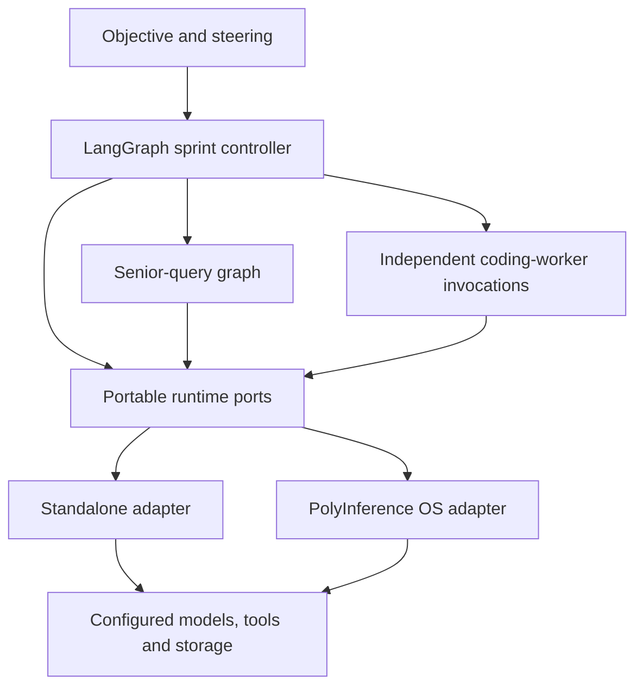
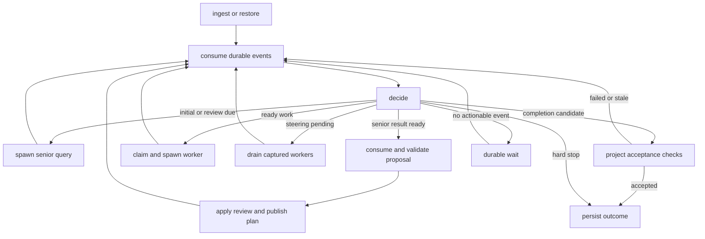
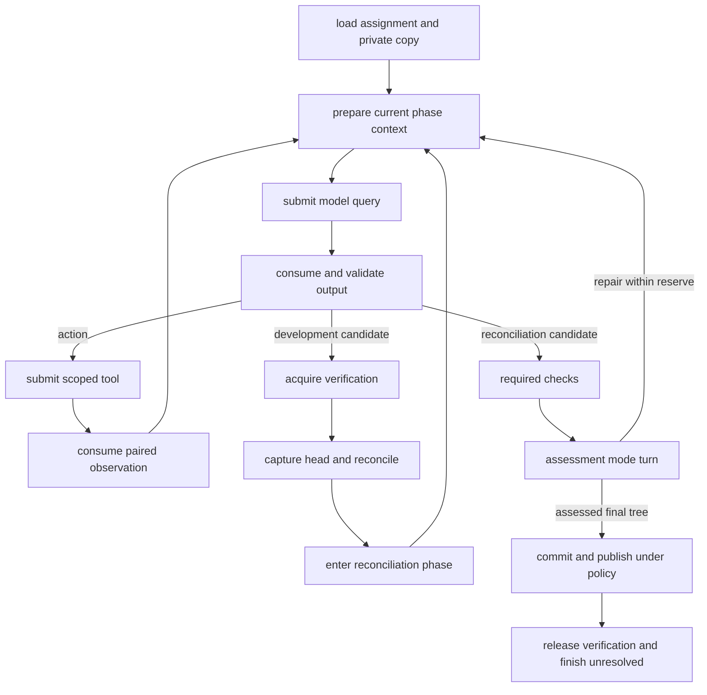

# PolyInference agent on LangGraph

Design proposal · 17 October 2026 · no agent or OS implementation

Build the agent as a portable LangGraph application with a deterministic sprint controller, one reusable coding-worker graph, and one senior-query graph. A replaceable runtime interface supplies model/tool execution, resource admission, storage and recovery. The agent declares its intended distribution and permitted flexibility. Graph nodes import no PolyInference scheduler, database, provider client or MCP transport.

The default preserves cloud-first sprint planning and bounded local implementation. Explicit policies can also run all-local, all-cloud or mixed distributions. These are placements of the same application, not additional supervisors.

## 1. Sources and authority

I treated [polyinference-agent-graph.html](../polyinference-design/polyinference-agent-graph.html) as the approved baseline because it is the current agent HTML without the AI-modified label. I read both embedded datasets. The downloaded `(3).html` filename survives only as a Zone.Identifier sidecar here. If another file was intended, that would change the precedence assessment.

| Material examined | Contribution/status |
| --- | --- |
| Approved graph: 15 execution nodes/19 edges; 19 memory nodes/21 edges | Primary intent: senior modes, worker queue, implementation/assessment, memory, steering, pressure response, documentation and deferred key frames. |
| [AI-modified HTML](../polyinference-design/ai-modified_agent_graph.html), [JSON](../polyinference-design/modified_agent_graph.json), [suggestions](../polyinference-design/agent_suggestion.md) | Proposed elaboration: 23 execution nodes/57 edges, 24 memory nodes/29 edges. Useful, but not presumed approved. |
| [OS design](../polyinference-design/project_design.md), [concurrency protocol](../polyinference-design/concurrent_coding_protocol.md), [five ordered OS research notes](../polyinference-design/os-research/README.md) | Process/operation identities, admission, private copies, two gates, recovery, assessment, provisional publication and growth. The research copy of the concurrency protocol is identical. |
| [Root brief](../../PROJECT_BRIEF.md), [design brief](../polyinference-design/PROJECT_BRIEF.md) | Small LangGraph workload and measured mixed-inference goal. Their local-discovery-first wording predates the cloud-led sprint design. |
| [v0 JSON](../../references/docs/polyinference-agent-structure-v0.json), [v1 JSON](../../references/docs/polyinference-agent-structure-v1.json), [v1 HTML](../../references/docs/polyinference-agent-v1.html), [v1-1 HTML](../../references/docs/polyinference-agent-v1-1.html), [editor source/notes](../../references/docs/agent-design/README.md) | Evolution from generic routing to eight sprint nodes and then the expanded agent. Current and v1-1 execution-node prose matches; current memory view is richer. Editor/template code concerns presentation. |
| [Architecture comparison](../../references/docs/agent-structures.html), [mini-SWE](../../references/docs/mini-swe-agent-handbook.md), [Deep Agents](../../references/docs/deepagents-agent-handbook.md), [Claude Code](../../references/docs/claude-code-agent-handbook.md) studies | Reference architecture: narrow model/environment contracts; LangGraph composition and context views; capability mediation and provenance. Their entire feature sets are not required. |
| [Mapping guide](../../references/docs/repo-mapping-guide.md), [proxy brief](../../references/codex-agent-proxy-brief.md) | Optional bounded navigation; raw inference versus a complete external agent job. No proxy selected here. |

The planning/lecture PDFs cited by older notes are absent. This review uses their supplied derivations, not a claim to have inspected the PDFs. Vendored repositories are reference implementations rather than additional PolyInference specifications.

### Differences that need explicit treatment

| Issue | Approved HTML | Later AI/OS proposal | Recommendation here |
| --- | --- | --- | --- |
| Verdict | `passed/failed/blocked/budget_exhausted`; memory view also mentions uncertainty | `fail/uncertain/successful`, with separate stop reason | Normalize assessment to three values; keep execution and stop fields separate. This is a proposal. |
| Assessment | Host evidence gate; some arrows mention model verification prompts | Mandatory final assessment-mode model turns | Deterministic checks plus a bounded final assessment turn. Host facts constrain success. |
| Failed code | Failed/partial commits stay private; passed work is a candidate | All normally completed commits advance provisional shared history | Default `reviewed_only`; support explicit opt-in `provisional_all`. Pressure cannot switch this policy. |
| Concurrency | Incomplete | Private copies, global shell mutex, serialized reconciliation/assessment/publication | Adopt as proposed concurrency model, implemented behind runtime ports. |
| Allocation | Cloud senior, ordinary local coding; pressure-driven upgrades/downgrades in memory view | Versioned bindings | Preserve the default, declare alternatives and fidelity by role/phase. |
| Raw API endpoint | Permits pretending it is an agent during prototyping | Requires a real bounded loop | Use an explicit loop or a declared agent job. A raw response cannot establish tool execution. |

The OS draft's memory-edge count is stale: the approved embedded dataset has 21, not 19. Older notes also mix fixed ExecutionProfiles with later dispatch bindings and have stale `research/…` and `modified_agent_graph.html` links. This proposal uses immutable catalog/policy versions plus versioned actual bindings.

## 2. Assessment

The application split is a useful research workload. Cloud has a concrete role—planning, review and difficult work—while local workers implement bounded assignments. Programmatic orchestration avoids paying for a supervisory inference after each tool action. Successful reports remaining unresolved until review correctly separates execution from acceptance. The memory view recognizes steering, hazards, documentation and pressure as persistent state.

The approved diagram needs contracts before implementation: ordinary queue-to-worker dispatch is missing; orchestration/documentation arrows contain placeholders; result-to-report can bypass assessment; the specialist observation/repair cycle is incomplete. These are missing transitions, not permission for the OS to invent application behavior.

The OS design is strongest on identities, ambiguous external effects, resource admission, evidence versions and ownership. Its two-gate protocol is coherent, but serializing merge, model reasoning, assessment and publication can become the throughput bottleneck. Measure wait/hold time before increasing workers. A verifier must release its gate before waiting for senior review that may require the same gate.

Strengthen three boundaries: application meaning versus runtime mechanisms; allocation fidelity versus capability; memory content/authority versus storage tier. No supplied design establishes measured savings, safe migration or enforceable quota bounds.

## 3. Agent/runtime boundary



| Agent owns | Runtime owns | Contract |
| --- | --- | --- |
| Objective, criteria, sprint/review policy, task DAG | Admission, quotas, global capacity, dispatch | Immutable process/task specs, dependencies, urgency, fidelity, limits |
| Prompts, logical context, output grammar | Backend fit, provider conversion, execution | ModelQuery, ContextView, requirements, BindingDecision |
| Action proposals, phases, repair decisions | Tool authorization, execution, server lifecycle, journal | CapabilityCall, scope, conflict keys, paired results |
| Reconciliation/assessment/publication sequence | Exclusive permits, Git/workspace mechanics, atomic comparisons | Generic resource claims, content revisions, publication intents |
| Assessment and senior decisions | Durable storage/events/accounting | Immutable proposals/reports and trusted validation |
| Memory meaning, retrieval needs, doc batching | Tiers, indexes, caching, movement, retention | Memory items, snapshots, provenance and freshness |

Authentication comes from the runtime principal, not caller-supplied JSON identities or grant handles. The agent package implements TaskLedger, SteeringBarrier and DocumentationBacklog over generic record/event ports. An OS can optimize these operations without embedding sprint semantics into its kernel.

A standalone adapter implements the same ports with configured providers/tools, a persistent saver, small metadata storage and artifacts. An OS adapter maps them to PolyInference services. Graphs and domain schemas remain identical. Missing required guarantees fail negotiation before effects; standalone mode cannot silently substitute weaker behavior.

The graph asks `exclusive.acquire(resource_key)` and `records.compare_and_publish()`, not `OS.shell_mutex` or SQLite transactions. Its manifest declares installation-wide shell exclusion and project-wide verification exclusion. A deployment can use wider exclusion, but cannot narrow global shell scope and still claim this concurrency protocol.

## 4. Graphs

Use three entry points within one application. Graphs are program definitions; invocations are logical processes. A node is not a separate agent or host process. Senior prompt modes reuse one role.

### 4.1 Sprint controller



| Node | Contract |
| --- | --- |
| `ingest_or_restore` | Pin objective/criteria/program/config/grant. Reconcile pending effects before resuming. Default first model call is senior initial planning. |
| `consume_events` | Read after cursor, deduplicate IDs, refresh authoritative records; retain later events for the next review range. |
| `decide` | Pure routing from records/policy. No model call for ordinary control decisions. |
| `spawn_senior` | Create a query process with mode, pinned report/steering range, expected plan/head, budget and output schema. |
| `apply_proposal` | Validate DAG, scope, finite limits and dispositions. Run keep/revert effects through ports; activate plan/acknowledgements only when their effects are known. |
| `dispatch_ready` | Atomic claim, concrete dependency inputs/base, private workspace and worker creation. Setup failure is visible. |
| `drain` | Close starts; await captured workers while continuing to admit their existing work and receive reports. |
| `accept_project` | Require senior proposal, reviewed resulting revision, current required checks, no relevant uncertain effects or pending steering. |
| `finalize` | Record truthful completed/failed/cancelled/budget-stopped outcome. Waiting/paused remains resumable. |

Review triggers: exhausted task queue, dependency frontier awaiting review, bounded unresolved/issue threshold, scope mismatch, integration failure or steering drain completion. No runnable work with active workers means wait. Deduplicate review triggers by input versions; a no-change review cannot repeatedly call senior for the same frontier.

Spawning a senior query returns immediately to event consumption; its result is another durable event. The controller never blocks all input handling while awaiting that query. User-input ingress calls the application's atomic SteeringBarrier service even while graph control waits, so receipt and worker claiming cannot race. Status/cancellation remain runtime services. A drain node updates bookkeeping once and then waits for a changed predicate/event; it does not repeatedly traverse an empty graph loop.

### 4.2 Coding worker



Phases are `development`, `reconciliation`, `assessment`. Record at least one completed development turn after capturing/merging the current head, including a clean merge. A reconciliation candidate enters checks rather than reacquiring its gate. Assessment actions use the same tool path and return to assessment. Implementation repairs return to reconciliation/development, invalidate affected checks, and require final assessment again.

Response grammar: `action | candidate | assessment | needs_review`. Only assessment mode can propose a verdict. Host code constrains it with required checks, exact tree, scope and limits. Definite failed criteria imply `fail`; missing/inconclusive required evidence implies `uncertain`; `successful` needs current sufficient evidence. Model explanation cannot override a failed required exit-code check.

Reserve reconciliation, checks, assessment, commit/report and cleanup budgets before ordinary development spends the allowance. If final assessment cannot run, retain interrupted/assessment-pending state and partial artifacts rather than fabricating normal completion. A normally completed attempt may truthfully report failure or uncertainty.

Each shell command separately acquires shell ownership, including Git/tests. Verification ownership spans head capture, merge, reconciliation, checks, assessment and publication. Order: verification then shell. An outside shell owner releases before queuing for verification. Never reserve shell across model reasoning. Private non-shell edits require workspace authority but no global shell permit. The coordinator remains responsive.

### 4.3 Senior queries and specialists

SeniorQueryGraph: `prepare -> submit -> consume -> validate -> return`. Modes: `initial`, `sprint_review`, `plan_correction`, `completion_review`, optional `doc_review`. Structured planning can use one raw generation with bounded correction attempts. Output is a proposal; model text cannot directly mutate authoritative records.

A difficult coding assignment is a worker task with role `specialist`. With `model_query` execution it uses the same worker graph/tool/evidence path, bound to eligible cloud inference. This supplies the missing observation/repair loop without a new supervisor.

An `agent_job` backend owns its internal loop. LangGraph submits/tracks the bounded job once, consumes artifacts, then enforces reconciliation/assessment/report. Observational tool events must not be executed again. An endpoint must prove workspace scope, tool brokerage, bounded limits, phase control and evidence visibility. Otherwise it is incompatible with that profile; use the model-query worker. Cross-harness migration normally starts a linked new attempt.

### 4.4 LangGraph state and execution

Small state shapes, not executable node implementations:

```python
class ControllerState(TypedDict):
    run_id: str
    process_id: str
    plan_ref: str
    event_cursor: int
    review_input_ref: str | None
    pending_operations: list[str]
    steering_barrier_ref: str | None
    next_transition: str

class WorkerState(TypedDict):
    process_id: str
    task_spec_ref: str
    attempt_id: str
    workspace_id: str
    phase: str
    logical_step: int
    trajectory_ref: str
    context_view_ref: str
    binding_ref: str
    pending_operation: str | None
    verification_permit_ref: str | None
    reconciliation_ref: str | None
    assessment_ref: str | None
    report_ref: str | None
```

Inject RuntimePorts through runtime context, not persisted state. Compile each entry with a persistent checkpointer, stable `thread_id=process_id` and pinned graph/state/prompt versions. One current driver advances each process. LangGraph supplies transitions/context, not global admission or task authority. [Graph API](https://docs.langchain.com/oss/python/langgraph/graph-api)

Launch independent worker invocations through the process port. Avoid using in-graph `Send` fan-out as the process ledger: workers need independent priority, pause, budgets and lifetimes across sprints. Internal sequential subgraphs can reuse logic but do not establish independently schedulable processes. [Subgraphs](https://docs.langchain.com/oss/python/langgraph/use-subgraphs)

Keep full histories/logs outside checkpoints. Each process has a canonical action/observation history; bounded message views preserve complete tool-call/result pairs and stable IDs. Never combine workers into one transcript. Only the controller publishes plan pointers. Reducers combine data, not authority or transactions.

Short waits use async I/O. A long wait may use a dedicated `interrupt` node whose wakeup prompts a journal re-read. Interrupted nodes restart from their beginning; no unguarded submission precedes the interrupt. [Interrupts](https://docs.langchain.com/oss/python/langgraph/interrupts)

Use synchronous checkpoint durability initially. The saver persists graph state; the record/effect journal persists process authority and operations. Co-location is optional; there is no assumed transaction with providers or Git. [Checkpointers](https://docs.langchain.com/oss/python/langgraph/checkpointers)

### 4.5 Mapping the approved components

| Approved component | Proposed owner/path |
| --- | --- |
| User Prompt | Input ingress, objective artifact and ordered steering records. |
| Orchestrator / Loop Handler | SprintControllerGraph and its pure transition policy. |
| Cloud Model / senior engineer | One senior role, query modes and specialist worker role; no additional preliminary model hop. |
| Cloud Query Processor | Senior-query preparation and ProcessSpec/OperationRequest construction. |
| Cloud process entry | Portable process/operation admission; not a second worker task queue. |
| Cloud conductor | Runtime backend/account adapters; the agent owns an explicit raw-model loop, or a declared agent-job endpoint owns its native loop. |
| Cloud Result Processor | Typed senior proposal validation and controller review/plan publication. |
| Task Queue | Application-owned TaskLedger with specs, attempts, unresolved reports and dispositions. |
| Local coding agent loop / Local inference | Worker graph / model-query runtime port, respectively. Placement may change without changing worker semantics. |
| Tools & observations | Validated capability operations, paired observations and exact revision evidence. |
| Local Result Processor / Task verification | Worker phase routing / checks plus bounded final assessment. |
| Commit & task report / Project acceptance | Candidate/report publication / controller checks of reviewed project revision. |
| Documentation / Immediate Memory | DocumentationBacklog and doc tasks / typed memory snapshots, hazards and SteeringBarrier. |
| Trap frame / Key frame | Continuation plus effect journal / explicitly deferred consistent snapshot feature. |

Raw-model loop placement is a deliberate portability refinement: it is reusable application code above the ports, rather than an assumption that every OS implements this coding harness. A runtime offering the same bounded loop can expose it as an agent-job capability with equivalent declared guarantees.

## 5. Runtime ports

```python
class RuntimePorts(Protocol):
    capabilities: CapabilityPort
    processes: ProcessPort
    operations: OperationPort
    records: RecordPort
    artifacts: ArtifactPort
    memory: MemoryPort
    workspaces: WorkspacePort
    exclusives: ExclusivePort
    events: EventPort
```

| Port | Conceptual methods | Guarantee |
| --- | --- | --- |
| Capabilities | negotiate, describe | Versioned supported features; reject unsupported effects. |
| Processes | create(spec, intent), status, pause, resume, cancel | Durable identity, one driver, declared safe boundaries. |
| Operations | prepare(step, request), submit, get, wait, cancel, reconcile | Stable intent lookup, actual binding/usage and effect certainty. |
| Records | read, compare_and_publish(expected, writes, event_intents) | Atomic publication within record domain; idempotent settlement. |
| Artifacts | put, read_range, pin, release | Immutable digest, bounded reads, scope and retention. |
| Memory | query, read_snapshot, append, supersede | Provenance, freshness, identity-preserving tier movement. |
| Workspaces | create(base), inspect, reconcile, commit | Exact content identity, private delta, attributable commit. |
| Exclusives | acquire(key, order, owner), release | Current fenced ownership; protected unknown effects retain exclusion. |
| Events | read_after(cursor), wait_after(cursor) | Publication before notification; cursor recovery/deduplication. |

## 6. Data model

[contracts.py](contracts.py) defines validated proposed wire models. [contract.schema.json](contract.schema.json) exports JSON Schema; [examples.json](examples.json) provides linked examples. These are design artifacts, not an agent/OS implementation. Semantic checks below supplement structural validation.

### Identities and state ownership

| Entity | Meaning |
| --- | --- |
| AgentProgram | Graph/contract/prompt versions, entries, required/optional features and explicit state migrations. |
| ProjectRun | Objective/criteria, allowed catalog, parent budget, application/publication policy, steering and head pointers. |
| SprintPlan | Immutable validated revision and parent; task proposals and review dispositions. |
| TaskSpec | Immutable worker assignment, dependencies, scope, criteria, inputs and policy. Planning queries stay outside this ledger. |
| TaskAttempt | One effort against a spec, with process/workspace/base/result. Changed scope or incompatible harness creates a linked new attempt. |
| ProcessSpec | Immutable invocation: entry, parent, role, inputs, schedule/fidelity, limits and output contract. |
| ProcessStatus | Runtime-owned lifecycle, wait reason, binding generation, active effects/resources, continuation and result. |
| Operation | One external intent: generation, tool call, job, commit or publication. Transport attempts are separate. |
| BindingDecision | Actual selected backend/model/catalog and policy explanation. Does not mutate task objective. |
| TaskReport/Resolution | Immutable assessment/evidence/commit initially unresolved; later review decisions are separate records. |
| Continuation | Graph/checkpoint, pinned inputs, workspace, outstanding effects and counters. Provider session is a separate opaque handle. |

Application IDs are independent of provider IDs/host PIDs. Relevant envelopes carry tenant/project/run/process, causal parent, trace and schema version. Runtime authentication binds the supplied identity.

Process lifecycle: `created -> ready -> running -> waiting/paused -> ready -> completed/failed/cancelled`. Running means graph control advances; provider work may remain active while control waits. A completed process can have a failed task verdict because the reporting protocol finished correctly. Terminal records cannot be resurrected; retries use new attempts.

Keep task execution (`pending/in_progress/completed/interrupted/cancelled`), assessment (`fail/uncertain/successful`), review action (`keep/revert/retry/defer`) and project outcome independent. Pending/interrupted work has no fabricated verdict. An immutable report retains its initial unresolved state; a projection joins later resolution events. Defer records review but leaves acceptance unresolved.

### Request envelope

| Field group | Information |
| --- | --- |
| Compatibility | Contract major/minor, kind, required feature identifiers, negotiated extension namespaces. |
| Identity | Tenant/project/run/process, stable operation ID, logical-step ID, causal parent, trace ID. |
| Preconditions | Grant handle, owner generation, expected process/binding revisions, application record/head versions as needed. |
| Timing/bounds | Created/deadline, finite operation limits, parent budget account, output/context caps. |
| Intent | Typed payload, immutable context/artifact refs and canonical fingerprint. Same ID plus changed intent is rejected. |
| Scheduling | Process policy ref, authorized urgency hint, requirements/resource vector/conflict keys and safe boundary. |

ArtifactRef has opaque ID, digest, media type, size, classification and scope; it is not an arbitrary fetch URL. CodeRevision has repository, optional commit, effective tree/content digest and environment digest. Dirty/untracked test inputs belong in that effective tree; a bare SHA is insufficient.

Fingerprints bind canonical semantic input/policy versions, excluding transport timestamps/key order. Operation IDs name intent; identical prompts at deliberately different steps still have different IDs. Credentials, sockets, model clients and live locks never enter serialized records.

### Scheduler-visible process information

ProcessSpec carries program/entry/parent/role, pinned input refs, optional task/attempt, workspace, feature requirements, schedule/fidelity, budget/limits, output schema and continuation policy. The OS can schedule without parsing prompts: dependencies/dispositions, urgency/deadline/age, eligible backends, capability floor, distribution, data placement, context/output size, resource estimates, budget ancestry, phase, safe boundaries, effects and locality. An optional capability-floor reference names a versioned evaluated profile; a binding can retain the evaluation reference supporting its eligibility. Capability profiles distinguish required protocol/tool support from empirically calibrated coding ability. Pressure or a model's self-confidence cannot certify that a weaker backend meets that floor.

Priority has a class (`interactive/critical/normal/background`), bounded relative value, optional deadline and aging flag. Role, priority and fidelity are independent. The runtime validates requested priority against the grant. A high-priority process with infeasible fidelity waits/fails its deadline rather than acquiring permission to violate it.

Resources are typed quantities: kind, domain, unit, amount, estimate/enforced status and lifetime (`operation/session/process/service`). RAM and discrete VRAM remain separate. Shared model residency is counted once by the service; processes declare incremental needs. Runtime replaces untrusted estimates with conservative measured/backend values. Conflict keys name workspace, global shell, project verification, provider session and external shared systems. Uncertain completion retains applicable ownership. Admission is atomic for an operation's simultaneous resource vector; the longer verification permit follows the separately declared acyclic acquisition order.

### Typed requests and results

| Request | Payload |
| --- | --- |
| model_query | Role/phase, prompt-template version, ContextView, tool catalog digest, output grammar/schema, generation settings, backend requirements, optional session and replay policy. |
| agent_job | Objective/input refs, required worker phase protocol, workspace/tools, enforced job limits, continuation strategy and evidence/event visibility requirements. |
| capability_call | Namespaced capability/schema digest, argument artifact, optional model call ID, workspace/revision preconditions, effect class, conflict claims and replay policy. |
| memory_query | Namespaces/kinds, query ref, snapshot/freshness/code validity, byte/token/item caps and permitted tiers. |
| publication | Expected record/head versions, commit/report/evidence refs, publication policy, permit refs and event intents. |

ContextView is an ordered list of instruction/data/message/tool-result parts with source/trust/digest/visibility/omission metadata, pinned memory/docs, a context cap and compaction provenance. Provider rendering cannot silently remove required pins or split a tool pair. An unfit view returns context incompatibility or requests an explicit replacement view.

OperationResult identifies operation/step, lifecycle, typed output refs, paired call ID, actual backend/model/harness, binding generation, timing, measured/estimated/unknown usage, errors/retry hints, effect/termination certainty and continuation. Progress is not completion. Unknown usage is not zero. API spend, subscription usage and local resource use are separate measures.

Tool denials are paired observations. Configured host checks are evidence events, without fake model call IDs. Full output is capped/spooled; previews state truncation and retrieval refs. Edits invalidate evidence whose code/environment/input dependencies changed.

Children reference a parent budget account and bounded allocations. Runtime enforces parent committed usage plus reservations within its limit; children cannot each allocate the same remainder. Explicit step/token/time/repair/output limits reserve final phases. Zero API spend is valid; unknown cost cannot satisfy a promised hard cap without another enforceable backend bound. Tool/data/backend grants inherit by intersection. An API-compatible response shape proves no execution guarantee.

## 7. Distribution and fidelity

**Fidelity is adherence to the declared execution distribution.** It is independent of model quality, priority, determinism and memory-summary accuracy.

DistributionPolicy is a versioned set of role/phase rules. Rules name eligible backend classes and optional target allocation, accounting unit, scope/window, tolerance, enforcement, fallback and migration boundaries. Backend classes are catalog-defined capability selectors, not permanent provider names. Intended distribution stays immutable; actual bindings/deviations are recorded separately.

| Profile | Behavior | Example |
| --- | --- | --- |
| Strict | Hard eligible sets/allocation bounds; infeasibility waits/fails without substitution | Senior cloud; worker/assessment local. |
| Bounded | Declared substitutions/deviation within an enforced bound | Worker decisions target 80% local/20% cloud with explicit rounding slack. |
| Flexible | Target is a preference over eligible classes; all-local/all-cloud permitted | Authorized background mapping task runs entirely on either class. |

These are named profiles over explicit rules. A UI scalar may select a profile, but cannot replace its semantics. Senior strictly cloud plus flexible workers is per-role fidelity. All-local execution of the whole application requires a senior rule permitting local; that differs from the approved default.

Allocation axes are explicit: `inference_location` describes model placement; `harness_class` describes this loop versus an external agent job. Substituting harnesses needs separate permission. Capability/context/data/tool/budget constraints remain hard at every fidelity.

### Accounting

Default unit is executed model-generation decisions, partitioned by matching role/phase rule. Dispatch commits a slot to a class. Transport retransmission of the same intent adds no slot; a new corrective generation after failure does. Uncertain dispatch reserves its slot until reconciliation. An opaque agent job counts in jobs, not unobservable internal turns/tokens.

For target shares p and observed shares q over N slots:

```text
deviation = 0.5 * sum(abs(p[class] - q[class]))
hard bound: deviation <= epsilon + rounding_slack_slots / N
```

Check the prospective prefix before dispatch and final allocation at window close. Rules match uniquely or use declared precedence. Tiny windows need explicit rounding slack because one call cannot be 80% local. No feasible hard-bound candidate means wait/infeasible; never promise to fix compliance after the task has ended. Strict role binding usually expresses the approved design better than percentages.

Do not mix request counts, tokens, costs or work items. Other units require negotiated accounting/uncertainty semantics. Retransmissions still consume real budget when executed. Counters aggregate at process/run/named-group scope; child creation or retry cannot reset compliance. Rule intersections with parent/data/capability restrictions must be feasible.

### Pressure and migration

Runtime selects a feasible candidate using pressure, age, urgency and locality. BindingDecision records catalog/backend/model, rule/policy version, allocation before/after, reason/deviation and context rebuild. Pressure includes source/time/staleness, account scope and unknown fields; it cannot change the objective.

| Situation | Behavior |
| --- | --- |
| Cloud busy, flexible critical work | Eligible local or authorized overflow if all hard constraints hold; otherwise wait. |
| Cloud busy, strict cloud senior | Preserve route; wait or deadline-stop. |
| Cloud idle, flexible background work | May release an already-authorized objective within quota/spend policy. |
| Local busy, flexible worker | Eligible cloud placement; same task scope/checks. |
| Active decode/tool/job | Drain or request supported cancellation; rebind only after settled effects. |
| Incompatible harness/state | Preserve artifacts; linked new attempt, never clone a live job. |

Priority inheritance can temporarily boost a shell holder/verifier blocking critical work; record and restore it after release. Aging cannot override hard feasibility. Runtime needs resource/dependency relationships and bounded phase work, not prompt interpretation. Reserve gate-holder progress resources; do not admit a verifier whose mandatory remaining phases are already infeasible under its grant.

Rebinding has a generation, reason, cooldown/finite count and safe-point proof. Task instructions and criteria remain pinned. Transfer canonical instructions/actions/observations, source-linked summaries, tree/effect state—not hidden reasoning, KV state or arbitrary provider internals. Sharing policy covers the entire rebuilt context.

## 8. Multi-stage memory and documentation

Separate semantic kind from physical tier.

| Kind | Purpose/authority |
| --- | --- |
| objective/user_instruction/steering | User/source-attributed input; steering applies only at its boundary. |
| working_summary | Derived process continuity, never authoritative evidence. |
| episode | Immutable actions, observations, reports and decisions. |
| project_fact/hazard | Attributed claim with code scope/revision, status and supporting evidence. |
| procedure | Reusable instructions with owner/approval/version/applicability. |
| documentation | Maintained explanation tied to code/event inputs and freshness. |

MemoryItem carries tenant/project/run/process scope, content/version, author/source/trust, validity interval, applicable code/environment, provenance, supersedes/tombstone, retention/access, tier preference and pin status. Hazards identify attempt/commit, affected scope and private/provisional/reviewed/reverted location. Model-written facts remain claims; retrieval ranking/promotion never turns them into user instructions.

Tiers may be working/warm/archive or deployment-specific names. Runtime may index/cache/compress/move/evict unpinned representations while preserving logical identity, source retention and provenance. Indexes are derived/versioned separately. Retrieval specifies allowed scopes/kinds, code/time validity, snapshot/freshness, required pins, size caps and permitted tiers. Results report selected versions, index/snapshot, scores/reasons, omissions and missing pins.

Pinning prevents eviction of required source objects; it does not guarantee context fit. Compaction creates a derived object with coverage/source refs. Exact criteria, current diff and unresolved tool pairs remain available. Workers pin snapshots at start; urgent hazards arrive as explicit refresh/pause events, not silent rewrites during generation. Shared memory uses scoped access rather than a writable shared transcript.

Documentation deduplicates report/change/disposition events, including cancellation/reversal. Capture cursor range, code revision and doc version at threshold/review. A bounded doc task generates an update; compare-and-publish new docs plus consumed cursor. Later events stay pending. Default workers may use older docs plus deltas unless freshness is required. Exclude housekeeping from recursively triggering itself.

Future consolidation/indexing/promotion are ordinary background processes with priority/fidelity/budget. They retain provenance and cannot rewrite authoritative history. Broad key frames remain deferred; durable intents and individual continuations are required initially.

## 9. MCP and capabilities

Direct tools, MCP tools/resources and future services share a capability contract: namespaced ID, version/schema digests, input/output types, effect class, scope/conflicts, resource estimate, replay/reconciliation guarantees and server/session needs. Model names are aliases into a pinned catalog; arguments cannot change credentials/server configuration.

Adapters negotiate MCP protocol/capabilities, retaining version/feature refs rather than assuming a universal set. Tool annotations do not establish trusted replay or memory bounds. [MCP lifecycle](https://modelcontextprotocol.io/specification/2025-11-25/basic/lifecycle), [MCP tools](https://modelcontextprotocol.io/specification/2025-11-25/server/tools)

Runtime owns single-generation startup, initialization, call leases, idle eviction and confirmed shutdown accounting. Schema changes require refreshed validation. Sampling/elicitation/nested model work needs explicit support and budget ancestry; it cannot bypass routing/accounting. Optional asynchronous MCP tasks map to external operation handles, not application TaskSpecs. Cancellation can race completion, so reconcile effects before replay or exclusion release. [MCP cancellation](https://modelcontextprotocol.io/specification/2025-11-25/basic/utilities/cancellation)

## 10. Publication and review

Keep reviewed head separate from optional provisional head. Every normal attempt retains a real attributable commit/evidence and unresolved report.

**Default reviewed_only:** while holding verification, capture reviewed H, preserve private delta from B, reconcile H, run development/checks/assessment, then create candidate P parented on H with the assessed tree. Publish candidate/report/hazards atomically without moving reviewed head; release before review. For keep, reacquire verification: if H and evidence/environment remain current, integrate P. If head changed, create a reconciliation attempt and reassess; senior must accept that updated candidate/tree. Do not cherry-pick and reuse stale checks. G0 reviews before dependent work, limiting this extra cost. Fail/uncertain stays private unless senior explicitly accepts documented partial work; successful also waits for keep. Rejected private work is abandoned, not reverted from history it never entered.

**Optional provisional_all:** workers capture provisional H and publish P plus report/hazards for every normally completed verdict before releasing verification. Subsequent workers receive that code and unresolved provenance. Dependencies still require declared dispositions. Keep/revert/retry/defer stays separate. Reviewed head cannot skip unresolved ancestors; it identifies an explicitly accepted resulting revision. A revert examines later semantic/build dependencies, creates an inverse commit, checks resulting content and invalidates affected evidence. Git cannot reverse unrelated remote effects.

In either policy, write immutable Git/evidence objects first. A short compare-and-publish validates expected head, ownership and application versions, then stores pointer/report/event intents. Git refs can be recoverable projections. No cross-Git/checkpoint/provider transaction is assumed. Crash recovery returns the original commit instead of creating another undo unit.

## 11. Steering and recovery

Steering is ordered input. Atomically record sequence, close new-worker starts and capture in-progress coding worker IDs, including inference/gate waiters. I generalize older “local agents” wording to logical workers: a cloud-rebound worker still belongs in the drain set. Senior queries serialize separately.

Captured workers finish on original instructions through assessment/report. Pending tasks do not run merely to empty the queue. After drain, senior consumes a pinned steering/report range and proposes the next plan; publication acknowledges exactly that range. Later steering stays pending and keeps starts closed. Receipt alone does not invalidate captured workers' authority.

A stuck/interrupted captured worker exposes a blocker; ordinary steering does not silently cancel it. Emergency cancellation is distinct: revoke new effects/publication, request termination, retain uncertain work. Required grant revocation may stop work and is recorded as revocation rather than early application of steering.

```text
prepared -> submitting -> active -> succeeded | failed | cancelled
                        \------> uncertain -> reconciled terminal result
```

Persist process/logical-step-to-operation mapping and fingerprint before submission; persist submitting before sending. Replay returns retained result, awaits active work or reconciles uncertainty. A crash after send can be ambiguous without a provider ID. Timeout/lease expiry does not prove termination. The contract provides idempotent journal settlement, not exactly-once effects at arbitrary providers.

Continuation records program/state/checkpoint, plan/spec/binding versions, workspace/tree, history/context refs, budgets, pending effects, permits and doc/memory cursors. Resume validates them. Startup reconciles effects/publication, repairs notifications and starts one current driver. Checkpoints do not reverse billing or remote mutations. Future key frames require consistent-cut capture/retention, not dumping live Python objects.

## 12. Evolution and first build

Strict core parsing rejects unknown fields. Namespaced extensions declare required feature versions; unsupported mandatory meaning fails before dispatch. Optional extensions may be ignored only under documented optional semantics. Extensions cannot weaken core grants. Additive defaults can be minor versions; changed accounting/control semantics requires a major version. Running programs remain pinned; migrations are explicit and recorded. Unknown future enum values never become success by default.

Opaque catalog classes/tier/capability IDs permit new providers, tools and memory stores without provider fields in WorkerState. A new execution protocol or guarantee needs negotiation.

| Stage | Scope | Evidence before expansion |
| --- | --- | --- |
| A | Three entries, one worker, model-query endpoints, search/read/patch/command, reviewed-only publication, strict default distribution, persistent operations/checkpoints, bounded memory/docs | Cloud-first plan, real implementation/repair, final assessment, commit/report, senior keep, exact project checks and recovery. |
| B | OS adapter for the same ports | Equivalent domain outcomes under scripted conformance scenarios; no graph/provider coupling. |
| C | Multiple private workers, global shell, project verifier, independent resource caps | Better accepted throughput/latency within quality/cost/memory limits; no starvation/stale publication. |
| D | Flexible/bounded routing, tested safe-point rebinds, explicit provisional mode, needed MCP and tiered retrieval | Fidelity compliance, compatible transfer and policy comparisons. |
| Later | Agent jobs, consolidation, broad snapshots, other programs | Adapter-specific guarantees proved; no automatic general-agent-platform expansion. |

Implementation acceptance scenarios:

1. Initial default inference is senior; no runnable work with active workers waits.
2. Check failure repairs within reserve; final tree is reassessed, committed and unresolved until senior review.
3. Concurrent private work reconciles changed head, even after a clean merge; stale evidence cannot integrate.
4. Reviewed-only never auto-includes fail/uncertain; provisional-all includes them with hazards and independent review history.
5. Duplicate/reordered events and crashes around send/commit/publication do not double-settle or create an untracked writer.
6. Steering captures cloud-rebound/gate-waiting workers; pending work stays unstarted; later steering remains pending.
7. Strict senior waits on cloud exhaustion; flexible roles can run entirely local/cloud; bounded windows handle rounding, retries and uncertainty without counter resets.
8. Parent/account resources cannot be double-reserved; priority inheritance preserves gate order and fidelity.
9. MCP cold startup happens once; active/uncertain calls prevent unsafe eviction; nested sampling cannot bypass budgets.
10. Memory promotion preserves trust; stale facts/missing pins are visible; summaries cannot substitute for evidence.
11. Incompatible opaque jobs are rejected; observational tool events are never replayed as actions.
12. Standalone and OS adapters pass the same domain scenarios and disclose actual execution/accounting differences.

Evaluate fixed objectives/trees/criteria/harnesses under cloud-only, feasible local-only and hybrid configurations. Record independent project success, assessment calibration, spend/subscription/local resource use, latency, retries/repairs, transfer overhead, gate wait/hold time, fidelity compliance and rollback propagation. Separate comparisons that also change harnesses. Numeric capacities, distributions and acceptable margins require measured deployment choices.

The recommended three-valued verdict, mandatory assessment turn, concurrency contract and optional provisional publication are proposals for review; the approved source HTML remains untouched.

## 13. Using the contract artifacts

The Python models require Pydantic 2.9 or later; this review used the locally installed 2.9.2. Run `python design-docs/langgraph-agent/contracts.py` to export the schema and `python design-docs/langgraph-agent/validate_contracts.py` to validate examples and semantic counterexamples. No provider, tool server or agent workload is started by either command.

Examples use synthetic IDs/digests and illustrate related records at different lifecycle points, rather than a complete transactional snapshot or actual code/test evidence. The strict, flexible and bounded process examples show alternative policies. The bundled schema covers structural wire validation. Python validators add some cross-field rules; authorization, fingerprint verification, DAG checks, full required-criteria coverage, budget conservation, rule feasibility, event ordering and cross-record referential integrity remain explicit adapter/application conformance obligations. Frozen models prevent field reassignment; persistence must store canonical immutable snapshots rather than relying on deep immutability of Python lists/dicts.
