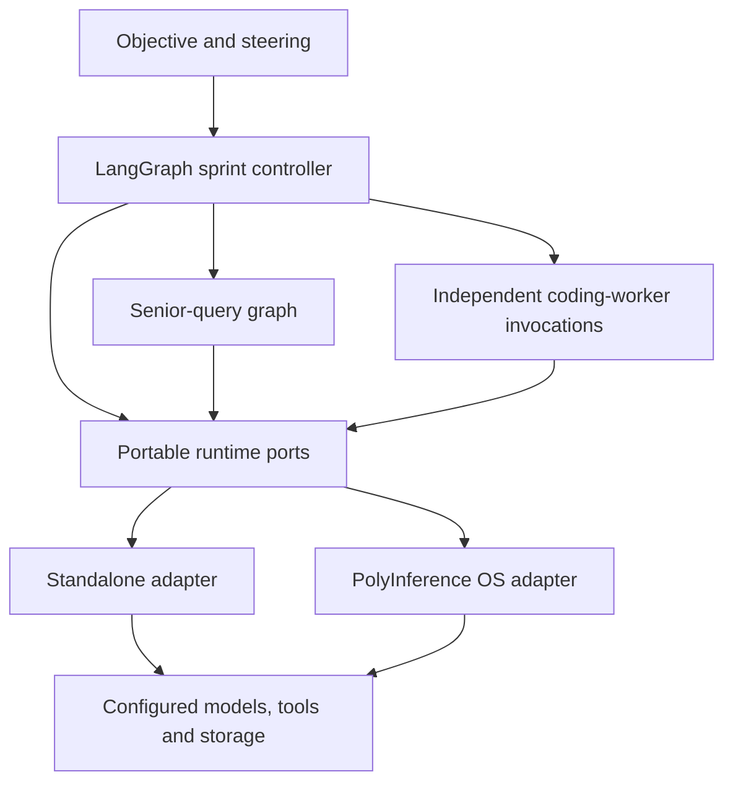
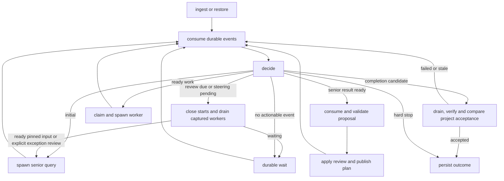
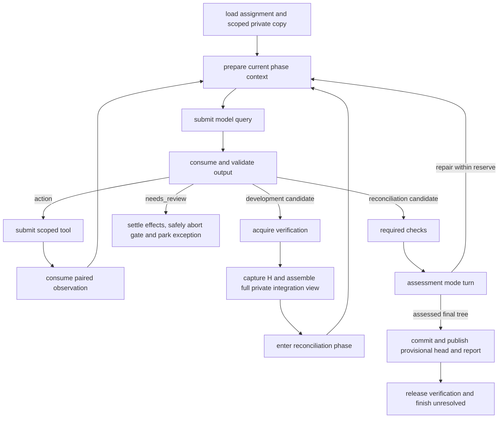

# PolyInference agent on LangGraph

Design proposal, revision 4 · 17 October 2026 · joint integration audit applied · no agent or OS implementation

Build the agent as a portable LangGraph application with a deterministic sprint controller, one reusable coding-worker graph, and one senior-query graph. A replaceable runtime interface supplies model/tool execution, resource admission, storage and recovery. The agent declares its intended distribution and permitted flexibility. Graph nodes import no PolyInference scheduler, database, provider client or MCP transport.

The default preserves cloud-first sprint planning and bounded local implementation. Every normally completed worker publishes its attributable commit and unresolved report into provisional shared history before releasing verification ownership, including fail and uncertain verdicts. Senior review remains separate. Explicit allocation policies can also run all-local, all-cloud or mixed distributions; they cannot change this publication protocol.

The current build target is the [simplified OS profile](../simplified-os/README.md). It supplies bounded concurrent requests to one local continuously batched model, one selected cloud protocol, private scoped development copies and complete private integration views. The richer allocation, multi-stage memory and MCP descriptions below define future interface possibilities; they are not required OS modules for this build. Core routing uses fixed eligible role bindings and plain versioned notes/records plus direct tools.

The [joint integration audit](../INTEGRATION_AUDIT.md) records corrections, supporting sources and remaining implementation checks. It refines the paired executable contracts while preserving the merged diagram's source identity and memory view.

## 1. Sources and authority

The user-designated current baseline is [polyinference-agent-design-merged.html](../polyinference-design/polyinference-agent-design-merged.html), with its matching [JSON export](../polyinference-design/polyinference-agent-design-merged.json) and [merge notes](../polyinference-design/merged-agent-design-notes.md). This supersedes revision 1's use of the older user graph as the behavioral authority. Both merged datasets were inspected; the HTML and JSON match semantically, and its memory dataset matches the original graph exactly.

| Material examined | Contribution/status |
| --- | --- |
| Merged graph: 23 execution nodes/57 edges; 19 memory nodes/21 edges | Current behavior: private development, two gates, mandatory reconciliation/assessment, provisional publication, unresolved reports and senior resolution. Original names/layout and the original memory view are retained. |
| [Older user graph](../polyinference-design/polyinference-agent-graph.html) | Historical source: 15 execution nodes/19 edges and 19 memory nodes/21 edges. Its private-candidate publication behavior no longer governs this design. |
| [AI-modified HTML](../polyinference-design/ai-modified_agent_graph.html), [JSON](../polyinference-design/modified_agent_graph.json), [suggestions](../polyinference-design/agent_suggestion.md) | Historical merge input: 23 execution nodes/57 edges and 24 memory nodes/29 edges. The merged file now determines which additions apply. |
| [OS design](../polyinference-design/project_design.md), [concurrency protocol](../polyinference-design/concurrent_coding_protocol.md), [five ordered OS research notes](../polyinference-design/os-research/README.md) | Process/operation identities, admission, private copies, two gates, recovery, assessment, provisional publication and growth. The research copy of the concurrency protocol is identical. |
| [Root brief](../../PROJECT_BRIEF.md), [design brief](../polyinference-design/PROJECT_BRIEF.md) | Small LangGraph workload and measured mixed-inference goal. Their local-discovery-first wording predates the cloud-led sprint design. |
| [v0 JSON](../../references/docs/polyinference-agent-structure-v0.json), [v1 JSON](../../references/docs/polyinference-agent-structure-v1.json), [v1 HTML](../../references/docs/polyinference-agent-v1.html), [v1-1 HTML](../../references/docs/polyinference-agent-v1-1.html), [editor source/notes](../../references/docs/agent-design/README.md) | Evolution from generic routing to eight sprint nodes and then the expanded agent. Current and v1-1 execution-node prose matches; current memory view is richer. Editor/template code concerns presentation. |
| [Architecture comparison](../../references/docs/agent-structures.html), [mini-SWE](../../references/docs/mini-swe-agent-handbook.md), [Deep Agents](../../references/docs/deepagents-agent-handbook.md), [Claude Code](../../references/docs/claude-code-agent-handbook.md) studies | Reference architecture: narrow model/environment contracts; LangGraph composition and context views; capability mediation and provenance. Their entire feature sets are not required. |
| [Mapping guide](../../references/docs/repo-mapping-guide.md), [proxy brief](../../references/codex-agent-proxy-brief.md) | Optional bounded navigation; raw inference versus a complete external agent job. No proxy selected here. |

The planning/lecture PDFs cited by older notes are absent. This review uses their supplied derivations, not a claim to have inspected the PDFs. Vendored repositories are reference implementations rather than additional PolyInference specifications.

### Changes from revision 1 and source precedence

| Issue | Current merged execution contract | Revision 2 treatment |
| --- | --- | --- |
| Verdict | `fail/uncertain/successful`; execution/stop state is independent | Required behavior, rather than a proposed normalization. |
| Assessment | Final model examination plus independent host validation of exact-tree evidence | Required phase; stale/missing/unavailable evidence cannot yield successful. |
| Publication | All normal assessed outcomes advance provisional head with unresolved reports | Required `provisional_all`; remove the earlier `reviewed_only` branch from this program's contracts/examples. |
| Concurrency | Private copies; global shell mutex; verification from head capture through publication | Required protocol behind portable ports, including at least one post-merge development turn. |
| Allocation | Cloud senior/local worker default; explicit pressure decisions and safe bindings | Keep independent priority/fidelity/capability constraints; no silent scope or publication change. |
| Raw endpoint | Genuine bounded loop or native agent-job protocol | No pretend agent execution; one loop owner. |

The merge notes deliberately preserve the memory view without reconciling its prose. Where duplicated behavioral text conflicts, use the expanded execution contract: three verdicts rather than four closure labels; provisional publication rather than private-only failed work; real raw-model loops rather than pretending; captured running workers rather than draining unstarted queue work. Preserve memory-only additions when consistent: pressure/fidelity, notes/hazards, documentation batching, trap-frame state and deferred key frames. This is an explicit interpretation of the merge notes, not an edit to the merged source.

The latest user direction further supersedes older full-development-checkout and single-decode defaults: every worker receives a private copy of its assigned files plus needed read/build/test closure; the complete private integration tree is assembled after acquiring verification. Multiple model requests can be admitted concurrently. Merge/test/commit/publication remains one critical section; it never grants exclusive use of all inference capacity.

The OS draft's older memory-edge count is stale: the preserved dataset has 21, not 19. Older notes also mix fixed ExecutionProfiles with later dispatch bindings and have stale `research/…` and `modified_agent_graph.html` links. This proposal uses immutable catalog/policy versions plus versioned actual bindings.

## 2. Assessment

The application split is a useful research workload. Cloud has a concrete role—planning, review and difficult work—while local workers implement bounded assignments. Programmatic orchestration avoids paying for a supervisory inference after each tool action. Successful reports remaining unresolved until review correctly separates execution from acceptance. The memory view recognizes steering, hazards, documentation and pressure as persistent state.

The merged execution diagram fixes the earlier queue-to-worker gap, placeholder orchestration/documentation arrows, inference-to-tools shortcut and ordinary candidate-to-report bypass. It supplies specialist observations/repairs and explicit shared-head handoff. Remaining implementation contracts include atomic publication, effect reconciliation, bounded phase allowances and lifecycle-safe steering. The cloud-specialist candidate arrow reaches Task verification directly; implement its identical worker protocol with verification ownership and reconciliation preconditions, rather than treating that arrow as a bypass around the required phase.

The OS design is strongest on identities, ambiguous external effects, resource admission, evidence versions and ownership. Its two-gate protocol is coherent, but serializing merge, model reasoning, assessment and publication can become the throughput bottleneck. Measure wait/hold time before increasing workers. A verifier must release its gate before waiting for senior review that may require the same gate.

Strengthen three boundaries: application meaning versus runtime mechanisms; allocation fidelity versus capability; memory content/authority versus storage tier. No supplied design establishes measured savings, safe migration or enforceable quota bounds.

## 3. Agent/runtime boundary



| Agent owns | Runtime owns | Contract |
| --- | --- | --- |
| Objective, criteria, sprint/review policy, task DAG | Admission, quotas, global capacity, dispatch | Immutable process/task specs, dependencies, urgency, fidelity, limits |
| Prompts, logical context, output grammar | Backend fit, provider conversion, execution | ModelQuery, ContextView, requirements, BindingDecision |
| Action proposals, phases, repair decisions | Tool authorization, execution, server lifecycle, journal | CapabilityCall, scope, conflict keys, paired results |
| Reconciliation/assessment/publication sequence | Exclusive permits, Git/workspace mechanics, atomic comparisons | Generic resource claims, content revisions, publication intents |
| Assessment and senior decisions | Durable storage/events/accounting | Immutable proposals/reports and trusted validation |
| Memory meaning, retrieval needs, doc batching | Tiers, indexes, caching, movement, retention | Memory items, snapshots, provenance and freshness |

Authentication comes from the runtime principal, not caller-supplied JSON identities or grant handles. The agent package implements TaskLedger, SteeringBarrier and DocumentationBacklog over generic record/event ports. An OS can optimize these operations without embedding sprint semantics into its kernel.

A standalone adapter implements the same ports with configured providers/tools, a persistent saver, small metadata storage and artifacts. An OS adapter maps them to PolyInference services. Graphs and domain schemas remain identical. Missing required guarantees fail negotiation before effects; standalone mode cannot silently substitute weaker behavior.

The graph asks `exclusive.acquire(resource_key)` and `records.compare_and_publish()`, not `OS.shell_mutex` or SQLite transactions. Its manifest declares installation-wide shell exclusion and project-wide verification exclusion. A deployment can use wider exclusion, but cannot narrow global shell scope and still claim this concurrency protocol.

## 4. Graphs

Use three entry points within one application. Graphs are program definitions; invocations are logical processes. A node is not a separate agent or host process. Senior prompt modes reuse one role.

### 4.1 Sprint controller



| Node | Contract |
| --- | --- |
| `ingest_or_restore` | Pin objective/criteria/program/config/grant. Reconcile pending effects before resuming. Default first model call is senior initial planning. |
| `consume_events` | Read after cursor, deduplicate IDs, refresh authoritative records; retain later events for the next review range. |
| `decide` | Pure routing from records/policy. No model call for ordinary control decisions. |
| `spawn_senior` | Create a query process with mode, pinned report/steering range, expected plan/head, budget and output schema. |
| `apply_proposal` | Validate DAG, scope, finite limits and dispositions. Run keep/revert effects through ports; activate plan/acknowledgements only when their effects are known. |
| `dispatch_ready` | Atomic claim, concrete dependency inputs/base, private workspace and worker creation. Setup failure is visible. |
| `drain` | Close starts; await captured workers while continuing to admit their existing work and receive reports. |
| `accept_project` | Close starts and drain before taking verification; require matching reviewed/provisional revision and senior proposal, current required checks, no unresolved contributing work, active coding workers, relevant uncertain effects or pending steering. Compare all authority/input versions when publishing completion. |
| `finalize` | Record truthful completed/failed/cancelled/budget-stopped outcome. Waiting/paused remains resumable. |

Review triggers: exhausted task queue, dependency frontier awaiting review, bounded unresolved/issue threshold, scope mismatch, integration failure or steering drain completion. No runnable work with active workers means wait. Deduplicate review triggers by input versions; a no-change review cannot repeatedly call senior for the same frontier.

An ordinary review closes new coding starts and drains the already-started set before pinning the senior packet. A worker that cannot finish exposes a durable interrupted/blocked state with settled or explicitly uncertain effects; it does not receive a fabricated report. An unresolved blocker prevents normal steering-drain completion until explicitly reconciled. Review of such an exception is distinct from acknowledging steering or accepting the project. Drain and senior-query waits hold no verification permit. Apply validated dispositions, reconcile each resulting head update, then activate the next immutable plan. This conservative sprint barrier prevents plan publication from invalidating still-running assignments. Query results carry expected plan/head/report versions and a bounded input range; on a version conflict retain the proposal and refresh it, without acknowledging later input or silently retargeting a revert.

TaskSpec.base is the actual immutable development B. Resolve dependencies and their required dispositions before claim. If materializing those inputs requires another base or changed scope, publish a superseding spec and linked attempt rather than silently replacing B. Completed-unresolved reports release worker residency after known effect/cleanup completion. The controller and one senior query have separately bounded host capacity, so worker-pool exhaustion cannot block review. Documentation coding tasks share the worker limit and barriers.

Spawning a senior query returns immediately to event consumption; its result is another durable event. The controller never blocks all input handling while awaiting that query. User-input ingress calls the application's atomic SteeringBarrier service even while graph control waits, so receipt and worker claiming cannot race. Status/cancellation remain runtime services. A drain node updates bookkeeping once and then waits for a changed predicate/event; it does not repeatedly traverse an empty graph loop.

### 4.2 Coding worker



Phases are `development`, `reconciliation`, `assessment`. Record at least one completed development turn after capturing/merging the current head, including a clean merge. A reconciliation candidate enters checks rather than reacquiring its gate. Assessment actions use the same tool path and return to assessment. Implementation repairs return to reconciliation/development, invalidate affected checks, and require final assessment again.

Workspace setup creates a manifest at original B: copied file hashes, allowed write paths, dependency-closure basis and generation. Copying only a part never treats omitted paths as deletions. Preserve an explicit add/modify/delete/rename delta, then build a complete private view of current H and merge using B inside verification. Advance workspace generation/view; all final tools, checks, model context and commit refer to that integrated view. A stale-generation tool call is rejected. Closure expansion during development reads pinned B, while write expansion requires assignment authority. [Scoped-copy protocol](../simplified-os/README.md#6-each-agents-private-part-of-the-code)

The complete view does not expand allowed writes: validate the worker's H-to-P delta, including rename sources/destinations. An omitted file is not proof that an add destination is absent in B. Commands/checks/hooks that change assessed inputs invalidate evidence; generation checks do not replace content preconditions. After a reconciled verification abort, retire the integration view and rebuild from the original preserved development delta at fresh H; abandoned integration repairs remain artifacts for explicit reapplication. Repeat reconciliation and assessment, with a new generation/steps. Do not reuse the old integrated tree as a B-relative delta or publish its old assessment. If the original publication receipt exists, finish that attempt instead of rebuilding.

Response grammar: `action | candidate | assessment | needs_review`. Only assessment mode can propose a verdict. Host code constrains it with required checks, exact tree, scope and limits. Definite failed criteria imply `fail`; missing/inconclusive required evidence implies `uncertain`; `successful` needs current sufficient evidence. Model explanation cannot override a failed required exit-code check.

`needs_review` settles or reconciles outstanding effects, explicitly aborts verification if held, and parks with a durable exception/partial-work record. It is not an assessed normal TaskReport. The controller can request exception review without claiming the ordinary steering drain completed. A scope/base change produces a superseding assignment/linked attempt; unchanged authority may resume from its explicit safe boundary.

Reserve reconciliation, checks, assessment, commit/report and cleanup budgets before ordinary development spends the allowance. If final assessment cannot run, retain interrupted/assessment-pending state and partial artifacts rather than fabricating normal completion. A normally completed attempt may truthfully report failure or uncertainty.

Each shell command separately acquires shell ownership, including Git/tests. Verification ownership spans head capture, merge, reconciliation, checks, assessment and publication. Order: verification then shell. An outside shell owner releases before queuing for verification. Never reserve shell across model reasoning. Private non-shell edits require workspace authority but no global shell permit. The coordinator remains responsive.

### 4.3 Senior queries and specialists

SeniorQueryGraph: `prepare -> submit -> consume -> validate -> return`. Modes: `initial`, `sprint_review`, `plan_correction`, `completion_review`, optional `doc_review`. Structured planning can use one raw generation with bounded correction attempts. Output is a proposal; model text cannot directly mutate authoritative records.

A difficult coding assignment is a worker task with role `specialist`. With `model_query` execution it uses the same worker graph/tool/evidence path, bound to eligible cloud inference. This supplies the missing observation/repair loop without a new supervisor.

An `agent_job` backend owns its internal loop. LangGraph submits/tracks the bounded job once, consumes artifacts, then enforces reconciliation/assessment/report. Observational tool events must not be executed again. An endpoint must prove workspace scope, tool brokerage, bounded limits, phase control and evidence visibility. Otherwise it is incompatible with that profile; use the model-query worker. Cross-harness migration normally starts a linked new attempt.

The one-active-effect rule applies to top-level operations. A native job's actual broker callbacks are journaled subordinate capability calls with stable causal IDs and inherited budgets/grants; their completion does not end the parent job or release its cloud slot. A senior native job uses an explicitly read-only snapshot workspace and a query protocol, not the coding worker's publication protocol. Its adapter must return the senior output schema and prohibit code/shared mutations. The existing AgentJob workspace/protocol fields name that snapshot/protocol; raw senior inference continues to use ModelQuery. Declare `runtime/agent-job` only when the selected deployment implements it; the bundled raw-inference profile does not.

### 4.4 LangGraph state and execution

Small state shapes, not executable node implementations:

```python
class ControllerState(TypedDict):
    run_id: str
    process_id: str
    plan_ref: str
    event_cursor: int
    review_input_ref: str | None
    pending_operations: list[str]
    steering_barrier_ref: str | None
    next_transition: str

class WorkerState(TypedDict):
    process_id: str
    task_spec_ref: str
    attempt_id: str
    workspace_id: str
    workspace_manifest_ref: str
    workspace_generation: int
    workspace_view: str
    phase: str
    logical_step: int
    logical_step_id: str
    prepared_request_ref: str | None
    trajectory_ref: str
    context_view_ref: str
    binding_ref: str
    pending_operation: str | None
    shell_permit_ref: str | None
    verification_permit_ref: str | None
    captured_head_ref: str | None
    preserved_private_delta_ref: str | None
    reconciliation_ref: str | None
    assessment_ref: str | None
    report_ref: str | None
    publication_operation_ref: str | None
    publication_receipt_ref: str | None
```

Inject RuntimePorts through runtime context, not persisted state. Compile each entry with a persistent checkpointer, stable `thread_id=process_id` and pinned graph/state/prompt versions. One current driver advances each process. LangGraph supplies transitions/context, not global admission or task authority. [Graph API](https://docs.langchain.com/oss/python/langgraph/graph-api)

Launch independent worker invocations through the process port. Avoid using in-graph `Send` fan-out as the process ledger: workers need independent priority, pause, budgets and lifetimes across sprints. Internal sequential subgraphs can reuse logic but do not establish independently schedulable processes. [Subgraphs](https://docs.langchain.com/oss/python/langgraph/use-subgraphs)

Keep full histories/logs outside checkpoints. Each process has a canonical action/observation history; bounded message views preserve complete tool-call/result pairs and stable IDs. Never combine workers into one transcript. Only the controller publishes plan pointers. Reducers combine data, not authority or transactions.

Short waits use async I/O. A long wait may use a dedicated `interrupt` node whose wakeup prompts a journal re-read. Interrupted nodes restart from their beginning; no unguarded submission precedes the interrupt. [Interrupts](https://docs.langchain.com/oss/python/langgraph/interrupts)

Use synchronous checkpoint durability initially. The saver persists graph state; the record/effect journal persists process authority and operations. Co-location is optional; there is no assumed transaction with providers or Git. [Checkpointers](https://docs.langchain.com/oss/python/langgraph/checkpointers)

The OS driver does not hold a global execution permit while awaiting `ainvoke` or a generation. Several process coroutines submit independent model requests to the same server, which owns token batching. Local admission bounds submitted requests and reserved context; it is distinct from resident worker count, cloud capacity and the two exclusion objects. [Core scheduling contract](../simplified-os/README.md#5-scheduling-local-continuous-batching-and-cloud-work)

### Additive framework boundary

Use an external adapter/SDK over public StateGraph nodes, runtime context, async invocation and the persistent saver interface. Agent changes are explicit effect nodes and workspace/phase metadata. Do not patch LangGraph/Pregel internals or installed source. A small compatibility module and supported-version conformance checks handle future public API changes; running graph/state/saver versions stay pinned. This is additive integration, not a promise that every future framework version is compatible. [Integration shape](../simplified-os/README.md#9-agent-cooperation-and-additive-langgraph-integration)

### 4.5 Mapping the merged components

| Merged component | Proposed owner/path |
| --- | --- |
| User Prompt | Input ingress, objective artifact and ordered steering records. |
| Orchestrator / Loop Handler | SprintControllerGraph and its pure transition policy. |
| Cloud Model / senior engineer | One senior role, query modes and specialist worker role; no additional preliminary model hop. |
| Cloud Query Processor | Senior-query preparation and ProcessSpec/OperationRequest construction. |
| Cloud process entry | Portable process/operation admission; not a second worker task queue. |
| Cloud conductor | Runtime backend/account adapters; the agent owns an explicit raw-model loop, or a declared agent-job endpoint owns its native loop. |
| Cloud Result Processor | Typed senior proposal validation and controller review/plan publication. |
| Task Queue | Application-owned TaskLedger with specs, attempts, unresolved reports and dispositions. |
| Local coding agent loop / Local inference | Worker graph / model-query runtime port, respectively. Placement may change without changing worker semantics. |
| Tools & observations | Validated capability operations, paired observations and exact revision evidence. |
| Local Result Processor / Task verification | Worker phase routing / checks plus bounded final assessment. |
| Private code copy / Shell mutex | Scoped private workspace / installation-wide command exclusion. |
| Verification critical section / Merge head and reconciliation dev | Capture provisional head, merge, mandatory development turn, final assessment, commit and durable publication under one verifier. |
| Commit & task report / Senior resolution and commit undo | Provisional commit plus unresolved report / separate keep, revert, retry or defer decisions. |
| Project acceptance | Independent checks of the senior-reviewed resulting project revision. |
| Documentation / Immediate Memory | DocumentationBacklog and doc tasks / typed memory snapshots, hazards and SteeringBarrier. |
| Trap frame / Key frame | Continuation plus effect journal / explicitly deferred consistent snapshot feature. |

Raw-model loop placement is a deliberate portability refinement: it is reusable application code above the ports, rather than an assumption that every OS implements this coding harness. A runtime offering the same bounded loop can expose it as an agent-job capability with equivalent declared guarantees.

Preserve source identity when binding nodes: `state_45l9fwoc` is the cloud Result Processor; `state_b93kssuk` is the local Result Processor. Their identical titles do not make them one graph state. The source-derived program contract retains stable IDs and the merged HTML digest for traceability.

## 5. Runtime ports

```python
class RuntimePorts(Protocol):
    capabilities: CapabilityPort
    processes: ProcessPort
    operations: OperationPort
    records: RecordPort
    artifacts: ArtifactPort
    memory: MemoryPort
    workspaces: WorkspacePort
    exclusives: ExclusivePort
    events: EventPort
```

| Port | Conceptual methods | Guarantee |
| --- | --- | --- |
| Capabilities | negotiate, describe | Versioned supported features; reject unsupported effects. |
| Processes | create(spec, intent), status, pause, resume, cancel | Durable identity, one driver, declared safe boundaries. |
| Operations | prepare(step, request), submit, get, wait, cancel, reconcile | Stable intent lookup, actual binding/usage and effect certainty. |
| Records | read, compare_and_publish(expected, writes, event_intents) | Atomic publication within record domain; idempotent settlement. |
| Artifacts | put, read_range, pin, release | Immutable digest, bounded reads, scope and retention. |
| Memory | query, read_snapshot, append, supersede | Provenance, freshness, identity-preserving tier movement. |
| Workspaces | create(base), inspect, reconcile, commit | Exact content identity, private delta, attributable commit. |
| Exclusives | acquire(key, order, owner), release | Current fenced ownership; protected unknown effects retain exclusion. |
| Events | read_after(cursor), wait_after(cursor) | Publication before notification; cursor recovery/deduplication. |

## 6. Data model

[contracts.py](contracts.py) defines validated proposed wire models. [contract.schema.json](contract.schema.json) exports JSON Schema; [examples.json](examples.json) provides linked examples. These are design artifacts, not an agent/OS implementation. Semantic checks below supplement structural validation.

The [core extension schema](../simplified-os/contracts.py) adds a minimal deployment profile and scoped workspace/delta/view contracts. Workspace-bound effect envelopes declare required feature `runtime/workspace-view` version `1` and extension `polyinference/workspace-view` containing workspace ID, manifest reference, generation and view. Scoped-copy creation similarly declares `runtime/scoped-workspace-copy`. A core adapter validates these negotiated payloads before effects. Existing 2.0 envelopes need no breaking change; an adapter missing a mandatory feature rejects it instead of ignoring generation checks.

### Identities and state ownership

| Entity | Meaning |
| --- | --- |
| AgentProgram | Graph/contract/prompt versions, entries, required/optional features and explicit state migrations. |
| ProjectRun | Objective/criteria, allowed catalog, parent budget, application/publication policy, steering and head pointers. |
| SprintPlan | Immutable validated revision and parent; task proposals and review dispositions. |
| TaskSpec | Immutable worker assignment, dependencies, scope, criteria, inputs and policy. Planning queries stay outside this ledger. |
| TaskAttempt | One effort against a spec, with process/workspace/base/result. Changed scope or incompatible harness creates a linked new attempt. |
| ProcessSpec | Immutable invocation: entry, parent, role, inputs, schedule/fidelity, limits and output contract. |
| ProcessStatus | Runtime-owned lifecycle, wait reason, binding generation, active effects/resources, continuation and result. |
| Operation | One external intent: generation, tool call, job, commit or publication. Transport attempts are separate. |
| BindingDecision | Actual selected backend/model/catalog and policy explanation. Does not mutate task objective. |
| TaskReport/PublicationReceipt/Resolution | Immutable assessment/commit initially unresolved; durable provisional head/report publication receipt; later senior decisions are separate records. |
| Continuation | Graph/checkpoint, pinned inputs, workspace, outstanding effects and counters. Provider session is a separate opaque handle. |

Application IDs are independent of provider IDs/host PIDs. Relevant envelopes carry tenant/project/run/process, causal parent, trace and schema version. Runtime authentication binds the supplied identity.

Process lifecycle: `created -> ready -> running -> waiting/paused -> ready -> completed/failed/cancelled`. Running means graph control advances; provider work may remain active while control waits. A completed process can have a failed task verdict because the reporting protocol finished correctly. Terminal records cannot be resurrected; retries use new attempts.

Keep task execution (`pending/in_progress/completed/interrupted/cancelled`), assessment (`fail/uncertain/successful`), review action (`keep/revert/retry/defer`) and project outcome independent. Pending/interrupted work has no fabricated verdict. An immutable report retains its initial unresolved state; a projection joins later resolution events. Defer records review but leaves acceptance unresolved.

### Request envelope

| Field group | Information |
| --- | --- |
| Compatibility | Contract major/minor, kind, required feature identifiers, negotiated extension namespaces. |
| Identity | Tenant/project/run/process, stable operation ID, logical-step ID, causal parent, trace ID. |
| Preconditions | Grant handle, owner generation, expected process/binding revisions, application record/head versions as needed. |
| Timing/bounds | Created/deadline, finite operation limits, parent budget account, output/context caps. |
| Intent | Typed payload, immutable context/artifact refs and canonical fingerprint. Same ID plus changed intent is rejected. |
| Scheduling | Process policy ref, authorized urgency hint, requirements/resource vector/conflict keys and safe boundary. |

ArtifactRef has opaque ID, digest, media type, size, classification and scope; it is not an arbitrary fetch URL. CodeRevision has repository, optional commit, effective tree/content digest and environment digest. Dirty/untracked test inputs belong in that effective tree; a bare SHA is insufficient.

Fingerprints bind canonical semantic input/policy versions, excluding transport timestamps/key order. Operation IDs name intent; identical prompts at deliberately different steps still have different IDs. Credentials, sockets, model clients and live locks never enter serialized records.

### Scheduler-visible process information

ProcessSpec carries program/entry/parent/role, pinned input refs, optional task/attempt, workspace, feature requirements, schedule/fidelity, budget/limits, output schema and continuation policy. The OS can schedule without parsing prompts: dependencies/dispositions, urgency/deadline/age, eligible backends, capability floor, distribution, data placement, context/output size, resource estimates, budget ancestry, phase, safe boundaries, effects and locality. An optional capability-floor reference names a versioned evaluated profile; a binding can retain the evaluation reference supporting its eligibility. Capability profiles distinguish required protocol/tool support from empirically calibrated coding ability. Pressure or a model's self-confidence cannot certify that a weaker backend meets that floor.

Priority has a class (`interactive/critical/normal/background`), bounded relative value, optional deadline and aging flag. Role, priority and fidelity are independent. The runtime validates requested priority against the grant. A high-priority process with infeasible fidelity waits/fails its deadline rather than acquiring permission to violate it.

Resources are typed quantities: kind, domain, unit, amount, estimate/enforced status and lifetime (`operation/session/process/service`). RAM and discrete VRAM remain separate. Shared model residency is counted once by the service; processes declare incremental needs. Runtime replaces untrusted estimates with conservative measured/backend values. Conflict keys name workspace, global shell, project verification, provider session and external shared systems. Uncertain completion retains applicable ownership. Admission is atomic for an operation's simultaneous resource vector; the longer verification permit follows the separately declared acyclic acquisition order.

### Typed requests and results

| Request | Payload |
| --- | --- |
| model_query | Role/phase, prompt-template version, ContextView, tool catalog digest, output grammar/schema, generation settings, backend requirements, optional session and replay policy. |
| agent_job | Objective/input refs, required worker phase protocol, workspace/tools, enforced job limits, continuation strategy and evidence/event visibility requirements. |
| capability_call | Namespaced capability/schema digest, argument artifact, optional model call ID, workspace/revision preconditions, effect class, conflict claims and replay policy. |
| memory_query | Namespaces/kinds, query ref, snapshot/freshness/code validity, byte/token/item caps and permitted tiers. |
| publication | Expected record/head versions, commit and its sole parent, assessed final code, report/evidence refs, verification permit and event intents. Receipt records the actual new provisional head and durable report. |

ContextView is an ordered list of instruction/data/message/tool-result parts with source/trust/digest/visibility/omission metadata, pinned memory/docs, a context cap and compaction provenance. Part IDs are unique; each result follows its matching call. Provider rendering cannot silently remove required pins or split a tool pair. An unfit view returns context incompatibility or requests an explicit replacement view.

OperationResult identifies operation/step, lifecycle, typed output refs, paired call ID, actual backend/model/harness, binding generation, timing, measured/estimated/unknown usage, errors/retry hints, effect/termination certainty and continuation. Progress is not completion. Unknown usage is not zero. API spend, subscription usage and local resource use are separate measures.

Tool denials are paired observations. Configured host checks are evidence events, without fake model call IDs. Full output is capped/spooled; previews state truncation and retrieval refs. Edits invalidate evidence whose code/environment/input dependencies changed.

Children reference a parent budget account and bounded allocations. Runtime enforces parent committed usage plus reservations within its limit; children cannot each allocate the same remainder. Explicit step/token/time/repair/output limits reserve final phases. Zero API spend is valid; unknown cost cannot satisfy a promised hard cap without another enforceable backend bound. Tool/data/backend grants inherit by intersection. An API-compatible response shape proves no execution guarantee.

Record parsing also rejects applied steering beyond received input, an open steering barrier with pending input, and a completed run with pending steering or mismatched reviewed/provisional revisions. These are necessary local checks. A complete acceptance decision additionally needs the atomic no-active-worker/effect and required-criteria checks described below; a valid JSON record alone cannot prove them.

## 7. Distribution and fidelity

**Fidelity is adherence to the declared execution distribution.** It is independent of model quality, priority, determinism and memory-summary accuracy.

DistributionPolicy is a versioned set of role/phase rules. Rules name eligible backend classes and optional target allocation, accounting unit, scope/window, tolerance, enforcement, fallback and migration boundaries. Backend classes are catalog-defined capability selectors, not permanent provider names. Intended distribution stays immutable; actual bindings/deviations are recorded separately.

| Profile | Behavior | Example |
| --- | --- | --- |
| Strict | Hard eligible sets/allocation bounds; infeasibility waits/fails without substitution | Senior cloud; worker/assessment local. |
| Bounded | Declared substitutions/deviation within an enforced bound | Worker decisions target 80% local/20% cloud with explicit rounding slack. |
| Flexible | Target is a preference over eligible classes; all-local/all-cloud permitted | Authorized background mapping task runs entirely on either class. |

These are named profiles over explicit rules. A UI scalar may select a profile, but cannot replace its semantics. Senior strictly cloud plus flexible workers is per-role fidelity. All-local execution of the whole application requires a senior rule permitting local; that differs from the merged default.

Allocation axes are explicit: `inference_location` describes model placement; `harness_class` describes this loop versus an external agent job. Substituting harnesses needs separate permission. Capability/context/data/tool/budget constraints remain hard at every fidelity.

### Accounting

Default unit is executed model-generation decisions, partitioned by matching role/phase rule. Dispatch commits a slot to a class. Transport retransmission of the same intent adds no slot; a new corrective generation after failure does. Uncertain dispatch reserves its slot until reconciliation. An opaque agent job counts in jobs, not unobservable internal turns/tokens.

For target shares p and observed shares q over N slots:

```text
deviation = 0.5 * sum(abs(p[class] - q[class]))
hard bound: deviation <= epsilon + rounding_slack_slots / N
```

Check the prospective prefix before dispatch and final allocation at window close. Rules match uniquely or use declared precedence. Tiny windows need explicit rounding slack because one call cannot be 80% local. No feasible hard-bound candidate means wait/infeasible; never promise to fix compliance after the task has ended. Strict role binding usually expresses the merged design better than percentages.

Do not mix request counts, tokens, costs or work items. Other units require negotiated accounting/uncertainty semantics. Retransmissions still consume real budget when executed. Counters aggregate at process/run/named-group scope; child creation or retry cannot reset compliance. Rule intersections with parent/data/capability restrictions must be feasible.

### Pressure and migration

Runtime selects a feasible candidate using pressure, age, urgency and locality. BindingDecision records catalog/backend/model, rule/policy version, allocation before/after, reason/deviation and context rebuild. Pressure includes source/time/staleness, account scope and unknown fields; it cannot change the objective.

| Situation | Behavior |
| --- | --- |
| Cloud busy, flexible critical work | Eligible local or authorized overflow if all hard constraints hold; otherwise wait. |
| Cloud busy, strict cloud senior | Preserve route; wait or deadline-stop. |
| Cloud idle, flexible background work | May release an already-authorized objective within quota/spend policy. |
| Local busy, flexible worker | Eligible cloud placement; same task scope/checks. |
| Active decode/tool/job | Drain or request supported cancellation; rebind only after settled effects. |
| Incompatible harness/state | Preserve artifacts; linked new attempt, never clone a live job. |

Priority inheritance can temporarily boost a shell holder/verifier blocking critical work; record and restore it after release. Aging cannot override hard feasibility. Runtime needs resource/dependency relationships and bounded phase work, not prompt interpretation. Reserve gate-holder progress resources; do not admit a verifier whose mandatory remaining phases are already infeasible under its grant.

Rebinding has a generation, reason, cooldown/finite count and safe-point proof. Task instructions and criteria remain pinned. Transfer canonical instructions/actions/observations, source-linked summaries, tree/effect state—not hidden reasoning, KV state or arbitrary provider internals. Sharing policy covers the entire rebuilt context.

The simplified adapter keeps bindings fixed throughout a run. Cloud-only or feasible local-only comparison runs can pin different static role maps and matching ProcessSpec policies at creation; every role still has to satisfy its capability/data/context requirements. The reference hybrid map is the default, not a runtime requirement to override an experiment's explicit policy. Changing the map of an active run still requires the future rebinding feature, not a configuration edit.

## 8. Multi-stage memory and documentation

Separate semantic kind from physical tier.

| Kind | Purpose/authority |
| --- | --- |
| objective/user_instruction/steering | User/source-attributed input; steering applies only at its boundary. |
| working_summary | Derived process continuity, never authoritative evidence. |
| episode | Immutable actions, observations, reports and decisions. |
| project_fact/hazard | Attributed claim with code scope/revision, status and supporting evidence. |
| procedure | Reusable instructions with owner/approval/version/applicability. |
| documentation | Maintained explanation tied to code/event inputs and freshness. |

MemoryItem carries tenant/project/run/process scope, content/version, author/source/trust, validity interval, applicable code/environment, provenance, supersedes/tombstone, retention/access, tier preference and pin status. Hazards identify attempt/commit, affected scope and private/provisional/reviewed/reverted location. Model-written facts remain claims; retrieval ranking/promotion never turns them into user instructions.

Tiers may be working/warm/archive or deployment-specific names. Runtime may index/cache/compress/move/evict unpinned representations while preserving logical identity, source retention and provenance. Indexes are derived/versioned separately. Retrieval specifies allowed scopes/kinds, code/time validity, snapshot/freshness, required pins, size caps and permitted tiers. Results report selected versions, index/snapshot, scores/reasons, omissions and missing pins.

Pinning prevents eviction of required source objects; it does not guarantee context fit. Compaction creates a derived object with coverage/source refs. Exact criteria, current diff and unresolved tool pairs remain available. Workers pin snapshots at start; urgent hazards arrive as explicit refresh/pause events, not silent rewrites during generation. Shared memory uses scoped access rather than a writable shared transcript.

Documentation deduplicates report/change/disposition events, including cancellation/reversal. Capture cursor range, code revision and doc version at threshold/review. A bounded doc task generates an update; compare-and-publish new docs plus consumed cursor. Later events stay pending. Default workers may use older docs plus deltas unless freshness is required. Exclude housekeeping from recursively triggering itself.

Future consolidation/indexing/promotion are ordinary background processes with priority/fidelity/budget. They retain provenance and cannot rewrite authoritative history. Broad key frames remain deferred; durable intents and individual continuations are required initially.

## 9. MCP and capabilities

Direct tools, MCP tools/resources and future services share a capability contract: namespaced ID, version/schema digests, input/output types, effect class, scope/conflicts, resource estimate, replay/reconciliation guarantees and server/session needs. Model names are aliases into a pinned catalog; arguments cannot change credentials/server configuration.

Adapters negotiate MCP protocol/capabilities, retaining version/feature refs rather than assuming a universal set. Tool annotations do not establish trusted replay or memory bounds. [MCP lifecycle](https://modelcontextprotocol.io/specification/2025-11-25/basic/lifecycle), [MCP tools](https://modelcontextprotocol.io/specification/2025-11-25/server/tools)

Runtime owns single-generation startup, initialization, call leases, idle eviction and confirmed shutdown accounting. Schema changes require refreshed validation. Sampling/elicitation/nested model work needs explicit support and budget ancestry; it cannot bypass routing/accounting. Optional asynchronous MCP tasks map to external operation handles, not application TaskSpecs. Cancellation can race completion, so reconcile effects before replay or exclusion release. [MCP cancellation](https://modelcontextprotocol.io/specification/2025-11-25/basic/utilities/cancellation)

## 10. Publication and review

The merged program requires `provisional_all`. Keep reviewed and provisional heads separate and initialize both to the starting accepted revision. Every normally assessed attempt, including fail/uncertain, publishes a real attributable commit and immutable unresolved report before verification ownership is released. Private development state and interrupted/incompletely assessed work remain private until reconciled; they are not normal completions.

Under verification ownership: capture provisional H; preserve the scoped delta from original base B; assemble a complete private integration view of H and three-way merge that delta; run at least one reconciliation-development turn; run checks and the final model assessment; create P with sole parent H and the final assessed tree; atomically compare expected head/owner/application versions and publish `provisional_head=P`, report, hazards, and event intents. Retain B, H, both workspace views/generations, preserved private delta/history, reconciliation/assessment turn refs, final content/environment identity and P. A no-diff normal attempt may create an empty metadata commit, with the same actual-SHA requirement.

A PublicationReceipt names the operation, verification permit, previous head H, published head P, report and publication revision. All IDs can be allocated before the transaction so immutable report/receipt records reference each other. Their visibility and the head pointer publish together. It is not evidence of completion merely to allocate a receipt ID: the adapter must read and validate the committed receipt. If publication is uncertain, retain ownership/recovery state and reconcile before normal closure or handoff.

The next verifier captures the newly published P, not only a commit existing in its predecessor's private branch. It receives fail/uncertain/unresolved hazards describing code already present in that history. Required dependencies still wait for their declared senior disposition; publication does not satisfy a kept/reviewed prerequisite.

Senior keep/revert/retry/defer remains separate. Keep accepts already-published work; it does not integrate a formerly private candidate. Reviewed head identifies an explicitly accepted resulting revision and cannot jump past unresolved ancestors merely because a later task was kept. Revert acquires verification ownership, examines later semantic/build dependencies, creates an inverse commit, checks the resulting content and publishes the updated provisional head before release. Invalidate affected evidence and record original/revert relationships. Retry/defer alone cannot erase code already published; any removal needs an explicit recorded revert. Git cannot reverse unrelated remote effects.

Worker `Publication`/PublicationReceipt records carry an unresolved TaskReport and apply only to worker publication. A senior revert uses a journaled `capability_call` for the generic record-publication capability: its argument artifact binds expected H, actual inverse commit/sole parent/resulting tree, current verification owner, resolution/check refs and event intents. Atomically advance provisional head with the immutable resolution and its durable receipt; do not invent a worker report to fit the payload union. Each head-changing disposition has its own intent/receipt. After interruption, reconcile completed dispositions and resume the rest before activating the plan/steering acknowledgement; no cross-Git atomic batch is assumed. `reviewed_resulting_code` describes the resolution's resulting code, while advancing ProjectRun.reviewed_revision additionally requires closure of unresolved contributing work.

Project acceptance is a separate guarded publication. With new starts closed and started coding workers settled, acquire verification, confirm the senior completion proposal matches the accepted reviewed/provisional head, and run independent project checks on a complete private view. Keep shell ownership per command. Complete only after an atomic comparison of head/plan/input versions, current permit, no active coding worker, no unresolved contributing work and no relevant uncertain effects. All required criteria must have current passing evidence on that content/environment. Steering received during checks invalidates the snapshot. A failed/stale attempt releases after effects settle and returns to review; it does not await a worker or senior while holding verification.

Write immutable Git/evidence objects before the short record transaction; Git refs can be recoverable projections. No cross-Git/checkpoint/provider transaction is assumed. Crash recovery returns the original commit/receipt instead of creating another undo unit. The standalone adapter must implement the same provisional handoff, not substitute reviewed-only integration.

## 11. Steering and recovery

Steering is ordered input. Atomically record sequence, close new-worker starts and capture in-progress coding worker IDs, including inference/gate waiters. I generalize older “local agents” wording to logical workers: a cloud-rebound worker still belongs in the drain set. Senior queries serialize separately.

Starting workspace setup already counts as in progress because its claim and barrier capture share the transaction. Each new steering receipt unions any still-started workers into the outstanding drain set; it never replaces that set with only currently running decodes. Input watermarks satisfy `applied <= planner_input_through <= received` when a planner snapshot exists. Pending input requires starts closed. A late message during a senior query remains pending and requires a further review before starts reopen.

Captured workers finish on original instructions through assessment/report. Pending tasks do not run merely to empty the queue. After drain, senior consumes a pinned steering/report range and proposes the next plan; publication acknowledges exactly that range. Later steering stays pending and keeps starts closed. Receipt alone does not invalidate captured workers' authority.

A stuck/interrupted captured worker exposes a blocker; ordinary steering does not silently cancel it. Emergency cancellation is distinct: revoke new effects/publication, request termination, retain uncertain work. Required grant revocation may stop work and is recorded as revocation rather than early application of steering.

```text
prepared -> submitting -> active -> succeeded | failed | cancelled
                        \------> uncertain -> reconciled terminal result
```

Persist process/logical-step-to-operation mapping and fingerprint before submission; persist submitting before sending. Replay returns retained result, awaits active work or reconciles uncertainty. A crash after send can be ambiguous without a provider ID. Timeout/lease expiry does not prove termination. The contract provides idempotent journal settlement, not exactly-once effects at arbitrary providers.

Continuation records program/state/checkpoint, plan/spec/binding versions, workspace/tree, history/context refs, budgets, pending effects, permits and doc/memory cursors. Resume validates them. Startup reconciles effects/publication, repairs notifications and starts one current driver. Checkpoints do not reverse billing or remote mutations. Future key frames require consistent-cut capture/retention, not dumping live Python objects.

## 12. Evolution and first build

Strict core parsing rejects unknown fields. Namespaced extensions declare required feature versions; unsupported mandatory meaning fails before dispatch. Optional extensions may be ignored only under documented optional semantics. Extensions cannot weaken core grants. Additive defaults can be minor versions; changed accounting/control semantics requires a major version. Running programs remain pinned; migrations are explicit and recorded. Unknown future enum values never become success by default.

Opaque catalog classes/tier/capability IDs permit new providers, tools and memory stores without provider fields in WorkerState. A new execution protocol or guarantee needs negotiation.

| Stage | Scope | Evidence before expansion |
| --- | --- | --- |
| A | Bring-up slice: three entries, one worker, scoped copy, direct tools, full private integration and provisional publication | Plan, implement, reconcile, assess, publish unresolved, review and recover. This smoke test alone does not demonstrate batching. |
| B | Completed core: simplified OS adapter, bounded concurrent workers/local requests, one shared model and one cloud protocol, two gates and persistent effects | Independent local requests overlap; scoped copies cannot mix; full final phase serializes without freezing control/model execution. |
| C | Measure/tune the same core's W/L/context/memory limits | Useful accepted throughput/latency within limits; no stale publication or unsafe release. |
| D | Flexible/bounded routing, tested safe-point rebinds, needed MCP and tiered retrieval | Fidelity compliance and compatible transfer while preserving the same publication/assessment contract. |
| Later | Agent jobs, consolidation, broad snapshots, other programs | Adapter-specific guarantees proved; no automatic general-agent-platform expansion. |

Implementation acceptance scenarios:

1. Initial default inference is senior; no runnable work with active workers waits.
2. Check failure repairs within reserve; final tree is reassessed, committed and unresolved until senior review.
3. Concurrent private work reconciles changed head, even after a clean merge; stale evidence cannot integrate.
4. Every normally completed verdict publishes provisionally, remains unresolved and carries provenance. A private-only report, absent durable receipt or publication after gate release is rejected. Interrupted/incomplete assessment is retained without a fabricated verdict.
5. Duplicate/reordered events and crashes around send/commit/publication do not double-settle or create an untracked writer.
6. Steering captures cloud-rebound/gate-waiting workers; pending work stays unstarted; later steering remains pending.
7. Strict senior waits on cloud exhaustion; flexible roles can run entirely local/cloud; bounded windows handle rounding, retries and uncertainty without counter resets.
8. Parent/account resources cannot be double-reserved; priority inheritance preserves gate order and fidelity.
9. MCP cold startup happens once; active/uncertain calls prevent unsafe eviction; nested sampling cannot bypass budgets.
10. Memory promotion preserves trust; stale facts/missing pins are visible; summaries cannot substitute for evidence.
11. Incompatible opaque jobs are rejected; observational tool events are never replayed as actions.
12. Standalone and OS adapters pass the same domain scenarios and disclose actual execution/accounting differences.
13. A full worker pool cannot starve senior/recovery work; completed-unresolved reports retain storage, not worker execution slots.
14. Review closes starts and drains workers; acceptance additionally holds verification and rejects new steering, stale heads or active-worker races at its final comparison.
15. An aborted integration resumes at fresh H from the preserved original private delta, without reattributing predecessor changes or reusing stale assessment.
16. Senior reverts use journaled generic head publication and resume a partial disposition batch without fake worker reports or duplicate inverse commits.

Evaluate fixed objectives/trees/criteria/harnesses under cloud-only, feasible local-only and hybrid configurations. Record independent project success, assessment calibration, spend/subscription/local resource use, latency, retries/repairs, transfer overhead, gate wait/hold time, fidelity compliance and rollback propagation. Separate comparisons that also change harnesses. Numeric capacities, distributions and acceptable margins require measured deployment choices.

The merged graph establishes verdicts, assessment, the two-gate protocol and provisional publication. The simplified OS now supplies the concrete minimal implementation boundary, scoped-copy strategy and c-batching admission model. Weighted fidelity allocation, tiered memory and MCP lifecycle remain future extensions. Historical source graphs are preserved; the older broad OS proposal links to the current scope.

## 13. Using the contract artifacts

The Python models require Pydantic 2.9 or later; this review used the locally installed 2.9.2. Run `python design-docs/langgraph-agent/contracts.py` to export the schema and `python design-docs/langgraph-agent/validate_contracts.py` to validate examples and semantic counterexamples. No provider, tool server or agent workload is started by either command.

Wire contract version remains **2.0**. Program version is `proposal-4-audited-core`; scoped workspaces use negotiated required extensions and additive state schema `2.1`. This audit tightens semantic validation without adding wire fields. Older 1.0 records or earlier program continuations must not silently resume under it. Retain their history and finish under the old registered program or explicitly reconcile/transfer into a linked new attempt. No automatic migration pretends old private work was provisionally published or already had generation-safe workspace views.

Examples use synthetic IDs/digests and illustrate related records at different lifecycle points, rather than a complete transactional snapshot or actual code/test evidence. Only the source-design digest/counts describe real source files. Strict, flexible and bounded process examples vary allocation, not publication. The bundled schema covers structural wire validation. Python validators add some cross-field rules; authorization, fingerprint verification, DAG checks, full required-criteria coverage, budget conservation, rule feasibility, event ordering and general cross-record referential integrity remain adapter/application conformance obligations. The validation helper also checks the linked example report/receipt/request chain. Frozen models prevent field reassignment; persistence must store canonical immutable snapshots rather than relying on deep immutability of Python lists/dicts.
