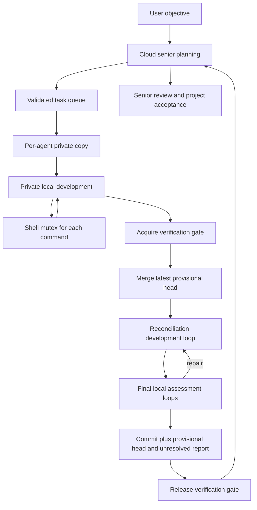

# Polyinference OS design — 1. Kernel boundary and the two-tier agent

## Current agent concurrency contract

Updated using the full agent HTML and the user's later clarifications. The HTML is the agent design, including OS-handled parts; the LLM OS is an application operating endpoints, not a computer-kernel subsystem. [Concurrent coding protocol](concurrent_coding_protocol.md) defines the current operational contract. It supersedes any earlier screenshot-based alternatives below where their scope differs.

Every in-progress coding process owns a codebase copy. Private development overlaps. Every shell/script command, including test/Git commands, acquires a global `shell_mutex`. A separate `verification_gate` serializes latest-head merge, at least one specially prompted development/reconciliation loop, the final one/few local-model testing/examination/assessment iterations, commit and provisional shared-head/report publication. Release verification only after that boundary; release shell after each confirmed command. When both are needed the order is **verification then shell**; an outside shell owner releases before requesting verification. The application coordinator keeps running throughout.

Assessment produces `fail / uncertain / successful`; every normal local completion remains `unresolved` until sprint-coordinator review. Publish completed commits provisionally with verdict/hazards so the next entrant receives them; this is not senior acceptance. Preserve one attributable net-change commit for senior revert and blast-radius analysis. Steering stops new local starts, waits only for the captured in-progress locals (including gate waiters) to finish, then goes to the planner.

| Current extension | Required behavior |
| --- | --- |
| L1-C01 | Each active coding attempt owns its copy, base revision and scoped tool context; no shared editing before publication. |
| L1-C02 | Shell and verification ownership are distinct, obey one acquisition order, and are not computer-OS locks. |
| L1-C03 | Each verifier merges the latest published head, runs reconciliation development and final assessment, and publishes its commit/report before releasing. |
| L1-C04 | Publication stays provisional/unresolved; unknown active effects retain applicable exclusion and senior rollback checks dependents. |


**Lecture basis:** CS350-1.pdf, Introduction, 17 PDF pages / 15 numbered slides. Uses lecture 1 only. **Project references:** F26 Planning.pdf, pp. 1–3, and the agent-v1 screenshot supplied in chat. **Revision/research date:** 2026-10-16. This is a research-derived design specification; no project implementation is included.

## 1. Project facts and proposed decisions

The planning document defines three layers: an existing agent/framework at the frontend, a custom agent OS kernel at the midend, and existing inference/MCP/tools at the backend. These are the project's terms, not web-development layers. The kernel is the main development effort; sourcing a coding-agent base is supporting work. V1 supports only the LangGraph features exercised by the first simple coding agent. The plan also makes the small memory allowance left by local inference a first-order constraint. [Project references: planning pp. 1–3.]

The screenshot establishes a **cloud strategy path** and a **local execution path**. It names User Prompt, Orchestrator / Loop Handler, Info Documentation, Cloud Model / senior engineer, Cloud Query Processor, Cloud process entry, cloud Result Processor, Task Queue, Local coding agent loop, Local inference, Tools & observations, local Result Processor, Task verification, Commit & task report, and Project acceptance. Some labels and edges are truncated; the contracts below are proposed decisions, not recovered HTML details.

**Selected v1 interpretation:** the cloud model develops/revises strategy and task specifications. The local model performs bounded coding work using tools and observations. Host code controls both loops, validates their outputs, and decides whether an authorized operation can run. This replaces the earlier draft's generic local-first router. Switching models on every arbitrary node is not the v1 architecture.

**Selected kernel placement:** an ordinary application-level coordinator operating inference/tool endpoints. Its process/request/critical-section abstractions do not implement or extend Linux or any computer OS kernel.

| Stage | Supported application | Kernel scope |
| --- | --- | --- |
| G0 / first OS version | One mixed-tier coding application, one local coding worker at a time | The exact operation and LangGraph subset needed by the screenshot's path |
| G1 | Many instances of that coding worker, sharing inference and tools | Bounded concurrent admission, process isolation, synchronization and integration |
| G2 | More agent programs / richer features | Explicit capability and schema extensions, added when a program needs them |

The controller is host orchestration, not an extra autonomous model agent. Its cloud calls and the local worker's model calls are both backend operations. The concrete logical process mapping is derived in document 2.

## 2. Slide-to-design derivation, in order

References use PDF pages; printed slides 9 and 10 have repeated reveals.

| PDF pages / numbered slides | Lecture concept | Polyinference consequence |
| --- | --- | --- |
| 1–3 / 1–3 | Systems scope and OS topics | Define a resource/authority layer beneath the chosen coding agent; future topics are not all v1 features. |
| 4–6 / 4–6 | Course administration | No product requirement inferred. |
| 7 / 7 | Abstraction between application and hardware | Both model tiers and all tool calls use one kernel request boundary; the agent graph owns strategy/execution policy. |
| 8 / 8 | Library OS; one program; poor utilization while waiting | A small embedded kernel is a valid start. Cloud waiting must not freeze status, cancellation, or eligible local work. |
| 9–10 / 9 | Multitasking; preemption and protection | Bound local loops/tools and separate waiting from active resource use. Enforce access through host mechanisms. |
| 11–12 / 10 | Bursty demand, policies, memory pressure, thrashing | Admit against the residual memory left by inference; prevent extra workers/MCP servers from defeating the mixed-model cost benefit. |
| 13 / 11 | Mediation, privileged operations, revocation | Model suggestions cannot authorize shell commands, spend, or change their own grants. |
| 14 / 12 | Kernel services and device drivers | Keep backend-specific clients, tool lifecycle and resource accounting behind adapters; keep project strategy outside the kernel. |
| 15–17 / 13–15 | Stable syscall interface and library wrappers | Give LangGraph nodes convenient typed requests and structured results, rather than direct provider/tool access. |

## 3. Research findings that constrain this design

LangGraph distinguishes fixed workflows from dynamic model-driven agents and supports orchestrator/worker patterns. That supports representing strategy and execution as separate roles while using ordinary host control paths for their handoffs. It does not decide the OS process boundary or enforce resource limits. [LangGraph workflows and agents](https://docs.langchain.com/oss/python/langgraph/workflows-agents).

The planning document names mini-SWE-agent v2 and Deep Agents as candidate bases. Mini-SWE-agent's documented simple model/action/observation loop is a useful behavioral baseline; its native agent is not thereby a LangGraph program. Deep Agents is built on LangGraph and bundles more features. Select or adapt a small loop; importing a base does not justify supporting its entire feature set. This research does not select, install, or port either project. [mini-SWE-agent source documentation](https://github.com/SWE-agent/mini-swe-agent), [Deep Agents source documentation](https://github.com/langchain-ai/deepagents).

Codex App Server exposes agent conversations, turns, events and interruption. Treat it as an agent endpoint where used, with different control/usage guarantees from a raw model call. Its harness can be local even when inference is cloud-hosted. [Codex App Server](https://developers.openai.com/codex/app-server/).

MCP negotiates protocol/capabilities and defines schema-described tool requests. That supplies an adapter protocol, not kernel admission, a sandbox, or a memory limit. Local tool-server startup must also fit the host budget. [MCP lifecycle](https://modelcontextprotocol.io/specification/2025-11-25/basic/lifecycle), [MCP tools](https://modelcontextprotocol.io/specification/2025-11-25/server/tools).

## 4. Component ownership: what belongs in the OS

| Screenshot component | Application responsibility | Kernel service it uses |
| --- | --- | --- |
| User Prompt | Capture objective and acceptance criteria | Create scoped run and input artifact |
| Orchestrator / Loop Handler | Choose plan/run/review/finish transitions | Process status, request submission, waits, budgets |
| Info Documentation | Maintain project instructions and technical context | Versioned artifact read/write; bounded retrieval |
| Cloud Model / senior engineer | Produce strategy, task breakdown and review decisions | Cloud inference or declared agent-job operation |
| Cloud Query Processor | Build bounded context packet and validate response format | Artifact handles, cloud submission and usage accounting |
| Cloud process entry | Adapter entry into the selected external execution mode | Launch/track/cancel/reconcile an operation |
| Cloud Result Processor | Normalize strategy into TaskSpec proposals; process task reports | Validated queue/state updates under controller authority |
| Task Queue | Hold project work and dependency status | Bounded task records and claim operations |
| Local coding agent loop | Decide the next allowed coding action | Local inference, tool calls, observation handles |
| Local inference | Existing serving backend | Shared backend adapter and admission |
| Tools & observations | Execute approved actions and capture evidence | Tool broker, scoped workspace, output limits |
| Local Result Processor | Validate/normalize model and tool outcomes | Structured results and immutable artifacts |
| Task verification | Check the task's declared criteria | Bounded verifier commands against an exact revision |
| Commit & task report | Prepare a private candidate and evidence report | Workspace/artifact publication, commit operation |
| Project acceptance | Assess the complete objective and evidence | Retained results and scoped delivery operation |

The kernel does not interpret “senior engineer” as privileged authority. It enforces a grant issued for the run. Neither cloud-generated tasks nor local-generated shell text can expand that grant. Task verification and project acceptance are distinct: passing one task's tests does not prove the project objective is satisfied.

The first registered graph and adapters use application-level scope, versions and ownership. Computer-OS sandboxing and protection mechanisms are outside this project design.

## 5. The selected two-tier interaction



Shell operations inside the verification phase also acquire/release shell_mutex individually. The application coordinator remains active; the verification owner retains its permit until publication, not senior review.

This is a proposed semantic flow, not a claim to reproduce every screenshot arrow. The queue and return/report paths connect the tiers. Local work starts from a cloud-authored, host-validated TaskSpec. A local repair remains within that task. A dependency gap, changed scope, exhausted repair budget or unsupported action returns evidence to cloud strategy through the controller; it does not silently swap the local worker into an unrestricted cloud agent.

A cloud backend descriptor declares `execution_kind = model_inference | agent_job`, model/provider version, inference location, harness location, tool environment, context/output limits, completion lookup, cancellation semantics and usage-bound support. The proposed G0 default binds strategy/review to cloud model inference and coding to local model inference. The provider/model remains a deployment choice. A Codex-style agent-job profile is an explicit alternative adapter configuration: scope it to the strategy role and isolate any enabled remote tools; do not add cloud code-writing authority implicitly.

## 6. Minimum interface and feature surface

The first kernel needs process admission/status/cancel, role-bound inference submission, tool invocation, bounded artifact access, task/result publication and a persistent continuation. Helpers may collapse these into a small SDK, but every privileged action reaches the same enforcement path. Documents 2–4 specify the records and synchronization.

Every operation has an authenticated caller, project/process identity, schema version, stable operation ID, operation kind, input handles, required resources, deadline and grant reference. The kernel returns a receipt/handle plus a typed terminal result or explicit wait state. Large context, logs and patches remain artifact references. Transport may be an in-process interface initially; a network daemon is not a v1 requirement.

The v1 agent manifest declares its exact graph entry roles, state schema, conditional loops, supported model response/action format, tool names and required capabilities. Accept sequential nodes, conditional edges, bounded loops and the persistent state needed by this agent. Reject unsupported graph features explicitly at registration. General dynamic subagents, arbitrary graph import, distributed execution and hot feature installation are deferred.

Represent the selected LLM stack as a versioned `ExecutionProfile`: role-to-backend bindings, model/context/output limits, local serving capacity, memory domains, tool availability and default operation limits. Pin a profile to a run and include its version in requests/results. V1's optimization mechanism is explicit profile configuration plus measured admission and context limits; automatic graph rewriting or learned tier allocation is later research. This gives the project's agent-design-to-LLM-stack goal a concrete initial interface without claiming an optimizer has already been designed or measured.

## 7. Memory is an admission constraint

Measure each physical memory domain separately: host RAM, accelerator VRAM, or a genuinely shared/unified pool. For a domain `d`, the design condition is:

```text
model_residency[d] + inference_peak[d] + kernel_and_graph_peak[d]
  + admitted_tool_and_MCP_peak[d] + bounded_buffers[d] + headroom[d]
  <= usable_capacity[d]
```

Use disjoint measured terms: additional inference working memory excludes model residency, and the buffer allowance excludes buffers already included elsewhere. Do not add unrelated RAM and VRAM totals, double-count unified memory, or assume model weights are the entire inference footprint. Context/KV and serving buffers can vary with admitted work. The hardware, model and numerical limits remain deployment inputs; the plan supplies no reliable values.

Keep the kernel's resident services small. Store long histories/docs/results outside live graph state. Register compact tool metadata; start only the local tool/MCP processes needed for the next admitted action, and stop idle servers according to a configured policy. Reserve startup and call peaks before launch. An active non-idempotent call cannot be evicted merely because another task wants its memory. A tool that cannot coexist with the configured local model is reported as an admission/configuration problem; repeated restart loops are not a solution.

MCP remains optional for the first agent if direct tools meet its needs, as the plan allows. The same tool-service contract must accommodate an MCP adapter later. Do not run a fleet of servers just to claim MCP support.

## 8. Requirements and acceptance conditions

“MUST” denotes the proposed build contract. A requirement applies when its corresponding feature is enabled. P1/P2/P3 refer to planning PDF pages; D refers to the design screenshot. Lecture origins use PDF pages.

| ID | System requirement | Origin | Acceptance condition for a future build |
| --- | --- | --- | --- |
| L1-R01 | The graph MUST express cloud strategy and local execution through role-bound kernel operations. | pp. 7, 14–17; D | Tracing a normal run shows cloud-authored work reaching the local loop and reports returning through the controller; no generic model switch changes role authority. |
| L1-R02 | Every run/process MUST have a kernel-owned identity, graph version, workspace scope and limits. | pp. 7, 13–14; P1 | Permissions, memory allowance and cloud budget are inspectable without interpreting prompts. |
| L1-R03 | Inference, tool, artifact and publication operations MUST check current grants and record their outcome. | pp. 13, 15–17 | A cloud task requesting a new network destination or local tool outside its grant is denied before dispatch. |
| L1-R04 | Generated actions MUST use the caller's declared private workspace and application-level tool scope. | pp. 10, 13–14 | A worker cannot alter kernel metadata, read provider secrets or write another worker's checkout. |
| L1-R05 | A cloud wait MUST leave status, cancellation and eligible local work responsive. | pp. 8–10 | Delay strategy review while an already authorized local task runs; the controller remains observable and cancellable. |
| L1-R06 | Strategy rounds, local iterations, repair attempts, outputs and tools MUST have independent finite limits. | pp. 10, 13; P1 | A failing verifier cannot drive an unbounded local/cloud repair loop. |
| L1-R07 | Cancellation MUST distinguish stopped graph control, contained local work and confirmed/unknown external termination. | p. 13; backend research | A disconnected cloud agent remains visible as unresolved and retains appropriate accounting. |
| L1-R08 | Admission MUST cover residual physical memory, local inference capacity and cloud quota/spend. | pp. 11–12; P1 | An MCP startup that would exceed residual RAM is queued/rejected before launch, even if an inference request-count slot is free. |
| L1-R09 | Resumable control state MUST be persistent and refer to versioned artifacts. | pp. 7, 12; framework research | Restart can locate the accepted plan, TaskSpec, last continuation and referenced observations without old model memory. |
| L1-R10 | Cloud context and strategy changes MUST remain within project data policy and authority. | pp. 7, 13; D | Cloud Query Processor omits forbidden artifacts; a proposed TaskSpec cannot grant itself tool access. |
| L1-R11 | V1 MUST accept only the declared LangGraph/tool subset and reject unsupported features before running. | pp. 14–17; P2–P3 | A graph needing an unimplemented subagent operation fails registration with a precise missing capability. |
| L1-R12 | Accounting MUST attribute latency, memory peaks and cost to strategy, local coding, tools, verification and repair. | pp. 8–12; P3 | The run report shows whether cloud savings were consumed by extra local repairs or tool/model churn. |
| L1-R13 | The kernel MUST manage local tool/MCP lifecycle within the measured memory envelope. | pp. 11–14; P1 | Idle-server teardown reclaims measured resources; active calls are not silently abandoned to reclaim memory. |
| L1-R14 | Cloud Result Processor MUST validate TaskSpec proposals before queue publication; local verification MUST remain distinct from project acceptance. | pp. 13, 15–17; D | Malformed/unbounded work never enters the runnable queue; a passing task cannot alone mark the project accepted. |

## 9. First-version design boundary

G0 contains one controller context, one coding worker at a time, a small persistent metadata/checkpoint facility, bounded artifact files, one shared local inference service, one strategy adapter, and the direct tools or one minimal MCP integration actually used by the agent. A small embedded transactional store is the default metadata choice; later documents refine its use. There is no need for a cluster manager, vector database, general plugin marketplace or support for every candidate harness feature.

The first research comparison should hold the coding objective and acceptance checks constant while comparing the supplied strategy/local-execution split with cloud-only execution and a local-only baseline where feasible. Measure accepted outcomes, cloud cost, total time, memory peaks and repair frequency. These are proposed evaluation requirements, not experiments performed in this task. Model choice, hardware fit and thresholds remain open until measured.

**Next:** [Lecture 2 — process and request contracts](02-CS350-2-processes.md).
