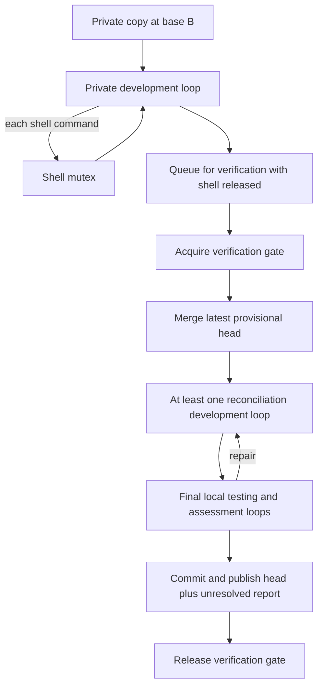

# Polyinference OS design — 3. LangGraph execution and bounded host tasks

## Current agent concurrency contract

Updated using the full agent HTML and the user's later clarifications. The HTML is the agent design, including OS-handled parts; the LLM OS is an application operating endpoints, not a computer-kernel subsystem. [Concurrent coding protocol](concurrent_coding_protocol.md) defines the current operational contract. It supersedes any earlier screenshot-based alternatives below where their scope differs.

Every in-progress coding process owns a codebase copy. Private development overlaps. Every shell/script command, including test/Git commands, acquires a global `shell_mutex`. A separate `verification_gate` serializes latest-head merge, at least one specially prompted development/reconciliation loop, the final one/few local-model testing/examination/assessment iterations, commit and provisional shared-head/report publication. Release verification only after that boundary; release shell after each confirmed command. When both are needed the order is **verification then shell**; an outside shell owner releases before requesting verification. The application coordinator keeps running throughout.

Assessment produces `fail / uncertain / successful`; every normal local completion remains `unresolved` until sprint-coordinator review. Publish completed commits provisionally with verdict/hazards so the next entrant receives them; this is not senior acceptance. Preserve one attributable net-change commit for senior revert and blast-radius analysis. Steering stops new local starts, waits only for the captured in-progress locals (including gate waiters) to finish, then goes to the planner.

| Current extension | Required behavior |
| --- | --- |
| L3-C01 | Each active coding attempt owns its copy, base revision and scoped tool context; no shared editing before publication. |
| L3-C02 | Shell and verification ownership are distinct, obey one acquisition order, and are not computer-OS locks. |
| L3-C03 | Each verifier merges the latest published head, runs reconciliation development and final assessment, and publishes its commit/report before releasing. |
| L3-C04 | Publication stays provisional/unresolved; unknown active effects retain applicable exclusion and senior rollback checks dependents. |

**Lecture basis:** CS350-3.pdf, Threads, 29 pages / 29 numbered slides. Builds on [the kernel boundary](01-CS350-1-foundations.md) and [process/request contracts](02-CS350-2-processes.md), using lectures 1–3 only. **Project context:** the small LangGraph subset, residual-memory constraint and supplied cloud-strategy/local-execution design. **Revision/research date:** 2026-10-16.

## 1. Selected execution model

Use an asynchronous host control plane, one graph driver per logical process, bounded handling of blocking libraries, and an independently managed local inference server. Keep the model/action/observation loop simple. Do not add general thread/subagent APIs just because LangGraph or a candidate harness supports them.

The controller graph and coding-worker graph are the two role entries of the `coding-v1` application from document 2. G0 has one controller and one coding worker at a time. Each role can have an inference waiter, progress reader and cancellation watcher, even though coding actions are sequential. These host tasks are not new TaskSpecs or new agent processes.

A graph driver remains the sole owner of its continuation while an async request is pending. It yields the host thread while awaiting; it does not hold a global “graph worker” permit that prevents another process from running. Limit the number of resident drivers for memory, and limit each backend's active operations separately.

## 2. Slide-to-design derivation, in order

| Pages | Lecture concept | Polyinference consequence |
| --- | --- | --- |
| 1–3 | Threads and outline | Distinguish durable agent processes from transient execution contexts. |
| 4–5 | Schedulable context; shared memory/resources; overlap | Model/observation waiters can coexist; shared client, queue and workspace state need disciplined ownership. |
| 6 | Create, exit, join, yield | Every host task has an owner, completion path and cancellation/join policy. |
| 7–8 | Kernel-thread cost | Avoid a host thread per cloud request or sleeping process; do not turn historical cycle counts into targets. |
| 9–11 | User threads and blocking pitfalls | A synchronous provider call, disk read or logger must not block the event loop. |
| 12–14 | N:M mapping and hidden blocking | Bound executors and expose their occupancy; use established host runtimes. |
| 15 | Outline | No independent requirement. |
| 16–17 | Go runtime, lightweight contexts and I/O scheduling | Separate logical work, host execution and actual local/cloud capacity. |
| 18 | Channels and joining | Use operation handles and TaskReports to synchronize the two tiers. |
| 19 | Outline | No independent requirement. |
| 20–22 | Independent stacks and non-LIFO resumption | Each controller/worker owns a complete logical continuation; nested function calls are not independent processes. |
| 23–25 | Fiber initialization and context switching | Define safe initialization/resume boundaries and let the language runtime manage stacks. |
| 26–29 | COS common switch paths and save/restore | Run initial dispatch, resume, cancellation and completion through common authority/accounting hooks. |

## 3. Research constraints

Asyncio task groups give scoped supervision and joining; cancellation is cooperative. A timed-out coroutine does not prove a host thread, subprocess or cloud job has stopped. [Python tasks](https://docs.python.org/3/library/asyncio-task.html). Blocking work and cross-thread callbacks need the documented executor/ingress mechanisms. [Asyncio development guidance](https://docs.python.org/3/library/asyncio-dev.html).

LangGraph supports sequential nodes, conditional loops, state updates and graph-local concurrency controls. Its `max_concurrency` setting is passed when invoking a graph; it is not this kernel's global local-inference, MCP-memory or provider quota. [LangGraph Graph API guide](https://docs.langchain.com/oss/python/langgraph/use-graph-api).

A resumed interrupt node starts again from its beginning. Side effects before that boundary can run again unless separately guarded. Use stable operation handles and separate submit/consume steps. [LangGraph interrupts](https://docs.langchain.com/oss/python/langgraph/interrupts). This supports the logical continuation design from document 2, not native stack migration.

Go's current runtime distinguishes goroutines, host threads and execution resources, with dynamically managed stacks. Borrow that separation; do not reproduce its scheduler or the slides' historical segmented-stack implementation. [Go runtime notes](https://go.dev/src/runtime/HACKING.md).

## 4. Concrete graph/state design

These node names describe a proposed graph specification, not project code. Adjacent pure transformations may be combined; an unbounded loop or several untracked side effects must not be hidden inside a node.

### 4.1 Controller entry

| Logical step | Input → output | Transition |
| --- | --- | --- |
| `ingest_run` | User objective, acceptance criteria, project grants → ProjectRun/input references | Reject missing/unbounded setup; otherwise prepare strategy |
| `prepare_cloud_packet` | Objective or pending TaskReports plus versioned Info Documentation → bounded strategy/review packet | Submit cloud role operation |
| `submit_cloud` | Packet reference and stable operation ID → receipt/pending operation reference | Checkpoint, then await |
| `await_cloud` | Operation reference → retained cloud result | Wait without host-thread occupancy; uncertainty stays explicit |
| `normalize_cloud_result` | Result → validated plan/task proposals or review decision | Invalid response gets bounded correction or a blocked result |
| `publish_and_dispatch` | Accepted plan and executable tasks → queue records/worker processes | Dispatch only eligible tasks and available worker slots |
| `await_task_reports` | Project queue/process status → new immutable reports | Review reports, dispatch more accepted-plan work, or wait |
| `accept_or_replan` | Cloud review proposal plus exact project evidence → continue, revised plan, blocked state or project acceptance | Host enforces acceptance preconditions and limits |

`normalize_cloud_result` does not execute cloud-proposed shell commands. `publish_and_dispatch` uses the process/task services and inherited limits. A cloud review may suggest project completion, but only the controller's acceptance path can record it against the exact delivered revision and required evidence.

### 4.2 Coding-worker entry

Merge/dev/test/Git shell operations inside verification also acquire/release the shell mutex individually, in verification→shell order. These logical permits do not block the coordinator. Assessment verdicts are fail, uncertain and successful; all completions remain unresolved for senior review.

The local response grammar is deliberately small: one registered action, proposed task completion, or a blocked/needs-strategy outcome. The selected agent may express that through structured tool calling or a parsed shell-action format; its manifest declares exactly one supported format/version. A parse error produces bounded feedback, not an unrestricted execution fallback.

The Tools & observations and local Result Processor boxes become the submit/consume/normalize steps. Task verification uses the accepted `acceptance_spec_ref` against the identified candidate. The local model cannot weaken tests merely by proposing a new verification command. Verification infrastructure failure is reported separately from code failing a check.

After final assessment, Commit & task report records the attributable commit, evidence, three-valued verdict and unresolved report. Publish provisional head under the still-held verification gate, then release it. Stop reasons and interrupted assessment are separate from verdicts. A new scope or strategy requires a new TaskSpec revision; the worker does not independently rewrite the cloud plan.

### 4.3 Durable state fields

| State | Compact persisted fields |
| --- | --- |
| Controller | Project/process IDs, program/schema/ExecutionProfile versions, objective/acceptance refs, current plan reference/revision, working revision, strategy round count, pending cloud operation ID, report IDs/cursor, project outcome |
| Coding worker | Process/task/spec/attempt IDs, pinned plan/base/docs refs and ExecutionProfile version, workspace ID, original base/captured head, implementation/reconciliation/assessment phase, both lock token refs, publication state, local iteration and repair counts, last action/observation refs, pending operation ID, candidate ref, verification evidence ref, report ref/outcome |
| Kernel-owned records | Grants, resource reservations, authoritative lifecycle revisions, task claims, operation status and costs; graph state refers to them but cannot override them |

Full message histories, patches and command output are retained in bounded artifacts. Build each prompt from selected task/context/evidence references and a capped trajectory window. Summaries keep source links; a summary is not proof that a dependency passed. Live clients, sockets, locks, server handles and model KV state do not belong in serialized state.

## 5. Dispatch, waiting and recovery semantics

### 5.1 Submit and consume are separate effect boundaries

1. The node obtains a stable operation identity from its persisted logical step/attempt, not a fresh random ID on every retry.
2. Submission records the intended effect in the kernel and returns its handle. The graph publishes that handle before advancing to a separate consuming node.
3. The consuming node awaits or retrieves the operation's retained outcome. It does not submit again merely because the graph restarted.
4. Parsing returns a pure proposed state update. A subsequent side effect uses its own stable identity.
5. On restart, the sole graph driver reconciles kernel operation state and the last published continuation before dispatching new work.

For the proposed worker graph, a stable step reference contains process/attempt identity, phase, local iteration and action index; controller steps use process identity, phase and strategy/review round. These counters/inputs are checkpointed before entering submission. The kernel's unique step-reference mapping yields the same operation ID on replay. A deliberately repeated generation after new feedback advances the logical step, even if the prompt happens to be identical; request fingerprints validate intent rather than define it.

A crash between kernel submission and graph checkpointing still requires the logical-step-to-operation lookup; having separate nodes alone does not close that gap. Document 4 defines the durable protocol. Normal backend waits can be ordinary async waits in G0. Deliberate long external/user pauses may use a supported interrupt node that has no unguarded side effect before it.

### 5.2 What the scheduler actually schedules

| Layer | Selected responsibility |
| --- | --- |
| Kernel process control | Admit controller/worker instances, cap resident continuations, serialize external commands to each driver |
| LangGraph | Advance the selected role's nodes and conditional loops; initially one active node per role invocation |
| Kernel operation queues | Admit local inference, cloud strategy/review, tools/verifiers and tool-server startup against their real constraints |
| Host async runtime | Run ready coroutines until they await; deliver progress/status/cancel events |
| Existing serving/provider runtime | Token generation, batching and any internal agent scheduling |
| Host OS | Physical CPU scheduling, process containment and memory enforcement |

G0 uses graph-local concurrency one, one active coding worker and one admitted local decode by default. These are conservative initial configuration choices, not measured hardware maxima. Cloud strategy/review and local work may overlap when the tasks remain authorized under the accepted plan and the resources fit. G1 increases coding-worker residency separately from local inference slots; ten waiting workers do not imply ten simultaneous decodes.

Round-robin at kernel operation admission provides execution opportunities between model/tool steps. There is no promise to pause a LangGraph function at an arbitrary instruction or force a provider to hand over its hidden internal state. A noncooperative node or tool needs a supervised host process and a finite deadline.

### 5.3 Blocking work and task supervision

One event loop handles controller/worker I/O, status and cancellation. Use a bounded executor for unavoidable trusted blocking SDK/file calls and supervised processes for CPU-heavy, untrusted or noncooperative work. Queue limits count work waiting for an executor as well as active threads. Cancelling a thread future leaves its still-running call accounted for; it cannot safely be reused as an empty slot.

Each operation scope owns its output consumers and watcher tasks. Join required stream consumers before declaring the result complete; preserve terminal errors. On process exit, join/cancel them or explicitly transfer persistent external work to the kernel supervisor. G0 needs no speculative execution or first-winner model race.

Callbacks enter through the event loop's supported thread-safe path and deliver immutable messages. They do not mutate graph state directly. Do not change a shared process's global working directory for a tool call: pass a per-operation workspace/CWD to its execution boundary. Similarly, do not mutate shared model-client defaults to select one worker's prompt/session.

## 6. Memory and safe growth of the LangGraph subset

A live driver, prompt assembly and output consumer all use the residual memory identified in document 1. Cap active drivers, pending task records, per-driver trajectory bytes, tool-output buffers and executor queues independently. Cold processes can remain represented by metadata/checkpoint references instead of pre-instantiated graphs with full histories; unloading at supported safe boundaries is a later optimization, not arbitrary coroutine serialization.

Share direct/MCP adapters through kernel services where their concurrency contract permits it. Tool-server process lifetime is independent of one coding process. A stateful MCP session or provider conversation is serialized or separately scoped; neither is automatically safe to share because the transport supports multiple requests.

Grow capabilities by declaring a new program/manifest version: identify the additional graph feature/operation, its state and memory cost, its completion/cancellation contract and its compatibility rules. Existing processes stay pinned to their version. Unsupported dynamic fan-out, nested subagents or new action formats are rejected until those contracts exist. This implements the planning document's feature-driven growth without supporting all of LangGraph up front.

## 7. Requirements and acceptance conditions

| ID | System requirement | Origin | Acceptance condition for a future build |
| --- | --- | --- | --- |
| L3-R01 | Every graph driver, progress reader and cancellation watcher MUST have an owning process/operation and join path. | pp. 4–6, 18 | Worker exit leaves no invisible reader/task running against its private state. |
| L3-R02 | Blocking clients, file I/O, logging and CPU work MUST NOT monopolize the orchestration loop. | pp. 9–13, 17 | A delayed cloud SDK does not freeze local observations, status or cancellation within the deployment's response target. |
| L3-R03 | Resident drivers, graph fan-out, pending operations, executor queues and backend capacity MUST be bounded separately. | pp. 8, 12–17; L1-R08 | Raising worker count cannot silently raise decode slots or exceed the measured RAM envelope. |
| L3-R04 | One driver MUST own each controller/worker continuation; awaiting a child MUST NOT hold a global execution permit. | pp. 20–29; L2-R05 | With one host event loop, a waiting controller still permits its worker to advance. |
| L3-R05 | Any later parallel nodes MUST use explicit merge and workspace policies. | pp. 4–5, 14, 18 | Fan-out cannot cause completion-order overwrites of a TaskSpec, shared message list or checkout. |
| L3-R06 | Cancellation MUST propagate through transient task scopes and preserve unresolved remote ownership. | pp. 6, 10–13; L1-R07 | A cancelled graph cannot launch another repair; a still-running external job remains supervised/accounted. |
| L3-R07 | Submit/consume steps MUST recover by stable operation lookup without relying on an old coroutine stack. | pp. 20–29; L2-R09 | Restart after cloud submission reattaches/reconciles rather than creating a second strategy job. |
| L3-R08 | Required streams/checks MUST be joined with a declared failure policy. | pp. 6, 18 | EOF on one stream or a verifier crash cannot be interpreted as task success. |
| L3-R09 | Initial dispatch, resume, yield and finish MUST use common grant/accounting/trace hooks. | pp. 26–29; L1-R03 | Resuming a task cannot bypass a revoked tool or expired project limit. |
| L3-R10 | Metrics MUST distinguish runnable graph control, pending coroutines, occupied host executors and active backend operations. | pp. 12–17 | Local inference is visible as active even when its worker's graph control is waiting. |
| L3-R11 | Shared provider/MCP clients MUST preserve per-process session/workspace isolation and declared concurrency. | pp. 4–5; documents 1–2 | Two requests cannot exchange context through mutable defaults or global CWD. |
| L3-R12 | Graph/action/state versions MUST remain compatible with the retained continuation. | pp. 20–29; framework research | A new action grammar or reordered interrupt sequence is rejected/migrated, rather than silently replayed against old state. |
| L3-R13 | The local loop MUST distinguish action, completion proposal, parse failure and needs-strategy outcomes. | pp. 6, 18; D | Invalid local output does not execute as shell text; repair exhaustion produces a bounded TaskReport to cloud strategy. |
| L3-R14 | V1 feature support MUST be determined by the registered role graphs and their manifest. | pp. 7–14; planning p. 2 | Adding one needed node/tool does not enable every bundled harness feature or dynamic subagent API. |

## 8. Verification scenarios for the design

Trace one task through cloud proposal → TaskSpec → local inference → tool observation → failed verification → bounded repair → private candidate → TaskReport → cloud review. Assert which graph owns each transition and which kernel operation owns each resource. Then force cancellation during local decode, a blocking SDK beside healthy I/O, a verbose verifier, duplicate result delivery, and restart between submit and consume.

Before G1, repeat with several workers sharing one local decode slot and limited tool memory. A healthy result is bounded memory and fair progress, not one host thread or model copy per agent. General graph fan-out and distributed driver takeover remain later features whose synchronization is defined when enabled.

**Next:** [Lecture 4 — synchronization of the actual queue, reports and resources](04-CS350-4-concurrency.md).
