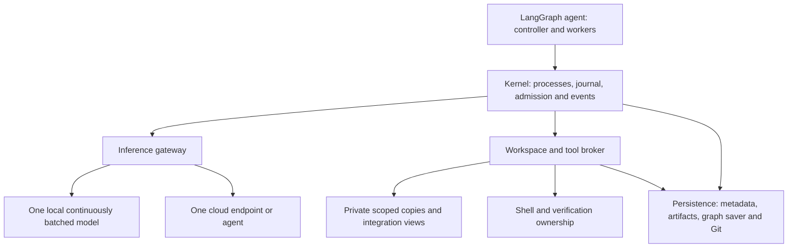
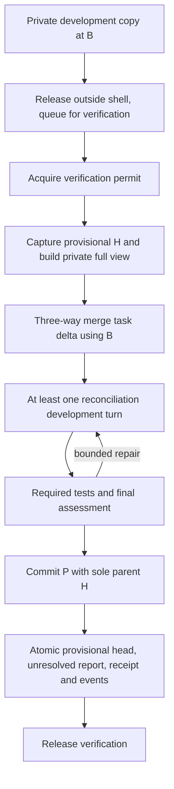

# PolyInference OS: minimal design

17 October 2026 · design specification, not an implemented OS

Build one small asynchronous runtime for one coding project, with one resident local model service, one configured cloud endpoint, several bounded agent processes, private task code copies, and a serialized merge/test/commit phase. Keep LangGraph as the agent's workflow runtime. PolyInference schedules model/tool operations and owns their effects; the inference server owns continuous batching and GPU execution.

This is the implementation scope for the reference agent. The broader [agent design](../langgraph-agent/README.md) and its wire contract retain extension points, but they do not require implementing every future feature. [SOURCES.md](SOURCES.md) consolidates the scattered evidence and maps all five lecture derivations to this design.

The [joint integration audit](../INTEGRATION_AUDIT.md) records the paired-design corrections and the implementation scenarios needed to verify them.

## 1. Scope and authority

The latest user instructions govern the simplified scope, partial code copies, inference-resource model and additive LangGraph integration. The [merged graph](../polyinference-design/polyinference-agent-design-merged.html) governs cloud-first planning, private development, reconciliation, assessment, provisional publication, steering and senior review. Its preserved memory view supplies consistent additional requirements; conflicting old prose does not override the expanded execution contracts.

Two older defaults change: a single worker/one admitted decode is only a bring-up configuration, not the completed continuous-batching design; a full development checkout per agent is replaced by a private copy of its assigned code and necessary dependency closure. Final integration testing still needs a complete private view of the resulting project.

| Build now | Concrete boundary |
| --- | --- |
| Process lifecycle and persistent continuations | One controller and bounded worker/query invocations; one driver each; status, wait, cancel and restart reconciliation. |
| Shared local inference | One resident model service accepting several independent bounded requests concurrently. |
| One cloud adapter | Implement the actual selected endpoint protocol: raw inference or an agent endpoint. No provider marketplace or overflow router. |
| Admission and limits | Worker residency, local in-flight/context capacity, cloud account/endpoint capacity, spend, deadlines and bounded tool/output/storage use. |
| Private scoped code copies | Pinned base, explicit copied/read/write sets, tracked changes and workspace generation. |
| Two exclusion objects | One global shell command; one project merge/reconcile/test/assess/commit/publication owner. |
| Direct tools and evidence | Search, bounded reads, scoped patches, foreground commands/checks; actual effects and exact-tree evidence. |
| Durable journal and records | Stable operation IDs, atomic head/report publication, retained unresolved results, replay/recovery. |
| Input/notes persistence | Ordered steering, versioned notes/hazards and report/doc backlog through generic records/artifacts. Their meaning stays in the agent. |

Do not build MCP discovery/lifecycle, a memory hierarchy/vector database, autonomous consolidation, automatic provider overflow or running-process model migration, weighted allocation optimization, graph rewriting, general subagent APIs, distributed coordination, whole-machine snapshots, custom GPU scheduling or native lock algorithms. These remain outside this OS version. Existing optional wire fields do not turn these into required subsystems.

## 2. What the CPU analogy means here

| Lecture abstraction | Actual resource |
| --- | --- |
| Process | Durable agent invocation: assignment, private code/context, limits, phase and continuation. |
| CPU work | A local model generation or a cloud inference/agent operation; ordinary Python graph transitions are control overhead. |
| Local execution engine | One serving backend sharing weights and batching active sequences; agents are not separate loaded models. |
| Scheduling unit | OS admission of one bounded generation/job/tool operation. GPU token scheduling stays inside the server. |
| Context switch | Graph yields between settled operations, retaining explicit history/checkpoint/workspace. Not copying hidden reasoning or a GPU execution stack. |
| Memory | Shared model residency and KV/serving capacity, plus host graph/context/tool buffers. Private source files primarily occupy disk. |
| I/O wait | A process awaits model/tool output; the endpoint may still be consuming compute/memory/quota. |
| Critical section | Application ownership of shared-project reconciliation through publication; it intentionally spans model and tool waits. |

A continuously batched model is not a collection of equal independent CPU cores. Several sequences share the same model execution, memory bandwidth and token budget. More agents may increase useful overlap, or only increase latency/KV pressure. Do not infer linear speedup from agent count.

Current serving documentation distinguishes sequence limits and per-iteration token budgets, and describes chunked prefill sharing capacity with decode. These constrain the adapter's capacity description; the OS does not recreate that scheduler. [vLLM scheduler configuration](https://docs.vllm.ai/en/stable/api/vllm/config/scheduler/), [optimization guidance](https://docs.vllm.ai/en/stable/configuration/optimization/)

## 3. Four implementation modules



1. **Kernel:** sole runtime authority for process/operation state, resource reservations, ownership, wait queues and durable event publication. One event loop, small bounded blocking executor, no coordinator cluster.
2. **Inference gateway:** local asynchronous serving client and the one selected cloud adapter; validate context/capabilities, submit/track/cancel/reconcile, report actual usage. One immutable configured role map per run; the reference default is senior to cloud, ordinary worker to local, and explicit cloud specialist when assigned. An experiment may pin another feasible static map before the run starts.
3. **Workspace/tool broker:** task code copies, scope/generation validation, foreground command supervision, two critical-section queues, merge/commit and evidence collection. All agent effects reach this boundary.
4. **Persistence:** SQLite metadata on local deployment storage; immutable artifact files and Git objects; an existing persistent LangGraph saver. Keep separate consistency domains explicit. Store logs/checkpoints by reference instead of retaining all histories in RAM.

The task ledger, sprint decisions, verdict proposals, senior resolutions and doc batching are agent application code over these generic services. The OS enforces versions/grants/limits and publication invariants without interpreting sprint prompts. Physical deployment may keep all four modules in one Python application plus the existing inference server and tool subprocesses.

## 4. Processes and operations

Use the existing [2.0 agent contract](../langgraph-agent/contracts.py). A process is not a host thread, provider session or model slot. A process owns compact continuation state and may issue at most one active top-level model/tool effect at a time. Multiple processes can have active effects concurrently. A native job's brokered tool callbacks are subordinate operations with stable IDs, causal ancestry and the same budget/grant; they cannot become an independent agent loop or bypass either gate. Keep the parent job's cloud reservation until it actually ends.

```text
Process: created -> ready -> running -> waiting -> ready -> completed/failed/cancelled
                                    \-> paused -> ready
Effect:  prepared -> submitting -> active -> settled
                            \----------> uncertain -> reconciled outcome
```

Persist input/program versions, task/attempt, budget/grant, workspace/generation, current phase, next logical step, pending operation IDs, held permits, checkpoint and result. `waiting` does not release resources still consumed by a submitted effect. Completed worker execution always has a normal assessed/published report; interrupted work keeps its partial state without an invented verdict.

The controller starts registered worker/query entries with immutable inputs. Expensive workspace setup occurs after an atomic claim but before readiness. Setup failure remains a tracked failure/cleanup state. Queue/task claims and steering capture serialize against the same short record transaction.

`W` counts claimed coding workers from setup through execution and necessary cleanup, including gate/model waiters and coding documentation tasks. A worker whose effects have ended and whose report is durably published releases its worker slot even while the report remains unresolved; retained records/artifacts have separate storage limits. Reserve bounded host/control capacity for the controller, recovery and one serialized senior query independently of W. A full worker pool must not prevent the review needed to unblock those workers. A paused worker retains its slot unless explicitly hibernated after settled effects, no held permits and a durable continuation; hibernation readmission must reserve it again.

Every effect has a stable `(process, logical_step) -> operation_id` mapping and semantic input fingerprint. Persist intent before dispatch and submitting before sending. A retried node looks up the original effect; it does not mint a new ID and execute again. Repeated result delivery settles usage/resources once. A genuinely new repair/inference advances the logical step.

Replay lookup precedes new-dispatch checks: an already settled effect returns its original result/receipt even if its workspace generation or permit later changed. Current generation/ownership checks apply before a new external submission, not as a reason to duplicate or lose a previously committed effect.

## 5. Scheduling local continuous batching and cloud work

### 5.1 Independent limits

| Limit | What it bounds |
| --- | --- |
| `W` | Resident coding workers and their host state/private workspace allowance. |
| `L` | Local requests submitted but not confirmed ended; queued-in-engine requests count. |
| `E` | Configured backend sequence capacity; an engine constraint, not an OS count of agents. |
| `T` | Conservatively reserved local context tokens across admitted requests. |
| `C` | Cloud operations in flight; also serialize mutable sessions individually. |
| Shell / verification | Exactly one command / one final-phase owner. These are independent of W/L/C. |

Admit local request i only when `inflight < L`, its input plus reserved output fits the configured context bound, and `reserved_context + input_i + max_output_i <= T`. Use model-specific tokenization or a conservative bound. A common minimal deployment keeps `L <= E` to bound hidden backlog; the engine may still queue/preempt internally. If the backend uses a different capacity contract, its adapter must provide equivalent bounded admission.

Also require measured fit in each physical memory domain. Count model weights/serving residency once, active inference/KV allowance separately, then host process/tool buffers and headroom. Do not add discrete VRAM to RAM or count unified memory twice. Token capacity is an admission approximation unless the backend exposes an enforceable reservation. If a reliable KV estimator is absent, use a measured conservative static capacity and backend limits, and label that guarantee honestly.

Start a few bounded workers so they can overlap model calls with tools. `W` and `L` may differ; several agents waiting for tools need not consume local model capacity. Exercise at least two independent concurrent local requests when hardware fit permits. A one-request configuration remains a valid fallback/bring-up mode, but does not demonstrate c-batching.

### 5.2 Dispatch policy

Keep separate local, cloud, shell and verification wait queues. Ordinary requests use FIFO. The current verification owner has a local finishing lane; when both finishing and ordinary requests wait, alternate admitted opportunities between those lanes. This gives the critical-section owner progress without making every other ready agent wait for its model reasoning. A lane contains only the owner's bounded mandatory phase requests. No inactive verifier receives a reserved decode slot.

Submit each eligible request as soon as capacity is available. Never wait for an entire batch to fill, never put a global mutex around the local client call, and never await the complete generation while holding a dispatch/metadata lock. Results return independently by operation ID. The serving backend decides how tokens from those requests share batches.

Shell and verification queues remain FIFO with bounded command/phase allowances. No arbitrary token-level preemption is required. Stop new submissions when capacity is full and wait for a completion event. Fixed role eligibility is enforced; request priority/fidelity metadata is retained, but this core does not promise dynamic priority optimization or weighted-distribution control. Unsupported mandatory scheduling policies fail negotiation; optional preferences do not override FIFO.

Infer required capabilities from semantic constraints as well as feature lists: a hard mixed-class target allocation is rejected even if a caller omits the weighted-allocation feature flag. A soft preference may use a fixed eligible binding throughout the process. The profile names the actual static role-to-endpoint references; a process cannot change them by editing its prompt.

### 5.3 Cloud execution

For a raw inference endpoint, the agent's senior-query/worker graph owns the loop and the OS submits one generation at a time. For a native agent endpoint, the selected adapter owns submit/status/events/cancel/result/reconciliation for a whole bounded job. Implement only the actual selected protocol; do not pretend a raw reply executed tools.

Reserve cloud account/project allowance independently of local capacity. Known rate/quota refusal waits until a bounded retry/deadline or pauses the run; no automatic overflow provider is required. Keep capacity for necessary review in the internal budget where meaningful. Provider percentages/unknown subscription limits are not exact token reservations, and other account users may consume quota. An unavailable required cloud call becomes an honest wait/stop.

Native agent work that edits code must use the workspace/tool broker and required phases, or a verified equivalent enforcing the same exclusion/evidence guarantees. An opaque endpoint cannot write code while the OS claims global shell and merge/test/commit exclusion. It may still be usable for a scoped non-mutating senior query if its declared data/limit contract fits.

### 5.4 Example overlap

```text
A: local generation ---- private edit ---- request verification
B: local generation -------- shell/test -------- private edit
C: private search --- local generation -------- private edit
                     ^ independent requests can coexist in one local engine

A owns verification: materialize H -> merge -> local reconciliation turn
                     -> shell tests -> local assessment -> commit/publish -> release
B/C:                 continue private work and eligible local calls;
                     their final sections queue, their shell calls serialize
```

The verifier retains its project permit during its inference waits, not exclusive use of the model. Each local request releases only its own occupied capacity after confirmed end. The control plane continues accepting status, steering and completions.

## 6. Each agent's private part of the code

### 6.1 Development view

Before starting a worker, create a logical workspace at immutable base B. Copy the files in its allowed edit scope plus the read/build/test dependency closure needed for that assignment. Record a manifest of relative paths, base hashes and read/write permissions. Include configuration, imports and test fixtures when needed. Do not assume a package folder alone is a sufficient closure.

Each worker has its own physical writable files; assigned paths may overlap across private copies. Never use writable hard links into another agent's files or a shared base. Immutable Git objects/content may be shared; file-copy or proven copy-on-write storage are implementation choices. No model state/weights are copied per workspace. Code copies on disk are not copies injected wholesale into the prompt.

The core obtains the initial closure from task paths and configured source/build/test include rules. Missing reads request bounded expansion at B. It does not build an automatic dependency graph or assume the initial closure is complete merely because it can parse a package manifest; full integration checks remain mandatory.

The broker maps all reads/patches/commands through workspace ID, current view and generation. A path must be a normalized relative project path; reject traversal/symlink escape and access to Git control paths. Writable scope stays within the TaskSpec grant. A broad shell is also constrained by the configured execution backend; setting CWD alone is not isolation. Shared caches, ports and services need per-workspace scoping; this core disallows unmanaged background services and undeclared shared mutations. Full integration materialization expands visibility, not write authority: validate the final H-to-P source delta against the assignment. Agents cannot write shared refs, Git metadata or authoritative artifacts directly. Run Git publication through trusted broker operations; configured hooks/filters are controlled effects, not an untracked path around scope or evidence checks.

If more source is needed, expand the read closure from the same pinned B, record the addition and increment the workspace generation. Reading a moving global latest would mix bases. Expansion of write authority needs a validated assignment change; an agent cannot grant it through a path argument. Tools carrying a stale generation are rejected.

### 6.2 Delta and complete integration view

Track changes explicitly as add/modify/delete/rename against copied base hashes. A file absent from a partial copy is **not a deletion**. Preserve the pre-merge delta/history before integration. Generated/build artifacts do not become source changes unless specifically included in the grant.

The delta is a simultaneous description against B, not an ordered patch program. Each affected path participates once, including both rename endpoints. Adds and rename destinations require confirmed absence in B, not merely absence from the copy; existing sources require the copied writable base hash. Replacements use explicit modify/delete changes instead of an ambiguous overwriting rename. A rename without replacement content preserves source bytes. Verify modes/symlinks and the full resulting Git tree in the broker; the fixture schema's file hashes alone do not prove those properties.

When verification ownership is acquired, capture current provisional H and materialize a complete private integration view of H. Apply the task delta using B as the three-way ancestor. This preserves all files outside the task scope and incoming predecessor changes. Resolve conflicts explicitly within authority, then run the mandatory reconciliation-development turn even when the merge is mechanically clean.

The same logical workspace ID now names an integration view with a new generation. Original development files/delta remain retained evidence. All subsequent reasoning, tools, checks, assessment and commit use the integration view. Earlier partial-view checks are development feedback; final acceptance evidence comes from the integrated final tree and recorded environment.

A generation identifies the materialization/authority view, not each edit. Serialize effects within it and bind mutations/checks to current content identity as well. Rehash after commands and trusted commit preparation: a formatter, test or hook that changes assessed inputs invalidates affected evidence and requires checks/final assessment again before publication.

If a full-project test environment cannot be prepared, report that limit; do not pass a partial-copy test as project-level integration. If reconciliation needs writes beyond scope, stop safely, retain the private work, release after settled effects and request a new assignment. Never wait for a senior scope decision while holding the gate it may need.

## 7. Merge/test/commit is one critical section



| Ownership object | Lifetime and rule |
| --- | --- |
| `verification_gate(project)` | From before reading the integration head through merge, development, tests, assessment, commit and durable head/report publication; or an explicit reconciled abort. |
| `shell_mutex(installation)` | One foreground command and relevant descendants through known completion/output accounting. Acquired separately for each command, including merge/Git/tests. |

**Order: verification before shell.** An outside shell owner finishes/releases before requesting verification. A verifier takes shell only when a command actually needs it; it does not hold shell during model reasoning. All code-head publishers, including senior revert, use verification ownership. Short metadata locks never span a model/tool/lock wait. These application permits do not pause the event loop or all model requests.

Before verification entry, ensure no pending tool effects, preserve the delta, and check the remaining reconciliation/assessment/publication allowances. This avoids admitting an owner already unable to finish. Tokens/spend needed later still require actual per-operation admission; an internal reserve cannot guarantee remote availability.

Final assessment produces `fail / uncertain / successful`. Every normally assessed verdict creates attributable P with parent H and the assessed tree, then publishes `provisional_head=P`, immutable unresolved report, hazards, receipt and notification intents under expected-head/current-owner checks. The next owner must see P and its unresolved provenance. A no-diff normal completion can use a real empty metadata commit.

Senior review does not occur inside the worker's section. Keep accepts already-published work; revert is another serialized change with dependency/blast-radius checks. Retry/defer alone does not remove published code. Project acceptance uses the reviewed resulting revision and current independent project checks.

Ordinary review is an application barrier: close new coding starts atomically, let already-started workers finish or expose an explicit interrupted blocker, then pin the report/head/steering input and run one senior query. Apply its dispositions before activating the next plan. This avoids revoking a running worker's pinned plan through an unrelated review. No verification permit is held while draining workers or waiting for the senior. Keep ingress, status and recovery responsive throughout. A stale proposal cannot advance heads or acknowledge unseen input; preserve it as evidence and refresh review after a bounded version conflict.

Senior reverts use a journaled, authorized `capability_call` to a record-publication capability, with an immutable argument artifact naming expected H, the actual new commit/sole parent/tree, verification owner, resolution/evidence refs and event intents. The same atomic compare-and-publish primitive advances provisional head and records the resolution/receipt. The worker-specific `publication` payload and TaskReport are not fabricated for a senior revert. Reconcile each revert receipt before the next disposition; interrupted multi-disposition review resumes its remaining intents and does not pretend the entire Git batch was atomic. Advance reviewed head only to a resulting revision whose contributing work has explicit accepted/reverted dispositions; defer/retry alone leaves it unresolved.

For project acceptance, close starts and settle the captured workers before acquiring verification. Require reviewed and provisional heads to identify the same accepted commit/content, no unresolved contributing work, a matching senior completion proposal and no pending steering or uncertain effects. Run independent project checks on a complete private view of that revision, taking shell per command. Atomically publish completion only if heads, plan, input watermarks, owner and no-active-worker predicate still match. New steering invalidates acceptance even while the gate prevents code publication. On failure/staleness release after settled effects and return to review; never wait for a worker while holding verification. This uses the generic record-publication port, not a fake worker report.

### Failure and abort

Reserve finite repair/model-call/time allowances; the gate must not contain an unbounded agent loop. A definite assessed failure still publishes as required by the merged design. An interrupted or unfinished assessment does not manufacture normal completion. If all protected operations have ended and publication did not happen, save the workspace/continuation and explicitly abort/release; a resumed worker must reacquire and capture a fresh H.

If a shell command or publication outcome is unknown, retain conflicting exclusion and reconcile. Timeout, graph exception or permit expiry does not establish termination. A generic `finally: release()` is insufficient. The trusted recovery path checks the durable journal, host descendants, actual Git objects and publication receipt, then either completes the original publication or records a reconciled abort.

On a reconciled abort, retire the integration generation and its candidate/check/assessment authority. The minimal resume path reacquires verification, captures fresh H and rebuilds from the preserved original B-to-development delta. Retain abandoned reconciliation repairs as attributable artifacts for explicit reapplication; do not automatically turn the whole abandoned integration tree into a delta against B, which would replay predecessor changes as this worker's edits. Repeat reconciliation/checks/assessment with new logical steps and generation. A published receipt instead resumes completion of the original attempt, never a second publication. Preserving repairs automatically via an H-old-to-private delta would need an additional validated rebase protocol and is outside this core.

## 8. Minimal storage and state

| Record | Minimum state |
| --- | --- |
| Program/run | Registered versions, static role bindings, grants/budgets, provisional/reviewed heads and application record pointers. |
| Process | Parent/entry/task, lifecycle/phase, next logical step, workspace/generation, pending operations, checkpoint/result and stop intent. |
| Operation | Stable intent/fingerprint, caller/input versions, queued/submitting/active/uncertain/settled state, reservations, provider/host IDs, result/usage. |
| Workspace | B, copied file manifest, write scope, view/generation, private delta, captured H and integrated tree/commit. |
| Ownership | Resource key, current process/generation, FIFO waiters, protected operation references. No time-based automatic unlock. |
| Publication | Expected H, actual P/parent/tree, report/evidence, verifier, receipt and event intents. |
| Input/context | Ordered steering, notes/hazards/docs versions, backlog cursor and immutable history/output refs. |

Use local SQLite transactions for metadata claims/reservations/publications. Model calls, copy/merge/test/Git operations happen outside those short transactions. Complete immutable artifacts/Git objects before advancing authoritative pointers. A convenient Git ref is a repaired projection; a private commit existing does not imply head publication. Metadata, Git and graph saver are not assumed to share a transaction.

Bound queues, live graph state, prompt assembly, output buffers, artifact storage and workspace disk separately. Stream outputs to capped files and retain a useful paired preview. Pin live inputs/recovery artifacts; reclaim completed workspaces only after effects end and commit/report/recovery references are safe. A simple explicit retention policy suffices; no memory-tier service is needed.

The source-derived wire records already cover most of this. [contracts.py](contracts.py) specifies the minimal profile and scoped-workspace manifest/delta extension; [core.schema.json](core.schema.json) and [core-examples.json](core-examples.json) make those additions reviewable. They do not implement scheduling or file isolation.

## 9. Agent cooperation and additive LangGraph integration

Use a small external package, conceptually `polyinference_runtime`, providing the existing RuntimePorts adapter, process driver and explicit SDK helpers. Agent nodes call the ports rather than models/files/subprocesses directly. All provider/tool routing stays at these effect boundaries. Nothing requires changing LangGraph's token scheduler, checkpoint storage internals or graph engine.

Use public StateGraph nodes, runtime context, async invocation and a maintained persistent saver. Runtime context carries live service dependencies outside serialized state. These are documented extension surfaces. [LangGraph Graph API](https://docs.langchain.com/oss/python/langgraph/graph-api)

Illustrative integration, not complete agent code:

```python
from dataclasses import dataclass
from langgraph.graph import StateGraph
from langgraph.runtime import Runtime

@dataclass(frozen=True)
class AppContext:
    ports: RuntimePorts

async def submit_model(state: WorkerState, runtime: Runtime[AppContext]):
    # This application helper persists/reuses the stable intent before sending.
    operation = await runtime.context.ports.operations.ensure_submitted(
        process_id=state["process_id"],
        step_id=state["logical_step_id"],
        request_ref=state["prepared_request_ref"],
    )
    return {"pending_operation": operation.operation_id}

builder = StateGraph(WorkerState, context_schema=AppContext)
builder.add_node("submit_model", submit_model)
# Other ordinary nodes/edges implement the agent's explicit phase protocol.
worker = builder.compile(checkpointer=persistent_saver)

await worker.ainvoke(
    initial_state,
    config={"configurable": {"thread_id": process_id}},
    context=AppContext(ports=runtime_ports),
    durability="sync",
)
```

The helper and field names are proposed application APIs. Compiled graph execution remains owned by LangGraph; `Runtime` is the public context type. The OS runs one driver coroutine per admitted process, and the driver yields while its effects wait. Do not hold a global graph-execution semaphore across `ainvoke`; that would serialize the very model requests continuous batching needs.

Sync checkpoint durability persists steps before advancement, but external effects still need the journal's intent mapping. An interrupted node may rerun, so use separate prepare/submit/consume boundaries and idempotent SDK lookup. [LangGraph checkpointers](https://docs.langchain.com/oss/python/langgraph/checkpointers), [interrupts](https://docs.langchain.com/oss/python/langgraph/interrupts)

Maintain additive agent changes: workspace generation/view refs, explicit verification entry/exit, journaled model/tool calls and publication receipt. Do not monkey-patch Pregel/private classes, replace site-packages or depend on internal checkpoint-table layouts. Put any future framework adaptation behind one compatibility module using public APIs. Pin/test a supported LangGraph version range, fail clearly for unsupported versions, and pin running programs/savers until completion or explicit migration. Public APIs can change; this limits the change surface rather than promising every future release is compatible.

## 10. Steering, recovery and progress

Steering receipt atomically closes new starts and captures started coding workers, including model/shell/verification waiters. Captured workers continue original instructions and required final phases. Pending unstarted tasks remain pending. After the set finishes, the controller applies the captured input range in senior review; later input remains unacknowledged until consumed. Fixed core role bindings make these ordinary local workers; the role-based contract also works for explicitly assigned cloud specialists.

On crash: stop dispatch; establish the old coordinator/driver cannot keep writing; load journal/owners/checkpoints; reconcile submitted/unknown effects and publication; repair ref/event projections; then resume one driver per compatible process. This is single-coordinator recovery, not distributed failover. Retain resources for unresolved external work until termination/effects are known. Full power-loss snapshots and hidden provider state restoration are not promised.

Reject task dependency cycles before starting. Release ended inference capacity before a process waits for tools; retain only legitimately consumed resources. A verifier never waits for senior review or another worker's entry while holding verification. Impossible model/context/tool fit is a configuration error, not an infinite wait. Recheck wait predicates after notifications and on recovery; no busy polling or lost result because it arrived before subscription.

## 11. Implementation order and acceptance

1. Register the three agent entries and fixed bindings; establish generic records/artifacts/journal plus one persistent driver per process.
2. Implement scoped copy manifests, direct tools and workspace generation checks; exercise two agents with distinct files and explicit deltas.
3. Add the two queues/ownership objects and complete reconcile/develop/test/assess/commit/publication, including fail/uncertain and recovery.
4. Admit multiple bounded local requests to one model server; add the selected cloud adapter/account limits and responsive input/status handling.
5. Run the integrated acceptance scenarios and choose W/L/token/memory limits from measurement. A one-worker smoke test alone is insufficient.

| Scenario | Required result |
| --- | --- |
| Two model calls ready | Both can be in flight on one shared model; results match their process/operation. No batch-fill barrier or second model load. |
| Two agents edit overlapping scope | Private writes stay separate. B's final section captures A's P, merges/adapts/tests and publishes P2. |
| Partial copy omits an unrelated file | Omission never deletes that file. Full integration view preserves H outside explicit delta. |
| Base changed after private work | Three-way merge uses original B/current H; clean merge still gets a development turn. |
| Stale workspace generation | Old command/patch cannot target the switched view. |
| Verifier waits for inference | Other eligible requests and control events progress; second verifier waits; all shell commands still serialize. |
| Missing check/assessment or unfinished command | No fabricated successful/normal report or unsafe lock release. |
| Normal fail/uncertain | Publish P plus hazards/unresolved report, then release; next owner sees that actual history. |
| Crash before/after commit/publication | Recover the original intent/commit/receipt; settle its journal once and never blindly redispatch ambiguous work. Actual provider executions remain billable; no exactly-once billing guarantee is claimed. |
| Unknown remote job/command end | Keep visible ownership/accounting; reconcile before replacement/conflicting work. |
| Steering during gate waits | Drain only captured started workers and keep their entry paths open. |
| Worker pool full, review needed | Senior/control/recovery capacity remains usable; published unresolved reports do not retain worker slots. |
| Review or acceptance races a worker/input | Drain before review; stale proposals and acceptance snapshots fail comparison without losing reports or acknowledging unseen steering. |
| Abort after merging predecessor changes | Resume from the original private delta with a fresh head/generation; predecessor edits are not reattributed and old assessment cannot publish. |
| Framework update | Explicit graph/adapter tests pass under the supported release; no LangGraph source patch is required. |

Measure accepted project outcomes and exact final checks, total local/cloud usage, latency, local request overlap/queue time/context reservations, backend TTFT/token timing where exposed, shell/verification wait and hold time, merge repairs, peak memory and copied/staged bytes. More graph completions or fewer cloud tokens alone do not show a useful result. No runtime or inference benchmark has been executed for this specification.

## 12. Contract artifact checks

Run `python -B design-docs/simplified-os/contracts.py` to export the schema and `python -B design-docs/simplified-os/validate_contracts.py` to check the core fixtures and their links to the agent examples. The fixtures use a synthetic three-file repository: each development view copies two files; each integration view contains all three. Their capacity numbers are illustrative, not hardware measurements or recommended deployment limits. Schema/Pydantic validation covers shapes and selected invariants; actual copy isolation, merge correctness, continuous batching, ownership, cancellation and framework compatibility require the implementation tests in section 11.
