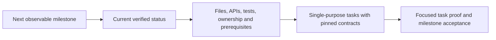

# Prompting proposal audit and corrected implementation plan

Date: 2026-11-04. Status: **analysis and revised plan; unimplemented**.
[Implementation issue: PROMPT-01](current-iter-issues.md#prompt-01) ·
[Earlier proposal, retained for history](agent-prompting-proposal-2026-11-04.md) ·
[Fix history](FIXES.md#fix-0177)

## Conclusion

Parts of the earlier proposal would break the current agent if implemented
literally. Others could undo protections added after observed failures. Its
milestone/status/work-organization/task-distribution structure is sound, and its
diagnosis of the recorded prompt and repair failures still holds. The proposal
went too far when it treated contract semantics and execution phases as removable
paperwork without specifying their replacement.

The corrected approach is to simplify what models read, remove redundant manual
work and improve repair input **while retaining current execution guarantees**.
Separate new task types and any phase/evidence optimization into explicit later
work. All proposed implementation remains agent-level. No OS change is needed for
the first stage, and no implementation or new live inference occurs in this audit.

This audit supersedes the earlier proposal's claims that source review may replace
required task checks, that reconciliation/assessment calls may simply be skipped,
that detailed local contracts can become optional, and that test-only support is
just a small task-shape change. It also narrows the receipt-reuse, read-subsetting
and repair-record recommendations as described below. The earlier prompt-family
matrix remains historical; apply the correction matrix in this document before
using it as an implementation guide.

## What went wrong in my proposal

1. I combined three different changes: clearer presentation, a new task model,
   and a different completion workflow. I described their combined implementation
   as a small prompt refactor.
2. I treated fewer checks as if it necessarily meant more successful delivery.
   That outcome is unmeasured. Removing a check can also accept broken work or
   make the current worker pause because its publication contract is unsatisfied.
3. I acknowledged historical protections but did not trace the consequences of
   removing them through worker state, receipts, publication and final acceptance.
4. I confused duplicate wording with duplicate semantics. A short prompt can still
   retain exact interfaces, ownership, check purpose and acceptance requirements.
5. I inferred that repeated same-tree checks could be removed without first
   establishing which executions were discretionary and which were required
   post-integration checks. I had not proven environment/phase interchangeability.
6. I described generic record access as sufficient evidence of a stable failed-
   response lookup API. Existing OS record names are not automatically portable
   public contracts. An agent-owned record of its own validator input is cleaner.
7. I gave examples of partial read fulfillment and relaxed schema handling without
   defining their accounting, reporting and plan-application behavior.

The latest user direction legitimately asks for simpler workflows and one-file or
one-test assignments. Earlier docs do not veto that request. The error was failing
to identify which changes preserve current semantics and which require an explicit
replacement design and evidence before the agent can honestly claim success.

## Compatibility findings against design, fixes and source

| Earlier recommendation | What the design/history establishes | Consequence if implemented literally | Corrected decision |
| --- | --- | --- | --- |
| Make local contract detail optional and rely on a concise purpose/target. | [FIX-0162](FIXES.md#fix-0162): all seven local assignments in a retained continuation stalled; small-behavior prose did not establish a usable boundary. Current local coding requires input/output shapes, symbols, ownership, effects/errors and one implementation file. | Missing or incompatible APIs can recur. Current `validate_local_tasks` rejects the proposed reduced assignment. | Retain the canonical contract; render it concisely, reuse existing API definitions and avoid asking the model to restate the same facts in several fields. |
| Use detailed shared contracts only where the manager considers them useful. | [Architecture validation](../src/polyinference/agent/architecture.py) pins shared interface versions, provider dependencies and pending-consumer updates. [FIX-0137](FIXES.md#fix-0137) preserves linked recovery contracts/resources when dependencies change. | Producers and consumers can disagree, or replacement plans can strand consumers or reset lineage. | Keep shared-boundary semantics and relevant validation. Reuse existing pinned interfaces; avoid inventing a new contract for an isolated helper. |
| Finish intermediate edits from source review without required checks. | [Worker publication](../src/polyinference/agent/worker.py) requires matching passed assigned checks; no required checks or missing evidence yields `uncertain`. [FIX-0086](FIXES.md#fix-0086) separates prerequisite, task and final acceptance authority. | More pauses/private candidates under current code; or false success if the guard is removed without a replacement. | Engineers retain implementation judgment. Keep configured task and final evidence requirements; select appropriate focused checks and reduce redundant manual executions. |
| Skip reconciliation/assessment when integration seems unchanged. | [User design review A03/A04](../design-docs/implementation/user-agent-review.json) and [worker design](../design-docs/langgraph-agent/README.md#42-coding-worker) require a post-merge engineering turn, checks and assessment. The design explicitly includes clean merges. | `publish()` raises `Missing mandatory phase turns`; deleting that guard would remove the semantic post-merge review and final-tree assessment. | Keep the required phases in the first implementation. Shorten the prompts and avoid repeated commands within them. Any future fast path is a separate agent protocol/publication change. |
| Reuse a passing receipt to eliminate later verification. | [FIX-0166](FIXES.md#fix-0166) exposes matching passing/failing receipts for diagnosis and private exception review; it explicitly does not replace reconciliation, assessment, publication or full-objective acceptance. | Evidence presentation can accidentally acquire authority it did not have. Same tree hash does not prove a prepared environment or an independent acceptance execution. | First reuse evidence as information. Only remove a physical check after proving the exact source, invocation, environment, workspace/phase and authority conditions permit it. Keep mandatory post-integration/final checks initially. |
| Drop the production-file requirement for test-only tasks. | `Assignment` requires nonempty `write_paths` and `checks`; local coding requires a local contract; the code-worker path culminates in a source commit and report. | A test-only result cannot just enter the existing successful coding-publication path. A dummy write target would misrepresent authority/purpose. | Define the test assignment, result/evidence and readiness semantics in a later agent-only stage. Reuse generic OS processes/tools without forcing a code commit. |
| Remove the separate eight-range cap and fulfill an allowed read prefix. | Current read schema, cumulative accounting, `read_context` and context bounds are separate implemented contracts. The recorded root failure was undisclosed limits, not proof that the eight-range cap itself is harmful. | Silent partial answers can be mistaken for complete inspection, while accounting or correction flow can diverge. | Keep current limits visible and unchanged in stage A. A later partial-read policy must report every fulfilled/deferred request and preserve cumulative budget and evidence coverage. |
| Tolerate harmless extra fields/normalize imperfect results. | Agent results and registered native schemas are pinned; OS action arguments use strict registered types. [FIX-0085](FIXES.md#fix-0085) preserves caller grammar through recovery. | A broad tolerance rule can hide a misspelled required field or be misapplied to a tool action. | Limit normalization to explicit, nonsemantic defaults in a new logical request. Never silently reinterpret authority, dependency, role, check, interface or completion fields. Preserve strict OS action validation. |
| Use model-visible artifact references instead of repeated data. | [FIX-0089](FIXES.md#fix-0089) made retained-source offers actionable because references in prose did not hand source to replacements. Current manager reads repository paths, not arbitrary artifact references. | The manager can again be told to inspect evidence it cannot retrieve. | Present essential content or implement bounded agent evidence retrieval through supported ports. Keep explicit source offers and `resume_from`; prose alone does not select source. |
| Capture repair input by reading retained runtime attempt records. | [FIX-0136](FIXES.md#fix-0136) supplies a registered agent repair callback. [RuntimePorts](../src/polyinference/ports.py) exposes generic records/artifacts, but no typed failed-output lookup method. | A new dependency on private runtime record layouts can make an apparently agent-only fix brittle across runtimes/versions. | Capture the rejected answer in the agent's validator wrapper, keyed to the payload/context and scope; the repair callback reads that agent-owned record. Application validation already has the rejected reply directly. |

The historical fixes establish rationale and regression coverage, not proof that
the current workflow converges reliably. In particular, FIX-0162's structural
contract tests did not qualify live local-model convergence. Preserve the required
semantics while improving their presentation; do not assume every historical
field, repetition or model hop is permanently optimal.

## The original run's causes still hold

These are narrower than the broad workflow changes I proposed:

1. **Undisclosed read limits.** The original manager requested eight ranges while
   the saved configuration allowed four. The prompt omitted the allowance; the
   response schema allowed eight. No read occurred. FIX-0175 now exposes limits and
   defaults fresh configurations to 16; an explicit old four-read value remains valid.
2. **Misleading field semantics.** `focused_check` was described alongside a
   behavior/pass condition and typed as a generic string. The Python validator
   required membership in `checks`. The model supplied sensible test descriptions
   in the wrong field. The membership requirement is useful; its explanation was
   deficient. This does not justify dropping the verification contract.
3. **Context regression during repair.** The physical repair removed optional
   `invalid-0/feedback`, omitted the rejected task proposal, and asked a tool-free
   manager to "use a small action." The next reply again requested eight ranges.
   The source and recorded context parts establish the loss and repeated response;
   their exact contribution to model choice cannot be measured from one trace.
4. **Environment handoff failure.** Setup created a usable local Node helper, but
   independent preparation still invoked unavailable plain `npm`. This is an agent
   setup/repository-policy problem. Prompt clarity alone will not make the helper's
   command reach that execution path.
5. **A genuine code failure was repaired normally.** The first TypeScript check
   exposed a conflicting `status` variable. The engineer fixed it. This supports
   keeping concrete tool feedback and giving the engineer room to repair code.

All 41 recorded native callbacks delivered observations successfully. This supports
keeping the existing OS broker while fixing agent inputs. Callback success does
not imply that the enclosed command or test passed.

## What remains sound

Keep the earlier P1 explicit invocation requests, P2 milestone/status/organization
sequence, P3 native/raw action agreement, P4 relevant evidence selection, and P5/P6
context-aware correction and active-fact retention. Correct their implementation
boundaries as specified here. Keep the goal of fewer unnecessary commands and
reviews, but do not equate accepting more replies with delivering more working code.

The corrected manager sequence remains:

### Organization the manager must supply

| Organization element | Retained semantics |
| --- | --- |
| File map | New/existing target files, each responsibility, existing APIs to reuse and the entry wiring that makes the milestone usable. |
| Shared interfaces | Signatures, data shapes, coordinate/units conventions, ownership, side effects/errors and necessary versioned references. Define once and pin consistently for providers/consumers. |
| Test work | Test file/scenario, fixtures/inputs, expected observable outcome, runner and environment. Separate writing one test file from executing a read-only test assignment. |
| Prerequisites | Exact dependency preparation command, shared runner owner, required source paths and dependencies that become available after acceptance. |
| Task distribution | One target file and bounded behavior per local edit; dependencies/read closure and the relevant canonical contract. Keep effective placement and the protected coupled cloud exception. |
| Verification | Appropriate prerequisite/task/final purpose, the chosen check identifiers and the behavior each is intended to establish. |
| Continuity | Existing accepted/pending work, retained-source offers, started immutable contracts and recovery accounts/deadlines. |

This does not require another planning agent or several mandatory model calls.
Use the current `goal`, assignments, interfaces and context machinery first. A
concise organization can be rendered in the goal/plan summary while exact task
boundaries remain in existing canonical contracts. If a durable separate file-map
field is needed, add one agent-owned field and persist it once; avoid independently
maintained summaries that can disagree with the assignments.

The latest user rule still controls: local writing assignments target one file,
including a test or documentation file. Necessary reads and proportionate self-
checks are allowed. The manager must not bundle a second write target into a local
edit or omit eventual integration merely to satisfy the file limit. Truly coupled
cloud work retains the supported exception and original resource limits.

## Corrected staged plan

### Stage A — Prompt and repair correction with current execution contracts

This is the first implementation scope. It is agent-level and deliberately keeps
the current worker graph, canonical local/shared contracts, read limits, report and
acceptance guards.

1. Render explicit Git/setup/development/reconciliation/assessment/manager/diagnosis
   requests. Keep the final host request after history and preserve roles/trust:
   [FIX-0023](FIXES.md#fix-0023) repaired a real provider failure caused by losing it.
2. Render the manager's milestone, status, work organization and resulting task
   instructions using the retained contract semantics above. Include actual check
   commands, purposes, source closure and acceptance-gated dependencies. Preserve
   the full user objective and scope meaning from [FIX-0025](FIXES.md#fix-0025).
3. Explain `focused_check` as the exact selected check ID; put expected behavior in
   `behavior`/criteria. Keep membership validation. Do not remove or change a schema
   field during a physical retry. A later concise model-facing verification view
   may compile to the same validated canonical fields in a new logical request.
4. Build correction input from the rejected answer, exact error, current assignment,
   allowed values and unresolved earlier constraints. Capture validator input in
   agent-owned records/artifacts through existing callbacks; application semantic
   validation already holds its reply. Match payload/context identity and scope.
   Keep this bounded so the existing synchronous repair window remains usable.
5. Preserve every existing required context pin and keep role/schema/grants,
   deadlines and retry allowances unchanged. Add relevant active feedback rather
   than replacing the original required packet with a repair-only message. Resolve
   old errors only when supported by a new valid result; preserve immutable history.
6. Use registered protocol schemas and native granted tools consistently. Remove
   duplicate agent protocol wording through agent registration/context assembly.
   Keep a textual contract for raw APIs, which do not currently send provider schema
   constraints. No raw API or broker rewrite is required for these changes.
7. Reduce discretionary repetition: tell engineers which checks the host will run
   next and present already available evidence. Avoid a routine manual rerun solely
   because the phase changed. Keep the required reconciliation turn, host check and
   final assessment. Keep independent final acceptance distinct.

Keep prompt output guidance feasible for the retained contracts: a soft 4096-byte
response recommendation is not a reason to omit required task fields or truncate
a plan. Prefer a smaller useful task batch within actual output limits. Conditional
recovery instructions can be omitted when irrelevant; include the actual eligible
source/placement offers and inherited-resource restrictions when recovery exists.

Stage A does not change success classification or task/report types. It can improve
clarity and remove redundant manual work without first changing publication policy.
It still requires fresh program/state pins for changed prompt/protocol fingerprints.

### Stage B — Support read-only testing/inspection as an actual agent task kind

Honor the user's one-test/one-inquiry assignment model through explicit agent
semantics, rather than pretending it is a successful code edit:

- Define required test/question inputs, tested revision, permissible tools, expected
  result and a concise evidence-bearing result record.
- Define how that result satisfies a dependency, reaches manager review and is
  distinguished from a code contribution. Do not mint a code commit or a successful
  coding report when no source was edited.
- Reuse existing generic OS processes, workspaces, tools, artifacts and records.
  Existing diagnosis is an example of an agent-defined read-only process. No new
  supervisor or OS task meaning is required.
- Respect the actual ABI: `checks.run` accepts a registered name, not an invented
  test selector. A focused command can use granted `shell.run`; its observed output
  is not automatically a configured final-acceptance receipt. Preserve purpose and
  provenance when reporting the result.
- Keep local code-edit contracts and the protected cloud placement mechanism.
  Treat task construction, dispatch, result collection and review as a coherent
  change, not just removal of `implementation_path` validation.

This is a separate bounded agent feature. Current code cannot honestly claim to
support it merely because the prompt describes a test-only assignment.

### Stage C — Evidence-backed reductions in mandatory work, only where justified

Identify a specific redundant execution before removing it. The first target is
discretionary model-requested rechecking, not mandatory publication checks.

For any later receipt-reuse optimization, state its validity predicate: repository,
effective content, exact command/definition, environment and dependency state,
execution context, relevant changes and the intended evidence authority. Preserve
failed/conflicting observations. Do not promote diagnostic/private-worker receipts
into independent completion authority. `matching_checks()` is an evidence selector,
not a general cache that authorizes skipping phases.

A reconciliation/assessment fast path needs an explicit replacement for semantic
post-merge inspection, final-tree assessment, mandatory turn records and publication
preconditions. The user review A03/A04 and current implementation require these.
Do not include such a fast path in the initial prompt cleanup or call it a harmless
optimization. If later evidence supports a smaller engineering pass preserving
those guarantees, document and verify that protocol change separately. Never mint
synthetic phase-turn references merely to satisfy the old report validator.

Likewise, partial evidence fulfillment requires explicit per-request outcomes,
exact coverage and cumulative accounting. Do not silently clip reads or suggest
that requested but unreturned evidence was inspected. Retain the existing proposal
cap and cumulative allowance initially; the original failure is addressed by clear
limits and context-aware repair.

Stage C is a candidate optimization, not a prerequisite for Stage A or B. Success
rate improvement remains a hypothesis until a fresh workflow demonstrates useful
completion with fewer avoidable pauses and no false claims.

## Correction matrix for the earlier prompt-family chart

| Family or cross-cutting point | Keep | Corrected boundary |
| --- | --- | --- |
| Git and all phase transitions | Explicit current decision/request. | Keep a final host/user request after history and actual selected-mode rules. |
| Setup | Runnable prerequisites, organization and environment handoff. | Retain meaningful purpose-specific checks, source/output declarations and setup-only selection authority. |
| Local edit | One file and one bounded behavior. | Retain canonical API/ownership/effect/error/check semantics; compact their presentation. |
| Test/inspection | One coherent scenario or question. | Stage B must define its own honest result path; no dummy edit or code-publication shortcut. |
| Reconciliation | Focus on incoming changes and compatibility. | Required engineering turn remains even for a clean merge in Stage A. |
| Assessment | Evaluate the exact current tree. | Required assessment and evidence/report conditions remain; previous narration alone is insufficient. |
| Manager initial/review | Milestone → status → organization → distribution → verification. | Preserve typed interfaces, check closure/owners, pending work, accepted dependencies and protected placement. |
| Manager completion | Full requirement assessment and useful behavior. | Keep source-backed final criteria, current independent checks, unresolved-work/steering guards and reviewed-head matching. |
| Diagnosis and cloud takeover | Relevant frozen evidence and changed approach. | Matching evidence informs repair; it does not create acceptance authority or reset inherited resources. |
| Validation repair | Rejected answer, exact error, active constraints. | Append within the existing repair contract; do not swap pinned input, phase/schema or authority. |
| Output recovery/native continuation | Smaller complete output or settled continuation. | Preserve caller grammar, completed effects, uncertainty handling and physical retry bounds. |
| Progress and memory | Current unresolved facts and useful next step. | Preserve source/generation validity and resolved-error retirement; do not revive obsolete warnings. |
| Compaction/probe | Minimal purpose-specific request. | Retain provenance, required inputs, original bounds and correct transport format. |
| P7 fewer checks | Reduce unnecessary manual reruns and duplicate reading/narration. | Do not remove required proof or bypass a failed check to raise apparent completion. |

## OS boundary and necessity

Stage A and the intended Stage B use existing OS interfaces. Agent-owned schemas,
protocol registration, task/result interpretation, records and verification policy
remain in the agent. OS argument validation, grants, source preconditions, replay,
certainty, budget and immutable-context protections remain intact.

The earlier deferred list still applies: generic broker schema changes, raw provider
structured-output support and exact physical-wire export hooks would be OS/adapter
work. None is justified as a prerequisite by this run. Do not add them to PROMPT-01
without identifying a specific missing public operation and why existing ports
cannot provide it. Generic record access alone is not a promise about private OS
record layouts; the agent-owned validator-output capture avoids that dependency.

## Small verification plan and actual evidence from this audit

For implementation, reuse existing tests protecting single-file contracts, shared
interfaces/dependencies, authority, mandatory phases, retry pins and source-backed
acceptance. Add focused cases for the changed boundary only:

1. A clear normal manager plan preserves the milestone organization and canonical
   local/shared contracts and can be dispatched.
2. Explicit four-read and default sixteen-read inputs explain actual limits; the
   recorded focused-check error receives the rejected answer and active feedback.
3. Correction preserves required pins, scope, deadlines, role/schema and retry
   counts; a resolved error leaves the active view without rewriting history.
4. Native/raw instructions match actual actions and final response protocols;
   final host-message ordering remains valid.
5. Stage B separately demonstrates a test-only result without a source commit,
   fabricated check authority, or weakened code-edit completion.

No new critic chain or exhaustive prompt-scoring framework is proposed. A short
fresh live workflow, when separately authorized, should measure useful completion,
avoidable stops, actual commands/model calls and prompt size. Keep fixture evidence
and live convergence separate.

This audit ran three in-memory compatibility probes against the current classes:
an otherwise valid one-file edit without `local_contract` is rejected; an assignment
with empty `write_paths` is rejected; and an assignment with empty `checks` is
rejected. These are expected results showing incompatibility, not implementation
regression failures. The current schema allows eight reads per proposal, and the
historical run still validates with its explicit four-read allowance.

The code path also directly confirms that publication refuses missing phase turns
and downgrades absent/failed required evidence. No production workflow, new model
call, old-run Resume or implementation change was performed. Documentation and
preservation checks are recorded in FIX-0177; claimed future performance remains
unverified.
