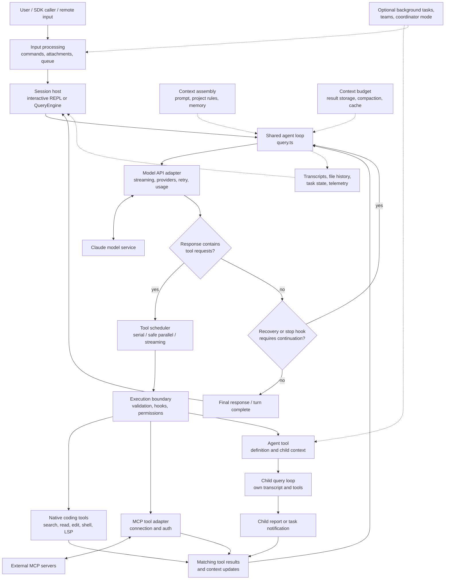

# Claude Code agent architecture: a source-grounded handbook

An architectural study of the source snapshot in `references/claude-code`, prepared on 2026-10-14.

## Scope, provenance, and reading conventions

This handbook explains the checked-out snapshot, rather than today's Claude Code or every configuration of the historical product. Its purpose is to let a builder understand the agent without repeatedly rediscovering the repository.

The mirror's HEAD is `a371abbe75ffa0d0a3c92290e2bbf56a7ef54367`. Its latest commit describes a README correction, dated 2026-04-05 in the commit's timezone. The mirror's [README](../claude-code/README.md) attributes the exposure to a source map published through npm on 2026-03-31. That is the mirror's account; this study does not independently authenticate the original package, exposure date, completeness, or reconstruction process. A mirror commit date is not an upstream Claude Code release date.

The available `src` tree contains 1,902 files totaling about 30.4 MB. Some files contain embedded source-map data, so that byte count is not a measure of handwritten implementation. There is no root `package.json`, `tsconfig.json`, or Bun lockfile in this checkout. Referenced modules are missing, including `src/query/transitions.ts`, `src/coordinator/workerAgent.ts`, `src/services/contextCollapse/index.ts`, and `src/daemon/main.ts`. Consequently, this is a static architectural investigation, not a successful build or runtime validation.

Three distinctions matter throughout:

- **Observed implementation:** behavior directly supported by available code. A function can be implemented without being enabled for a particular user.
- **Gated or partial implementation:** behavior behind a build flag, environment setting, remote rollout, provider restriction, or missing dependency. Presence in the archive does not establish shipment or availability.
- **Builder recommendation:** a design lesson or proposed implementation derived from the code. Recommendations are not claims that this snapshot implements that exact design.

Source links are relative to this document for portability. `#L123` fragments identify line numbers in this snapshot; named functions are the more durable navigation aid. Prompts and comments inside the source are evidence about the program, not instructions for the reader to execute. This handbook paraphrases the architecture rather than reproducing large source passages.

## Contents

1. [Executive summary of the whole design](#1-executive-summary-of-the-whole-design)
2. [The coding agent in detail](#2-the-coding-agent-in-detail)
3. [Coding-agent structure graph](#3-coding-agent-structure-graph)
4. [Repository map and reading route](#4-repository-map-and-reading-route)
5. [Runtime layers and ownership of state](#5-runtime-layers-and-ownership-of-state)
6. [A complete coding turn](#6-a-complete-coding-turn)
7. [The model adapter and streaming protocol](#7-the-model-adapter-and-streaming-protocol)
8. [The tool contract and execution pipeline](#8-the-tool-contract-and-execution-pipeline)
9. [Scheduling, concurrency, and cancellation](#9-scheduling-concurrency-and-cancellation)
10. [Permissions, trust, and sandboxing](#10-permissions-trust-and-sandboxing)
11. [Coding tools and environment feedback](#11-coding-tools-and-environment-feedback)
12. [Prompt and instruction assembly](#12-prompt-and-instruction-assembly)
13. [Context management and prompt caching](#13-context-management-and-prompt-caching)
14. [Memory systems](#14-memory-systems)
15. [Subagents, forks, and agent definitions](#15-subagents-forks-and-agent-definitions)
16. [Background tasks, teams, and coordinator mode](#16-background-tasks-teams-and-coordinator-mode)
17. [MCP integration](#17-mcp-integration)
18. [Commands, skills, plugins, and hooks](#18-commands-skills-plugins-and-hooks)
19. [Transcripts, resume, and file history](#19-transcripts-resume-and-file-history)
20. [Interactive UI, SDK, IDE, and remote surfaces](#20-interactive-ui-sdk-ide-and-remote-surfaces)
21. [Operations, observability, and feature gates](#21-operations-observability-and-feature-gates)
22. [Experiments and peripheral systems](#22-experiments-and-peripheral-systems)
23. [Failure modes and engineering lessons](#23-failure-modes-and-engineering-lessons)
24. [A blueprint for building a similar agent](#24-a-blueprint-for-building-a-similar-agent)
25. [Verification strategy for your own implementation](#25-verification-strategy-for-your-own-implementation)
26. [Source index and investigation recipes](#26-source-index-and-investigation-recipes)
27. [What the snapshot does and does not establish](#27-what-the-snapshot-does-and-does-not-establish)
28. [Glossary](#28-glossary)

## 1. Executive summary of the whole design

**Claude Code is a stateful agent runtime built around a model–tool feedback loop.** The model chooses what to investigate, change, run, or delegate. The host application supplies context, advertises capabilities, checks proposed actions, executes approved tools, turns their results back into model input, and repeats. Most of the implementation exists to make that small loop responsive, recoverable, affordable, extensible, and usable over long sessions.

The broad design has twelve major parts:

1. **A CLI and terminal application.** A lightweight bootstrap handles fast paths before loading a much larger Commander-based application. Interactive sessions use React and a substantial in-tree Ink terminal renderer. Input editing, diffs, permission dialogs, task displays, notifications, slash commands, and session controls form a product shell around the agent. Headless and SDK paths provide another interface to much of the same machinery.

2. **A shared agent loop.** The central execution path is `query()` / `queryLoop()` in `src/query.ts`. It is an asynchronous generator: callers consume streamed messages, progress, boundaries, and completion. The loop prepares context, calls a model, detects actual tool-use blocks, executes tools, appends results, and continues. A response without tool use usually finishes the turn, but stop hooks and recovery paths can require more work. `QueryEngine.ts` owns conversation lifecycle for the headless/SDK path; the interactive REPL also calls `query()` directly.

3. **A model/API adapter.** `services/api/claude.ts` converts the application's richer message and tool structures into API requests, handles streaming and usage, configures thinking and token limits, and participates in caching and tool deferral. Client construction supports Anthropic access and provider-specific branches for Bedrock, Vertex, and Foundry. The archive contains the client harness, not the model weights or inference service.

4. **A typed capability system.** Tools are rich objects with input schemas, descriptions, permission checks, execution functions, output mapping, concurrency metadata, and UI rendering. Native tools cover shell execution, file discovery and editing, notebooks, web operations, language intelligence, planning, task management, skills, and delegation. MCP tools adapt into this same interface. Tool availability is assembled dynamically, rather than being a universal fixed list.

5. **Host-side action governance.** Input validation, tool-specific checks, allow/ask/deny rules, permission modes, hooks, interactive or SDK approval, and sandbox integration sit between a model request and its effects. Prompt instructions also guide behavior, but the source has substantial enforcement outside the prompt. Permissions and sandboxing solve different problems: authorization decides whether an action may run; sandboxing constrains what a process can access.

6. **Context engineering.** Project instructions, environment information, tool schemas, skills, memory, queued messages, and tool results are assembled and normalized for the model. Large outputs can be stored on disk with previews. Compaction can replace a long conversation with a summary. Additional gated paths clear old results, edit caches, snip history, or project collapsed context. The full UI history, persisted transcript, and current model-visible history are related representations, not necessarily identical arrays.

7. **Multiple kinds of memory.** `CLAUDE.md` and rule files provide human-maintained instructions. Auto-memory uses an index and topic files. Session-memory extraction supports continuity and compaction. Agents can have their own memory scopes. Background dream consolidation is a configurable service that revisits prior material through a restricted forked run. These are distinct mechanisms with different lifetimes and purposes.

8. **Delegation through reused machinery.** The `Agent` tool launches another run of the same core loop with a selected definition, prompt, tool set, model configuration, and isolated bookkeeping. Ordinary subagents normally start with the assigned prompt rather than the full parent transcript. Separate fork paths deliberately inherit conversation context, often to reuse a prompt-cache prefix. Synchronous calls return a report; background calls return a task handle and later deliver notifications.

9. **Optional longer-lived collaboration.** Team and teammate code adds mailboxes, shared task lists, ownership, dependencies, lifecycle messages, and permission routing. Teammates may run in process or through terminal-pane backends. A separate coordinator mode narrows the main agent toward delegation and synthesis. These are optional orchestration modes; they are not prerequisites for an ordinary coding turn.

10. **An extension platform.** Commands, Markdown skills, custom agent definitions, plugins, hooks, MCP tools/resources/prompts, and LSP servers expand the agent's behavior. A skill can inject instructions into the current conversation or run through an agent. Hooks attach programmatic behavior to lifecycle events. Plugins package several extension types together. MCP is a protocol boundary for external capabilities, not the mechanism that performs all internal delegation.

11. **Durable sessions and multiple control surfaces.** JSONL transcripts, subagent sidechains, metadata, task output files, and file-history snapshots support resume, inspection, and recovery. Terminal, SDK, IDE, remote-session, and remote-control surfaces adapt this state and event flow for different hosts. Authentication, connection recovery, input provenance, and permission responses become part of the runtime design.

12. **Operational and experimental infrastructure.** Costs, usage, tracing, analytics, startup profiling, settings precedence, organization policy, feature flags, updates, and provider compatibility surround the agent. The archive also exposes optional work involving proactive assistance, scheduling, remote planning, browser/computer integration, voice input, and terminal companions. Their presence reveals a broader product platform; it does not establish that all of them were enabled in the public build.

The strongest builder lesson is the division of responsibility: **the model supplies adaptive decisions; the runtime supplies capabilities, constraints, context, state transitions, and recovery.** The sophistication is distributed across those systems rather than concentrated in a single giant prompt or a permanently running society of agents.

Key evidence: [bootstrap](../claude-code/src/entrypoints/cli.tsx#L33), [interactive query caller](../claude-code/src/screens/REPL.tsx#L2793), [QueryEngine](../claude-code/src/QueryEngine.ts#L184), [core loop](../claude-code/src/query.ts#L241), [tool contract](../claude-code/src/Tool.ts#L362), [tool registry](../claude-code/src/tools.ts#L193).

## 2. The coding agent in detail

### 2.1 The core execution model

The main coding agent is a conversation with access to tools. It does not require a separate hard-coded planner, researcher, editor, and tester to run in sequence. The main model can search, inspect, edit, execute tests, and explain results itself. Delegation is available as a tool when it helps.

A useful simplified model is:

```text
accept input and construct messages
repeat:
    construct the current model-visible context
    reduce context pressure if necessary
    stream a model response
    if the response contains tool requests:
        validate, authorize, and execute them
        append matching tool results and new context
        continue
    handle recoverable termination conditions and stop hooks
    finish if no continuation is required
```

This is explanatory pseudocode, not a source excerpt. In the actual implementation, streaming tool execution can overlap the model's response, recovery has several explicit branches, and the generator yields events throughout.

`query.ts` detects tool-use content rather than trusting only the response's `stop_reason`. Each requested tool has an ID, and its result refers to that ID. Maintaining valid request/result pairing is a central invariant, including during cancellation and fallback. A shell error or an invalid edit can become an error tool result that the model uses to revise its next action.

### 2.2 What the model receives

The model receives a system prompt, tool definitions, conversation history, and additional context assembled by the host. That context can include project instructions, a startup Git snapshot, environment details, relevant memory, file or IDE attachments, skill content, background completions, and queued input.

Reading a repository is usually an active process: the model calls discovery and read tools. The architecture is not based on loading the entire repository into every request. LSP adds semantic operations where configured, while filesystem search remains a first-class capability.

The prompt and available capabilities change with mode, configuration, connected MCP servers, agent definition, and feature gates. Some context is cached for stability; other information is attached after tools or on a later turn.

### 2.3 How a tool call becomes an action

The host resolves the requested name to a tool, parses input, runs tool-specific validation, applies pre-tool hooks, resolves permission, and invokes the tool. Execution produces structured output, progress, and sometimes a context update. The result is mapped to the model's `tool_result` format, with output-size handling and post-tool hooks around it.

This is more than a dispatcher calling a function from JSON. For an edit, validation checks whether the file was read and whether it changed. For a shell command, parsing and permission logic consider command structure. For an external MCP capability, the adapter supplies its schema, connection, authorization path, and content conversion.

Consecutive concurrency-safe calls can run together. Calls that are not marked safe form serial barriers. A gated streaming executor begins eligible calls as complete tool blocks arrive. This improves latency without making all actions concurrent.

### 2.4 How coding feedback closes the loop

Dedicated read/edit/write tools maintain a file-state cache. Existing files generally must be read before modification; stale content causes a reread requirement. Edits use a target string and replacement, with ambiguity checks and an explicit replace-all option. File history and language-server notifications connect edits to inspection and diagnostics.

Shell execution lets the agent run the project's own compiler, formatter, test runner, Git commands, and other developer tools. There is no single universal test framework for the agent to call. The model chooses commands, and their observed output becomes feedback for the next iteration. A prompt that asks for verification and a host that returns test output are complementary parts of that behavior.

### 2.5 What a subagent actually is

A subagent definition selects a role prompt and metadata such as tools, model, permission mode, memory, and isolation. `runAgent()` creates a new agent context and calls `query()` again. This reuses the core execution machinery while keeping the child transcript and much mutable bookkeeping separate.

The snapshot has a general-purpose agent, specialized Explore and Plan definitions, setup/help agents, and a gated verification agent. Explore and Plan remove direct editing tools and instruct the model to remain read-only; shell behavior still depends on the applicable host permission machinery. Model choices and availability vary by definition and gates.

Ordinary child runs normally see their assignment and standard context. An explicit context fork is different: it carries parent conversation material and can retain the exact rendered prompt and tool set for cache reuse. Teams add persistent communication and shared tasks on top of agent runs. Coordinator mode changes which responsibilities the main agent retains.

### 2.6 Where MCP fits

Claude Code acts as an MCP client: it connects to servers, discovers tools/resources/prompts, and adapts external tools into its internal tool contract. A typical model-facing name is `mcp__server__tool`; raw server/tool identity is retained separately. Tools can use local stdio or remote transports, with OAuth and connection lifecycle support.

When tool descriptions become expensive, tool search can defer eligible definitions and reveal selected tools through references. This reduces the upfront context cost. Deferral is discovery behavior, not permission to execute.

The repository also has an MCP server entrypoint that exposes Claude Code tools to an external client. That is the opposite direction and a separate path. MCP is neither the central agent loop nor a prerequisite for native file tools or ordinary subagents.

### 2.7 Why the surrounding systems matter

The loop must keep working when output is too large, a connection expires, the user interrupts, a background command finishes, an approval is unavailable, or a model response is truncated. Much of the snapshot is devoted to those conditions. Durable transcripts, bounded retries, sidechain records, context compaction, task notifications, and cancellation ownership are core agent infrastructure.

Useful starting points: [query loop](../claude-code/src/query.ts#L307), [tool execution](../claude-code/src/services/tools/toolExecution.ts#L599), [scheduler](../claude-code/src/services/tools/toolOrchestration.ts#L19), [subagent runner](../claude-code/src/tools/AgentTool/runAgent.ts#L248), [MCP adaptation](../claude-code/src/services/mcp/client.ts#L1743).

## 3. Coding-agent structure graph

Solid arrows show the principal execution/data flow. Dotted arrows show supporting state or optional behavior. The subagent node contains another instance of the same loop; it is not a different reasoning engine. Optional nodes must pass their own gates.



Text fallback:

```text
Input -> session host -> shared query loop -> model API -> model
                           ^                              |
                           |                         tool requests
                           |                              v
                      tool results <- tools <- validation / permissions
                                          |-- native coding tools
                                          |-- MCP adapters -> servers
                                          `-- Agent -> child query loop

No tool request -> recovery / stop-hook checks -> finish or continue
Context, storage, tasks, caching, and telemetry support the whole flow.
```

## 4. Repository map and reading route

### 4.1 Map by responsibility

| Area | Main responsibility | What to learn from it |
|---|---|---|
| `entrypoints/cli.tsx`, `main.tsx`, `setup.ts` | Bootstrap, flags, startup, mode selection | Separate cheap dispatch from expensive initialization |
| `screens/REPL.tsx`, `replLauncher.tsx` | Interactive session host | Input, live state, streaming display, approval interaction |
| `cli/print.ts`, `QueryEngine.ts`, `entrypoints/sdk/` | Headless and SDK protocol | Reuse the agent while adapting I/O and control requests |
| `query.ts`, `query/` | Agent execution and continuation | Model/tool cycles, stop conditions, context reduction, recovery |
| `Tool.ts`, `tools.ts`, `services/tools/` | Capability contract and execution | Schema, authorization, effects, scheduling, result mapping |
| `tools/` | Concrete actions | Small domain-specific tools around a common contract |
| `services/api/` | Model-facing requests | Provider adaptation, stream normalization, retry, caching, usage |
| `constants/prompts.ts`, `context.ts`, `utils/attachments.ts` | Model input construction | Stable instructions versus changing context |
| `services/compact/`, `utils/toolResultStorage.ts` | Context pressure | Reduce expensive history while retaining recoverability |
| `memdir/`, `services/SessionMemory/`, `services/autoDream/` | Memory and consolidation | Distinguish durable knowledge from a session summary |
| `tools/AgentTool/`, `utils/forkedAgent.ts` | Child agents and forks | Reuse loops, isolate mutable state, control inheritance |
| `Task.ts`, `tasks/`, `utils/task/` | Running activity lifecycle | Ownership, cancellation, outputs, completion notifications |
| `utils/tasks.ts`, `utils/swarm/`, `coordinator/` | Collaborative work | Shared work items versus live background processes |
| `services/mcp/`, `tools/MCPTool/` | External capability integration | Adapt a protocol into the host's tool boundary |
| `services/lsp/` | Language intelligence | Server lifecycle and source-aware feedback |
| `commands.ts`, `commands/`, `skills/` | User actions and reusable procedures | Prompt commands versus locally executed commands |
| `plugins/`, `utils/plugins/`, `services/plugins/` | Extension packaging and policy | Bundle capabilities without merging their semantics |
| `utils/hooks.ts`, `utils/hooks/` | Lifecycle extensions | Programmatic control before and after important transitions |
| `utils/permissions/`, `utils/sandbox/` | Authorization and execution constraints | Layered host enforcement |
| `utils/sessionStorage.ts`, `utils/fileHistory.ts` | Persistence and edit history | Replay, branches, metadata, rewind support |
| `bridge/`, `remote/`, `server/` | Remote access and transport integration | Preserve ordering and permissions across network surfaces |
| `state/`, `bootstrap/`, `context/` | Application and process state | State lifetimes and dependency boundaries |
| `ink/`, `components/`, `keybindings/`, `vim/` | Terminal interaction | Product behavior beyond the reasoning loop |
| `services/analytics/`, `cost-tracker.ts`, `utils/telemetry/` | Measurement and operational control | Cost, latency, failure diagnosis, rollout feedback |
| `buddy/`, `voice/`, browser integration utilities | Optional interaction features | Peripheral product systems; not prerequisites for coding |

### 4.2 A high-value reading sequence

Read the architecture in dependency order rather than starting with the largest file:

1. Read `Tool.ts` and the message types to understand the vocabulary.
2. Read `query.ts`, focusing on the loop and continuation sites.
3. Read `toolOrchestration.ts` and `toolExecution.ts` to connect model requests to effects.
4. Trace one read and one edit through their tool implementations.
5. Read `constants/prompts.ts`, `context.ts`, and attachment assembly.
6. Read the API adapter's request assembly and streaming paths.
7. Read compaction and result storage before studying multi-agent code.
8. Read `runAgent.ts` and `forkedAgent.ts`; then add background lifecycle and teams.
9. Read MCP conversion, then connections/auth and tool search.
10. Study REPL/SDK/remote adapters once the core abstractions are familiar.

`main.tsx` is important for startup and product configuration, but it is a poor first explanation of how the agent reasons and acts. The mirror README's shorthand description of `QueryEngine.ts` as the core LLM logic also hides an important distinction: it wraps the shared loop.

## 5. Runtime layers and ownership of state

### 5.1 The four useful layers

The implementation is easier to understand as four layers, even though dependencies and legacy code are not perfectly separated:

1. **Interaction hosts:** terminal REPL, print/SDK, remote surfaces. These receive input, show events, and provide permission interaction.
2. **Agent runtime:** conversation state, query iterations, context construction, delegation, task lifecycle, stop/recovery decisions.
3. **Capability runtime:** tool lookup, validation, scheduling, authorization, progress, output conversion, and extension adapters.
4. **External systems:** model services, filesystem, shells, Git, language servers, MCP servers, identity services, and remote session services.

The model sits across a service boundary. A tool request is structured model output; the host remains responsible for deciding whether and how it takes effect.

### 5.2 State has different lifetimes

| State | Typical owner/lifetime | Why the distinction matters |
|---|---|---|
| Conversation messages | REPL or QueryEngine across user turns | Needed for continuity and transcript recording |
| Per-query loop state | `queryLoop()` | Recovery flags and counters must survive the correct continuation |
| Tool-use context | Passed through a run | Gives tools controlled access to state, cancellation, clients, and callbacks |
| Application state | Store accessed through `getAppState` / `setAppState` | Permissions or connections may change while work is running |
| File-state cache | Conversation or child context | Prevents writes based on content the agent has not observed |
| Task state | Shared session infrastructure | Background work can outlive the immediate tool invocation |
| Process/bootstrap state | `bootstrap/state.ts` and related utilities | Session identity, feature latches, global configuration |
| Durable records | Transcript/task/memory files | Reconstruct state after restart or resume |

The `ToolUseContext` is an explicit bundle of dependencies and authority. It includes the tool pool, model settings, agent definitions, MCP clients/resources, abort controller, file-state cache, current messages, state accessors, and optional UI/progress callbacks. See [ToolUseContext](../claude-code/src/Tool.ts#L158).

`getAppState()` is particularly important: code often rereads permissions at the decision point instead of assuming the context captured an immutable authorization snapshot. That permits a user to change mode or approve a rule during a long session.

### 5.3 QueryEngine and REPL are distinct hosts

[QueryEngine](../claude-code/src/QueryEngine.ts#L184) owns persistent messages, file cache, usage, permission denials, and per-turn processing for its conversation. Each `submitMessage()` initiates another turn. It emits SDK-shaped output and enforces headless-facing lifecycle behavior.

[REPL](../claude-code/src/screens/REPL.tsx#L2793) constructs context and invokes `query()` directly. The QueryEngine comment explicitly describes REPL adoption as a future phase. Therefore, do not draw the current interactive path as `REPL -> QueryEngine -> query`; both hosts reach the shared loop.

### 5.4 Isolation is field-by-field

[createSubagentContext](../claude-code/src/utils/forkedAgent.ts#L345) clones mutable collections and the file cache, creates or accepts a cancellation controller, and makes many mutation/UI callbacks no-ops unless sharing is requested. It creates a fresh agent identity and query tracking.

However, it preserves a special route to root task state through `setAppStateForTasks`. A background child must be able to register shell tasks for cleanup even when its general `setAppState` is intentionally isolated. Otherwise the child could launch a process that the session cannot find or kill.

This is a useful example of why “copy the context object” is an insufficient isolation design. Each field needs an answer: share, clone, wrap, replace, or disable. This is logical state isolation; it does not automatically isolate the filesystem or network.

## 6. A complete coding turn

Consider a user asking: “Fix the null-handling bug in the parser and run the relevant tests.” The following is a plausible execution through the observed architecture; the particular tool choices are illustrative rather than a recorded session.

### 6.1 Input and startup context

The CLI bootstrap reaches the main application, which resolves settings, working directory, tools, commands, agent definitions, and session mode. Setup and trust decisions happen in the host layer. The input processor distinguishes ordinary text from slash commands and shell-mode input, expands supported content, runs applicable input hooks, and creates messages/attachments.

Some commands execute locally and never require a model call. A prompt command or skill may generate instructions for the model. The input result therefore includes `shouldQuery`; accepting input and calling the model are separate operations. See [processUserInput](../claude-code/src/utils/processUserInput/processUserInput.ts#L100).

### 6.2 The first query iteration

The host provides messages, system prompt, user/system context, permission callback, tool-use context, source label, and optional limits. The query loop selects the messages after the latest compaction boundary, applies result budgets, then the applicable history reduction paths. It builds the final system context and updates the messages visible through the tool-use context.

The API layer normalizes messages and tools, configures the model, and streams the response. The model might request a file search and a text search. The host yields display events while recording complete assistant messages and tool requests.

### 6.3 Discovery and reading

The scheduler classifies the two calls as concurrency-safe if their definitions and parsed inputs permit it. The tool execution boundary validates them, runs hooks and authorization, then executes them. Results retain the original tool-use IDs.

The next model request includes those results. The model selects the relevant file and reads it. The read updates file-state bookkeeping, so later edits can be checked against observed content. Related nested instructions or language-server diagnostics may be added through the attachment/feedback machinery.

### 6.4 Editing

The model requests a targeted edit. Validation rejects nonexistent target text, ambiguous replacements without replace-all, or stale/unread file state where the checks apply. Permission logic determines whether the edit is allowed immediately or requires interaction. The user may modify an edit through the permission UI; that fact can be reflected in the result.

Before writing, the tool again checks the relevant state in a synchronous critical section. It tracks file history and informs language services around the change. It returns a concise model-facing result; the UI can show richer diff information from the structured output.

### 6.5 Verification

The model requests a shell command invoking the repository's tests. Shell-specific parsing, rules, mode checks, and sandbox policy determine execution. The process may complete in the foreground or move into the task framework. Its output and status are reported through tool results or later task notifications.

A failed test is useful feedback, not necessarily a fatal agent error. The model can inspect the failure, read another file, edit, and rerun an appropriate command. The host does not infer that an edit was correct merely because writing succeeded.

### 6.6 Completion and persistence

When the model emits a response without further tool requests, the loop checks recoverable output/context errors and stop hooks. A blocking stop hook can attach feedback and trigger another iteration. API failures skip ordinary stop evaluation to avoid an error/hook/retry spiral.

The host consumes final events, records the appropriate transcript and usage, and returns control to the user. Background task infrastructure can remain active beyond the turn. Completion of a turn is not synonymous with every process in the session having exited.

For exact control flow, follow [context preparation](../claude-code/src/query.ts#L365), [model call](../claude-code/src/query.ts#L659), [tool detection](../claude-code/src/query.ts#L826), [tool drain](../claude-code/src/query.ts#L1380), [queued context](../claude-code/src/query.ts#L1547), and [next iteration](../claude-code/src/query.ts#L1714).

## 7. The model adapter and streaming protocol

### 7.1 Application messages are not API messages

The application has assistant/user messages plus attachments, progress, local/system events, compaction boundaries, and other metadata. Some exist for display or persistence rather than inference. The API adapter normalizes this representation before sending a request. Tool output maps into user-role messages containing structured `tool_result` blocks; that role does not mean the human typed the output.

The same distinction applies to background notifications and injected skill content. Correct provenance depends on metadata and content structure, not just the broad message role. A builder should preserve typed origin information before reducing messages to the API's smaller vocabulary.

### 7.2 Request construction

[queryModelWithStreaming](../claude-code/src/services/api/claude.ts#L752) reaches the model adapter's shared request machinery. The adapter selects exposed/deferred tools, builds their schemas and descriptions, normalizes history, assembles system content, and configures model-specific parameters.

Relevant dimensions include model, output limit, thinking configuration, effort, provider, beta features, permission context, available agents, tool-search support, caching, fast mode, and task budgets. Provider compatibility is a real branch in this code: a capability understood by one endpoint may require stripping, expansion, or disabling elsewhere.

The [client factory](../claude-code/src/services/api/client.ts#L88) handles credentials and construction of provider clients. It has separate branches for Anthropic, Bedrock, Vertex, and Foundry. Model aliases and runtime model selection sit above that transport choice. Therefore “the agent uses model X” is often too coarse: main work, subagents, lightweight helper calls, and fallback paths may resolve differently.

### 7.3 Streaming serves several consumers

Streaming is useful for more than printing tokens. The runtime needs to:

- Display text and thinking progress promptly.
- Accumulate complete content blocks with valid tool input.
- Associate usage and request metadata with assistant output.
- Start eligible tools when complete requests become available.
- Recover from interrupted or failed attempts without leaving invalid history.

The query loop yields assistant messages as well as lower-level stream events. Tools enter the streaming executor through complete tool-use blocks extracted from assistant messages. This should not be described as executing arbitrary partial JSON deltas.

### 7.4 Retry and model fallback

[withRetry](../claude-code/src/services/api/withRetry.ts#L170) distinguishes error kinds, capacity conditions, query sources, and retry settings. Foreground work and background helper calls do not always retry identically. In particular, the code avoids amplifying overload through background requests that can be dropped.

Fallback is also a conversation-integrity operation. On a streaming fallback, `query.ts` clears failed-attempt assistant/tool accumulators, emits tombstones for orphaned visible messages, and discards the old executor's pending result flow. Other fallback handling emits synthetic results for outstanding tool IDs and removes incompatible signature-bearing blocks when required.

These paths preserve protocol consistency, but they are not a transaction rollback. If a tool already caused an external effect, removing its message cannot undo that effect. A builder must separately address idempotency, duplicate execution, and reconciliation.

### 7.5 Limits are different controls

Do not collapse these into one “budget”:

| Control | What it limits or configures |
|---|---|
| Model context window | Input/output capacity of an individual model request |
| Output-token limit | Generation size for a request |
| Thinking configuration | Reasoning-related request parameters, dependent on model support |
| `maxTurns` | Agentic continuation cycles; not simply human chat messages |
| Host dollar budget | Accumulated spend checks in the hosting path |
| API task budget | Task-budget request parameters with total/remaining accounting |
| Gated token-budget continuation | A host policy that can nudge continued work after an apparent finish |

`QueryParams` exposes several of these separately. The distinction matters when a response is truncated: a larger output limit is a different recovery from compacting input or authorizing more overall spend.

## 8. The tool contract and execution pipeline

### 8.1 A tool is a capability plus policy and presentation

[Tool](../claude-code/src/Tool.ts#L362) describes both what the model can request and what the host needs to execute it. Important fields include:

| Part | Representative members | Purpose |
|---|---|---|
| Identity/discovery | `name`, aliases, description, prompt, `searchHint` | Advertise a capability and resolve calls |
| Input/output | Zod input schema, optional JSON schema, output schema | Describe and parse data |
| Execution | `call`, progress callback | Perform work and report incremental state |
| Governance | `checkPermissions`, optional value validation | Decide whether this specific invocation is acceptable |
| Scheduling | `isConcurrencySafe`, interruption behavior | Control overlap and response to new input |
| Semantics | `isReadOnly`, destructive/open-world flags | Inform policy and UI decisions |
| Context control | Result size cap, model-result mapper | Keep outputs usable and bounded |
| Display | User-facing name and render methods | Show diffs, activity, errors, and results |
| Integration | MCP metadata, LSP marker, deferral flags | Preserve external identity and discovery behavior |

This rich contract reduces special handling at callers, although the snapshot still has named-tool cases and historical compatibility paths.

### 8.2 Assembly is separate from execution authorization

[getAllBaseTools](../claude-code/src/tools.ts#L193) lists potential native tools. `getTools()` applies configuration/mode and enablement checks. `assembleToolPool()` merges built-ins with MCP tools, filters blanket-denied capabilities, and deduplicates. Agent-specific resolution narrows that pool further.

A blanket deny can remove a tool before the model sees it. A content-specific rule still needs runtime checking against the actual arguments. A listed capability is not blanket approval for every possible invocation.

Simple mode is informative: its ordinary primitive set is Bash, Read, and Edit, with conditional adjustments for other modes. This supports the architectural conclusion that sophisticated orchestration can grow around a small useful capability core.

### 8.3 The ordinary execution pipeline

Follow [runToolUse](../claude-code/src/services/tools/toolExecution.ts#L337) into `checkPermissionsAndCallTool()`:

1. Resolve the requested tool and handle unknown names as structured failures.
2. Parse input through the tool's input schema.
3. Run tool-specific value validation, such as edit preconditions.
4. Prepare/normalize input and compatibility fields for observers.
5. Run applicable `PreToolUse` hooks; these can add context, update input, decide permission, or stop continuation.
6. Resolve the hook decision with the host's permission callback.
7. Return an error result if denied or stopped; otherwise invoke `tool.call()` with the resolved input and progress channel.
8. Map structured output into the model-facing result and apply output handling.
9. Run success or failure hooks, record metrics, and yield messages/context changes.

This is the ordinary query execution path. Auxiliary entrypoints deserve separate review: the MCP server entrypoint, for example, directly invokes tools through a different handler rather than automatically traversing the whole ordinary pipeline.

### 8.4 Tool defaults are a design tradeoff

[buildTool](../claude-code/src/Tool.ts#L757) supplies defaults. Concurrency-safe and read-only default to false. However, the tool-specific permission method defaults to returning allow, and classifier input defaults to an empty string. General rule checks still exist, but the factory is not universally “default-deny.” Security-relevant tools need deliberate overrides.

Builder recommendation: make the policy requirements of new effectful tools explicit in type-level or registration checks. Conservative scheduling defaults do not imply conservative authorization defaults.

### 8.5 Native and MCP schema validation differ

Native tools typically use specific Zod schemas. The generic [MCP tool base](../claude-code/src/tools/MCPTool/MCPTool.ts#L15) accepts an object with passthrough properties. The adapter carries the external tool's real JSON schema in `inputJSONSchema` for model-facing schema construction.

Therefore, the ordinary host Zod parse is not proof that every MCP argument has been fully validated against the external server's schema. External validation and protocol behavior remain relevant. If building a general adapter, consider compiling the supplied JSON schema for local validation as a separate step.

### 8.6 Model-facing output and UI output can differ

The tool's structured result can contain rich data for rendering, while `mapToolResultToToolResultBlockParam()` supplies a concise or transformed model result. The shell implementation explicitly separates persisted-output references seen by the model from stdout used by the UI.

This distinction lets a user inspect a detailed diff or log without forcing the model to consume all of it. It also creates a consistency obligation: neither representation should suggest an action succeeded when the actual effect failed.

## 9. Scheduling, concurrency, and cancellation

### 9.1 The batch scheduler

[runTools](../claude-code/src/services/tools/toolOrchestration.ts#L19) partitions requested calls into consecutive groups using each tool's parsed input and `isConcurrencySafe()` result. Safe neighboring calls share a concurrent batch; unsafe calls execute serially. A parse error or an exception in the safety predicate is treated conservatively.

The batch scheduler's default concurrency cap is ten, with an environment override. That number belongs to this scheduler; it should not be presented as a universal limit for every agent/task/streaming path.

Concurrent result updates can arrive as work completes. Context modifiers from a batch are queued and then applied in original block order. Serial tools apply context changes before the next tool. This separates physical completion order from controlled state mutation order.

### 9.2 The streaming executor

[StreamingToolExecutor](../claude-code/src/services/tools/StreamingToolExecutor.ts#L40) tracks queued, executing, completed, and yielded calls. Eligible safe work can overlap, while an unsafe operation requires exclusive execution. Queued unsafe calls act as ordering barriers.

Progress has a separate channel and can be surfaced while calls are running. Final results are buffered for yielding. A subtle reading point: the class comment speaks broadly about results arriving in received order, but `getCompletedResults()` can skip an unfinished concurrency-safe call and yield a later completed safe call. It stops at an executing unsafe call. Do not infer a universal strict completion-order guarantee from the comment alone.

The query loop selects this executor through a runtime gate. When it is unavailable, it drains the response's collected calls through the batch scheduler.

### 9.3 Cancellation is a hierarchy

The implementation distinguishes the session/query controller, child controllers, sibling-tool cancellation, and independent background controllers. These distinctions prevent a local failure from accidentally killing unrelated work or a parent interruption from leaving subprocesses orphaned.

The streaming path specifically cancels sibling execution on Bash error results, because shell calls may have implicit dependencies. Read and fetch errors do not automatically cancel all sibling reads/fetches. That is a concrete policy choice, not a generic property of concurrency.

The `interruptBehavior` tool contract also distinguishes tools that can be cancelled when new input arrives from tools for which new input waits. New user input, hard cancellation, task stop, and model fallback are separate events.

### 9.4 Logical isolation versus workspace isolation

Cloning messages and caches protects agent bookkeeping. It does not stop two children from editing the same file. Optional worktree isolation gives a separate checkout, and asynchronous working-directory overrides help in-process runs avoid corrupting one another's current-directory assumptions.

See [working-directory context](../claude-code/src/utils/cwd.ts#L1), [agent execution](../claude-code/src/tools/AgentTool/AgentTool.tsx#L733), and [worktree utilities](../claude-code/src/utils/worktree.ts).

Builder recommendation: define write ownership or separate worktrees for parallel implementation. A dependency-aware scheduler is preferable to assuming that different agent identities imply independent effects.

## 10. Permissions, trust, and sandboxing

### 10.1 Several independent questions

Before an action executes, the system may need to answer:

1. Is this workspace trusted enough to load executable customization?
2. Is the capability enabled and exposed to this run?
3. Are its input and preconditions valid?
4. Do rules or hooks deny, ask about, or allow this invocation?
5. Can the current surface obtain approval if necessary?
6. If a process runs, what filesystem/network access does its sandbox permit?

These checks are related but not interchangeable. A tool description is not an access-control policy, and a sandbox does not establish user intent.

### 10.2 Rule precedence and tool-specific decisions

The main [permission implementation](../claude-code/src/utils/permissions/permissions.ts#L473) wraps a rule/tool decision pipeline with mode handling and other transformations. The underlying checks include blanket deny/ask rules, tool-specific permission decisions, forced interaction, content-specific ask rules, safety checks, bypass mode, and blanket allow rules.

In the inspected pipeline, denial, explicit content ask rules, and designated safety checks are considered before the generic bypass allowance. Even bypass mode is not implemented as “skip every check.” The surrounding transformations handle `dontAsk`, optional automatic classification, and agents that cannot show prompts.

Hooks can participate in permission decisions too, so the exact precedence is the whole execution-plus-permission path, not just one helper. Source entry: [permission resolution during tool execution](../claude-code/src/services/tools/toolExecution.ts#L916).

### 10.3 Modes

| Mode | Architectural purpose | Important qualification |
|---|---|---|
| `default` | Ordinary rule-driven behavior with interaction when needed | Tool-specific checks still determine the result |
| `acceptEdits` | Reduce approval friction for eligible edits | Does not grant arbitrary command/network authority |
| `plan` | Planning-oriented interaction and tool policy | Not a new model or a complete security boundary by itself |
| `bypassPermissions` | Broad mode-based allowance | Earlier explicit and safety decisions can still matter |
| `dontAsk` | Turn unresolved asks into denials | Useful when prompting is disallowed |
| `auto` | Gated classifier-supported decisions | Availability/failure/denial limits require separate handling |
| `bubble` | Route a child run's required interaction outward | Used by special agent paths rather than an ordinary external UI mode |

See [mode definitions](../claude-code/src/utils/permissions/PermissionMode.ts) and [permission types](../claude-code/src/types/permissions.ts). Do not assume all internal modes are exposed identically in the external CLI or SDK.

### 10.4 Shell policy is more than string matching

Shell commands can contain multiple operations, quoting, redirects, substitutions, and directory changes. The archive includes parsers and specialized shell permission code because checking only a command's first word is inadequate.

For example, Bash's permission-hook matching prepares parsed subcommands so a later operation in a compound command can trigger a relevant hook. If parsing is unavailable or too complex, this path runs the hook conservatively. The shell's read-only classification also affects whether calls can execute concurrently.

Pointers: [Bash tool](../claude-code/src/tools/BashTool/BashTool.tsx#L434), [Bash permissions](../claude-code/src/tools/BashTool/bashPermissions.ts), [parser](../claude-code/src/utils/bash/bashParser.ts), [path validation](../claude-code/src/utils/permissions/pathValidation.ts).

### 10.5 Background permission behavior

Ordinary asynchronous agents usually cannot display interactive approval, so their context marks prompts to be avoided. Permission-request hooks get an opportunity to decide in the headless path; unresolved asks can then be denied. Explicit bubble behavior and in-process teammates have additional routes for surfacing approvals to the parent/leader.

Thus “background” should not mean “automatically bypass permissions.” Permission interaction is a capability of the hosting surface and must be defined for each run.

### 10.6 Sandboxing and workspace trust

The [sandbox adapter](../claude-code/src/utils/sandbox/sandbox-adapter.ts) integrates an external sandbox runtime and translates filesystem/network settings and permission-related configuration into execution constraints. The archive alone does not contain that runtime's full implementation or establish identical enforcement on every platform.

Hooks are executable customization, and [hook trust checks](../claude-code/src/utils/hooks.ts#L270) explicitly address their ability to run commands. Source instructions, plugins, MCP servers, and hooks should be assessed as distinct authority surfaces.

Builder recommendation: retain semantic checks, approval decisions, and operating-system restrictions as separate layers. Model-generated text and external tool descriptions cannot substitute for the host's authority decisions.

## 11. Coding tools and environment feedback

### 11.1 Discovery and reading

The basic navigation capabilities are [Glob](../claude-code/src/tools/GlobTool/GlobTool.ts), [Grep](../claude-code/src/tools/GrepTool/GrepTool.ts), and [Read](../claude-code/src/tools/FileReadTool/FileReadTool.ts). They let the model narrow a repository incrementally instead of consuming a monolithic index dump. Certain builds with embedded search utilities remove dedicated Glob/Grep tools and guide the model toward those utilities through the shell.

Reads are bounded and structured for the model. The file-state cache connects observation to later modification. It is an implementation aid for consistency, not a full versioned filesystem: the application still needs write-time checks and ordinary filesystem error handling.

The Read tool also has special output handling: its declared persistence cap can be infinite because it already bounds its own output. Persisting a Read result into a file and telling the model to Read that file could create a pointless recursive loop.

### 11.2 Edit and Write

[Edit](../claude-code/src/tools/FileEditTool/FileEditTool.ts#L137) accepts a path, old string, new string, and optional replace-all behavior. Validation covers no-op replacements, file existence, observed file state, stale content, target matching, ambiguity, and special settings-file concerns.

The implementation is more careful than a bare `replace()` call. It finds the actual matching text, handles normalization concerns, and performs a final read/check/write sequence without intervening asynchronous work in the critical section. History tracking and diagnostic coordination happen around the mutation.

[Write](../claude-code/src/tools/FileWriteTool/FileWriteTool.ts#L153) handles whole-file content. Existing files generally require a prior read and a freshness check. Creating a new file is a different case. Both tools update cached file state after success and notify language services about open/change/save events when available.

Builder recommendation: preserve the exact input the model acted on, the user-reviewed version if it changed, and the resulting file version. Check preconditions again near the effect. A validation that happened before a permission dialog can become stale while the user is deciding.

### 11.3 Shell execution

[Bash](../claude-code/src/tools/BashTool/BashTool.tsx#L624) delegates to a shell execution generator. It streams progress, captures output, applies time/background behavior, and connects to task registration and cleanup. A separate PowerShell tool provides a Windows-oriented capability when enabled.

Shell output can be represented differently for the user and model. Large output is persisted with a preview/reference; background execution yields an ID and output path. A command that is still running must not be represented as a completed test result.

The Bash call prevents subagents from changing the main thread's current directory. Together with asynchronous cwd overrides, this addresses shared-process hazards. It does not make a shell command pure or eliminate all shared environmental effects.

### 11.4 Language intelligence

[LSPTool](../claude-code/src/tools/LSPTool/LSPTool.ts) exposes operations such as definitions, references, hover, symbols, implementations, and call hierarchy. The [server manager](../claude-code/src/services/lsp/LSPServerManager.ts#L64) maps file extensions to configured servers, starts servers as needed, routes requests, and synchronizes file lifecycle events.

Edits and writes coordinate diagnostics, so the agent can receive language-aware feedback after changes. LSP is a separate integration from MCP even though both expose external services. The model can use plain text search without a language server, and LSP availability depends on configuration and tool enablement.

### 11.5 Web and notebook capabilities

[WebFetch](../claude-code/src/tools/WebFetchTool/WebFetchTool.ts) retrieves a URL and applies a requested processing prompt. Cross-host redirects are surfaced for a new fetch decision, and output processing can use a smaller helper model. This is not the same as returning an unprocessed page verbatim.

[WebSearch](../claude-code/src/tools/WebSearchTool/WebSearchTool.ts) wraps a model request with a server-side web-search capability and converts the resulting content/citations into a tool result. A “tool call” in the main agent can therefore involve another model/API operation rather than only local code.

[NotebookEdit](../claude-code/src/tools/NotebookEditTool/NotebookEditTool.ts) gives notebooks a domain-specific mutation path. Keeping structured formats out of generic text replacement can improve reliability.

## 12. Prompt and instruction assembly

### 12.1 Three context pieces

[fetchSystemPromptParts](../claude-code/src/utils/queryContext.ts#L46) fetches a default system prompt, user context, and system context. A custom system prompt can replace the default assembly; an appended prompt adds material afterward. `query.ts` appends system context and prepends user context through the message adapter.

The names describe application organization, not necessarily a direct one-to-one mapping to API role precedence. To understand what the model actually sees, inspect assembly and normalization rather than assuming a variable named `userContext` is a new human message.

### 12.2 The system prompt is modular

[constants/prompts.ts](../claude-code/src/constants/prompts.ts#L444) builds sections for task behavior, tool use, action handling, output style, environment, hooks, MCP instructions, and gated behaviors. Some guidance depends on the actual tool set or orchestration mode.

[systemPromptSections.ts](../claude-code/src/constants/systemPromptSections.ts) distinguishes cached sections from explicitly volatile sections. Stable sections are computed once until reset; volatile sections can change between turns. The code names cache-breaking section construction conspicuously because small variations can have substantial inference cost.

The prompt also contains a static/dynamic boundary used by caching logic. This is evidence that prompt layout is treated as operational infrastructure rather than an arbitrary concatenation of strings.

### 12.3 Project instructions

[claudemd.ts](../claude-code/src/utils/claudemd.ts#L1) loads managed, user, project, and local instruction files and traverses directory ancestry. Project instructions can live in `CLAUDE.md`, `.claude/CLAUDE.md`, and `.claude/rules/*.md`; local instructions include `CLAUDE.local.md`. It supports includes and path-scoped rules, with cycle/deduplication handling.

The loader describes later/closer instruction content as receiving higher model attention. That textual ordering is not the same as a hard settings-policy override. Managed settings and model-visible prose must be reasoned about separately.

Nested instruction attachment avoids loading every subtree's rules at startup. As the run touches a relevant area, additional applicable context can be attached. Per-run loaded-path tracking prevents repeated injection even when the file cache evicts old entries.

### 12.4 Environment and Git context

[context.ts](../claude-code/src/context.ts) constructs cached user/system context, including project instructions, date, and a startup Git snapshot when applicable. The Git snapshot is explicitly labeled as potentially stale. A model that needs current status should run an appropriate tool.

This illustrates a practical split: cheap orientation can be cached, but correctness-sensitive current facts should be observed again. An old branch/status summary is useful context, not a live repository truth source.

### 12.5 Attachments are a context bus

[attachments.ts](../claude-code/src/utils/attachments.ts) handles contextual material beyond ordinary chat text. In `query.ts`, new attachments and queued notifications are drained after tool execution so user messages do not break tool-result adjacency.

The queue is scoped: the main run consumes its own messages, while subagents consume task notifications addressed to them and do not inherit the general user prompt stream. Slash commands are excluded from the mid-turn text drain because they need command processing.

Builder recommendation: type attachment origins and lifetimes. “Add text to context” becomes an unsafe and hard-to-debug operation if user intent, retrieved documents, tool results, and system-generated notices lose their provenance.

## 13. Context management and prompt caching

### 13.1 Several representations of history

The runtime may retain:

- A display history for scrollback and inspection.
- A persisted transcript with branches and metadata.
- The messages after a compaction boundary.
- A budgeted or projected model-visible view.
- API-normalized content with caching and provider transformations.

These representations serve different purposes. A UI showing an earlier file read does not prove the model is currently receiving that full read. Conversely, reducing the current prompt does not necessarily erase the durable record.

### 13.2 The preparation order

The query call sites apply these stages before inference:

1. Select messages after the latest compact boundary.
2. Enforce aggregate tool-result budgets and persist replacement decisions where applicable.
3. Apply gated history snipping.
4. Run microcompaction.
5. Apply gated context-collapse projections.
6. Invoke automatic compaction if its own enablement/eligibility logic requests it.

This is a call order, not a promise that all mechanisms run on every iteration. For example, `shouldAutoCompact()` has a branch that skips ordinary automatic compaction when context collapse is enabled. Context-collapse implementation files are absent here, so its internal algorithm cannot be reconstructed from this checkout.

### 13.3 Large tool outputs

[toolResultStorage.ts](../claude-code/src/utils/toolResultStorage.ts) stores large outputs under a session-specific `tool-results` directory and builds a preview plus file reference. Per-tool caps combine with a global default and optional rollout overrides. The implementation also supports aggregate per-message budgeting, because many moderate outputs can collectively overwhelm context.

Replacement decisions can be retained and replayed so resume/fork requests do not unpredictably change old message bytes. Read's explicit persistence opt-out is important to avoid recursive output storage.

The general technique is **bounded observation with recoverable detail**: the model gets enough information to decide whether to inspect the full file. The stored file is not a guarantee the model will revisit it, so preserve important error/status summaries in the preview.

### 13.4 Microcompaction

[microCompact.ts](../claude-code/src/services/compact/microCompact.ts#L260) has a time-based path that clears older compactable tool content when an idle gap means the relevant prompt cache is cold. It can preserve a configured recent subset.

A gated cached-microcompaction path instead tracks tool-result references and requests cache edits without rewriting the local message content. That path is limited by build, model, runtime, and query-source eligibility. The code explicitly says the legacy fallback path was removed; in contexts where cached microcompaction is unavailable, this function may leave messages unchanged and ordinary compaction handles pressure.

The lesson is not “always erase old results after N turns.” The choice is tied to cache state, tool identity, source scope, and model support.

### 13.5 Automatic compaction

[autoCompact.ts](../claude-code/src/services/compact/autoCompact.ts) computes a usable window after reserving space for summary generation and applies an additional buffer. Its default threshold calculation is:

```text
effective window = configured model window - min(model max output, 20,000)
default auto-compact threshold = effective window - 13,000
```

Overrides and enablement logic can change the effective behavior. This is not a universal fixed percentage or a universal 200k-token limit.

The service can try session-memory-based compaction or generate a conversation summary through [compact.ts](../claude-code/src/services/compact/compact.ts). A successful result yields a boundary, summary messages, attachments, and hook results; the loop then continues on the post-compaction conversation.

After three consecutive automatic compaction failures, a circuit breaker stops that path from retrying forever. Failure counts are carried through loop state rather than discarded at every continuation.

### 13.6 Reactive recovery

The query loop contains optional recovery branches for prompt-too-long and media-size errors, plus output-limit recovery. Some errors are withheld from SDK consumers while recovery is attempted, because a consumer might terminate immediately on a visible error event.

Output truncation can trigger a retry with a larger generation allowance or a continuation request, bounded by recovery counters. Context overflow instead calls for input reduction. The loop preserves the relevant guard across stop-hook continuations to prevent repeated doomed recovery.

### 13.7 Cache-compatible forks

[CacheSafeParams](../claude-code/src/utils/forkedAgent.ts#L57) bundles system prompt, user/system context, tools/model/thinking options through the tool-use context, and conversation prefix. Reusing a prefix requires structural and byte consistency, not just semantically equivalent instructions.

The special fork path retains the parent's rendered prompt and exact tools to avoid cold/warm feature evaluation producing a different prefix. It also preserves thinking configuration, while ordinary subagents normally disable thinking in `runAgent()` to control cost.

Changing a tool description, output replacement, system section, signature block, or thinking budget can affect cache behavior. That explains why compatibility/backfill code often clones observable messages rather than mutating the original API-bound history.

Builder recommendation: make caching measurable and explicit, but keep authority boundaries independent. Retaining a tool definition for prefix compatibility must not allow an otherwise forbidden action to execute.

## 14. Memory systems

### 14.1 Four different meanings of memory

| Mechanism | Purpose | Typical source of truth |
|---|---|---|
| Instruction memory | Tell the agent how this project/user wants work done | Human-authored `CLAUDE.md` and rules |
| Durable auto-memory | Carry useful facts/preferences across sessions | Memory index plus topic files |
| Session memory | Summarize a particular ongoing conversation | Session summary/extraction state |
| Agent memory | Carry knowledge for a named agent role | Agent-specific user/project/local scope |

These can interact but should not be implemented as one undifferentiated string. Their authority, retention, and update policy differ.

### 14.2 Auto-memory index and topic files

[memdir.ts](../claude-code/src/memdir/memdir.ts#L34) defines `MEMORY.md` as an entrypoint and builds the model's memory-use instructions. The entrypoint is capped at 200 lines and a size limit named `MAX_ENTRYPOINT_BYTES` with value 25,000; detail belongs in topic files.

A precise implementation note: the shown size check uses JavaScript string length, despite the constant's byte-oriented name. A strict UTF-8 storage budget in a new implementation should count encoded bytes deliberately.

Memory loading and paths are configured separately through [memdir/paths.ts](../claude-code/src/memdir/paths.ts). Relevant material can be retrieved/attached without inserting every topic file into every request. Agent memory definitions and snapshots provide another scoped form of reuse.

### 14.3 Session memory and compaction

[SessionMemory](../claude-code/src/services/SessionMemory/sessionMemory.ts) decides when to extract a session summary and prepares a restricted tool/permission path for writing it. The result can support later session-memory compaction.

This avoids repeatedly deriving a full summary from scratch, but introduces synchronization concerns: which messages were summarized, whether a tool cycle was complete, and whether a summary corresponds to the right conversation boundary. The implementation tracks summarized message identity rather than relying solely on elapsed time.

### 14.4 Background dream consolidation

[autoDream](../claude-code/src/services/autoDream/autoDream.ts#L122) is a configurable consolidation service. It checks enablement, elapsed time, sufficiently many changed sessions, and a cross-process consolidation lock. It then invokes a forked run with a consolidation prompt and restricted memory permissions.

Its purpose is to inspect prior material, consolidate useful memory, and prune/update organization. This is another use of the existing query machinery, not a separate learning algorithm that changes model weights. [config.ts](../claude-code/src/services/autoDream/config.ts) combines a user setting with a remote default; availability is not established by the feature's presence alone.

The service registers a dream task with its own abort controller and reports touched files/completion. Its shell exploration is restricted, and its write authority is scoped through the supplied memory permission function. Lock rollback and error handling matter because a failed consolidation should not permanently suppress future attempts.

### 14.5 Design lessons

For a similar agent, store concise reusable facts with provenance and keep full transcripts separately. Avoid silently turning every historical utterance into durable instruction. Make memory inspectable, editable, and scoped. Summaries should identify what they cover, and consolidation should have mutual exclusion and failure recovery.

The code demonstrates these mechanisms, but it does not prove perfect recall or that stored memory is always relevant or correct. Memory is a managed information source, not an oracle.

## 15. Subagents, forks, and agent definitions

### 15.1 Agent definitions are mostly configuration

[BaseAgentDefinition](../claude-code/src/tools/AgentTool/loadAgentsDir.ts#L106) includes role identity, when-to-use description, tool allow/disallow lists, skills, MCP servers, hooks, model/effort, permission mode, turn cap, memory scope, background preference, initial prompt, and isolation. Built-in definitions supply a prompt function; custom Markdown and plugin definitions supply parsed content through closures.

Definitions with the same agent type are resolved in the order built-in, plugin, user, project, flag, and managed; later definitions replace earlier entries in the active map. Required-MCP filters can hide definitions whose server requirements are unavailable. This ordering is specific to agent definitions; do not reuse it blindly as the settings merge algorithm.

Custom agents are not separately trained models. They are configurations for another run of the harness, potentially selecting a different base model.

### 15.2 Built-in roles

| Definition | Purpose | Relevant implementation detail |
|---|---|---|
| `general-purpose` | Broad research and multi-step work | Wildcard tools are still narrowed by runtime agent filters |
| `Explore` | Fast repository discovery | Removes direct mutation tools, omits routine CLAUDE.md context, external definition selects Haiku |
| `Plan` | Architecture and implementation planning | Removes direct mutation tools, inherits model setting in its definition |
| `statusline-setup` | Focused product configuration | Specialized prompt and capabilities |
| Claude Code guide | Product/API help | Registered differently for SDK versus non-SDK entrypoints |
| `verification` | Independent checking | Build/runtime gated; not universal mandatory behavior |

See [built-in registration](../claude-code/src/tools/AgentTool/builtInAgents.ts), [general-purpose](../claude-code/src/tools/AgentTool/built-in/generalPurposeAgent.ts), [Explore](../claude-code/src/tools/AgentTool/built-in/exploreAgent.ts), and [Plan](../claude-code/src/tools/AgentTool/built-in/planAgent.ts).

Explore and Plan are useful examples of specialization by both prompt and tool exposure. However, “read-only agent” must not be read as proof of an independent operating-system sandbox: shell policy and permissions still matter. Removing Edit/Write does not mathematically prevent every possible mutation through a shell.

### 15.3 The Agent tool's orchestration job

[AgentTool](../claude-code/src/tools/AgentTool/AgentTool.tsx#L196) accepts an assignment and selected agent type, with optional model, background, addressing/team, and isolation fields depending on gates. Its model-facing name is `Agent`; [constants.ts](../claude-code/src/tools/AgentTool/constants.ts) retains `Task` as a legacy wire alias.

The tool resolves the definition, validates the requested mode, prepares tools and working-directory/isolation context, and chooses a lifecycle path. A synchronous run waits and returns the child's report and usage. An asynchronous run registers a task, returns its identity/output location, and arranges later notification. Worktree cleanup and retained-result metadata are part of this orchestration.

The tool is therefore both a capability visible to the model and a host-side supervisor for child work.

### 15.4 What runAgent constructs

[runAgent](../claude-code/src/tools/AgentTool/runAgent.ts#L248) creates or resolves:

1. A child agent ID and transcript grouping.
2. Initial messages: ordinarily just the assignment, or sanitized inherited history when explicitly supplied.
3. A fresh or cloned file-state cache appropriate to that history.
4. User/system context, optionally omitting routine project instructions and stale startup Git context for search/planning roles.
5. Effective permissions, including background interaction behavior.
6. Resolved tools/model, scoped hooks, preloaded skills, and agent-specific MCP connections.
7. A child `ToolUseContext` with explicit sharing/isolation choices.
8. Sidechain transcript/metadata recording.
9. Another invocation of `query()` with the child configuration and limits.
10. Finalization and cleanup of child-specific infrastructure.

Ordinary subagents disable thinking in this runner; the special exact-tool fork path inherits the parent's configuration for prefix compatibility. This is a local implementation policy, not a claim that subagents cannot reason or that all helper model calls use the same settings.

### 15.5 Tool narrowing and permission inheritance

[resolveAgentTools](../claude-code/src/tools/AgentTool/agentToolUtils.ts#L122) intersects requested capabilities with the available pool and disallowed tools. Global agent filters prevent ordinary unrestricted recursive spawning and exclude tools that require main-thread state. Asynchronous agents have additional restrictions. Some internal/teammate paths have exceptions, so nesting must be traced under the actual build and runtime gates.

MCP tools are allowed through the generic agent filter, then definition-specific resolution and permission checks still apply. The stale comment in `constants/tools.ts` that lists MCP as a future async addition is less authoritative than the current filter implementation.

When a caller supplies scoped `allowedTools`, `runAgent()` replaces inherited session-level allow rules but deliberately retains explicit CLI rules. This prevents casual parent approvals from automatically leaking while preserving authority explicitly granted by the SDK/CLI consumer.

Agent-specific MCP declarations can reference existing configurations or define new servers inline. Existing named connections can be shared; newly created inline connections are cleaned up by the child. Read the ownership distinction before implementing connection cleanup.

### 15.6 Forks are different from ordinary subagents

There are two related mechanisms worth separating:

- [runForkedAgent](../claude-code/src/utils/forkedAgent.ts#L489) is a utility used for helper work such as session memory and consolidation. It inherits cache-compatible context and substitutes its own permission/run configuration.
- [forkSubagent.ts](../claude-code/src/tools/AgentTool/forkSubagent.ts#L32) implements a gated interactive delegation mode in which omitting the agent type creates a background conversation fork. It is excluded from coordinator and noninteractive sessions by its gate.

The special fork definition preserves exact parent tools, model, rendered system prompt, and conversation prefix. It uses bubble permission behavior and guards against recursive forks at execution time. Keeping a schema in context for cache compatibility does not imply granting permission to recurse.

Forking conversation context is also separate from worktree isolation: one controls information inheritance; the other controls the checkout used for effects.

### 15.7 Returning results and continuing an agent

The parent normally receives a report, not every child read/search result. [finalizeAgentTool](../claude-code/src/tools/AgentTool/agentToolUtils.ts#L276) extracts the final useful assistant text and usage/tool counts. Background completion is packaged as a typed task notification. This is a major context-saving reason for delegation.

The snapshot also supports continuing/resuming agents through messaging and persisted sidechains. [SendMessage](../claude-code/src/tools/SendMessageTool/SendMessageTool.ts#L800) routes to running local agents and can resume stopped or disk-backed agents in relevant paths. Do not assume an old `resume` argument from another Claude Code version is present in this snapshot's Agent schema.

## 16. Background tasks, teams, and coordinator mode

### 16.1 Two meanings of task

The repository uses “task” for two different objects:

| Kind | Example | Lifecycle |
|---|---|---|
| Running activity | Shell process, local agent, remote agent, dream | Pending/running and terminal states such as completed/failed/killed |
| Work item | Investigate bug, implement fix, verify change | Pending/in-progress/completed, owner, blocks/blocked-by |

[Task.ts](../claude-code/src/Task.ts) models running infrastructure, while [utils/tasks.ts](../claude-code/src/utils/tasks.ts#L69) models the shared work list. Confusing these produces errors such as assuming a task-list completion automatically terminates an agent process.

### 16.2 Background lifecycle

[LocalAgentTask](../claude-code/src/tasks/LocalAgentTask/LocalAgentTask.tsx) tracks agent identity, output file, progress, cancellation, pending messages, notification status, and cleanup. [LocalShellTask](../claude-code/src/tasks/LocalShellTask/LocalShellTask.tsx) provides corresponding shell lifecycle behavior. [RemoteAgentTask](../claude-code/src/tasks/RemoteAgentTask/RemoteAgentTask.tsx) adapts remotely running work.

Task output and task completion are separate signals. A tool can return a handle while activity continues. Progress trackers summarize current tool activity and usage without requiring the parent to repeatedly reread every raw event.

Completion notifications enter a message queue and later become context for the appropriate run. The queue's priority and agent scoping determine when the model sees them. This supports responsiveness while preserving the main conversation's tool-result ordering.

Cleanup must reach shell subprocesses owned by a child, even when that child's normal state callbacks are isolated. This is why the root task-state route in `ToolUseContext` exists.

### 16.3 Team state and communication

[TeamCreate](../claude-code/src/tools/TeamCreateTool/TeamCreateTool.ts) creates team configuration and a corresponding shared task-list directory. Team members have identities and execution backend metadata. [SendMessage](../claude-code/src/tools/SendMessageTool/SendMessageTool.ts) handles addressed messages, broadcast, plan approval, and shutdown protocols.

The [in-process runner](../claude-code/src/utils/swarm/inProcessRunner.ts) wraps `runAgent()` with teammate behavior: retained state, message delivery, idle waiting, task claiming, and leader permission interaction. A teammate can finish one assignment and remain idle for another rather than disappearing like a one-shot search agent.

The implementation includes file-based mailboxes and in-memory pending message queues. Permission bridging may use the leader's UI queue or mailbox fallback. This is coordination infrastructure around model runs; it is not an emergent property of sending prompts to several models.

### 16.4 Backends and work-item consistency

The [backend registry](../claude-code/src/utils/swarm/backends/registry.ts) chooses between in-process and pane-based execution. Tmux and iTerm integrations launch visible peer sessions; in-process execution shares a host process with explicit context/state isolation.

The shared task list uses files, sanitized identities, locks, and high-water marks for numbering. [claimTask](../claude-code/src/utils/tasks.ts) and update operations must coordinate concurrent workers. Dependency fields support blocked/unblocked work, but they do not automatically solve merge conflicts or conflicting edits.

### 16.5 Coordinator mode

[coordinatorMode.ts](../claude-code/src/coordinator/coordinatorMode.ts) defines an optional mode that gives the main agent an orchestration-oriented prompt and a narrow tool set. [COORDINATOR_MODE_ALLOWED_TOOLS](../claude-code/src/constants/tools.ts) emphasizes Agent, TaskStop, SendMessage, and structured output.

Workers receive coding capabilities and report back; the coordinator synthesizes and directs follow-up work. Its prompt distinguishes worker notifications from human messages and describes research, implementation, and verification workflows. These are behavioral instructions, not a deterministic scheduler that guarantees those phases occur.

The worker-definition module referenced by registration is missing from this archive. The mode's interfaces and prompt are visible, but its complete worker registration cannot be validated here.

### 16.6 When these designs help

Ordinary subagents are a good fit for bounded research and context containment. Background agents help responsiveness. Teams help ongoing collaboration with explicit ownership and communication. Coordinator mode reallocates the main model's capabilities toward management. They solve different problems and carry different token, coordination, and reliability costs.

Builder recommendation: add these in that order only when measurements justify them. A single reliable loop with good tools is the foundation for every variant.

## 17. MCP integration

### 17.1 The adapter boundary

The core flow is:

```text
MCP server configuration
  -> connection and capability negotiation
  -> tools/list, resources, prompts, server instructions
  -> internal Tool adapters
  -> common model schema/discovery path
  -> common execution/permission path
  -> MCP tools/call
  -> result content/progress/error conversion
```

[fetchToolsForClient](../claude-code/src/services/mcp/client.ts#L1743) is the most useful place to understand this boundary. It turns external descriptions into internal capabilities rather than implementing a second agent loop.

### 17.2 Identity, schemas, and annotations

The adapter normally constructs `mcp__server__tool` names and retains raw identity in `mcpInfo`. An SDK-specific opt-out can expose unprefixed names, so permission matching should not rely exclusively on string prefixes.

It carries the server's JSON schema, description, and metadata into the tool object. Read-only hints drive both `isReadOnly()` and concurrency eligibility; destructive/open-world hints populate corresponding metadata. Missing read-only hints default to false.

These are declarations by an external service, not a proof about effects. A robust host should treat their trust level deliberately. The adapter's permission check returns passthrough for the general permission system to resolve rather than automatically approving tools simply because the server connected.

### 17.3 Connections and transport

[client.ts](../claude-code/src/services/mcp/client.ts#L595) supports local stdio, SSE, streamable HTTP, WebSocket variants, Claude.ai proxy connections, and SDK/in-process transport paths. [types.ts](../claude-code/src/services/mcp/types.ts) models configuration and pending/connected/failed/auth-related states.

Connection logic includes timeouts, headers/proxy/TLS configuration, memoization, cleanup, failure detection, and reconnection. A dropped connection must close pending requests instead of leaving the agent waiting indefinitely. Tool calls can retry once after an expired MCP session is recovered.

The connection manager can populate capabilities after startup. Tool refresh and pending-server information let the agent discover a server that finishes connecting mid-session rather than freezing the startup tool list forever.

### 17.4 Authentication and elicitation

[auth.ts](../claude-code/src/services/mcp/auth.ts) and related OAuth modules manage server authorization. Tool calls can trigger elicitation, including a URL-based flow, through UI or SDK handlers. This is distinct from local permission to invoke the tool: both the external service's identity requirements and the agent host's action authorization may need to succeed.

Agent-owned inline MCP servers require lifecycle cleanup; referenced shared connections should not be closed just because one child completed. That ownership is explicit in `runAgent()`.

### 17.5 Deferred tools and discovery

[toolSearch.ts](../claude-code/src/utils/toolSearch.ts) decides whether eligible tools should be deferred based on configuration, model/provider compatibility, and description-size pressure. [ToolSearchTool](../claude-code/src/tools/ToolSearchTool/ToolSearchTool.ts) supports direct selection and local keyword search across names, descriptions, and hints. It returns tool references that cause the selected schemas to become usable in compatible API paths.

This snapshot's search implementation should not be described as a mandatory embedding/vector retrieval system. The local implementation includes explicit keyword scoring. The API adapter also handles models that cannot accept reference blocks.

`alwaysLoad` can keep essential tools visible initially. Native tools marked `shouldDefer` can participate too, so tool search is not inherently limited to MCP, even though large MCP catalogs motivate it.

Discovery, exposure, and authorization remain separate. Finding a deferred tool does not grant new permission.

### 17.6 Resources, prompts, and channels

[ListMcpResources](../claude-code/src/tools/ListMcpResourcesTool/ListMcpResourcesTool.ts) and [ReadMcpResource](../claude-code/src/tools/ReadMcpResourceTool/ReadMcpResourceTool.ts) expose resource operations. MCP prompts can enter the command/skill surface through adapters such as [mcpSkillBuilders.ts](../claude-code/src/skills/mcpSkillBuilders.ts). Server instructions can enter system-prompt assembly.

Gated [channel notifications](../claude-code/src/services/mcp/channelNotification.ts) let an MCP server push inbound messages into the queue. They preserve source information and require explicit policy/allowlist conditions. A structured permission-response channel is a separate opt-in, rather than interpreting arbitrary inbound text as approval.

### 17.7 Claude Code as an MCP server

[entrypoints/mcp.ts](../claude-code/src/entrypoints/mcp.ts#L39) implements the reverse role: an external client can list and invoke Claude Code tools over stdio. It has its own tool-call handler, lightweight context, and output conversion. The file contains TODOs around full schema validation and re-exposing downstream MCP tools.

This path is not equivalent to “send a coding task to the main agent.” It exposes tool capabilities through another protocol boundary. Builders should assess alternate entrypoints independently, especially whether they traverse the same authorization and hook pipeline.

## 18. Commands, skills, plugins, and hooks

### 18.1 Different extension types solve different problems

| Extension | Main role | Does it inherently start a child agent? |
|---|---|---|
| Local command | Execute application behavior or show UI | No |
| Prompt command / skill | Supply a reusable procedure/instructions | No; forked execution is an option |
| Agent definition | Configure another agent run | Used when launching a run |
| Hook | React programmatically to a lifecycle event | Some hook types use a model/agent |
| MCP server | Provide external tools/resources/prompts | No |
| Plugin | Package several extension types | Depends on packaged components |
| LSP server | Supply language-aware operations/diagnostics | No |

This separation is essential when copying the design. A skill is not a tool implementation, and a plugin is not necessarily a running agent.

### 18.2 Commands and skill loading

[commands.ts](../claude-code/src/commands.ts) and [processSlashCommand.tsx](../claude-code/src/utils/processUserInput/processSlashCommand.tsx) distinguish local behavior from prompt-producing commands. Input beginning with a slash can change settings, launch UI, or expand a procedure rather than being sent unchanged to the model.

[loadSkillsDir.ts](../claude-code/src/skills/loadSkillsDir.ts#L185) parses Markdown/frontmatter into prompt commands. Fields include description, argument hints, allowed tools, model/effort, user invocability, model-invocation disablement, hooks, paths, and optional fork context/agent choice. Directory-format skills use `SKILL.md`; compatibility command loaders can also handle Markdown command files.

Skill metadata helps discovery without loading every full body into the prompt. Invocation loads the procedure and its relevant execution metadata. This is another example of progressive disclosure reducing context cost.

### 18.3 Inline and forked skill execution

[SkillTool](../claude-code/src/tools/SkillTool/SkillTool.ts#L331) validates discovery/invocation and permission conditions. Inline execution adds the expanded instructions to the current conversation and can return context modifiers such as scoped tool permissions/model settings. Forked execution prepares a child assignment and invokes `runAgent()` with the chosen agent configuration.

Permissions matter because skills can carry more than harmless prose: allowed-tool declarations, hooks, shell preprocessing, or other metadata can change execution behavior. The implementation distinguishes safe-property cases and model-invocation restrictions rather than assuming all Markdown is inert.

Builder recommendation: represent a loaded skill as structured data with an origin and effect-bearing metadata. Avoid treating every body as an untyped string to append.

### 18.4 Plugins

[pluginLoader.ts](../claude-code/src/utils/plugins/pluginLoader.ts) and neighboring modules handle installed plugins, marketplaces/caches, discovery, validation, dependencies, policy, and refresh. Separate loaders adapt plugin agents, commands/skills, hooks, output styles, MCP servers, and LSP configuration into the host's existing extension systems.

This design keeps the core executor relatively uniform: a plugin-provided tool or agent should eventually reach a familiar capability/run contract. Namespace and source information prevent collisions and allow policy to distinguish trusted managed extensions from user-controlled customization.

Installation and auto-update are operational concerns, not inference-loop steps. They affect reproducibility: a resumed session can encounter changed extension definitions unless versions and effective configuration are tracked deliberately.

### 18.5 Hook lifecycle

[HOOK_EVENTS](../claude-code/src/entrypoints/sdk/coreTypes.ts#L29) covers input/session lifecycle, pre/post/failure tool use, stop/subagent stop, compaction, permission requests/denials, task/team events, configuration/instruction/file changes, worktrees, and elicitation.

[hooks.ts](../claude-code/src/utils/hooks.ts) resolves matching configured hooks, executes them, interprets output, and turns results into decisions/context/messages. The archive supports command, HTTP, prompt, and agent hook executors. Prompt hooks ask a model to evaluate an event; agent hooks can use a constrained tool set for a more involved check.

Hooks can observe events, update tool input, decide permission, supply context, block stopping, or request termination depending on event semantics. These are powerful control points and require workspace trust and clear source/priority rules.

### 18.6 Stop hooks extend the loop

[handleStopHooks](../claude-code/src/query/stopHooks.ts) can return blocking errors that become another model iteration. That allows a procedure such as “check completion criteria before finishing” to operate outside the model's first attempt at a final answer.

The query loop tracks whether stop processing is already active and avoids ordinary stop evaluation on API error messages. This reduces self-sustaining loops in which infrastructure failures are misinterpreted as incomplete work requiring more inference.

Builder recommendation: specify every hook's timeout, failure mode, authority, replay behavior, and reentrancy policy. Event names alone are not enough to make a reliable lifecycle system.

## 19. Transcripts, resume, and file history

### 19.1 Persistence is richer than a chat log

[sessionStorage.ts](../claude-code/src/utils/sessionStorage.ts) stores conversation records in project/session JSONL files. Messages have identities and parent links, and the loader reconstructs conversation paths rather than assuming one permanently flat array. Metadata records capture additional session state.

Subagent sidechains live under a session directory, with agent transcript and metadata files. The implementation also stores remote-agent metadata and content-replacement records relevant to replay. A child can be resumed without inserting all of its history into the parent's transcript.

Progress is generally ephemeral: current `isTranscriptMessage()` / `isChainParticipant()` logic excludes progress from the durable parent chain, while compatibility code handles older transcripts that persisted it. This is another case where visible events and replayable conversation state differ.

### 19.2 Ordering, flush, and tombstones

Transcript writes are buffered and flushed through lifecycle cleanup. Incremental serialization must retain relationships among assistant messages, tool results, compaction boundaries, and metadata. Tombstones remove invalid/orphaned messages produced by failed streaming attempts.

The storage code also limits expensive full-file reads and has specialized metadata scanning for listing sessions. A mature resume feature cannot assume every transcript fits comfortably in memory or that all historical record formats are identical.

Builder recommendation: version your transcript format, use stable IDs, and define which event classes participate in inference/replay. Do not replay an old tool request by simply executing it again; restoring conversation context and reapplying an effect are different operations.

### 19.3 Resume needs more than messages

Depending on the path, a resumed agent may need its type, working directory/worktree, file read state, permissions, memory scope, tool-output replacement decisions, model configuration, and task metadata reconstructed or reconciled. Connections and permissions may have changed since recording.

The archive has [sessionRestore.ts](../claude-code/src/utils/sessionRestore.ts), [resumeAgent.ts](../claude-code/src/tools/AgentTool/resumeAgent.ts), and QueryEngine/REPL-specific resume handling. Treat resume as restoration plus validation against current host state, not deserialization alone.

### 19.4 File history is a separate recovery system

[fileHistory.ts](../claude-code/src/utils/fileHistory.ts) records snapshots and backups associated with message boundaries, tracks edits, calculates diffs, and implements rewind. It includes checks for external file changes and restoration from logs.

Rewinding files does not undo arbitrary shell/network effects. Rewinding conversation history does not automatically restore the filesystem. The UI/SDK can coordinate these operations, but the underlying state machines are different.

## 20. Interactive UI, SDK, IDE, and remote surfaces

### 20.1 Terminal UI

The [REPL](../claude-code/src/screens/REPL.tsx) is a large session coordinator as well as a display component. It handles prompt input, command processing, queues, query guards, tool permissions, streaming callbacks, task displays, notifications, context construction, and bridge/IDE integration.

The in-tree [Ink renderer](../claude-code/src/ink.ts) and `ink/` implementation provide React-based terminal rendering. Surrounding components implement tool-specific views, diffs, status bars, task panels, selection, scrolling, keyboard shortcuts, and modal interaction. `vim/` and keybinding modules extend input behavior.

The size of the terminal product should not be mistaken for the minimum size of the reasoning loop. A new agent can start with a line-oriented interface and add richer interaction after its state transitions are reliable.

### 20.2 Headless and SDK operation

[cli/print.ts](../claude-code/src/cli/print.ts) hosts noninteractive operation and structured I/O. [QueryEngine](../claude-code/src/QueryEngine.ts) processes turns, maintains conversation state, calls the shared loop, and maps events into SDK messages.

The [control schemas](../claude-code/src/entrypoints/sdk/controlSchemas.ts) describe initialize, interrupt, tool permission requests, permission-mode changes, model changes, context inspection, file rewind, MCP management, task stop, plugin reload, and other control operations.

This is a bidirectional protocol: a caller can submit messages and respond to approval/elicitation requests while receiving output/progress. A print-only stream is insufficient for every interactive control behavior. The host must distinguish ordinary result messages from recoverable intermediate failures and control requests.

Structured output can use a synthetic output tool and enforcement hooks. That is a host-assisted contract for a final result shape, not a guarantee that every text response naturally conforms to a schema.

### 20.3 IDE integration

IDE functionality is spread across MCP integration, selection hooks, diagnostics, diff/permission components, file-history notifications, and connection utilities. It is inaccurate to label the entire `bridge/` directory simply “the IDE layer.” Much of that directory implements remote control and session transport.

A useful distinction is between **editor context** (selection/open files/diagnostics), **tool execution location** (where filesystem/shell operations happen), and **interaction surface** (where the user approves or reads output). They need not be the same application.

### 20.4 Remote sessions versus remote control

[RemoteSessionManager](../claude-code/src/remote/RemoteSessionManager.ts#L95) adapts a remote conversation into the local UI/event model, including callbacks and permission responses. The [bridge](../claude-code/src/bridge/bridgeMain.ts) can expose a local environment to remote control while preserving session and execution machinery.

These directions are different: one displays/interacts with remote execution; another makes local execution available through a remote surface. The archive also contains remote worker/session APIs and direct-connect server components.

[remoteBridgeCore.ts](../claude-code/src/bridge/remoteBridgeCore.ts#L1) describes a gated “environment-less” path that directly creates a code session, exchanges OAuth for worker credentials, creates an event transport, refreshes credentials, and recovers transport on authentication failure. Its own comments distinguish removing the environment-dispatch layer from choosing the CCR v2 transport protocol.

### 20.5 Network hosting adds correctness requirements

Remote adapters must handle ordering, deduplication, reconnect cursors, credentials, message provenance, pending permissions, and session lifecycle. Remote input can deliberately skip local slash-command interpretation so text arriving over a bridge does not accidentally execute a local command.

Builder recommendation: define the wire protocol around stable IDs and typed control operations. Preserve authorization semantics across surfaces; a remote approval response must match the right pending request and cannot be inferred from unrelated text.

## 21. Operations, observability, and feature gates

### 21.1 Startup is a dependency-management problem

[entrypoints/cli.tsx](../claude-code/src/entrypoints/cli.tsx#L33) handles `--version` with minimal loading and dynamically imports expensive paths. `main.tsx` and setup overlap independent initialization where useful, but working-directory changes and trust requirements impose ordering constraints.

The code frequently uses lazy imports/requires to avoid cycles or loading React, authentication, settings, and command registries in paths that do not need them. This improves startup but makes the dependency graph harder to reason about. A smaller implementation should prefer clear module boundaries before accumulating many cycle-breaking exceptions.

### 21.2 Configuration and managed policy

[settings/constants.ts](../claude-code/src/utils/settings/constants.ts#L7) gives the broad settings-source order: user, project, local, flags, then policy. [settings.ts](../claude-code/src/utils/settings/settings.ts) validates and merges settings, loads managed files/drop-ins, and exposes effective configuration.

Some settings merge structurally rather than as a simple last-string-wins rule. Separate services supply remote managed settings, organization policy limits, synchronization, and plugin restrictions. Effective behavior depends on these policies as well as user preferences.

For reproducibility, record the effective configuration and relevant extension versions alongside a session. A model prompt alone is not enough to reproduce an agent run.

### 21.3 Three kinds of feature selection

| Mechanism | Example form | Architectural consequence |
|---|---|---|
| Build-time gate | `feature('...')`, build constants | Excluded code/imports can be removed from a distribution |
| Local runtime configuration | Environment variables, settings, CLI flags | Behavior depends on the current session/host |
| Remote rollout/configuration | Cached GrowthBook/Statsig-style helper calls | Behavior can depend on cohort, rollout, or remotely supplied parameters |

Some reconstructed files contain constant-folded expressions such as a literal external-build comparison. Others retain source-style feature calls. This is another reason not to treat the tree as a clean, fully buildable upstream checkout or infer public availability from a function's existence.

Cache-latched decisions and explicitly stale cached values are used to avoid changing request prefixes or startup behavior unexpectedly. A feature flag can affect correctness and cache identity, not just UI visibility.

### 21.4 Measurement

[cost-tracker.ts](../claude-code/src/cost-tracker.ts) and API usage helpers account for inference use and costs. Query tracking associates calls with chains/depth; agent/task metadata distinguishes parent and child work. Startup/query profilers and telemetry spans identify time spent waiting on the model, tools, or user permission.

[analytics/index.ts](../claude-code/src/services/analytics/index.ts) queues events before a sink is attached, avoiding a heavy dependency chain during early startup. It uses explicit metadata marker types and separate handling of specially tagged fields. [telemetry modules](../claude-code/src/utils/telemetry/instrumentation.ts) add tracing and diagnostic instrumentation.

These mechanisms show an intent to control what gets logged; type casts and comments alone are not proof of a complete privacy property. Assess actual sinks, settings, payloads, and deployment configuration when building or auditing an equivalent system.

### 21.5 Operational design lessons

Measure task success, user interruption, tool failures, permission latency, context growth, cache hit behavior, spend, and background retry load. A capable model with a slow or fragile harness can still feel like a poor coding agent. Conversely, faster execution that loses state or bypasses checks is not a reliable improvement.

## 22. Experiments and peripheral systems

### 22.1 How to interpret “secret features”

The mirror README emphasizes unusual features, but their engineering significance varies. Use the actual call sites and gates as evidence. A prompt string can reveal an intended behavior without proving the complete service exists or was enabled in a public release.

| Area | Evidence available here | What can safely be concluded |
|---|---|---|
| Coordinator mode | Prompt, mode checks, tool restrictions; worker module missing | An orchestration-oriented mode was designed; full registration is incomplete here |
| Conversation fork mode | Gate, inherited-context construction, runtime guards | A specific interactive fork path exists under its eligibility checks |
| Verification agent | Definition and registration/prompt gates | Independent verification was an optional/gated workflow |
| Dream consolidation | Scheduler/config, lock, restricted fork execution | Memory consolidation reuses the agent runtime when enabled |
| Context collapse / history snip / cached microcompaction | Integration points and some related code; important modules absent | Intended context-reduction stages are visible; absent algorithms cannot be fully audited |
| KAIROS/proactive behavior | Feature-gated prompts, tools, channel/scheduling integration | Proactive/event-driven designs are represented; a complete always-on implementation is not established |
| Ultraplan | Remote plan polling and command implementation | Remote planning is represented, with explicit availability restrictions |
| Voice | Input/service and enablement modules | Another input modality around the conversation |
| Browser/computer integration | MCP/native-host entrypoints and utilities | External interaction capabilities fit into the broader tool platform |
| Buddy/companion | Types, generation/state/prompt/sprite/UI files | An optional terminal companion system, separate from coding-agent reasoning |
| Undercover | Internal-user checks and publication-related instructions | Internal metadata/attribution handling for public contribution paths |

### 22.2 Ultraplan

[commands/ultraplan.tsx](../claude-code/src/commands/ultraplan.tsx) launches a remote planning workflow and has a 30-minute timeout. Its default model selection references an Opus 4.6 configuration with remote override support. [ccrSession.ts](../claude-code/src/utils/ultraplan/ccrSession.ts) polls typed session events and scans matching ExitPlanMode requests/results for approval, rejection, transfer, and termination.

In this reconstructed command file, `isEnabled` is a constant external-versus-internal comparison that evaluates false. Thus the existence of implementation is not evidence this command was publicly usable in this artifact. The scanner's handling of approved-plan-versus-termination ordering is still a useful pattern for remote workflows.

### 22.3 Proactive behavior and scheduling

The ordinary coding loop begins with input and ends when its turn completes. A proactive assistant adds event sources and wakeup policies around that loop: scheduled prompts, channel input, background completions, sleep/wake behavior, and external notifications.

The archive shows these integration surfaces, including [cron tools](../claude-code/src/tools/ScheduleCronTool/CronCreateTool.ts) and [channel notifications](../claude-code/src/services/mcp/channelNotification.ts). Do not infer that the model is continuously reasoning between events. A scheduler can reenter a normal turn when a condition or timer fires.

### 22.4 Undercover and Buddy

[undercover.ts](../claude-code/src/utils/undercover.ts#L1) is explicitly scoped to internal-user/build paths and focuses on preventing internal metadata in commit/PR output and attribution. It does not reveal a separate coding-agent loop or establish that ordinary users run that mode.

[buddy/companion.ts](../claude-code/src/buddy/companion.ts) and [buddy/types.ts](../claude-code/src/buddy/types.ts) describe companion state/generation and visual identities. This is product personality/interaction infrastructure. Its details are not needed to reproduce the coding harness, and the mirror's colorful summary should not replace direct inspection.

### 22.5 What is actually reusable

The broadly reusable patterns are event-driven reentry, scoped background work, stable identity, restricted helper agents, typed approval/result matching, and explicit gates. The names of experiments and individual prompt wording are much less important than these boundaries.

## 23. Failure modes and engineering lessons

### 23.1 The protocol invariants

A similar agent should make the following invariants explicit:

1. Every model tool request that remains in inference history has a corresponding result before unrelated input breaks the tool cycle.
2. A result refers to the original tool-use identity, including synthetic cancellation/error results.
3. Failed-attempt assistant output cannot silently coexist with replacement output as though both were one valid response.
4. Cancellation ownership is explicit; stopping a child or sibling does not accidentally stop or orphan unrelated work.
5. Mutable child state is cloned or explicitly shared field by field.
6. Authorization is checked at execution time against current authority, not inferred from tool visibility.
7. File mutation verifies the observed preconditions close to the write.
8. Every recovery loop has a bound or a deliberate operator-controlled persistence policy.
9. Inference-history reduction preserves enough identity/metadata for correct resume and cache behavior.
10. A turn's completion, a background task's completion, and a work item's completion are different events.

The snapshot repeatedly handles these invariants because violating them creates API errors, lost work, wasted inference, or misleading UI.

### 23.2 Concrete hazards visible in the code

| Hazard | Mechanism in or motivated by the snapshot | Builder lesson |
|---|---|---|
| Tool request left unmatched after abort | Synthetic error/interruption results | Repair conversation structure even when execution stops |
| Streaming fallback leaves invalid partial messages | Tombstones, reset accumulators, executor discard | Recovery affects history and display as well as network retry |
| Prompt remains too large after compaction | Failure counter/circuit breaker, guarded recovery | Do not retry an unchanged impossible request forever |
| Stop hook interprets API error as incomplete task | Skip normal stop evaluation for API errors | Separate task-quality failure from infrastructure failure |
| Background helpers amplify model overload | Query-source-specific retry behavior | Make auxiliary work expendable when appropriate |
| Child launches shell tasks through no-op state setter | Root task-state channel | Isolation must preserve lifecycle ownership |
| Simultaneous agents change process cwd | Async-local cwd override and shell restrictions | Global process state is unsafe as per-agent state |
| User/linter changes a file while approval waits | Freshness/content checks near write | Preflight validation can become stale |
| Many tool results exceed context together | Aggregate result budgeting | Per-tool caps alone are insufficient |
| Read output is persisted into another Read loop | Tool-specific persistence opt-out | Output management must respect tool semantics |
| Deferred schemas unsupported by a provider/model | Compatibility detection/normalization | Protocol capabilities are negotiated/configured, not universal |
| MCP session drops while request waits | Close/reconnect and bounded session recovery | Connection liveness must resolve pending operations |
| Teammates claim the same work | Locks and ownership operations | Coordination needs atomic state, not only natural-language intent |
| Metadata/hints from external tools affect behavior | Sanitization and explicit MCP identity | Treat external descriptions as a trust surface |

### 23.3 Comments and implementation can disagree

Several useful examples appeared during this investigation:

- The mirror README calls `QueryEngine.ts` the core, while the actual shared loop is in `query.ts` and the REPL still calls it directly.
- A constants comment lists MCP as a future async-agent capability, while the current agent filter explicitly allows prefixed MCP tools.
- The streaming-executor class comment suggests broad result ordering, while the implementation permits later completed safe calls to be yielded ahead of unfinished safe calls.
- A memory size constant says bytes, while the shown check uses JavaScript string length.

These are not reasons to discard comments. They show why a builder should trace the effect-bearing implementation and call sites before converting documentation into a system guarantee.

### 23.4 Keep the separation between policy and mechanism

The model can decide that a test is appropriate; the host controls command execution. A prompt can ask an agent to remain read-only; tools and sandboxing determine its actual authority. A stop hook can demand verification; external evidence determines whether it occurred. A task list can declare ownership; filesystem/worktree policy determines whether writes conflict.

This separation makes a system easier to improve. You can change delegation prompts without rewriting the process supervisor, or replace a model without redesigning transcript identity and file preconditions.

## 24. A blueprint for building a similar agent

This section is a recommendation derived from the source, not a claim that the archive already has this exact clean architecture.

### 24.1 A minimal module layout

```text
app/
  cli-host             input, output, approval interaction
  session              messages, per-session state, limits
agent/
  loop                 explicit state transitions
  context              instruction and history assembly
  model-adapter        request/stream/provider normalization
  stop-policy          completion and bounded continuation
tools/
  contract             schemas, policy, effects, output mapping
  registry             effective capability pool
  executor             validation, authorization, hooks, progress
  scheduler            safe concurrency and barriers
  native/              read, search, edit, shell
policy/
  permissions          rules and approval decisions
  trust                extension/workspace trust
  sandbox              execution constraints
storage/
  transcript           durable events, IDs, branches, replay
  outputs              large tool-result artifacts
  file-history         preconditions, snapshots, rewind
extensions/
  mcp-adapter          external capability conversion
  skills               procedure loading/invocation
  agents               child definitions and run construction
tasks/
  supervisor           background lifecycle and cleanup
  notifications        scoped completion/event queue
observability/
  usage                cost/tokens/latency
  tracing              run/query/tool identities
```

Start with clear boundaries even if several modules initially fit in one file. The important property is that UI, model serialization, permissions, and effects are not inseparable.

### 24.2 The core interfaces

An independent implementation needs contracts for:

| Contract | Essential information |
|---|---|
| Model request | System content, normalized history, exposed schemas, generation parameters, cancellation |
| Model event | Text/progress, completed tool request, usage, completion/error |
| Tool definition | Identity, input schema, semantic preconditions, execution, result mapping, concurrency/effect metadata |
| Permission decision | Allow/deny/ask, reason, scope, optional reviewed input |
| Run context | Run/parent IDs, tools, authority, file state, cwd, cancellation, state services |
| Tool result | Request ID, success/error, bounded model content, artifact references, progress/metadata |
| Durable record | Stable event ID, parent/run identity, schema version, replay semantics |
| Background task | Owner, status, output, cancellation, notification and cleanup state |

Do not make the model adapter responsible for arbitrary filesystem effects. Do not make tool implementations responsible for presenting every approval surface. Do not make storage infer causal order from wall-clock timestamps alone.

### 24.3 An explicit loop state machine

A clean design could make the transitions explicit:

```text
Ready
  -> PreparingContext
  -> CallingModel
  -> ExecutingTools -> IntegratingResults -> PreparingContext
  -> CheckingCompletion -> Complete
  -> Recovering -> PreparingContext
  -> WaitingForApproval -> ExecutingTools
  -> Cancelled / Failed
```

Carry recovery counters and the reason for continuation in state. The snapshot already moves in this direction through its loop `State`, query configuration, dependency seams, and typed terminal/continue references, although the transition-type module is missing here.

Original explanatory pseudocode:

```text
while run is active:
    view = prepare_context(session, run)
    response = stream_model(view, run.cancel_signal)
    record_response(response)

    if response.has_tool_requests:
        for each scheduled call:
            validate(call)
            decision = authorize(call, current_authority())
            result = execute_or_reject(call, decision)
            record_and_integrate(result)
        integrate_addressed_notifications_at_a_valid_boundary()
        enforce_run_limits()
        continue

    recovery = classify_recovery(response, run.recovery_state)
    if recovery.is_allowed_and_bounded:
        apply_recovery(recovery)
        continue

    completion = evaluate_stop_policy(response)
    if completion.requires_more_work:
        integrate_feedback(completion)
        continue

    finish_run(response)
```

Streaming execution can be added later as a latency optimization while preserving the same effect and message invariants. Retry an inference request deliberately; do not blindly replay side-effecting tools as part of a transport retry.

### 24.4 A staged implementation plan

**Stage 1: useful single-agent coding.** Implement text input, one model adapter, stable tool IDs, Read/Search/Edit/Shell, bounded output, cancellation, and final text. Keep permission checks in the host from the first effectful tool. Run the project's actual tests through shell output rather than inventing a universal testing abstraction.

**Stage 2: reliable sessions.** Add durable transcripts, file freshness checks, progress events, error results, cleanup ownership, token/cost accounting, and bounded retries. Make interruption and resume work before adding many extensions.

**Stage 3: long-context behavior.** Add output artifacts, aggregate budgets, explicit summary boundaries, and cache measurement. Keep the durable record separate from the current prompt view. Evaluate information loss after compaction.

**Stage 4: extension adapters.** Add MCP discovery/calls with identity, timeout, auth, and authorization preserved. Add skills as structured procedures. Add hooks with explicit authority and failure semantics. Add LSP only where its benefit justifies lifecycle complexity.

**Stage 5: bounded subagents.** Reuse the same loop with fresh identity, narrow tools/authority, isolated state, and a concise report contract. Begin with synchronous children. Add background supervision and notifications after cancellation/cleanup are solid.

**Stage 6: advanced orchestration.** Add inherited-context forks, worktrees, task ownership, messaging, and coordinator/teammate modes only when actual workloads need them. Measure duplication, conflicts, parent context savings, latency, and total spend.

**Stage 7: richer surfaces.** Add terminal diffs, IDE integration, SDK control, remote hosting, and proactive event sources. Each new surface must preserve provenance and permission semantics rather than creating an alternate unchecked execution path.

### 24.5 Design choices worth reconsidering

The snapshot is a mature, feature-rich product with compatibility layers and experiments. A new implementation need not reproduce every complexity:

- Prefer explicit effect classifications over permissive tool-policy defaults.
- Use a small dependency-injected runtime before adding many globals and lazy cycle breakers.
- Keep provider-specific transformations in adapters with contract tests.
- Treat read-only hints as declared metadata with a trust policy.
- Scope memory and hooks deliberately; avoid unconditional context injection.
- Use background work for responsiveness, not as an excuse to hide approval or cleanup failures.
- Record effective configuration and extension versions for reproducibility.
- Choose a small number of measured context-reduction strategies before implementing overlapping experiments.

The source is most valuable as a catalog of design pressures and failure repairs. Copying all of its incidental structure would import complexity without guaranteeing its benefits.

## 25. Verification strategy for your own implementation

The checkout lacks the build/test infrastructure needed to validate this archive as a runnable product. The following is a proposed verification program for an agent you build from these ideas.

### 25.1 Deterministic runtime tests

Inject a fake model that emits controlled messages/tool requests. Assert exact state transitions and durable records, rather than asking a live model to reproduce a scenario reliably. [query/deps.ts](../claude-code/src/query/deps.ts) provides a small example of injectable model/compaction/UUID dependencies.

Test at least:

- A complete read/edit/test cycle with matching tool-use IDs.
- Invalid schema, unknown tool, value-validation error, denial, and approval with reviewed input.
- Cancellation before execution, during execution, during approval, and after a background handoff.
- Two safe calls around an unsafe barrier, including out-of-order completion.
- Model stream failure after partial display and after a tool has started.
- Prompt-too-long recovery, compaction failure exhaustion, and stop-hook continuation.
- Resume with old-format records and persisted output-replacement decisions.
- MCP authentication/elicitation, connection expiry, pending discovery, and unsupported schema-reference support.
- Child cleanup, inherited versus fresh context, scoped permissions, and concurrent cwd overrides.
- Duplicate task notifications, teammate shutdown, and atomic task claiming.

### 25.2 Effect-boundary tests

Use a temporary workspace and a controlled process/network environment. Verify actual effects, not just return strings: which files changed, which process survived cancellation, which denied action did not happen, and whether rewind preserves external user edits appropriately.

For shell tools, test compound commands and parse failures. For file tools, change the file while approval is pending. For MCP tools, supply misleading annotations and malformed/large content to check your trust and output policies.

### 25.3 End-to-end agent evaluations

Live-model evaluations should measure whether the agent solves realistic repository tasks, chooses relevant tests, recovers from ordinary failures, and reports evidence honestly. Include tasks with missing dependencies, ambiguous requirements, large logs, stale instructions, and limited permissions.

Measure success together with latency, spend, retries, unnecessary file changes, context growth, and user intervention. Multi-agent speedups should include coordination overhead and duplicate work. A shorter wall time is not sufficient if total correctness or cost degrades substantially.

## 26. Source index and investigation recipes

### 26.1 Fast answers to recurring questions

| Question | Start here | Follow next |
|---|---|---|
| Where is the actual agent loop? | [query.ts: query/queryLoop](../claude-code/src/query.ts#L219) | Context preparation, model call, tool drain, continuation sites |
| Who owns a conversation? | [QueryEngine](../claude-code/src/QueryEngine.ts#L184) | REPL's separate direct query path |
| What is a tool? | [Tool.ts](../claude-code/src/Tool.ts#L362) | `buildTool`, concrete tool, result mapper |
| Which tools are available? | [tools.ts](../claude-code/src/tools.ts#L193) | Enablement, deny filtering, pool assembly, agent filters |
| How does JSON become an effect? | [toolExecution.ts](../claude-code/src/services/tools/toolExecution.ts#L599) | Validation, hooks, permission callback, `tool.call` |
| How are calls parallelized? | [toolOrchestration.ts](../claude-code/src/services/tools/toolOrchestration.ts#L19) | StreamingToolExecutor and tool safety predicates |
| Where are permissions decided? | [permissions.ts](../claude-code/src/utils/permissions/permissions.ts#L473) | Tool-specific checks, UI/SDK callbacks, sandbox |
| How are edits made safe against stale content? | [FileEditTool](../claude-code/src/tools/FileEditTool/FileEditTool.ts#L137) | Write-time checks, file cache, file history |
| How are model requests assembled? | [claude.ts](../claude-code/src/services/api/claude.ts#L1017) | Tool schema conversion, message normalization, client factory |
| Where does the system prompt come from? | [prompts.ts](../claude-code/src/constants/prompts.ts#L444) | System-prompt sections, context, attachments |
| How is project guidance loaded? | [claudemd.ts](../claude-code/src/utils/claudemd.ts#L1) | Nested/rule loading and memory attachment filtering |
| What happens near the context limit? | [autoCompact.ts](../claude-code/src/services/compact/autoCompact.ts) | Microcompaction, result storage, query recovery |
| How does a child run start? | [runAgent.ts](../claude-code/src/tools/AgentTool/runAgent.ts#L248) | AgentTool lifecycle and createSubagentContext |
| What exactly does a child inherit? | [forkedAgent.ts](../claude-code/src/utils/forkedAgent.ts#L345) | Overrides supplied by runAgent or helper caller |
| What is a conversation fork? | [forkSubagent.ts](../claude-code/src/tools/AgentTool/forkSubagent.ts#L32) | Exact-tool/prompt options and recursive-fork guard |
| How do agents talk after launch? | [SendMessageTool](../claude-code/src/tools/SendMessageTool/SendMessageTool.ts) | Local task queues, resume, teammate mailboxes |
| How do teams stay alive? | [inProcessRunner.ts](../claude-code/src/utils/swarm/inProcessRunner.ts) | Idle loop, task claims, permission bridge, backend registry |
| How are external tools adapted? | [MCP tools/list conversion](../claude-code/src/services/mcp/client.ts#L1743) | MCPTool base, raw identity, call path, connection cleanup |
| How do deferred tools appear? | [ToolSearchTool](../claude-code/src/tools/ToolSearchTool/ToolSearchTool.ts) | toolSearch eligibility and API schema/reference handling |
| How are skills invoked? | [SkillTool](../claude-code/src/tools/SkillTool/SkillTool.ts) | loadSkillsDir, slash command processing, forked skills |
| What can a lifecycle hook do? | [hooks.ts](../claude-code/src/utils/hooks.ts) | Event-specific result interpretation and executor type |
| How does resume work? | [sessionStorage.ts](../claude-code/src/utils/sessionStorage.ts) | Parent links, sessionRestore, resumeAgent, replacement records |
| What does remote control add? | [remoteBridgeCore.ts](../claude-code/src/bridge/remoteBridgeCore.ts) | Credential refresh, event transport, permission bridge |
| Is a feature actually enabled? | Its registration and `isEnabled` call site | Build gate, runtime settings, rollout, provider, missing imports |

### 26.2 Search recipes

From the reference checkout, these are useful read-only searches:

```bash
rg -n 'query\(' src/query.ts src/QueryEngine.ts src/screens/REPL.tsx src/tools/AgentTool/runAgent.ts
rg -n 'validateInput|checkPermissions|async call|mapToolResult' src/tools/FileEditTool/FileEditTool.ts
rg -n 'state =|reason:|return \{ reason:' src/query.ts
rg -n 'createSubagentContext|shareSetAppState|setAppStateForTasks' src/utils/forkedAgent.ts
rg -n 'fetchToolsForClient|inputJSONSchema|readOnlyHint|mcpInfo' src/services/mcp/client.ts
rg -n --max-columns 240 'feature\(|isEnabled|USER_TYPE' src/tools/AgentTool src/commands/ultraplan.tsx
```

Use `--max-columns` when searching files with embedded source-map lines. Search both definitions and callers: a well-written helper can be irrelevant if registration excludes it, and an apparently harmless entrypoint can bypass a richer common pipeline.

## 27. What the snapshot does and does not establish

### 27.1 What is well supported

The available code strongly supports a shared asynchronous model/tool loop, a rich tool contract, host-side validation/authorization, safe/serial scheduling, context and cache management, child runs using the same loop, MCP adaptation, durable session records, and multiple interaction hosts.

These conclusions come from connected definitions and call sites, not only directory names or README claims. The detailed helper implementations are extensive enough to explain the core design even though the full build graph is incomplete.

### 27.2 What remains unverified

This study does not establish:

- An exact upstream release version or cryptographically authenticated original package.
- That the mirror is the entire upstream monorepo or an untouched original source tree.
- That every referenced internal module is present or that the checkout compiles.
- Which build flags and remote rollouts applied to any particular historical user.
- Runtime security properties of absent sandbox dependencies or server infrastructure.
- Current Claude Code behavior, model capabilities, prices, limits, or feature availability.
- The behavior of the model service, training pipeline, or model weights.
- That every prompt instruction was reliably followed in practice.

The mirror README's installation commands cannot be treated as verified build instructions when the package manifest and other required files are missing.

### 27.3 What a source-map exposure can reveal

In general, a source map links generated code to source locations. Some maps embed original source text in `sourcesContent`; others only reference source files. Embedded source content can reveal implementation, comments, prompts, and source paths without providing a complete buildable project.

That explains why an extracted archive can expose substantial architecture while lacking manifests, generated modules, build macros, tests, internal packages, or service backends. The mirror's specific account of the exposure mechanism is attribution, not independently verified incident forensics in this handbook.

### 27.4 Architectural conclusions that survive the uncertainty

You can learn the loop, capability boundary, context budget, state isolation, persistence model, and integration patterns without assuming every experiment shipped. These are the most useful foundations for building a similar coding agent.

The correct way to extend this investigation is to add evidence: an authenticated package/version, complete dependency graph, relevant build flags, and controlled runtime traces. Do not fill missing modules with imagined implementations.

## 28. Glossary

| Term | Meaning in this handbook |
|---|---|
| Agent harness/runtime | Host code that connects model decisions to context, tools, policy, state, and recovery |
| Agentic turn | Work initiated by input, potentially spanning multiple model/tool cycles |
| Query iteration | One pass through the shared loop toward a model response and possible tool execution |
| Tool use | Structured model request for a named capability with an ID and arguments |
| Tool result | Host-produced response associated with that tool-use ID |
| Tool pool | Effective capabilities available to a run after assembly/filtering |
| Tool visibility | Whether the model sees a capability/schema; separate from authorization |
| ToolUseContext | Explicit dependencies/state/authority passed through execution |
| Subagent | A child configured run, ordinarily with its own transcript and assignment |
| Fork | A child/helper run deliberately inheriting conversation-prefix context |
| Sidechain | Separately persisted child-agent conversation records |
| Background task | Supervised activity that can outlive the immediate invocation/turn |
| Work item | Shared task-list record with status, ownership, and dependencies |
| Teammate | Longer-lived peer agent with messaging and team lifecycle behavior |
| Coordinator | Optional orchestration-oriented main-agent mode |
| Skill | Reusable procedure represented as prompt content plus structured metadata |
| Hook | Lifecycle extension that can observe or influence a transition |
| MCP | Protocol used here to integrate external capabilities and, in reverse, expose native tools |
| LSP | Language Server Protocol integration for code intelligence and diagnostics |
| Compaction | Replacing/reducing inference history to fit a bounded context |
| Microcompaction | More targeted clearing/cache-editing of eligible old tool outputs |
| Prompt cache | Model-service reuse of a compatible request prefix; distinct from application memoization |
| Auto-memory | Durable model-maintained memory files loaded/retrieved across sessions |
| Session memory | Summary material tied to a particular conversation |
| Dream | Configurable background memory consolidation through a restricted forked run |
| Permission mode | Policy context affecting whether actions are allowed, denied, or need interaction |
| Sandbox | Execution constraint on process access, separate from user authorization |
| Feature gate | Build-time or runtime condition controlling availability/behavior |

---

**Study validation:** the handbook was checked against the available source paths and cited line locations. The investigation did not execute the reference application, install its dependencies, connect its services, or validate a complete product build. Builder blueprints and proposed tests are explicitly recommendations.
