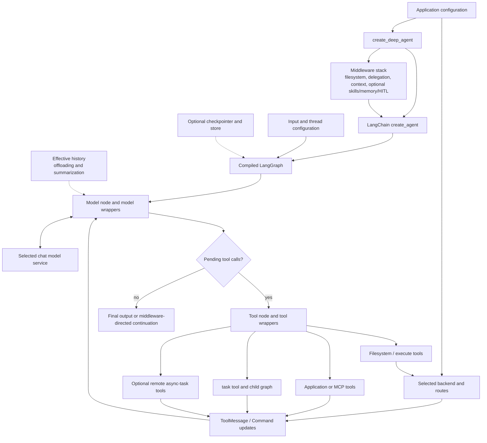
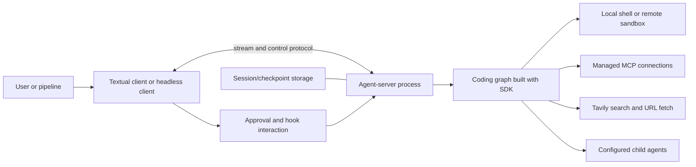
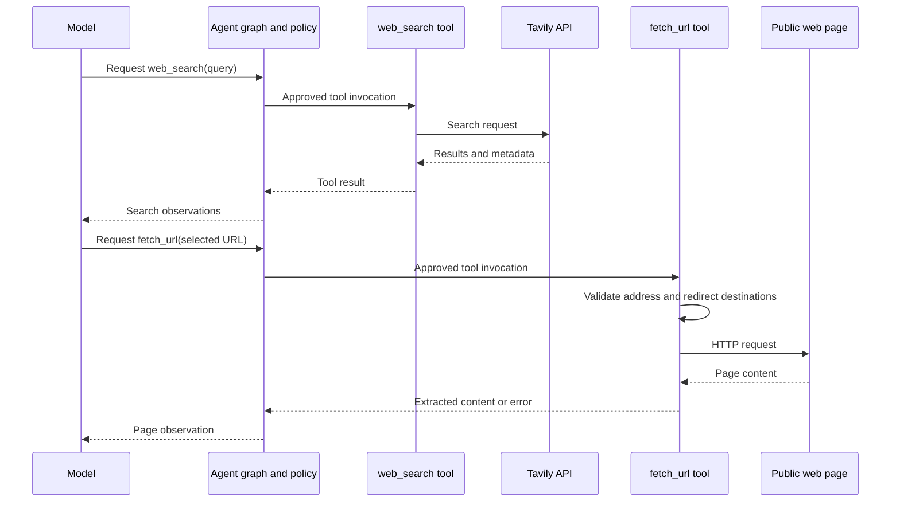

# Deep Agents: architecture and builder's handbook

A source-grounded study of [langchain-ai/deepagents](https://github.com/langchain-ai/deepagents), including its SDK and terminal coding application.

## Snapshot, scope, and evidence

The repository was cloned into `references/deepagents`. This handbook describes commit [`825acb3ca03bd103e4df6013b122eca8475d1982`](https://github.com/langchain-ai/deepagents/tree/825acb3ca03bd103e4df6013b122eca8475d1982), whose commit timestamp is 2026-10-14T20:52:34-04:00. At this snapshot:

| Component | Declared version | Role |
|---|---|---|
| `deepagents` | 0.7.25 | Python agent harness SDK |
| `deepagents-code` | 0.1.85 | Terminal coding application, launched as `dcode` or `deepagents-code` |
| `deepagents-acp` | 0.0.13 | Agent Client Protocol integration |
| `deepagents-talon` | 0.0.9 | Experimental host for channels and scheduled/long-running work |

Versions come from package manifests, not an assumption that every package is released or installed together. This is public MIT-licensed source, not leaked code. The purpose is a detailed architectural reference for building a comparable agent.

The investigation is static: source, configuration, lockfiles, and relevant tests were inspected; live model calls, sandbox services, and the full monorepo test suite were not run. Behavior of absent credentials/services cannot be established by source presence alone.

The core loop is delegated to LangChain/LangGraph. No installed copies were available in the inspection environment. To inspect the dependency boundary, the exact **LangChain 1.4.5** [wheel listed in the SDK lockfile](https://files.pythonhosted.org/packages/c1/e0/c8ec47569a73c0c6205eb545f229ffb9fae66e85b12e9032765442317a09/langchain-1.4.5-py3-none-any.whl) was downloaded without installation or execution. Its SHA-256 matched `libs/deepagents/uv.lock`: `0879b85a79d7fbc89fc91f6c65c9fa573f03f4d9458e6b5b3c50c717868bd79f`. References below distinguish repository code from that dependency's `langchain/agents/factory.py`. This does not claim that every other monorepo package resolves the same dependency versions.

Source links are relative to this document for local use. The pinned commit fixes their interpretation. Observed behavior, inherited framework behavior, optional configuration, and builder recommendations are identified separately.

## Contents

1. [Executive summary](#1-executive-summary)
2. [The coding agent in detail](#2-the-coding-agent-in-detail)
3. [Architecture graphs](#3-architecture-graphs)
4. [Monorepo map and reading route](#4-monorepo-map-and-reading-route)
5. [The three framework layers](#5-the-three-framework-layers)
6. [Agent construction and middleware assembly](#6-agent-construction-and-middleware-assembly)
7. [The model-tool loop](#7-the-model-tool-loop)
8. [State, reducers, checkpoints, and stores](#8-state-reducers-checkpoints-and-stores)
9. [Tools and filesystem middleware](#9-tools-and-filesystem-middleware)
10. [Backends and path routing](#10-backends-and-path-routing)
11. [Shell execution and coding feedback](#11-shell-execution-and-coding-feedback)
12. [Permissions and human approval](#12-permissions-and-human-approval)
13. [Context budgets, offloading, and compaction](#13-context-budgets-offloading-and-compaction)
14. [Prompts, profiles, and model selection](#14-prompts-profiles-and-model-selection)
15. [Memory and skills](#15-memory-and-skills)
16. [Synchronous subagents](#16-synchronous-subagents)
17. [Conversation forks](#17-conversation-forks)
18. [Asynchronous subagents](#18-asynchronous-subagents)
19. [The terminal coding application](#19-the-terminal-coding-application)
20. [MCP integration](#20-mcp-integration)
21. [Web search and page retrieval](#21-web-search-and-page-retrieval)
22. [Hooks, plugins, and Python extensions](#22-hooks-plugins-and-python-extensions)
23. [Completion rubrics and verification](#23-completion-rubrics-and-verification)
24. [Sessions, cancellation, and operational behavior](#24-sessions-cancellation-and-operational-behavior)
25. [Other packages and deployment surfaces](#25-other-packages-and-deployment-surfaces)
26. [A complete coding-task walkthrough](#26-a-complete-coding-task-walkthrough)
27. [Failure modes and design lessons](#27-failure-modes-and-design-lessons)
28. [A blueprint for building a similar agent](#28-a-blueprint-for-building-a-similar-agent)
29. [Testing and evaluation](#29-testing-and-evaluation)
30. [Source index, limitations, and glossary](#30-source-index-limitations-and-glossary)

## 1. Executive summary

**Deep Agents is a configurable harness assembled from middleware and pluggable backends on top of an existing graph-based agent runtime.** Its distinctive design is not a new handwritten model loop. It packages filesystem tools, context reduction, delegation, skills, memory, approval integration, and provider/model tuning around LangChain's agent abstraction and LangGraph's execution machinery.

The whole design has twelve major parts:

1. **A layered SDK.** `create_deep_agent()` builds a runnable graph by calling LangChain's `create_agent()`. LangGraph supplies state transitions, checkpoints, interrupts, and streaming. Deep Agents adds opinionated components around that foundation.
2. **Middleware as the primary composition mechanism.** Middleware can contribute tools/state and run before or around model/tool calls. This allows behavior such as memory injection or compaction that a model-selected tool alone could not provide.
3. **Pluggable filesystem and execution backends.** The same tool surface can work against graph-state files, a persistent store, a real filesystem, a local shell, or a remote sandbox. Composite routing combines them into a model-facing namespace.
4. **A rich coding-tool surface.** Filesystem middleware provides listing, reading, writing, editing, deleting, globbing, grep, and optional execution. Tool presence depends on allowlists, backend capability, profiles, and configured middleware.
5. **Explicit state and persistence distinctions.** Conversation/checkpoint state differs from cross-thread storage and external filesystem effects. Delta-based message/file channels reduce checkpoint growth while preserving stable message identities and updates.
6. **Context engineering.** Large tool and human messages can be offloaded; old arguments can be shortened; conversation summaries define a smaller effective history. Raw history, effective model input, and backend artifacts are deliberately distinct representations.
7. **Several forms of delegation.** Isolated synchronous subagents receive an assignment and selected shared state. Forks inherit effective conversation context. Compiled graphs can be supplied as children. Async agents run through Agent Protocol servers with explicit task lifecycle tools.
8. **Instruction and skill loading.** Memory sources load reference/instruction files into context. Skills expose a concise catalog and load bodies progressively; optional skill-associated tools can be disclosed only after the relevant skill is read.
9. **Configurable approval and resource policy.** The SDK has path-level filesystem rules and optional LangChain human-in-the-loop integration. The terminal application adds broader manual/automatic/unrestricted approval modes and additional trust checks. These layers are not interchangeable with sandboxing.
10. **A substantial terminal product.** `deepagents-code` adds a separate client/server arrangement, Textual interface, headless operation, session management, web tools, MCP connections, plugins, hooks, model configuration, costs, and workspace integration.
11. **Additional hosts and integrations.** ACP adapts the agent to editor clients; partner packages implement sandbox backends; Talon supplies an experimental host for channels and schedules; eval packages support assessment.
12. **Extension and operational controls.** Model/provider profiles, middleware replacement, typed tools, backend routing, tracing, resource lifetimes, and detailed tests make the harness configurable without replacing its runtime.

Two version-specific corrections are essential. In SDK 0.7.25 there is **no universal authored base prompt** injected into every agent, and **TodoListMiddleware is not universally installed by default**. Profiles or callers can add both behavior and planning tools. The Codex-specific profile, for example, adds todo middleware because its prompt guidance references it. Older tutorials showing a fixed base prompt and todo stack should not be treated as exact descriptions of this snapshot.

The builder's central lesson is to separate **loop runtime, capability implementation, request transformation, storage, and application hosting**. Deep Agents uses existing runtime semantics while adding replaceable policies and capabilities above them.

## 2. The coding agent in detail

### 2.1 Library versus application

Calling `create_deep_agent()` gives a reusable graph. With its default `StateBackend`, the files are virtual thread state and shell execution is unavailable. It is not automatically a local coding terminal, an MCP connection manager, or a web-search service.

The coding application constructs a real execution backend, supplies its own prompt and tools, discovers instructions/skills/subagents, sets approval policy, and hosts the graph in an agent-server process. The terminal client exchanges streamed events and control responses with that server.

### 2.2 A normal coding cycle

The model receives an effective conversation, system message, and selected tool schemas. It requests searches, reads, edits, shell commands, or delegation. The graph executes tool nodes and integrates returned `ToolMessage` or `Command` updates. It then calls the model again until no further work is requested or middleware changes the route.

The SDK does not enforce a fixed planner–researcher–implementer–tester sequence. The main agent can do the whole task, or use subagents as model-selected tools. Planning and verification behavior depend on prompts, middleware, profiles, and application policy.

### 2.3 A tool call crosses several layers

For a file read:

```text
model tool call
  -> LangChain/LangGraph tool execution
  -> middleware wrappers and configured approval
  -> FilesystemMiddleware tool implementation
  -> selected backend/path route
  -> structured backend result
  -> bounded model-facing ToolMessage and optional state updates
```

For `execute`, the selected backend must implement execution. A local shell backend runs commands on the host; a remote sandbox changes the effect location. A filesystem root or virtual path mapping does not automatically confine shell effects.

### 2.4 Context and persistence

Middleware can offload large outputs and construct summarized effective history while retaining raw state/history references. This controls inference cost without pretending the model still sees the entire original transcript.

Checkpointing supports resumable graph state only when an appropriate checkpointer/host is configured. Persistent memory/files require a backend with the intended lifetime. Selecting `StateBackend` does not create cross-thread long-term storage.

### 2.5 Delegation

The synchronous `task` tool chooses a registered subagent and invokes its runnable. Isolated children start with the task description in a fresh message list while receiving eligible state. Their final useful text or structured result becomes a tool result for the parent, and selected changed state can propagate through a `Command`.

Forks deliberately inherit effective history and prompt-producing configuration. Async children return task IDs and require explicit checking/updating/cancellation through their lifecycle tools. A coroutine-based synchronous child is still awaited work; it should not be confused with a background task.

### 2.6 MCP and web access

External tools can be supplied as LangChain tools to the SDK. The terminal application implements the connection/trust lifecycle around MCP and provides Tavily-backed search plus URL retrieval. Those are application integrations, not mandatory parts of every Deep Agents graph.

### 2.7 Enforcement boundaries

The SDK's filesystem permissions are enforced by its built-in filesystem tool implementations, not universally by backend methods. Direct backend access, arbitrary custom tools, and shell execution require their own boundary. The constructor rejects some incompatible permission/execution combinations rather than claiming a path rule governs arbitrary shell commands.

## 3. Architecture graphs

### 3.1 SDK construction and runtime



### 3.2 Terminal coding host



The graphs are conceptual ownership diagrams, not a dump of every generated middleware node. Middleware can add lifecycle nodes and explicit routing, and an opaque compiled subagent may have a different internal graph.

## 4. Monorepo map and reading route

| Area | Purpose |
|---|---|
| `libs/deepagents/deepagents/graph.py` | Public SDK assembly and defaults |
| `libs/deepagents/deepagents/middleware/` | Filesystem, subagents, memory, skills, summarization, permissions, repair |
| `libs/deepagents/deepagents/backends/` | Storage/execution contracts and implementations |
| `libs/deepagents/deepagents/profiles/` | Provider construction and harness/model tuning |
| `libs/deepagents/tests/` | SDK behavior, edge cases, streaming, backends, performance |
| `libs/code/deepagents_code/agent.py` | Terminal application's graph/policy/backend assembly |
| `libs/code/deepagents_code/server_graph.py` | Server graph factories and workspace resource lifecycle |
| `libs/code/deepagents_code/client/` | Remote graph adapter, launch, headless operation, client accounting |
| `libs/code/deepagents_code/app.py`, `tui/` | Textual interface and interaction |
| `libs/code/deepagents_code/mcp_*` | MCP discovery, session management, trust, auth, adaptation |
| `libs/code/deepagents_code/configuration/` | Layered configuration resolution |
| `libs/code/deepagents_code/hooks/`, `plugins/`, `extensions/` | Application extension mechanisms |
| `libs/acp/` | Editor/client protocol adaptation |
| `libs/talon/` | Experimental channels/schedules host |
| `libs/partners/` | Sandbox/interpreter integrations |
| `libs/evals/`, `examples/` | Evaluation and application examples |
| `openwiki/` | Generated evidence/navigation material; source remains authoritative |

Recommended reading order: SDK assembly; backend protocol; filesystem tool construction; LangChain factory loop; summarization/state; subagent dispatch; memory/skills; coding application assembly; MCP and terminal-client lifecycle. The in-repository [SDK architecture](../deepagents/libs/ARCHITECTURE.md) and [coding application architecture](../deepagents/libs/code/ARCHITECTURE.md) provide useful orientation, but verify defaults against current assembly code.

## 5. The three framework layers

### 5.1 LangGraph: runtime

LangGraph executes nodes and transitions over typed state. It supplies channels/reducers, streaming, interrupts, checkpoint integration, and runnable graph APIs. Deep Agents returns a compiled graph with runtime configuration rather than a separate forever-running process of its own.

Durability is a configured runtime/hosting property. A library object without a durable checkpointer is not equivalent to the terminal application's persisted session service.

### 5.2 LangChain: agent abstraction

LangChain's `create_agent` turns model, tools, middleware, state schema, and structured-output settings into a model/tool graph. The inspected 1.4.5 factory builds a model node, a tool node when needed, middleware lifecycle nodes, and conditional edges.

The factory distinguishes provider-side tools from local callable tools. Local calls pass through `ToolNode`; provider-native capabilities need not execute as local Python functions.

### 5.3 Deep Agents: harness composition

Deep Agents configures that abstraction with filesystem access, child-run dispatch, context policy, optional instruction/skill loading, profiles, and human approval. A plain tool executes only after the model selects it. Middleware can transform requests or state independently of that selection.

This division is why searching this repository for a giant handwritten `while` loop is misleading. The important local code is assembly and middleware; the runtime loop is in dependencies.

## 6. Agent construction and middleware assembly

[`graph.py`](../deepagents/libs/deepagents/deepagents/graph.py) is the main assembly point.

### 6.1 Construction stages

1. Resolve the explicit model or deprecated default-model path.
2. Resolve the harness profile and validate exclusions of required scaffolding.
3. Rewrite supplied tool descriptions as required by the profile.
4. Select the backend; default to an initialized `StateBackend`.
5. Compose caller prompt with applicable profile content.
6. Resolve declarative, compiled, forked, and async subagent specifications.
7. Add a default general-purpose child unless overridden/disabled.
8. Assemble the main middleware and relevant tail behavior.
9. Merge caller middleware by name and validate final exclusions.
10. Collect private state fields for child propagation filtering.
11. Call LangChain's `create_agent` and bind Deep Agents metadata/recursion configuration.

### 6.2 Main middleware baseline

The baseline includes FilesystemMiddleware, synchronous SubAgentMiddleware when children exist, summarization middleware, and PatchToolCallsMiddleware. Async-subagent middleware is conditional. Profiles add middleware. Skills and memory are conditional on configured sources. Prompt caching, optional HITL, unsupported-content handling, and final tool exclusions complete the assembled stack.

This is a construction order, not a guarantee that every middleware hook executes in simple forward order. Wrappers nest, lifecycle hooks have framework-specific ordering, and custom entries can replace default names.

### 6.3 Replacement and exclusions

Caller middleware with a matching name can replace a default slot. New custom middleware is inserted relative to core/tail positions. Profiles may exclude selected middleware, but required filesystem/subagent/permission scaffolding is protected. Exclusion coverage checks reject stale or misspelled exclusions that matched nothing.

Tool exclusion runs after custom tool-injecting behavior to avoid accidentally reintroducing hidden tools. Capability visibility is therefore a result of the final assembled stack, not simply the original `tools=` argument.

### 6.4 Important current defaults

- Default storage is thread-scoped virtual state, not the host filesystem.
- Shell support is conditional on backend execution capability.
- Backend factories were removed in 0.7; initialized instances are expected.
- A default general-purpose child can be auto-added, subject to profile/explicit configuration.
- SDK default recursion configuration is 9,999; this is not a spend or wall-time budget.
- A legacy authored base prompt remains only behind deprecated compatibility access.
- Todo/planning tools can come from profiles or callers; they are not an unconditional SDK component.

## 7. The model-tool loop

### 7.1 Request construction

The inspected LangChain factory's `model_node` creates a `ModelRequest` containing model, tools, system message, response format, messages, state, and runtime. Model wrappers receive this object and can override fields before invoking the next handler.

This is the seam used for context reduction, model routing, skill disclosure, prompt injection, and application retry logic. The final model request may differ substantially from raw graph state.

### 7.2 Routing after the model

The dependency's `_make_model_to_tools_edge` checks explicit routing overrides, finds the relevant assistant/tool messages, exits if no tools were requested, and schedules pending tool calls not already answered. Pending calls use graph `Send` operations rather than copying the full state into every scheduled task.

After tools, the graph ordinarily returns to the model. Return-direct tools and structured-output paths can produce different exit behavior. Middleware can also redirect execution.

### 7.3 Tool calls and state updates

Tool implementations can return a `ToolMessage` for inference feedback or a `Command` that updates state along with the result message. The latter is central to delegation, async task records, and manual compaction.

A tool result must preserve its originating call ID. Missing results and malformed calls can otherwise make later provider requests invalid.

### 7.4 Concurrency and streaming

The runtime can schedule multiple pending calls through graph execution. This repository does not add a universal read/write safety classifier around that scheduling. Its filesystem wrapper rejects later mutations to the same normalized path within one model response, but that is narrower than global effect conflict detection.

Graph streaming exposes progress/messages to callers. Streaming output does not imply that raw message chunks are appended as permanent state: Deep Agents' message reducer documentation states that the agent writes completed assistant messages while streaming operates on the output side.

### 7.5 Dangling-call repair

[`PatchToolCallsMiddleware`](../deepagents/libs/deepagents/deepagents/middleware/patch_tool_calls.py) inspects history before a run and inserts error results for unanswered valid or invalid calls with IDs. This repairs conversation protocol structure after interruption. It does not roll back effects or prove that a missing result means the action never happened.

## 8. State, reducers, checkpoints, and stores

### 8.1 Message state

`DeepAgentState` uses a `DeltaChannel` for messages, with periodic snapshots, to reduce checkpoint growth from repeatedly storing long histories. The [local reducer](../deepagents/libs/deepagents/deepagents/_messages_reducer.py) coerces supported raw input forms, deduplicates/updates by ID, handles removal tombstones, and recognizes a remove-all sentinel.

Stable IDs are assigned by the runtime before serialization. Random ID assignment inside a replayed reducer would produce inconsistent identities, so the reducer intentionally avoids doing that itself.

### 8.2 Middleware-owned state

Filesystem, skills, memory, summaries, async tasks, and application features contribute typed channels. Private fields are tracked so ordinary child runs do not inherit or return internal state indiscriminately.

The distinction is operational: summary events, cached skill disclosure, or a previous structured response can be valid for a parent while being wrong as initial state for a new child.

### 8.3 Checkpointer versus store versus backend

| Mechanism | Purpose |
|---|---|
| Checkpointer | Persist graph/thread state and interrupted execution |
| Store | Application-defined durable data addressable across threads/scopes |
| Backend | File/execution interface used by tools and middleware |
| External filesystem/sandbox | Actual workspace effects outside graph messages |

`StateBackend` uses graph channels and is naturally thread scoped. `StoreBackend` maps files into a configured store namespace. A real filesystem can persist independently of checkpoints. These lifetimes must be selected intentionally.

### 8.4 StateBackend execution context

[`state.py`](../deepagents/libs/deepagents/deepagents/backends/state.py) reads/writes through LangGraph configuration/channel internals. It is not a standalone in-memory dictionary backend that can be freely called outside a graph. Its fresh reads include pending writes for read-your-writes behavior within a superstep.

This makes initialized reusable backend objects possible, but also creates a dependency on runtime context and channel semantics.

## 9. Tools and filesystem middleware

### 9.1 Capability surface

[`FilesystemMiddleware`](../deepagents/libs/deepagents/deepagents/middleware/filesystem.py) constructs tools for `ls`, `read_file`, `write_file`, `edit_file`, `delete`, `glob`, `grep`, and `execute`. A tools allowlist must retain `read_file`; excluded tools are omitted from construction. Backend capability still determines whether execution/delete are supported.

The backend returns structured results with errors, file data, pagination, match limits, and execution metadata. Middleware converts them into model-facing content and preserves relevant state/artifact information.

### 9.2 Reads are paginated observations

Read results include source-window metadata and a continuation offset. Middleware handles line numbering, clipping, long lines, empty windows, and accurate pagination after display truncation. Returning a backend's original offset after clipping additional lines could silently skip content; the implementation works to avoid that.

Media reads can produce supported multimodal content, with optional blob offloading and later rehydration. They are not always ordinary UTF-8 text reads.

### 9.3 Search is bounded

The default grep result cap is configurable, and local filesystem search can use ripgrep with a Python fallback. Glob/search code has explicit runtime/result bounds and reports partial/truncated results. A model should be able to distinguish no matches from a search stopped by limits or redacted by policy.

### 9.4 Mutations

Write/edit/delete tools validate paths, apply configured built-in filesystem policy, call the backend, and turn recoverable failures into feedback. Edit behavior uses explicit old/new text replacement semantics. Exact freshness, locking, and atomicity properties depend on the selected backend; a universal read-before-write freshness cache is not established by these tools.

The wrapper rejects later same-path file mutations in one assistant response. That helps with parallel tool scheduling, but does not prevent conflicts with another run, shell command, external editor, or path alias in every backend.

### 9.5 Middleware also manages output

The same middleware intercepts large tool results and oversized historical content, saving artifacts and replacing model-visible payloads where configured. It handles both simple ToolMessages and Command-carried message updates. Some tools are exempt from eviction to avoid recursive or semantically inappropriate storage behavior.

## 10. Backends and path routing

The central contracts live in [`backends/protocol.py`](../deepagents/libs/deepagents/deepagents/backends/protocol.py). A backend implements filesystem operations through typed results; execution is a separate capability expressed by `SandboxBackendProtocol`. The word “sandbox” in that protocol's name does not establish an operating-system isolation boundary.

### 10.1 Choosing a storage model

| Backend | Where data lives | Lifetime and important consequence |
|---|---|---|
| `StateBackend` | LangGraph state channels | Thread-scoped, checkpointable virtual files; requires an active graph runtime |
| `StoreBackend` | Configured LangGraph store and namespace | Can persist across threads; namespace design determines sharing and isolation |
| `FilesystemBackend` | Host filesystem | External file effects; graph checkpoints do not roll them back |
| `LocalShellBackend` | Host filesystem plus subprocess execution | Real local coding authority under the host user |
| `BaseSandbox` and partner implementations | A provider's execution/filesystem environment | Provider-specific isolation, persistence, credentials, and lifecycle |
| `CompositeBackend` | Several backends selected by path prefix | One logical namespace with potentially different persistence and execution semantics |

Read [`state.py`](../deepagents/libs/deepagents/deepagents/backends/state.py), [`store.py`](../deepagents/libs/deepagents/deepagents/backends/store.py), [`filesystem.py`](../deepagents/libs/deepagents/deepagents/backends/filesystem.py), [`local_shell.py`](../deepagents/libs/deepagents/deepagents/backends/local_shell.py), and [`sandbox.py`](../deepagents/libs/deepagents/deepagents/backends/sandbox.py) when choosing these boundaries.

`StateBackend` is not a dictionary captured when the object is created. Operations obtain the current graph context and read/write channels, including fresh reads for read-your-writes behavior. Reusing the object across calls is compatible with resolving the current runtime; calling it outside that runtime is not equivalent to manipulating an ordinary in-memory filesystem.

`StoreBackend` solves a different problem: data accessible through a store namespace can outlive a thread. A user-specific namespace is an application decision. A shared namespace can intentionally share memory, or accidentally expose another tenant's data.

### 10.2 Composite routing

[`CompositeBackend`](../deepagents/libs/deepagents/deepagents/backends/composite.py) chooses the longest matching route prefix, strips the prefix before delegating, and remaps results back into the logical namespace. Listing and search must account for multiple mounted backends. Nested mounts therefore require more than a naive dictionary lookup.

A useful configuration is a real working tree as default, persistent memory under one prefix, and large artifacts under another. This makes those paths look adjacent to the agent while retaining separate storage policies.

Execution is a crucial exception: `execute` delegates to the default execution backend. A virtual route is **not automatically a directory mounted into that shell**. A model can successfully write a file through a routed filesystem tool and still fail to open it with `cat` unless the environment actually exposes the same storage. State this explicitly in prompts or provide integration that maintains the equivalence.

### 10.3 Backend implementation requirements

For a new backend, implement the protocol's result shapes, not merely similarly named methods. Preserve pagination metadata, error distinctions, relative-path conventions after routing, truncation indicators, and sync/async behavior. `FileData` carries content plus encoding, including base64 when appropriate; treating every upload as plain text loses information.

**Builder recommendation:** test the same capability contract against every backend. Also test combinations: composite routes plus permissions, summaries stored on a route, shell reads of tool-created files, and concurrent child updates. Most abstraction failures appear between components rather than in a simple read/write example.

## 11. Shell execution and coding feedback

### 11.1 Local execution

`LocalShellBackend.execute()` uses subprocess execution with a shell, a configured working directory, timeout handling, and captured output. Tool middleware bounds output presented to the model. The coding application's local setup supplies a curated environment and disables automatic inheritance in its backend construction.

There are several different bounds: per-command timeout, tool-output size, context budget, inference budget, and graph recursion. They are not substitutes for one another. The filesystem tool's maximum allowed timeout override also does not establish a whole-task wall-clock limit.

Virtual path mode helps interpret filesystem paths; it does not confine an arbitrary shell process. Host shell commands can invoke programs, access network resources, or touch paths according to the host account and actual execution restrictions. Select a remote or otherwise constrained backend when that authority is unsuitable.

### 11.2 How coding happens

The model combines dedicated discovery/edit tools with execution. A typical sequence is `glob` or `grep`, bounded `read_file`, `edit_file`, then `execute` for a formatter, targeted test, or build. Output returns as tool feedback, and the same graph loop lets the model diagnose failures and edit again.

No separate deterministic program-repair engine is implied. The harness supplies observations and execution semantics; the model proposes code changes and interprets test output. The caller must decide which commands count as adequate validation and which effects require approval.

### 11.3 Consequences for replay

Checkpointing can restore conversational state, but it cannot automatically undo a shell command or a remote API call. Retrying a node after an ambiguous failure may repeat an effect. For tools that publish, spend money, or mutate remote state, use idempotency keys or an explicit operation ledger at the tool/application boundary.

Filesystem tools may return state updates through a `Command`; shell effects normally occur outside the graph-state reducer. Do not infer equal replay safety from the fact that both arrive as ToolMessages.

## 12. Permissions and human approval

### 12.1 SDK filesystem policy

The policy implementation is primarily in [`middleware/filesystem.py`](../deepagents/libs/deepagents/deepagents/middleware/filesystem.py); [`middleware/permissions.py`](../deepagents/libs/deepagents/deepagents/middleware/permissions.py) preserves a compatibility export.

`FilesystemPermission` specifies operations, absolute path patterns, and a mode: `allow`, `deny`, or `interrupt`. Validation rejects unsupported path forms such as parent traversal. The rules are ordered: **the first matching rule wins, with allow as the fallback when no rule matches**. A deny-by-default policy therefore needs an appropriate final catch-all rule.

Policy checks account for routing and, for actual filesystem paths, resolved targets so that a permitted spelling cannot trivially bypass policy through a symlink. Bulk listing/search has a separate concern: denied results must be filtered, and interrupt decisions may need preflight checks. Recursive deletion also needs descendant checks.

The scope is the built-in filesystem tool layer. Direct backend calls, arbitrary Python extension code, or an unrelated tool are not automatically governed by these rules.

### 12.2 Why shell authority complicates path policy

An unrestricted command can bypass a path restriction imposed only on `read_file` or `edit_file`. The filesystem middleware rejects unsupported combinations of path permissions and execution-capable backends, with a special allowance for policies confined to separately routed paths. This is an explicit refusal to pretend that arbitrary shell execution is enforceable through ordinary file-tool checks.

The route-scoped case still requires understanding which backend actually holds that route and whether shell execution can reach the same data through another channel.

### 12.3 Human-in-the-loop control

`interrupt_on` integrates LangChain's human-in-the-loop middleware. Filesystem interrupt rules feed into that machinery. A usable approval flow requires persistence and a host able to receive an interrupt, display the proposed action, and resume with a decision. A declaration in a Python dictionary is only one part of that system.

The terminal application supplies its own approval architecture in [`approval_mode.py`](../deepagents/libs/code/deepagents_code/approval_mode.py) and [`auto_mode.py`](../deepagents/libs/code/deepagents_code/auto_mode.py). Modes include manual, automatic classification, and an unrestricted mode requiring the application's acknowledgement flow. Automatic mode is a policy classifier, not an execution sandbox. Invalid stored modes fall back conservatively.

These application modes should not be described as if they were the SDK's path-rule evaluator. The coding application's construction explicitly uses its own HITL configuration for its shell/filesystem tools.

### 12.4 Four separate questions

| Question | Responsible layer |
|---|---|
| Does the model see this tool? | Tool construction, allowlists, profiles, dynamic disclosure |
| May this proposed invocation proceed? | Policy wrappers, HITL, host approval decisions |
| What can the operation physically affect? | Backend, OS/container permissions, network and credential scope |
| What can be resumed or audited? | Checkpoints, traces, operation records, host session management |

Keeping these separate prevents a tool allowlist or an approval prompt from being mistaken for complete isolation.

## 13. Context budgets, offloading, and compaction

### 13.1 Three representations of a conversation

The implementation distinguishes durable message history, the effective history submitted to the model, and artifacts containing displaced content. This separation is central to understanding the design.

[`middleware/summarization.py`](../deepagents/libs/deepagents/deepagents/middleware/summarization.py) records a private summarization event containing a cutoff, a summary message, and a history artifact path when offloading succeeds. Subsequent requests reconstruct the effective history from that event plus the retained tail. The durable raw history need not disappear when the model stops receiving it in full.

This preserves audit and retrieval possibilities, but means “compaction” does not automatically imply that all stored checkpoints shrink to the size of the summary. Delta channels and artifact storage address different aspects of storage growth.

### 13.2 Automatic thresholds

When a model profile provides `max_input_tokens`, the default summarization factory uses fractions of that budget: trigger near 85%, retain roughly 10%, with corresponding old-argument truncation settings. These are construction defaults, not measured universal optima.

Without an input-token profile, the factory falls back to a 170,000-token trigger and six retained messages, with separate argument-truncation defaults. A builder targeting a smaller context model must configure appropriate limits or supply an accurate profile. A fallback intended for a large-context model is not a context-window discovery algorithm.

Token accounting considers system instructions and tool schemas as well as conversation content. A large MCP catalog can consume budget before the user has accumulated much dialogue.

### 13.3 Compaction pipeline

The middleware reconstructs effective history, shortens eligible old tool arguments, measures pressure, and summarizes when the configured conditions require it. Old history is offloaded before summarization so the summary can point back to recoverable material. A session identifier helps prevent simultaneous children from using the same history artifact identity.

The summary and recent messages become model-visible context. The implementation tracks offload failures and missing media references so it can avoid implying that unavailable original material is safely recoverable. The recent tail may retain useful detailed observations that a summary would otherwise lose.

### 13.4 Overflow recovery

Provider context-overflow errors can trigger a bounded recovery attempt with a smaller effective context. Recovery is not an unbounded retry loop: the implementation checks whether reduction made progress and raises `ContextOverflowError` when it cannot safely get below the necessary budget.

This matters when the irreducible content itself is too large: system prompts, tool schemas, a huge newest message, or retained content can exceed the model limit even after older conversation is summarized.

### 13.5 Artifact offloading

Filesystem middleware handles large tool results and oversized historical messages, storing recoverable content under artifact prefixes such as `/large_tool_results`, `/conversation_history`, and `/blobs`, rooted according to backend configuration. Binary offloading is optional and uses references with later hydration.

Routing determines the storage benefit. Saving a large payload into a `StateBackend` can leave it in the same checkpoint system you hoped to reduce. Using an external artifact backend can reduce graph-state pressure, but introduces availability, retention, authorization, and cleanup responsibilities.

### 13.6 Explicit compaction

The SDK can expose a `compact_conversation` tool through its tool-based summarization option. It is conditional, and updates state through the same compaction machinery. The coding application also has an explicit offload/compaction operation tied to its graph and backend rather than independently rewriting client-side history.

**Builder recommendation:** retain provenance in summaries: artifact location, covered range, current goals, unresolved failures, important paths, and exact decisions that affect future work. Test retrieval after compaction and recovery after restart; a pleasing summary alone does not establish continuity.

## 14. Prompts, profiles, and model selection

### 14.1 Prompt assembly is compositional

[`graph.py`](../deepagents/libs/deepagents/deepagents/graph.py) combines caller instructions with profile and middleware contributions. Filesystem descriptions, memory blocks, skill indexes, and delegation instructions can each add relevant guidance. As a result, the final request prompt is more than the initial `system_prompt` argument.

The retained legacy base prompt is a deprecated compatibility surface. It is not evidence that every 0.7.25 agent receives that text. Similarly, planning behavior may be provided through middleware or a profile rather than a single mandatory planner subsystem.

### 14.2 Provider profiles versus harness profiles

Model/provider resolution determines the chat-model implementation, credentials, defaults, and model capabilities. Harness profiles choose agent-facing prompt guidance, tools, middleware, and default-subagent behavior. A model's context limit belongs to a different concern from a profile's preference for a particular planning tool.

The model-resolution and profile machinery is indexed from [`_models.py`](../deepagents/libs/deepagents/deepagents/_models.py) and the graph construction code. Profile APIs in this snapshot include evolving/beta surfaces; pin versions if relying on their exact merger and exclusion behavior.

### 14.3 Why profile changes can change behavior substantially

A profile can add middleware whose tool names are referenced in its prompt, exclude unsupported capabilities, or adjust the general-purpose subagent. Prompt text and actual tools must remain coherent. Removing a tool while preserving instructions that require it creates a model-facing contradiction.

`graph.py` validates exclusions and protects required scaffolding. Caller middleware can replace existing slots by name. This is useful customization, but a replacement must satisfy the expectations of the components around it; matching a name alone does not prove semantic compatibility.

### 14.4 Coding-application model management

The application supports configurable models and owns retry/accounting middleware around them. It can disable nested provider SDK retries to prevent multiplicative retry behavior. Choosing a different model can alter context sizing, native content support, cache behavior, and tool compatibility, not merely response style.

No comparison of model quality or current pricing is established by this source study. The architectural lesson is to expose model capabilities explicitly and make adaptation decisions at construction/request boundaries.

## 15. Memory and skills

### 15.1 Memory is loaded reference context

[`MemoryMiddleware`](../deepagents/libs/deepagents/deepagents/middleware/memory.py) reads configured memory/instruction sources such as `AGENTS.md` through a backend. It loads them before the agent when the relevant private memory state has not already been populated. Missing files can be skipped; other backend errors are handled distinctly. Sources are combined, and HTML comments are stripped before injection.

The result is instruction/reference content in the model request. A model can update a memory file using editing tools when authorized and prompted. That is different from an automatic learning system, an embedding retrieval service, or a scheduled memory-consolidation agent.

Loading and reloading are also separate. Updating a source file does not necessarily invalidate previously populated `memory_contents` by itself. A host that promises live instruction refresh needs an explicit invalidation/reload policy.

### 15.2 Skills use progressive disclosure

[`SkillsMiddleware`](../deepagents/libs/deepagents/deepagents/middleware/skills.py) scans configured skill sources, parses `SKILL.md` metadata, and presents a concise catalog rather than injecting every full skill body. Sources can use their own backend/path pairing. Pinned skills are a separate mechanism for proactively loading selected bodies.

The model can read the relevant skill through the filesystem interface. This shifts a large instruction library out of the initial prompt while keeping it discoverable. The tradeoff is that skill descriptions and source availability determine whether the model finds and loads the right procedure.

### 15.3 Skills can disclose additional tools

The skill-tool machinery in [`_skill_tools.py`](../deepagents/libs/deepagents/deepagents/middleware/_skill_tools.py) resolves registered tool definitions associated with skill metadata. Successful reading of the relevant skill is evidence used to disclose those tools. Depending on provider support, disclosure uses native schema mechanisms or ordinary request tool binding.

The harness records disclosed tools in private state and checks dynamic dispatch against registered/disclosed tools. Guessing the name of an undisclosed tool is not intended to grant invocation authority. Async resolvers also require the corresponding async invocation path.

This is a discovery and dispatch mechanism; metadata fields such as `allowed-tools` should not be assumed to establish a universal sandbox for arbitrary tool implementations.

### 15.4 Keep four concepts distinct

Memory supplies continuing context. A skill supplies a discoverable procedure, possibly with associated tools. MCP supplies an external tool transport/discovery integration. A subagent supplies another runnable agent context. They may refer to one another, but none is automatically equivalent to the others.

**Builder recommendation:** treat loaded instructions and external tool results as data with provenance. Define which sources may change behavior, who can edit them, how they are refreshed, and which operations still require approval regardless of what a file says.

## 16. Synchronous subagents

### 16.1 Definitions and construction

[`middleware/subagents.py`](../deepagents/libs/deepagents/deepagents/middleware/subagents.py) defines declarative `SubAgent` configurations and `CompiledSubAgent` wrappers. A declarative child specifies a name, description, prompt, optional model/tools/middleware/skills/permissions, and mode. A compiled child supplies a runnable graph whose internals are opaque to the parent harness.

`graph.py` prepares declarative children with the necessary filesystem, summarization, tool-call repair, profile, and optional skill/cache machinery. It can add a default `general-purpose` agent unless disabled or replaced. This does not mean every arbitrary parent middleware is automatically cloned into every isolated child; the default-slot and override rules matter.

### 16.2 The task tool

The parent receives a `task` tool with a description of available subagent types. Calling it chooses a named child and passes an assignment. A tool-call ID is required so the returned result can be paired with the parent's tool invocation.

For an isolated child, the task wrapper prepares eligible shared state and a fresh assignment message rather than passing the full parent conversation. Private and excluded fields are withheld. The child runs its own model-tool loop and can use its configured backend and capabilities.

When the child finishes, the wrapper returns a parent ToolMessage plus selected changed state through a `Command`. It avoids blindly returning private fields, unchanged fields, or the entire child message log. A structured response is serialized when available; otherwise the wrapper selects the final useful assistant text, accounting for an empty terminal assistant turn.

### 16.3 Shared files versus shared conversation

Two isolated conversations can still affect the same workspace. File sharing is determined by backend/state routing, not by the fact that the child has a separate message history. A useful child report therefore states which files changed, which checks ran, and what remains uncertain.

Parallel task calls may allow multiple children to work at once under the underlying runtime. This does not provide conflict-free edits, automatic worktrees, or merge resolution. If children share mutable files, the host must establish ownership or use isolated workspaces.

### 16.4 Sync versus async invocation

An async `atask` implementation can await a child without blocking the Python event loop. That still represents a task whose parent tool call awaits its result. It is different from the explicit background task lifecycle described in section 18.

### 16.5 A useful delegation contract

**Builder recommendation:** each assignment should include scope, expected outputs, permitted shared resources, completion criteria, and the desired report format. Persist an explicit child identity for traces. Define what happens to child work if the parent is cancelled or an approval remains unanswered.

## 17. Conversation forks

A fork starts from the parent's effective conversational context instead of a fresh isolated assignment. The implementation accounts for summarization so a child inherits the effective view rather than naively duplicating every old raw message.

Forks are useful for tasks requiring implicit recent context, but cost more and need careful state filtering. Fields representing a parent's summary session, tool disclosure, pinned skill state, structured response, or rubric state cannot all be copied uncritically into an independent child lifecycle.

Declarative fork agents inherit parent skill sources and relevant prompt/middleware context according to the construction rules; they cannot independently redefine skills in the same way as isolated children. A compiled runnable still controls its own internals, so a caller cannot assume all prompt/middleware inheritance can be injected into it.

The implementation marks forked context and guards against further recursive forking. It can leave the task schema present while refusing an invalid nested fork, helping preserve a stable prompt/tool prefix. That is a bounded delegation policy, not an unlimited agent tree.

Forking is not a Git operation. It does not create a separate working tree, process namespace, file snapshot, or approval authority. To obtain those properties, connect the child to separately provisioned resources.

## 18. Asynchronous subagents

### 18.1 Remote lifecycle

[`middleware/async_subagents.py`](../deepagents/libs/deepagents/deepagents/middleware/async_subagents.py) integrates agents exposed through Agent Protocol/LangGraph SDK clients. An `AsyncSubAgent` identifies a graph and connection information. With no remote URL, a local ASGI transport is possible on the async path.

The model-facing lifecycle tools include:

| Tool | Purpose |
|---|---|
| `start_async_task` | Start a child thread/run and return a task identity |
| `check_async_task` | Inspect current status/results |
| `update_async_task` | Send an update through the supported remote lifecycle |
| `cancel_async_task` | Request cancellation |
| `list_async_tasks` | List tracked tasks with status information |

The parent stores task records including thread/run identity, status, and timing information. This lets the parent continue other work between checks rather than occupying one tool call until completion.

The shipped tool instructions impose a more specific interaction policy than the raw API capability: after launch, report the task ID and stop; do not immediately poll; use `check_async_task` when the user asks for status/results. Several tasks may run concurrently. This is a user-directed background workflow, not a default autonomous polling supervisor.

### 18.2 Human waits are a real state

This pinned commit adds reporting for children waiting on a human. A child awaiting approval is neither successfully complete nor simply failed. The parent needs to surface or otherwise handle that state, and later resume checking it.

The subtlety is that an interrupted remote run can have run status `success` while its thread is `interrupted`. The middleware consults the thread and maps this to nonterminal task status `waiting`. Its instructions also say that the user answers the child directly; the parent cannot supply a human approval or answer on the user's behalf.

Status retrieval can fall back to cached information with warnings when live lookup fails. List filters may be applied to cached status before live updates, so listing should not be treated as a globally synchronized database query across all remote runs.

### 18.3 Separate security and persistence domains

The remote agent's model, backend, credentials, approval policy, and checkpointer belong to that remote host. The parent's filesystem permissions or local approval settings do not automatically constrain it. Configure authentication and authorization on both sides.

Similarly, a parent task record is not the remote run's checkpoint. Durable recovery requires retaining enough identity to reconnect and ensuring the remote service retains its own state.

### 18.4 Coordination limits

These task tools provide lifecycle coordination; they do not establish an arbitrary peer-to-peer teammate mailbox, automatic source-control isolation, or a shared transaction across agents. The application must define cancellation propagation, retention, progress presentation, and how results enter the parent conversation.

## 19. The terminal coding application

### 19.1 A host around the SDK

The terminal application lives in [`libs/code/deepagents_code`](../deepagents/libs/code/deepagents_code). Its major entry points are:

| Source | Responsibility |
|---|---|
| [`main.py`](../deepagents/libs/code/deepagents_code/main.py) | CLI arguments, startup paths, lazy imports, command dispatch |
| [`app.py`](../deepagents/libs/code/deepagents_code/app.py) | Textual interactive interface and event handling |
| [`client/non_interactive.py`](../deepagents/libs/code/deepagents_code/client/non_interactive.py) | Headless execution and noninteractive output/control |
| [`client/launch/server.py`](../deepagents/libs/code/deepagents_code/client/launch/server.py) | Local server launch/configuration |
| [`client/remote_client.py`](../deepagents/libs/code/deepagents_code/client/remote_client.py) | Remote graph access, streaming, reconnect/run interaction |
| [`server_graph.py`](../deepagents/libs/code/deepagents_code/server_graph.py) | Server-side workspace resources and graph factories |
| [`agent.py`](../deepagents/libs/code/deepagents_code/agent.py) | Coding-agent assembly and application middleware |

Treat this as a substantial application, not merely a pretty wrapper around `agent.invoke()`. UI lifecycle, server resource ownership, approvals, checkpoints, and workspace switching account for much of its code.

### 19.2 Client/server separation

The client launches or connects to a LangGraph server. The local launch path generates configuration and uses `langgraph dev`. That is a local development-server arrangement; a production deployment needs an explicit hosting/authentication design.

The remote client wraps graph operations and translates streaming events into client-facing messages and lifecycle updates. The server owns the runnable graph and its state transitions. The UI presents events, gathers input, handles interactive decisions, and tracks the active session.

This separation makes reconnection and alternate clients possible, but introduces ownership issues: which client controls a thread, which workspace its server resources refer to, and what happens if the client disappears during execution.

### 19.3 Coding-agent construction

`create_cli_agent()` in `agent.py` resolves the model and workspace, constructs a local or remote execution backend, adds application tools, builds custom children, and calls `create_deep_agent()` with application middleware and persistence.

Its local shell path constructs `LocalShellBackend` with the workspace working directory and an explicitly curated environment. A shell-disabled configuration uses filesystem access without execution. Composite routes separate operational artifacts and other designated resources from ordinary working-tree files.

The application adds configurable-model/retry behavior, resume-state management, costs, goal tools, optional user-question tools, memory/skill/plugin integration, approval handling, hooks, and optional verification features. It also supplies its own general-purpose child configuration. The forked-child default in this host should not be generalized to every SDK caller.

### 19.4 Tool restrictions must survive delegation

The application's filesystem-tool allowlist handling propagates restrictions into children. Otherwise a parent denied a tool could regain it by asking a less restricted default child to perform the action.

This is an example of a broader capability rule: construct the effective authority for the whole reachable agent graph. Checking only the main agent's visible tool list is insufficient.

### 19.5 Optional programmatic tool calling

The application includes optional JavaScript evaluation/programmatic tool-calling support using the QuickJS integration and cost-aware wrappers. This lets code orchestrate tool calls rather than requiring a separate natural-language turn for every operation.

It is an optional execution path with compatibility restrictions; some remote-sandbox combinations are explicitly rejected. It should not be described as the universal inner loop of Deep Agents. The normal graph loop still provides the surrounding state, middleware, and completion semantics.

### 19.6 Side questions and explicit operations

Application-specific operations such as offload/compaction and “by the way” side questions have their own APIs. The side-question path captures relevant rendered prompt context without simply granting another unrestricted copy of the main agent's mutable workflow.

This illustrates a useful host design: expose bounded operations for UI features rather than encoding every button as another full-authority user turn. Review the actual operation's tool and state contract before assuming it is harmless.

## 20. MCP integration

### 20.1 Where it lives

MCP integration is primarily a coding-application feature in [`mcp_tools.py`](../deepagents/libs/code/deepagents_code/mcp_tools.py), supported by [`mcp_config.py`](../deepagents/libs/code/deepagents_code/mcp_config.py), [`mcp_auth.py`](../deepagents/libs/code/deepagents_code/mcp_auth.py), [`mcp_middleware.py`](../deepagents/libs/code/deepagents_code/mcp_middleware.py), and server resource construction. The SDK can receive tools created elsewhere, but its default graph does not automatically discover a user's MCP servers.

This snapshot uses FastMCP clients and LangChain MCP tool conversion/routing. Descriptions of a different revision based solely on `langchain-mcp-adapters` would miss the actual connection architecture here.

### 20.2 Connection and discovery flow

The host reads supported user/project/plugin configuration, resolves environment substitutions and trust/enablement decisions, creates a client per configured server, discovers remote tools, and converts them into the model-facing tool abstraction. A central router/session manager connects invocation to the correct server.

For stdio transports, a live server process and its session have a lifecycle longer than one individual tool call. HTTP/SSE-style connections have different authentication and failure behavior. Connection state, tool availability, and authorization failures need to be presented separately.

### 20.3 Invocation path

The model sees a tool schema. A selected call passes through agent/tool middleware and application policy, reaches the MCP-backed tool/router, invokes the configured server, and returns content to the graph as tool feedback.

The model does not directly speak MCP. Nor does MCP itself choose the next agent step. It supplies external capability discovery and invocation underneath the normal model-tool loop.

### 20.4 Authentication and trust

The application has OAuth/login support and explicit handling for missing login or unsupported authentication/transport combinations. OAuth is not a meaningful stdio process-launch authentication mechanism merely because the same configuration parser accepts auth fields elsewhere.

Project-defined server launch commands are executable configuration, so project trust and server enablement matter before connecting. Tool filters can limit discovered tools. Read-only/destructive hints may inform approval policy, but a remote server's annotation is not a substitute for checking its actual authority and implementation.

### 20.5 Reload and cleanup

MCP resources need cleanup on shutdown and a defined policy for configuration/tool reload. The manager retains session/client state rather than reconnecting indiscriminately per invocation. Application middleware updates the effective tool surface while respecting those resource lifetimes.

Dynamic changes affect context and behavior: a newly available server can add many schemas, change approval decisions, or increase the model input budget. A host should identify tool catalogs and connection errors in diagnostics so “the model did not use the tool” can be separated from “the server never connected.”

### 20.6 MCP versus the other protocols

MCP connects tools/resources. Agent Protocol connects graph runs and async subagents. ACP connects editor clients to an agent host. They occupy different boundaries even if one application uses all three.

## 21. Web search and page retrieval

### 21.1 Search is a regular application tool

[`tools.py`](../deepagents/libs/code/deepagents_code/tools.py) implements `web_search` using Tavily. The ordinary implementation directly calls a Tavily client; there is no separate model-powered research subagent inside this function.

The input includes a query, a result limit (default five), a topic such as general/news/finance, and an `include_raw_content` option that defaults to false. The tool returns the search service's response or a translated error payload. The tool description encourages using page retrieval when only selected results require full content.

The standalone helper can lazily initialize a client from application credentials. The server also constructs a workspace-bound search tool with an explicit API key, avoiding inappropriate reuse of a process-global credential across workspace contexts.

No Tavily key, missing optional packages, service failures, and timeouts have explicit error handling. Source presence does not establish that web search works without configuration.

### 21.2 Full-page retrieval is separate

`fetch_url` obtains HTTP/HTTPS content and converts HTML into usable text/Markdown. It validates destination addresses, blocks disallowed address categories, controls redirects, and revalidates each hop. DNS pinning is used to reduce the gap between validating a hostname and connecting to it.

This addresses a different boundary from search ranking. A search API may return a URL, but fetching it can still target an internal address or redirect somewhere unsafe. The code handles that at retrieval time.

HTML conversion is not a full interactive browser. JavaScript-heavy pages, login flows, and browser-only state may not be retrievable through this tool. Returned text is external page content, not trusted agent policy.

### 21.3 The complete web workflow



The model chooses queries and interprets results in the surrounding loop. A caller may add a research child or another search provider, but neither is mandatory in the SDK. A plain default SDK agent has no built-in requirement to search the internet.

### 21.4 Lessons for implementing search

**Builder recommendation:** separate query search, page acquisition, extraction, and evidence citation. Preserve URLs and retrieval metadata; limit result sizes before they dominate the context; validate every redirect; and treat page instructions as untrusted content. Provide clear failure payloads so the agent can revise a query or report unavailable access instead of inventing evidence.

## 22. Hooks, plugins, and Python extensions

### 22.1 Hooks are application lifecycle integration

The [`hooks`](../deepagents/libs/code/deepagents_code/hooks) package implements configuration, trust, transport, execution, and event projection. Events include tool-use phases, compaction, stopping, and subagent lifecycle transitions.

Server middleware can produce a typed interrupt describing a hook event. The client runs matching configured handlers and replies through the supported protocol. This crosses the client/server boundary; it is not merely a Python callback invoked in every SDK model request.

Hook commands execute with their host's actual authority. Trust, environment, timeout, output parsing, and failure behavior therefore matter. A hook that validates a diff and one that launches an arbitrary shell command share a configuration mechanism but have very different effects.

### 22.2 Plugins package several capabilities

The application's [`plugins`](../deepagents/libs/code/deepagents_code/plugins) machinery can supply skills, agent definitions, MCP configuration, and hooks. Plugin discovery/enablement determines which components enter the effective workspace configuration.

A plugin is not another inference runtime. It contributes pieces that the existing host loads into its instruction, tool, connection, or lifecycle systems. Debugging one requires identifying which of those components changed.

### 22.3 Python extensions are privileged code

The [`extensions`](../deepagents/libs/code/deepagents_code/extensions) package provides discovery, trust/settings, registry/API, runtime loading, and hosting integration. Extensions can contribute Python tools, middleware, and backends.

This is powerful precisely because it runs application code. It should not be treated like inert Markdown skill content or assumed sandboxed by filesystem-tool permissions. Extension trust and dependency management are part of the host's software-execution boundary.

### 22.4 Configuration is a snapshot with reload behavior

Configuration is consumed across model, plugin, hook, and server-resource code. The application uses generation-based cached configuration and explicit reload behavior; changing a file is not equivalent to every component immediately observing it. Some malformed configuration paths retain the last usable values so transient edit errors do not destroy the running setup.

**Builder recommendation:** make configuration generation visible in diagnostics. Record which generation constructed a graph/tool catalog and which resources must be rebuilt on reload. Otherwise a user can inspect the current file while the agent still uses an earlier effective configuration.

## 23. Completion rubrics and verification

### 23.1 Model completion versus application acceptance

In the underlying loop, an assistant response without pending tool calls can finish the graph. That control-flow event does not prove the coding task is correct. Application-level goal and rubric features add a separate layer for tracking intended outcomes and checking evidence.

Relevant sources include [`goal_tools.py`](../deepagents/libs/code/deepagents_code/goal_tools.py), [`goal_rubric.py`](../deepagents/libs/code/deepagents_code/goal_rubric.py), [`reliable_rubric.py`](../deepagents/libs/code/deepagents_code/reliable_rubric.py), and agent construction.

### 23.2 Goals and evidence

Goal tools represent/update task objectives and related state. Optional rubric behavior can evaluate acceptance criteria and influence whether the agent should continue. Restricted grader capabilities and read-only evidence collection help keep evaluation from changing the work it is judging.

These features are conditional. They are not proof that every default SDK response is automatically tested, independently reviewed, or correct. They also introduce their own model calls and resource costs.

### 23.3 Practical verification workflow

A coding agent should collect concrete evidence: relevant tests, formatter/type-check/build results, inspected diffs, and an account of checks it could not perform. A rubric can organize those requirements, but the underlying tool outputs remain the evidence.

**Builder recommendation:** distinguish three states in user-facing completion: the agent stopped, the configured checks completed, and the task met its acceptance criteria. Persist the exact checked revision or file state where possible. A passing test before the final edit does not validate the final workspace.

## 24. Sessions, cancellation, and operational behavior

### 24.1 Persistence and identity

The coding host combines checkpoint persistence, application thread records, workspace binding, and thread ownership. These records solve different problems. A server may need a thread re-registered after restart even though the checkpoint still exists.

[`thread_ownership.py`](../deepagents/libs/code/deepagents_code/thread_ownership.py) and [`workspace.py`](../deepagents/libs/code/deepagents_code/workspace.py) are useful starting points. A lease prevents multiple active clients from silently acting as the owner of the same conversational thread. It does not by itself lock every file in a shared repository.

### 24.2 Cancellation is distributed

The remote client coordinates cancellation of active server runs and uses bounded waits. Acknowledging a UI cancel event is different from confirming that a shell child, remote MCP operation, or async subagent has stopped.

Every effectful component needs a cancellation contract: request accepted, termination confirmed, or status unknown. Retrying immediately after an unknown result can duplicate effects.

### 24.3 Headless operation

The noninteractive client cannot display an ordinary approval dialog. It has explicit handling for gated tools and interrupts rather than assuming that a human will eventually click a button. Automation must decide in advance which operations are allowed, rejected, or reported as requiring attention.

This is a common difference between a reusable SDK and a production CLI: the runtime can emit an interrupt, but the host must translate it into a viable interaction policy.

### 24.4 Retry ownership

[`configurable_model.py`](../deepagents/libs/code/deepagents_code/configurable_model.py) and [`model_retry.py`](../deepagents/libs/code/deepagents_code/model_retry.py) place retry handling at an application boundary. Nested retries across the model SDK, LangChain, and the host can multiply latency and spending. The application avoids some of that by controlling lower-level retry settings.

Tool retries require additional caution because tools can have effects. A transient model request failure and an ambiguous remote mutation failure need different policies.

### 24.5 Cost accounting

[`cost_tracking.py`](../deepagents/libs/code/deepagents_code/cost_tracking.py) and related helper accounting track more than the visible main-model turn. Classifiers, subagents, compaction, and other helper operations may also consume tokens. Thread-scoped accounting and draining mechanisms support associating those costs with the right session.

A builder should record usage at the inference boundary and then attribute it to main agent, helper, or child. Counting only final assistant messages misses much of a complex harness's cost.

### 24.6 Startup performance

`main.py` deliberately delays heavy imports and preserves fast command paths. This matters for a terminal application invoked frequently for help, version, or configuration operations. A highly modular backend still feels slow if startup eagerly imports every provider, UI, sandbox SDK, and plugin dependency.

## 25. Other packages and deployment surfaces

### 25.1 ACP

[`libs/acp`](../deepagents/libs/acp) implements Agent Client Protocol integration for editor clients. Its purpose is to expose an agent to an editor-facing protocol, with the required session/event/permission translations. It is distinct from MCP tool connectivity and the async-agent Agent Protocol client.

### 25.2 Partner sandboxes

[`libs/partners`](../deepagents/libs/partners) contains separate integrations such as Daytona, Runloop, Modal, QuickJS, and Vercel-related packages. Their dependency and lifecycle requirements differ. The shared backend protocol allows the harness to use them without making every provider dependency mandatory in the core SDK.

Provider-specific guarantees must be checked in the selected implementation and service configuration. A protocol-compatible backend can offer very different network access, persistence, process isolation, and billing behavior.

### 25.3 Talon

[`libs/talon`](../deepagents/libs/talon) is an experimental host for channels and scheduled/long-running workflows. It reuses coding-agent infrastructure but adds a different application lifecycle. Its existence does not mean every SDK agent automatically runs a scheduler, monitors channels, or persists a daemon.

### 25.4 Evaluations and examples

[`libs/evals`](../deepagents/libs/evals) provides evaluation-oriented code and baselines. Examples demonstrate configurations rather than proving that every shown tool, backend, or prompt is installed by default.

Generated architecture/wiki material can help navigation, but exact implementation claims should be checked against the source and pinned dependencies. The repository's own architecture prose still mentions general planning defaults that differ from the precise `graph.py` assembly at this snapshot.

## 26. A complete coding-task walkthrough

Consider an illustrative request: “Fix pagination in this service, add a regression check, and explain the result.” This is a source-grounded execution sketch, not a recorded run or benchmark result.

### 26.1 Startup and resource binding

The terminal host resolves workspace and configuration, obtains ownership of a thread, launches/connects to its graph server, and builds workspace-bound resources. Those resources include the selected backend, checkpoint/store handles, model configuration, optional MCP connections, and application tools.

`create_cli_agent()` assembles application middleware and children, then `create_deep_agent()` assembles the SDK components and invokes LangChain's factory. The resulting graph has an explicit model/tool topology and middleware transitions. The UI streams events; it does not implement a second independent model loop.

### 26.2 First inference

Before the first model request, middleware makes memory and skill metadata available, adjusts the prompt/tool surface, and prepares the effective message history. The request includes caller instructions, applicable profile guidance, runtime context, and only the tools enabled for this configuration.

The model may start with `glob` and `grep`, then request relevant file windows. Filesystem middleware validates policy, resolves composite routing, calls the backend, and formats bounded observations. A failed search, denied path, missing file, and truncated result are different observations that the model must interpret accordingly.

### 26.3 Optional delegation

The parent can send an isolated child to inspect pagination tests, or use a fork when recent conversation context is essential. The child has its own loop and filtered state. If the same repository backend is shared, both can observe file changes, but their conversations remain distinct.

An independently hosted async child instead creates a remote task record. Under the shipped instructions, the parent reports that identity and stops rather than immediately polling; later user turns can request results or other work. A child waiting for approval is represented as such; the parent should not silently treat it as finished.

### 26.4 Editing and testing

The model proposes an exact replacement through `edit_file`, or uses an authorized execution command for a justified operation. Approval can pause the graph. On resume, tools execute and observations enter state.

The model invokes the relevant test command, reads failure output, and iterates. Large output may be stored as an artifact with an abbreviated visible result. The agent should retrieve the needed portion rather than assuming the abbreviation contains every failure.

The harness does not infer that a test is appropriate solely because it exits zero. The selected tests and their relationship to the requested behavior remain part of task reasoning or configured acceptance checks.

### 26.5 Context pressure

As tool traffic grows, summarization computes the effective input budget. It can save old history, generate a summary, and retain recent detail. Subsequent requests reconstruct that view from private summary state and the tail. A stored checkpoint may still retain raw messages or their delta representation.

If a provider reports context overflow, bounded recovery attempts a smaller request. A huge irreducible tool catalog or newest payload may still require an explicit configuration/content change.

### 26.6 Completion and persistence

The model produces a final response without pending calls. Optional goal/rubric machinery can add acceptance behavior. The host records final state, cost information, and thread/session metadata, and presents the result.

The changed repository remains an external effect. Resuming an earlier checkpoint does not restore the old source tree. A review/rollback workflow must use Git, file snapshots, or another explicit mechanism.

## 27. Failure modes and design lessons

| Failure or misunderstanding | Mechanism behind it | Builder response |
|---|---|---|
| A default SDK agent cannot run tests | Default state files do not provide shell capability | Select an execution backend and establish its authority |
| A shell cannot read a routed virtual file | Composite filesystem routes are not shell mounts | Align storage/execution or make the distinction explicit |
| A path rule appears ineffective | First-match policy and fallback allow, or bypass through another tool | Order rules deliberately and constrain every effectful path |
| A local “sandbox” reaches host files | Local execution runs with host authority | Use actual OS/provider confinement when needed |
| Parent restrictions disappear in a child | Child construction has a broader tool/backend configuration | Propagate or narrow capabilities across the reachable graph |
| Memory edits do not affect the next request | Loaded private memory state remains populated | Define invalidation/reload behavior |
| Compaction does not shrink persistence much | Effective history, raw checkpoints, and artifact storage differ | Measure each representation independently |
| A model still exceeds context after summary | Tool schemas/system/latest input are too large | Account for irreducible request overhead |
| A run waits forever in headless mode | Interrupt lacks a viable human/automation response path | Reject or explicitly surface gated work |
| A child looks complete while blocked | Approval wait collapsed into an ordinary status | Preserve nonterminal human-wait states |
| Restart loses apparent sessions | Application records and server checkpoints have different lifetimes | Reconcile identities and re-register retained threads |
| Costs exceed visible main-model usage | Helpers, classifiers, compaction, and children also call models | Attribute all inference calls to their owning thread/task |
| A retried operation happens twice | Tool effect succeeded before an ambiguous failure | Use idempotency and effect records |
| Skills advertise unusable tools | Disclosure/resolver/provider compatibility failed | Test metadata-to-schema-to-dispatch end to end |
| Two agents overwrite each other | Isolated conversations still share files | Give ownership, isolated workspaces, or conflict handling |

### 27.1 Do not blur abstraction boundaries

The strongest recurring lesson is to name the layer responsible for a guarantee. A graph reducer manages state updates; it does not make arbitrary file writes transactional. A tool schema guides generation; it does not validate all downstream business rules. A remote sandbox backend can constrain execution; its name alone does not specify what is mounted or network-accessible.

### 27.2 Context engineering is state engineering

Summaries, disclosed skill tools, loaded memory, and artifact references all have lifecycle state. If the state is copied into a child incorrectly, restored with the wrong backend, or reused after configuration changes, the model can receive an incoherent request even though each individual component works.

Test transitions between states, not only single requests. Particularly useful transitions are first run to resumed run, unapproved to approved, raw to compacted history, undisclosed to disclosed skill tool, and parent to forked child.

### 27.3 Optionality has an operational cost

The library's flexibility produces many combinations. A backend, model, profile, plugin, and child configuration may all be individually valid while their combination is unsupported. Construction-time validation and clear errors are preferable to a late model hallucination about unavailable capabilities.

## 28. A blueprint for building a similar agent

This section is a recommended implementation plan distilled from the inspected design. It is not a claim that the repository was built in this order.

### 28.1 Establish the invariants first

Choose the state and authority model before adding many tools. Define who owns a thread, where working files live, what a checkpoint restores, which effects survive restart, and who approves external mutations. Specify whether children share files or receive isolated environments.

A minimal set of invariants is:

1. Every executed tool call has a valid schema, an identity, a policy decision, and a result paired with that identity.
2. The tool surface shown to the model matches what dispatch will accept for that request.
3. A resumed thread resolves the same logical workspace and artifact namespace, or fails clearly.
4. Private lifecycle state is not copied into children without an explicit inheritance rule.
5. Model-input reduction preserves required tool-call/result pairing and a usable recent tail.
6. Cancellation and retry distinguish confirmed outcomes from unknown outcomes.

### 28.2 Build the smallest durable runtime

Use an existing graph runtime if you need durable interrupts, concurrent branches, and streaming. Implement a clear model node, tool dispatcher, and finish condition. Record raw messages and stable identities before adding compaction.

Conceptual pseudocode—not a replacement for LangChain's exact implementation:

```text
prepare or resume thread state
run before-agent lifecycle
repeat:
    request = construct model request from state
    request = apply prompt, tool, memory, and context middleware
    response = invoke model through retry and accounting wrappers
    append response through the message reducer
    apply post-model lifecycle and explicit routing decisions
    if response has no pending calls and no continuation is required:
        finish
    for each scheduled call:
        validate identity and arguments
        decide policy; interrupt if a decision is required
        invoke through tool wrappers
        append result and apply declared state updates
    apply post-tool routing
run completion lifecycle and persist final records
```

Deep Agents delegates most of this runtime loop to LangChain/LangGraph and concentrates on request/tool/state transformations around it.

### 28.3 Implement typed backend contracts

Start with one backend and make error/result shapes explicit. Add bounded listing, line-window reads, exact edits, search truncation, and execution metadata. Decide whether async methods are native or wrappers and document their cancellation behavior.

Then add a second backend and run the same contract tests. That exposes assumptions hidden in the first implementation. Introduce composite routing only after path normalization and result remapping are reliable.

### 28.4 Add policy at a common invocation boundary

Put policy immediately before effects, with enough context to decide the actual operation. Keep visibility filtering separate from authorization. Ensure direct tool calls, dynamic skill tools, subagents, hooks, and MCP all have a deliberate policy story.

Implement human approval as a durable state transition, not a blocking terminal prompt deep inside a backend. Persist the proposal and decision, then define safe behavior if the process restarts while waiting.

### 28.5 Add context management in stages

First bound individual tool outputs and preserve full artifacts where necessary. Next count the full request including tools/system content. Then implement summaries with provenance and tested recovery. Finally add provider-specific media/cache optimizations.

Measure both inference size and persistence size. Verify that artifact storage is outside the state channel if that is the intended storage optimization. Define retention and access checks before summaries rely on artifact paths as durable evidence.

### 28.6 Add isolated delegation before forks

Start with one child type that accepts a clear assignment and returns a concise report plus explicitly allowed state updates. Ensure that child authority is no broader than intended and that shared files have a conflict policy.

Add forks only after effective-history reconstruction and private-state filtering are tested. Add remote async children when the host can manage task identities, reconnect, approval waits, cancellation, and orphaned runs.

### 28.7 Introduce instruction extensibility

Memory and skills are useful once their provenance and refresh behavior are explicit. Present a compact skill catalog, load bodies on demand, and avoid globally injecting every tool schema. If skills disclose tools, bind disclosure state to the same registration/authorization system used by dispatch.

Treat executable plugins and Python extensions as a stronger trust category than ordinary documentation. Show which capability source introduced a tool when diagnosing behavior.

### 28.8 Build the host as its own subsystem

The UI/CLI should consume runtime events and provide decisions rather than duplicate the loop. Support a headless policy from the beginning. Add ownership leases, workspace binding, session persistence, server startup/shutdown, and resource cleanup before allowing many simultaneous threads.

Centralize retry and cost accounting so helper requests are visible. Configuration reload should produce a new effective generation and rebuild only resources whose contracts require it.

### 28.9 Decide what to reuse

| If you need... | Useful starting point in this design |
|---|---|
| A reusable agent graph with filesystem/context/delegation behavior | SDK `create_deep_agent` and middleware |
| Only the model-tool loop | LangChain factory boundary, without copying the terminal application |
| Custom storage or execution | Backend protocols and contract tests |
| A coding terminal | `libs/code` host, including persistence and approval machinery |
| Editor integration | ACP package and host/session translation |
| Remote child lifecycle | Async-subagent middleware plus a properly hosted remote graph |
| A very small shell-only agent | Compare the companion mini-swe-agent handbook before adopting this much machinery |

The most economical design is the one whose guarantees match the product. Copying every subsystem can create a larger maintenance burden without improving the intended workflow.

## 29. Testing and evaluation

### 29.1 Where to learn intended behavior

These inspected tests are particularly useful as executable specifications:

| Area | Source |
|---|---|
| Assembly and configuration | [`test_graph.py`](../deepagents/libs/deepagents/tests/unit_tests/test_graph.py) |
| Message reduction | [`test_messages_reducer.py`](../deepagents/libs/deepagents/tests/unit_tests/test_messages_reducer.py) |
| File tool semantics | [`test_file_system_tools.py`](../deepagents/libs/deepagents/tests/unit_tests/test_file_system_tools.py) |
| Permission rules | [`test_permissions.py`](../deepagents/libs/deepagents/tests/unit_tests/test_permissions.py) |
| Child state and results | [`test_subagents.py`](../deepagents/libs/deepagents/tests/unit_tests/test_subagents.py) |
| Remote task lifecycle | [`test_async_subagents.py`](../deepagents/libs/deepagents/tests/unit_tests/test_async_subagents.py) |
| Summary behavior | [`test_summarization_middleware.py`](../deepagents/libs/deepagents/tests/unit_tests/middleware/test_summarization_middleware.py) |
| Overflow recovery | [`test_compaction_recovery.py`](../deepagents/libs/deepagents/tests/unit_tests/middleware/test_compaction_recovery.py) |
| Eviction and replay | [`test_eviction_replay.py`](../deepagents/libs/deepagents/tests/unit_tests/test_eviction_replay.py) |
| Binary artifacts | [`test_blob_offload.py`](../deepagents/libs/deepagents/tests/unit_tests/middleware/test_blob_offload.py) |
| Skill tools | [`test_skill_tools.py`](../deepagents/libs/deepagents/tests/unit_tests/middleware/test_skill_tools.py) |
| Memory and skills | [`test_memory_middleware.py`](../deepagents/libs/deepagents/tests/unit_tests/middleware/test_memory_middleware.py), [`test_skills_middleware.py`](../deepagents/libs/deepagents/tests/unit_tests/middleware/test_skills_middleware.py) |
| Tool exclusions | [`test_tool_exclusion.py`](../deepagents/libs/deepagents/tests/unit_tests/middleware/test_tool_exclusion.py) |

Application tests under [`libs/code/tests`](../deepagents/libs/code/tests) cover the host's additional contracts. Provider integration tests and eval workloads have different dependency and credential requirements from deterministic unit tests.

### 29.2 Deterministic checks before expensive evaluations

For a similar implementation, test routing, state merges, permission precedence, pairing of calls/results, artifact recovery, and middleware ordering with controlled model outputs. Test the real backend separately for subprocess lifetime, timeout behavior, file encoding, and path traversal.

Use integration tests for a small number of provider/MCP/sandbox flows. A mock returning the expected string cannot validate that a server really supports authentication, cancellation, or the advertised tool schema.

### 29.3 Agent evaluation

Measure task success on final artifacts, resource use, wall-clock latency, intervention rate, and failures after resume. Compare the same tasks with and without delegation/compaction rather than assuming each additional mechanism improves success.

For coding tasks, preserve the starting revision, final patch, exact test commands/results, model/configuration versions, and full trajectory/artifact references. Separate model failures from infrastructure failures such as unavailable credentials or a sandbox that did not start.

### 29.4 This handbook's validation boundary

The source and relevant test/configuration paths were inspected, and local links/document structure were checked. No live-provider success rate, benchmark score, runtime security audit, or full-suite pass is asserted. Downloading and reading the pinned LangChain wheel established the factory code at that dependency boundary, not the behavior of every downstream installed dependency.

## 30. Source index, limitations, and glossary

### 30.1 Where to make a change

| Desired change | First source to inspect |
|---|---|
| SDK defaults, subagent construction, middleware order | [`graph.py`](../deepagents/libs/deepagents/deepagents/graph.py) |
| Loop topology and model/tool routing | Pinned LangChain `langchain/agents/factory.py`, described in section 7 |
| File tool schema, policy, offloading | [`middleware/filesystem.py`](../deepagents/libs/deepagents/deepagents/middleware/filesystem.py) |
| Storage/execution semantics | [`backends/protocol.py`](../deepagents/libs/deepagents/deepagents/backends/protocol.py) and selected implementation |
| Summary request view and overflow recovery | [`middleware/summarization.py`](../deepagents/libs/deepagents/deepagents/middleware/summarization.py) |
| Isolated/forked child dispatch | [`middleware/subagents.py`](../deepagents/libs/deepagents/deepagents/middleware/subagents.py) |
| Background/remote children | [`middleware/async_subagents.py`](../deepagents/libs/deepagents/deepagents/middleware/async_subagents.py) |
| Instruction and skill loading | [`middleware/memory.py`](../deepagents/libs/deepagents/deepagents/middleware/memory.py), [`middleware/skills.py`](../deepagents/libs/deepagents/deepagents/middleware/skills.py) |
| Provider/model adaptation | [`profiles`](../deepagents/libs/deepagents/deepagents/profiles) and [`_models.py`](../deepagents/libs/deepagents/deepagents/_models.py) |
| Terminal agent capabilities | [`agent.py`](../deepagents/libs/code/deepagents_code/agent.py) |
| Workspace-bound server resources | [`server_graph.py`](../deepagents/libs/code/deepagents_code/server_graph.py) |
| MCP connection and conversion | [`mcp_tools.py`](../deepagents/libs/code/deepagents_code/mcp_tools.py) |
| Search and page retrieval | [`tools.py`](../deepagents/libs/code/deepagents_code/tools.py) |
| Host trust/extension boundaries | [`hooks`](../deepagents/libs/code/deepagents_code/hooks), [`plugins`](../deepagents/libs/code/deepagents_code/plugins), [`extensions`](../deepagents/libs/code/deepagents_code/extensions) |

### 30.2 Focused source searches

Run from the cloned repository root:

```sh
rg -n 'def create_deep_agent|create_agent\(|recursion_limit' libs/deepagents/deepagents/graph.py
rg -n 'class .*Backend|def execute|def _route_for_path' libs/deepagents/deepagents/backends
rg -n 'FilesystemPermission|_check_fs_permission|_parallel_file_mutation_error' libs/deepagents/deepagents/middleware/filesystem.py
rg -n 'create_summarization_middleware|ContextOverflowError|_summarization_event' libs/deepagents/deepagents/middleware/summarization.py
rg -n '_build_task_tool|_fork_messages|CompiledSubAgent' libs/deepagents/deepagents/middleware/subagents.py
rg -n 'start_async_task|check_async_task|waiting_for' libs/deepagents/deepagents/middleware/async_subagents.py
rg -n 'create_cli_agent|LocalShellBackend|create_deep_agent' libs/code/deepagents_code/agent.py
rg -n 'FastMCP|Client|langchain.mcp' libs/code/deepagents_code/mcp_tools.py
rg -n 'create_web_search_tool|def web_search|def fetch_url' libs/code/deepagents_code/tools.py
```

These are navigation recipes, not commands that install packages, connect services, or execute agent tasks.

### 30.3 Limits of what the snapshot establishes

This snapshot establishes an extensible graph harness and the larger application's implementation choices. It does not establish a hidden universal planner, autonomous memory-learning process, always-on web access, unrestricted recursive agent team, or transactional rollback of external effects.

Defaults are version-specific, optional capabilities require configuration, and dependency behavior is inherited rather than reimplemented. Pin the repository and dependency versions when reproducing an architectural experiment.

### 30.4 Glossary

| Term | Meaning in this handbook |
|---|---|
| Harness | Middleware, tools, policies, backends, and defaults surrounding inference |
| Runtime | Graph scheduler/state/checkpoint/interrupt machinery |
| Middleware | Code participating in lifecycle or wrapping model/tool operations |
| Backend | Implementation of filesystem and optional execution capabilities |
| Checkpointer | Persistence for graph/thread state and resumability |
| Store | Separately namespaced storage usable across threads |
| Effective history | Messages actually reconstructed for the next model request |
| Artifact | Offloaded content stored through a backend and referenced from context |
| Isolated subagent | Child with a fresh assignment conversation and selected shared state |
| Forked subagent | Child inheriting effective conversational context under filtering rules |
| Async subagent | Independently tracked remote/background graph run with lifecycle tools |
| HITL | Human-in-the-loop interruption and decision/resume flow |
| Profile | Model/provider or harness-specific configuration contribution |
| Skill | Discoverable procedural instruction package, optionally associated with tools |
| MCP | Protocol integration for external tools/resources |
| ACP | Editor-facing Agent Client Protocol integration |
| Agent Protocol | Remote graph/run lifecycle API used by async-agent integration |

---

**Validation note:** this document is grounded in the pinned clone and explicitly identified dependency source. Local source links, section navigation, and Markdown structure were checked. Full applications, model calls, and benchmark suites were not executed for this study.
