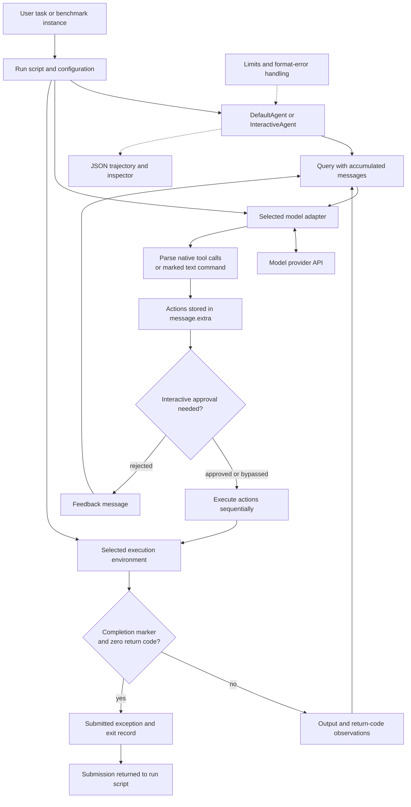

# mini-swe-agent: architecture and builder's handbook

Source-grounded study of the public [SWE-agent/mini-swe-agent repository](https://github.com/SWE-agent/mini-swe-agent).

## Snapshot and scope

The repository was cloned into `references/mini-swe-agent`. This handbook describes commit [`04d809ceab9df28f9adaed044884180159172930`](https://github.com/SWE-agent/mini-swe-agent/tree/04d809ceab9df28f9adaed044884180159172930), whose commit timestamp is 2026-09-03T01:05:59-04:00. The source declares version **2.4.6** in [`src/minisweagent/__init__.py`](../mini-swe-agent/src/minisweagent/__init__.py). It is a v2 snapshot, not the original v1 implementation commonly described in older articles.

The study covers the agent loop, action protocols, model adapters, execution environments, interactive host, configuration, trajectories, benchmark runners, and important omissions. This is a static source investigation; no live model calls, container workloads, or benchmark evaluations were run. References to tests describe inspected test coverage, not a claim that the whole test suite passed here.

These are public MIT-licensed sources, not a leak. The aim is the same as the earlier Claude Code handbook: explain enough of the implementation that a builder can use this document as a working reference without repeatedly rediscovering the repository. Source links are relative to this document; the commit above fixes their interpretation. Recommendations are identified separately from observed behavior.

## Contents

1. [Executive summary](#1-executive-summary)
2. [The coding agent in detail](#2-the-coding-agent-in-detail)
3. [Architecture graphs](#3-architecture-graphs)
4. [Repository map and reading route](#4-repository-map-and-reading-route)
5. [The three component contracts](#5-the-three-component-contracts)
6. [Construction and a complete coding task](#6-construction-and-a-complete-coding-task)
7. [The exact control loop](#7-the-exact-control-loop)
8. [Native tool calls and text actions](#8-native-tool-calls-and-text-actions)
9. [Model adapters and provider compatibility](#9-model-adapters-and-provider-compatibility)
10. [Execution environments and state](#10-execution-environments-and-state)
11. [Completion and submission](#11-completion-and-submission)
12. [Interactive operation and approval](#12-interactive-operation-and-approval)
13. [Prompts and configuration](#13-prompts-and-configuration)
14. [Context management and caching](#14-context-management-and-caching)
15. [Costs, limits, and retry](#15-costs-limits-and-retry)
16. [Errors, interruption, and cleanup](#16-errors-interruption-and-cleanup)
17. [Trajectories, inspection, and continuation](#17-trajectories-inspection-and-continuation)
18. [Benchmark orchestration](#18-benchmark-orchestration)
19. [MCP, web access, memory, and subagents](#19-mcp-web-access-memory-and-subagents)
20. [Security and authority boundaries](#20-security-and-authority-boundaries)
21. [Extension recipes](#21-extension-recipes)
22. [A blueprint for building a similar agent](#22-a-blueprint-for-building-a-similar-agent)
23. [Testing and evaluation](#23-testing-and-evaluation)
24. [Failure modes and implementation subtleties](#24-failure-modes-and-implementation-subtleties)
25. [Comparison with richer harnesses](#25-comparison-with-richer-harnesses)
26. [Source index and search recipes](#26-source-index-and-search-recipes)
27. [What this snapshot establishes](#27-what-this-snapshot-establishes)
28. [Glossary](#28-glossary)

## 1. Executive summary

**mini-swe-agent is a small, replaceable model–shell feedback loop.** Rather than implementing a large vocabulary of file, search, edit, test, planning, and delegation tools, it exposes shell execution and lets the language model compose the developer workflow with commands. Most architectural complexity is moved into the chosen model and execution environment.

Its design has ten principal parts:

1. **Three interchangeable components.** A run script constructs a model, environment, and agent. The agent owns control flow and conversation; the model adapter owns inference and action/observation formatting; the environment owns command effects. Protocols describe the boundary without requiring a large inheritance framework.
2. **A short central loop.** `DefaultAgent.run()` prepares the initial messages and repeatedly calls `step()`. A step queries the model and executes its actions. Messages accumulate linearly until a structured exit record is appended.
3. **One effectful primitive.** The model's built-in capability is `bash(command)`. Repository discovery, file reading/writing, tests, Git, and external commands are ordinary shell operations. There is no separate native editing engine maintaining read-before-write state.
4. **Two action protocols.** The v2 default model adapter uses native function/tool calls. Text-based adapters remain available and parse exactly one marked code block. Older descriptions that say the project never uses tool calling do not describe the recommended v2 path.
5. **Fresh command processes.** Each action executes independently, normally in a new shell process. A container or working tree can persist while shell-local variables and directory changes do not. This makes switching local execution to a container comparatively simple.
6. **An environment-driven finish signal.** A successful command whose first non-leading-whitespace output line is a specific completion marker raises `Submitted`. Remaining output becomes the submission. The default loop does not treat an ordinary prose answer as task completion.
7. **A small interactive extension.** `InteractiveAgent` adds human, confirmation, and unrestricted modes, rejection feedback, keyboard interruption, and optional confirmation before finishing. It extends the same query/execute loop rather than implementing a separate engine.
8. **Explicit configuration and traces.** YAML/Jinja templates describe task instructions and observation formatting. JSON trajectories preserve messages, actions, raw outputs, costs, configuration, and exit metadata. An inspector helps browse those records.
9. **Research and batch infrastructure.** SWE-bench and ProgramBench runners create environments per instance, construct independent agents, collect submissions, save trajectories, and optionally run many instances concurrently. Parallel benchmark instances are not cooperating subagents.
10. **Deliberately limited harness services.** The core has no native MCP manager, subagent supervisor, skills loader, automatic durable memory, or conversation compactor. Those features can be built around the contracts, but their complexity is not hidden inside the small loop.

The most reusable idea is **narrow interfaces with replaceable implementations**. The model can become more capable without changing the control loop, and the same action can run locally or inside an alternative environment. The tradeoff is that the agent relies heavily on model behavior and external execution boundaries rather than fine-grained host semantics.

Primary evidence: [component protocols](../mini-swe-agent/src/minisweagent/__init__.py), [default agent](../mini-swe-agent/src/minisweagent/agents/default.py), [native Bash action protocol](../mini-swe-agent/src/minisweagent/models/utils/actions_toolcall.py), [local environment](../mini-swe-agent/src/minisweagent/environments/local.py).

## 2. The coding agent in detail

### 2.1 How work is represented

The agent maintains a list of message dictionaries. A model response contains the provider-visible response plus an `extra` dictionary with parsed actions, cost, timestamps, and sometimes the original response. An action is principally a command string, optionally paired with a tool-call ID. An environment result carries output, a return code, and exception information.

The agent does not need to understand whether a command searches a repository, edits a file, or runs tests. It passes the action to the environment, obtains an observation, and appends model-compatible messages. This leaves a small orchestration boundary but grants the shell broad expressive power.

### 2.2 The coding cycle

For a bug fix, the model may list files, search for a symbol, inspect a function, write a reproduction script, modify the source with a shell command, and run tests. Each command's output becomes the next inference input. A failed test can lead to another inspection/edit cycle. Nothing in the default loop mandates those phases; prompt instructions and the model choose them.

```text
task -> initial prompt
     -> model response with command actions
     -> execute actions sequentially
     -> formatted output/return-code observations
     -> another model response
     -> completion marker -> exit record
```

### 2.3 v2 tool use

The normal `LitellmModel` supplies a function schema named `bash`. It accepts one or more tool calls in a model response, parses JSON arguments, rejects unknown tools or missing command arguments, and records call IDs. The default agent executes the resulting list sequentially. Multiple requested actions do not imply concurrent execution.

The text adapter uses a regular expression to extract exactly one `mswea_bash_command` code block. The parser lives in the model layer, allowing the core agent to work with either protocol.

### 2.4 Termination and recovery

Every normal inference response must produce an action in the supported protocol. A text-only answer on the native path becomes a format error. The model is expected to issue a shell command that prints the completion marker when finished.

Format errors are converted to corrective messages, with a configurable consecutive-error limit. Expected control-flow exceptions can add feedback or terminate the run. Unanticipated exceptions are recorded, the trajectory is saved in `finally`, and the error is re-raised.

### 2.5 Execution and approval

The local environment executes under the host user's available authority. An alternative environment changes where commands run. The interactive agent can ask the human to approve a proposed batch, but it does not implement a detailed semantic classifier for every possible shell effect.

The filesystem persists across command invocations. A prior `cd`, `export`, shell function, or activated virtual environment does not automatically persist to the next invocation. Commands must encode their needed context or use files to retain information.

### 2.6 The meaning of simplicity

The small loop is real, but it is not the whole repository. Model integration, configuration, containers, retries, interactive behavior, multimodal conversion, trajectories, and benchmarks add code around it. Its simplicity comes from a limited central contract, not from having no dependencies or operational requirements.

## 3. Architecture graphs

### 3.1 Component and execution structure



### 3.2 State boundaries

```text
Agent object: messages, counters, configuration, task template variables
Model adapter: provider settings, action parser, observation formatter
Environment: working tree/container plus execution configuration
Each action: fresh process/shell state
Trajectory file: durable record of the run
Benchmark runner: collection of independent agent/environment instances
```

The environment box can retain files without retaining a shell session. The graph contains no built-in cooperating subagent hierarchy.

## 4. Repository map and reading route

| Path under `src/minisweagent/` | Responsibility |
|---|---|
| `__init__.py` | Version, global configuration bootstrap, component protocols |
| `agents/default.py` | Core loop, counters, expected exceptions, serialization |
| `agents/interactive.py` | User interaction, confirmation modes, interruption |
| `exceptions.py` | Message-carrying control-flow exceptions |
| `models/__init__.py` | Model selection and process-wide usage tracking |
| `models/litellm_model.py` | Default native-tool-call model adapter |
| `models/litellm_textbased_model.py` | Text-action variant |
| `models/litellm_response_model.py` | Responses API variant |
| `models/openrouter*`, `portkey*`, `requesty_model.py` | Alternative provider adapters |
| `models/utils/` | Action protocols, cache markers, retries, multimodal compatibility |
| `environments/local.py`, `docker.py`, `singularity.py` | Main execution implementations |
| `environments/extra/` | Bubblewrap, SWE-ReX/Modal, and Contree alternatives |
| `config/` | Task prompts and observation/error templates |
| `run/mini.py` | Default interactive CLI construction |
| `run/hello_world.py` | Small example of component assembly |
| `run/benchmarks/` | SWE-bench/ProgramBench orchestration |
| `run/utilities/inspector.py` | Trajectory browsing UI |
| `utils/serialize.py` | Recursive configuration/metadata merge |

Read the protocols, default agent, native action helpers, local environment, and one run script first. Then read interactive behavior and model-specific adapters. Benchmark code is best understood after the distinction between a submission and a workspace patch is clear.

## 5. The three component contracts

### 5.1 Agent

The [Agent protocol](../mini-swe-agent/src/minisweagent/__init__.py) exposes a configured object with `run(task, ...)` and `save(...)`. `DefaultAgent` additionally exposes small methods such as `query`, `execute_actions`, `add_messages`, `serialize`, and template rendering. Subclasses can override one of these hooks without reconstructing the entire loop.

The agent owns message order and high-level control. It does not itself call a provider SDK or select a container command.

### 5.2 Model

The Model protocol includes:

- `query(messages, ...)`: obtain a response and parsed actions.
- `format_message(...)`: construct a message compatible with this adapter.
- `format_observation_messages(...)`: turn command results into the next conversation entries.
- `get_template_vars(...)`: expose configuration to templates.
- `serialize()`: report model configuration and metadata.

Putting observation formatting here accommodates both chat-completion tool messages and Responses API output items. Putting action parsing here keeps the loop independent of whether commands arrived as JSON function arguments or marked text.

### 5.3 Environment

The Environment protocol exposes `execute(action, cwd=...)`, template variables, and serialization. The effect boundary is narrow: actions enter, result dictionaries return, and certain results raise a message-carrying completion exception.

The interface itself does not guarantee sandboxing, atomic edits, approval, filesystem snapshots, or persistent shell state. Those are properties of a particular implementation or wrapper.

### 5.4 Why the contracts are useful

The default loop can be paired with a fake/deterministic model, a different API provider, a local filesystem, or a remote execution service. Changing action transport should require a model adapter; changing execution location should require an environment. A new loop is necessary only when the desired control flow itself changes.

## 6. Construction and a complete coding task

### 6.1 How `mini` starts

[`run/mini.py`](../mini-swe-agent/src/minisweagent/run/mini.py) loads configuration specifications, merges explicit CLI overrides, obtains a task or prompts for one, and constructs the model, environment, and agent. Its default agent is interactive and its default environment is local. Its default configuration is `mini.yaml`, not the older text-oriented `default.yaml`.

Model selection comes from explicit input, configuration, or `MSWEA_MODEL_NAME`; no model is universally hardcoded as the default. The model-class selector normally returns `LitellmModel` unless configured otherwise.

### 6.2 A plausible bug-fix execution

Suppose the task is to fix a parser's null handling. The agent renders its initial system/task templates. The model requests commands to discover source files and inspect the parser. It observes output and decides whether to reproduce the failure.

It may write a small reproduction with a heredoc, edit the parser using a Python script or `sed`, and run relevant tests. The host sees all these as command actions. A subsequent nonzero test result is formatted into the next message; it does not automatically terminate the agent.

When satisfied, the model prints the finish marker. A benchmark prompt may require the model to print a patch after that marker. The environment raises `Submitted`, the loop appends its exit record, and the run script consumes the submission.

This example is explanatory, not a recorded model execution. The code provides feedback mechanics; the model supplies the investigation and repair strategy.

### 6.3 What the host does not infer

The host does not know that a command named `pytest` verified the right behavior, that a textual edit was semantically correct, or that a Git patch obeyed benchmark instructions. It records effects/output and follows its protocol. Correctness depends on the model's choices plus external tests/evaluation.

## 7. The exact control loop

[`DefaultAgent`](../mini-swe-agent/src/minisweagent/agents/default.py) is the authoritative implementation. Its structure is approximately:

```text
initialize task template variables and initial messages
while no exit record:
    query model and execute returned actions
    reset consecutive format-error count on a clean step
    convert expected flow interruptions to messages
    count/handle consecutive formatting failures
    record unexpected exceptions and re-raise them
    save configured trajectory in finally
return metadata of the exit record
```

### 7.1 Query

`query()` checks per-agent step/cost and wall-clock limits before inference, increments the model-call counter, calls the adapter, accumulates returned cost, appends the response, and returns it.

### 7.2 Execution

`execute_actions()` reads `message.extra.actions`, calls `env.execute` for each action using a sequential list comprehension, then asks the model adapter to format the results and appends them.

There is no central graph scheduler, read/write conflict analysis, parallel safe-tool batching, or background-task framework in this method. Those could be introduced by an alternate implementation, but they are not part of the observed default.

### 7.3 Loop exit

The stopping condition is the last message's `role == "exit"`. The return value comes from that record's `extra` metadata, typically including `exit_status` and `submission`.

The `exit` role is an internal record convention; it is not a normal provider chat role that should be sent into another inference request. The loop stops before doing so.

### 7.4 Object reuse matters

`run()` clears `messages`, but counters, accumulated cost, and `_start_time` are initialized in the constructor rather than fully reset there. Task template variables are merged into an existing dictionary. For an independent new workload, construct a new agent object unless you intentionally want those lifetimes. A fresh message list does not imply a fully reset run budget.

## 8. Native tool calls and text actions

### 8.1 Native protocol

[`actions_toolcall.py`](../mini-swe-agent/src/minisweagent/models/utils/actions_toolcall.py) defines a single function tool named `bash` with a required `command` string. Parsing requires at least one tool call, rejects unknown tool names, parses argument JSON, and checks for the command key.

Each parsed action retains the tool-call ID. Observations become `role="tool"` messages with the matching ID, rendered using the configured observation template. Human-originated commands without IDs become user observations.

The code checks JSON shape/key presence, but it is not a complete semantic shell validator. A model-facing schema's `string` declaration alone does not establish that every locally parsed input is strictly type-validated before execution.

### 8.2 Text protocol

[`actions_text.py`](../mini-swe-agent/src/minisweagent/models/utils/actions_text.py) extracts actions using a configurable regular expression and requires exactly one match. The default marked fence is `mswea_bash_command`. Output becomes user-role observation messages rather than tool-ID results.

The special fence reduces accidental extraction of incidental examples, but remains a parsing convention. Quoted source text that resembles the protocol can confuse a model or parser. It is not a security boundary.

### 8.3 Responses API protocol

[`actions_toolcall_response.py`](../mini-swe-agent/src/minisweagent/models/utils/actions_toolcall_response.py) translates function-call output items and `call_id` values into the same action dictionary shape. Observations become `function_call_output` items. An incomplete response with `max_output_tokens` maps to a common truncation reason for corrective templates.

### 8.4 Missing and partial observations

The native and Responses formatters can pad missing results with an explicit “action was not executed” observation. This is useful for rejection/interruption paths. Whether those formatters are reached depends on the agent implementation: the interactive executor uses a `finally` block to preserve partial observations; the default executor does not provide that same guarantee around an exception in its action list comprehension.

## 9. Model adapters and provider compatibility

### 9.1 Default LiteLLM path

[`litellm_model.py`](../mini-swe-agent/src/minisweagent/models/litellm_model.py) supplies the Bash schema to `litellm.completion`, prepares messages, retries eligible request errors, calculates cost, parses actions, and packages the resulting message.

Its adapter removes `extra` metadata before calling the API. It also adjusts Anthropic thinking blocks and can add cache-control markers. Thus the canonical trajectory is linear and easy to inspect, but it is not necessarily byte-identical to the provider request.

### 9.2 Responses API path

[`litellm_response_model.py`](../mini-swe-agent/src/minisweagent/models/litellm_response_model.py) calls `litellm.responses`. It retains whole response objects in the trajectory and flattens their output items when constructing later stateless requests. This keeps the run's information locally visible rather than relying solely on a server-held conversation ID.

### 9.3 Alternative adapters

OpenRouter, Portkey, Requesty, and text/Responses variants maintain the same core contracts while changing API transport and formatting. A deterministic model implementation supports controlled development/testing. [`models/__init__.py`](../mini-swe-agent/src/minisweagent/models/__init__.py) selects classes through aliases or explicit import paths.

Provider support therefore lives in adapters and dependencies, not an ever-growing `if provider` branch inside the agent loop.

### 9.4 Formatting failures preserve evidence

When action parsing fails after a billed request, adapters attach cost and the original response to the `FormatError` message before re-raising. Serialization falls back to a representation if the provider object's normal dump fails. The agent can charge the failed response and save useful debugging evidence.

This is an important builder lesson: parsing failure does not mean no inference occurred or that the request was free.

## 10. Execution environments and state

### 10.1 Local execution

[`LocalEnvironment`](../mini-swe-agent/src/minisweagent/environments/local.py) selects a working directory from the invocation, configuration, or current process. It combines the host environment with configured overrides and launches the command with shell interpretation. Standard error joins standard output.

The current implementation uses a `Popen` helper and `communicate`, rather than only the `subprocess.run` shorthand used in broad project descriptions. On POSIX it creates a new session and kills the process group on timeout, then captures remaining output. This matters when a command launches children: killing only the immediate shell could leave work running.

Execution exceptions are converted to a result with return code `-1`, partial output where available, exception information, and metadata. The agent usually sees an observation and can adjust. This conversion is specific to execution failures; not every exception in the whole program is swallowed.

### 10.2 Docker and compatible runtimes

[`DockerEnvironment`](../mini-swe-agent/src/minisweagent/environments/docker.py) starts a long-lived container, generally kept alive by a sleep command. Actions use separate `docker exec` invocations with an explicit cwd and interpreter. Configured environment values and selected forwarded host values are passed explicitly.

The filesystem inside the container persists across commands. The individual Bash processes do not. Container startup lifetime, image-pull timeout, and per-command timeout are separate settings. A Docker-compatible executable can be selected through configuration, allowing compatible container runtimes where supported.

A timeout of the client-side `docker exec` subprocess is not the same verified guarantee as the local POSIX process-group kill. Do not assume all environment implementations terminate remote descendants identically; check the backend you deploy.

### 10.3 Other environments

| Implementation | Primary role | What to inspect before using it |
|---|---|---|
| [Singularity](../mini-swe-agent/src/minisweagent/environments/singularity.py) | Container execution on compatible research/HPC systems | Image handling, writable workspace, interpreter, cleanup |
| [Bubblewrap](../mini-swe-agent/src/minisweagent/environments/extra/bubblewrap.py) | Linux sandbox wrapper | Actual namespace/mount/network flags and platform support |
| [SWE-ReX Docker](../mini-swe-agent/src/minisweagent/environments/extra/swerex_docker.py) | Execution through the SWE-ReX service abstraction | Connection/runtime semantics and lifecycle |
| [SWE-ReX Modal](../mini-swe-agent/src/minisweagent/environments/extra/swerex_modal.py) | Remotely hosted execution | Credentials, resource lifetime, service behavior |
| [Contree](../mini-swe-agent/src/minisweagent/environments/extra/contree.py) | Alternative container/environment integration | Provider-specific execution and cleanup |

The common protocol does not certify equal isolation. For example, the Bubblewrap wrapper's exact bind mounts and namespace flags determine what it can access; the name alone is insufficient evidence of network or credential isolation.

### 10.4 Fresh shells are a deliberate constraint

Commands such as `cd project`, `export NAME=value`, and `source .venv/bin/activate` affect only that action's shell unless persisted in files or repeated as part of later commands. A reliable action can use an explicit directory prefix and executable path. The agent prompt explains this constraint.

State still exists in several places: files, container state, model messages, API/client configuration, and agent counters. “Stateless actions” means no required persistent shell interpreter, not a world without state.

## 11. Completion and submission

### 11.1 The exact marker condition

The environment's `_check_finished` examines output after stripping leading whitespace. If the first line equals `COMPLETE_TASK_AND_SUBMIT_FINAL_OUTPUT` and the return code is zero, it raises `Submitted`. Text after that line becomes the submission.

The marker must occupy the first relevant line; merely mentioning it later in a long command log does not satisfy that condition. A nonzero return code also prevents that successful-completion path.

### 11.2 Why the finish signal is in the environment

Every model protocol ultimately produces command actions. Placing completion recognition in the environment makes the same finish convention work for text actions, chat tool calls, and Responses output items. The main loop only needs to handle the message-carrying interruption and exit record.

The cost is coupling: the execution environment now also understands an agent-level protocol. A new environment that forgets the convention can execute the finish command successfully while leaving the agent running.

### 11.3 Submission is not automatically a patch

For a general CLI task, the submission can be ordinary final text printed after the marker. For SWE-bench, the prompt asks the agent to prepare a patch and emit it through the submission convention. The environment does not independently compute the correct `git diff` or verify that only permitted files are included.

The runner stores the returned submission as `model_patch`. Therefore benchmark artifact correctness is part of the prompt/model workflow and should be validated externally.

### 11.4 Protocol collision

The marker is ordinary process output, not an authenticated control channel. A command that unexpectedly prints it as its first successful line can be mistaken for completion. This is a direct consequence of the implementation, not evidence that a particular exploit occurred.

Builder recommendation: if adapting the design to untrusted external output, consider a structured completion action or a separate host-validated signal. Keep compatibility with benchmark conventions where necessary, but understand their trust assumptions.

## 12. Interactive operation and approval

[`InteractiveAgent`](../mini-swe-agent/src/minisweagent/agents/interactive.py) extends a few default methods rather than replacing the entire run loop.

| Mode | Behavior |
|---|---|
| `human` | Read commands from the human and execute them as actions |
| `confirm` | Ask before model commands unless a whitelist regex matches |
| `yolo` | Execute model commands without command confirmation |

The default interactive configuration selects confirmation. Slash commands switch modes, show help, or collect multiline input.

### 12.1 Confirmation is batch-oriented

The implementation collects the response's commands and asks whether to execute the batch when any command requires confirmation. Rejection becomes a user message explaining that the commands were not executed. The model can then propose another approach.

Whitelist matching uses regular expressions through `re.match`. It is not a shell AST policy or a full capability classifier. An overly broad prefix expression can approve more than intended.

### 12.2 Finishing can invite another assignment

When submission occurs, `confirm_exit` can ask whether to finish or accept a new task/comment. Additional input becomes another message in the current conversation. This is interactive continuation within a live object, distinct from durable checkpoint restoration after process restart.

### 12.3 Interruption and limits

Keyboard interruption is caught around an interactive step and turned into feedback after prompting the user. Step/cost limits can be raised interactively when stdin is a terminal. Wall-clock exhaustion is handled separately, because raising the step/cost caps would not reset the elapsed clock. Unattended stdin avoids prompting for new limits.

### 12.4 Partial results

The interactive action executor records whatever observations it has in a `finally` block. This gives it better partial-result preservation than the default action-list comprehension when an expected flow interruption happens mid-batch. The formatter fills missing action slots explicitly.

This design is useful for human-in-the-loop experiments, but it is much smaller than a permission service with persistent rules, per-resource grants, remote approval routing, and automatic risk classification.

## 13. Prompts and configuration

### 13.1 Configuration sources

[`config/__init__.py`](../mini-swe-agent/src/minisweagent/config/__init__.py) resolves YAML paths and dotted key-value specifications. Candidate paths include the supplied path, configured search directory, built-in configs, and benchmark configs. YAML is loaded with `safe_load`.

[`recursive_merge`](../mini-swe-agent/src/minisweagent/utils/serialize.py) merges nested dictionaries with later values taking precedence and skips a special `UNSET` sentinel. Lists and scalar values are replaced rather than automatically concatenated.

The CLI's repeated `-c` option replaces the default config list. Supplying just one override does not mean “load the normal config and apply this”; explicitly include the base configuration if needed. This is a practical source of otherwise surprising missing-template errors.

### 13.2 Jinja templates

The agent combines configuration, environment/model template variables, call count, cost, elapsed time, task variables, and explicit overrides. It renders using Jinja `StrictUndefined`, so missing variables fail visibly instead of silently producing empty instructions.

Templates control system/task instructions, observations, and format-error feedback. They are a major source of behavioral policy: workflow suggestions, restrictions on test/config edits, and submission instructions often live here rather than in host enforcement.

### 13.3 Class defaults differ from shipped configs

`AgentConfig` declares defaults such as a positive cost cap, while particular YAML files can disable or replace those settings. `mini.yaml`, `mini_textbased.yaml`, and benchmark configs select different protocols and workflows. Quote the effective configuration when discussing a run; class defaults alone are not enough.

### 13.4 Environment and secrets

Package import locates a global `.env` configuration file and loads it. Local execution can inherit the host environment, and local template variables include environment values. The fact that values are available to templates does not mean every prompt interpolates them, but broad interpolation can expose information unintentionally.

Builder recommendation: keep credentials separate from model-visible template variables and inspect serialized configuration before sharing trajectories.

## 14. Context management and caching

### 14.1 Linear history

The default agent appends messages and sends the accumulated conversation back through the model adapter. There is no native history branching, automatic summarization, or retrieval-based conversation memory in this path.

This makes debugging and training-data extraction straightforward: the causal sequence is explicit. It also means longer tasks eventually hit model context limits unless output is kept small or an extension changes context policy.

### 14.2 Observation truncation

The shipped task configurations use observation templates that bound large command output. A representative template retains the first and last 5,000 characters when output reaches the large-output threshold, with an omission count and advice to issue a narrower command.

That is observation formatting, not conversation compaction. Previous messages remain in history. The model can deliberately redirect a large command's output to a file and query portions later, but the core does not automatically persist every omitted output as an artifact.

The trajectory can retain `extra.raw_output` even when the model-visible observation is shorter. Thus a human inspector may see information that the model did not receive verbatim.

### 14.3 Cache control

[`cache_control.py`](../mini-swe-agent/src/minisweagent/models/utils/cache_control.py) can attach explicit ephemeral cache markers to the prepared conversation. It works on a copied representation when enabled and clears/repositions prior markers. This is provider request shaping, not a local semantic memory cache.

Caching can reduce the cost of repeating a compatible prefix. It does not solve context overflow or guarantee that all providers support the same block structure. The adapter contains compatibility handling for tool messages and thinking blocks.

### 14.4 Multimodal observations

[`openai_multimodal.py`](../mini-swe-agent/src/minisweagent/models/utils/openai_multimodal.py) can expand specially recognized content into multimodal messages when configured. This broadens observation representation without changing the command-oriented core. Enabling it is different from shipping a dedicated screenshot/browser tool suite.

## 15. Costs, limits, and retry

### 15.1 Local accounting

The agent increments its call counter before querying and accumulates cost returned in response metadata. Limits are checked before the next query. A cost cap is therefore a stopping threshold, not an exact preauthorization ensuring the next request cannot exceed it.

Format-error responses are charged through a special path, since normal `query()` did not receive a successful parsed message. Consecutive formatting failures can terminate with `RepeatedFormatError`.

### 15.2 Process-wide accounting

[`GlobalModelStats`](../mini-swe-agent/src/minisweagent/models/__init__.py) tracks usage across model instances under a lock and supports process-wide limits. This matters when benchmark threads run concurrently. A process-wide cap is separate from a per-agent budget and can terminate work through a different exception path.

### 15.3 Cost metadata can be missing

The LiteLLM adapter normally requires meaningful cost calculation. Unknown models or missing pricing can raise a runtime error unless configured to ignore cost errors. In ignore mode, zero recorded cost must not be mistaken for zero real spend.

### 15.4 Retry policy

[`retry.py`](../mini-swe-agent/src/minisweagent/models/utils/retry.py) wraps Tenacity with a default maximum of ten attempts and exponential waits bounded between four and sixty seconds. The maximum is configurable. Authentication, unsupported parameters, missing models, permission errors, and context overflow are among the default abort categories in the LiteLLM adapter.

Model transport retries are not a mechanism for replaying shell actions. Keep inference retry separate from effect retry: rerunning a command can duplicate writes, commits, or external operations.

### 15.5 Wall-clock limits

The agent's wall-time check occurs before model queries and uses elapsed time since object construction. It does not preempt every slow API request or command at an exact deadline. Environment timeouts and provider timeouts are separate controls. Use an outer supervisor if a strict end-to-end deadline is required.

## 16. Errors, interruption, and cleanup

### 16.1 Message-carrying exceptions

[`exceptions.py`](../mini-swe-agent/src/minisweagent/exceptions.py) defines `InterruptAgentFlow`, `Submitted`, `LimitsExceeded`, `TimeExceeded`, `UserInterruption`, and `FormatError`. Expected control flow carries messages to append, rather than requiring every layer to return a large tagged union.

This keeps methods short, but exception identity now has semantic importance. Accidentally catching a completion exception as a generic command failure would change whether the run terminates.

### 16.2 Ordinary command failures

A command's nonzero exit code normally returns an observation for the model to interpret. It is not the same as a Python exception aborting the host. Commands that time out can likewise return partial output and exception metadata.

### 16.3 Unexpected host failures

The default run records exception text and traceback in an exit-shaped message, saves in `finally`, and re-raises. This provides evidence without pretending execution succeeded. Saving can itself fail; a plain JSON write is not a transactional checkpoint system.

### 16.4 Cleanup ownership

Environment implementations own cleanup behavior. Docker attempts shutdown/removal; Bubblewrap owns a temporary workspace; remote wrappers have service-specific lifecycle concerns. Some cleanup is triggered by destructors, whose timing is less explicit than a managed context boundary.

Builder recommendation: for production use, give each environment an explicit lifecycle owner with `try/finally` or a context manager. Test descendant processes and remote resources after timeout, interruption, and host failure.

## 17. Trajectories, inspection, and continuation

### 17.1 Serialized structure

The default serializer includes:

| Field | Contents |
|---|---|
| `messages` | Ordered conversation records, actions, observations, and exit record |
| `info.model_stats` | Instance cost and API-call count |
| `info.config` | Agent/model/environment settings and implementation type names |
| `info.exit_status`, `info.submission` | Terminal outcome and returned payload |
| `info.mini_version` | Version identity |
| `trajectory_format` | Declared trajectory format version |

Additional dictionaries are recursively merged into the result. The save method rewrites formatted JSON at the chosen path after each loop pass when configured.

### 17.2 Why these records are useful

The record shows what the model proposed, what was executed, what output was observed, and why the run ended. Original provider responses and raw output can support parser debugging and cost investigation. This is valuable both for engineering and for research on model behavior.

However, tools/dependencies/configuration can change, and shell effects are external state. A trajectory alone does not recreate a filesystem or safely replay commands.

### 17.3 Inspector and continuation

[`inspector.py`](../mini-swe-agent/src/minisweagent/run/utilities/inspector.py) groups messages into steps and provides a Textual interface for browsing. This is a trajectory viewer, not a second agent runtime.

The inspected default path does not implement a full durable checkpoint/resume service. Interactive new-task feedback can continue a live conversation, and custom code can seed state, but importing JSON is not automatically equivalent to restoring environment state, budgets, credentials, and in-flight effects.

## 18. Benchmark orchestration

### 18.1 SWE-bench flow

[`run/benchmarks/swebench.py`](../mini-swe-agent/src/minisweagent/run/benchmarks/swebench.py) selects instances, prepares instance-specific environment configuration, creates a model/agent, runs the problem statement, saves a trajectory, and updates predictions.

It maps dataset aliases, supports filtering/slicing/shuffling, selects Docker image names, and can run an environment startup command. A progress-tracking agent adds reporting around the same underlying loop.

### 18.2 Submission contract

[`config/benchmarks/swebench.yaml`](../mini-swe-agent/src/minisweagent/config/benchmarks/swebench.yaml) supplies repository-task instructions and a patch-producing finish procedure. The batch runner writes the submission to a prediction record with instance and model identity.

The runner produces artifacts for evaluation; it does not establish that a patch resolves the task merely because `Submitted` was reached. Scoring belongs to the appropriate external evaluation harness.

### 18.3 Parallelism

Worker threads run independent instances. Each instance constructs its own environment and agent; prediction-file updates are protected by a lock. This is throughput parallelism across tasks, not a shared agent team collaborating on one issue.

### 18.4 ProgramBench and single-instance entrypoints

[ProgramBench](../mini-swe-agent/src/minisweagent/run/benchmarks/programbench.py) has task-specific setup, execution, and result handling. [swebench_single.py](../mini-swe-agent/src/minisweagent/run/benchmarks/swebench_single.py) provides focused single-instance workflows. Keep benchmark prompt/environment/evaluator assumptions together when comparing results.

The README's performance claims are context, not fresh measured results from this study. No benchmark percentage is independently reproduced here.

## 19. MCP, web access, memory, and subagents

### 19.1 What the core actually includes

Searches of the inspected `src/minisweagent` tree found no native MCP client manager, subagent framework, skills loader, AGENTS.md instruction discovery, or conversation compactor. The core's capability remains shell execution.

This scope statement is more precise than claiming these behaviors are impossible: a shell command can invoke an external CLI or script, and an application can wrap the component protocols with additional services.

### 19.2 Web search

There is no built-in web-search tool or managed search-provider connection in this core. A model can run a network/search CLI or a script using an API if the environment contains the tools and credentials. The host then sees ordinary command output. Search retrieval quality, authentication, citations, and network policy belong to that integration.

### 19.3 MCP

To add MCP cleanly, decide whether it remains behind a shell-invoked client or becomes an additional structured action type. The latter requires changes to schemas/parsers, execution dispatch, observation formatting, lifecycle management, and approval. Merely making MCP metadata visible in a prompt does not implement the protocol.

### 19.4 Memory and instructions

Conversation messages provide in-run context. Files can store notes that the model later reads through commands. Neither is an automatic cross-session memory service. A run script could explicitly load project instructions into task/system templates; that behavior is not present simply because the repository itself has an AGENTS.md for contributors.

### 19.5 Subagents

A parent could launch another process running mini, but the default system does not supervise such a child as an agent with tracked identity, scoped permissions, summarized results, or coordinated cancellation. Building that requires an outer orchestrator. Benchmark worker parallelism should not be relabeled as delegation.

## 20. Security and authority boundaries

The architecture's small interface does not imply small authority. One shell primitive can read/write files, invoke programs, and reach networks to the extent its environment allows.

| Boundary | What it provides | What it does not establish |
|---|---|---|
| Action parser | Expected action shape/name | Benign command semantics |
| Interactive confirmation | Human decision on proposed commands | Automatic complete risk analysis |
| Whitelist regex | Reduced confirmation for matching text | Shell-aware proof of safe effects |
| Local environment cwd | Default starting directory | Filesystem confinement |
| Container/sandbox wrapper | Configured execution separation | Equal protection across all wrappers/settings |
| Prompt constraints | Model-facing workflow guidance | Host enforcement of every instruction |
| Output template | Bounded model-visible observations | Bounded raw process memory in every implementation |

A working directory is not a sandbox. A benchmark prompt saying not to edit tests is not an operating-system prohibition. A single command string is not necessarily one low-impact operation: it can contain pipelines, scripts, substitutions, and redirections.

For a similar system, restrict mounts, credentials, network, and process lifetime in the environment; keep approvals outside model-generated text; and record execution evidence. These recommendations follow directly from the broad authority of the shell boundary rather than from a claim that every deployment needs the same policy.

## 21. Extension recipes

These are design recommendations based on the existing seams, not preexisting features claimed for the default agent.

### 21.1 Change the model without changing control flow

Implement the Model protocol and return messages with the same parsed `extra.actions` contract. Translate provider-specific tool IDs and observation formats inside the adapter. Preserve raw response/cost evidence if parsing fails. Keep authentication and transport retries there rather than adding provider branches to the agent.

### 21.2 Change execution location

Implement Environment around a local process, container, or remote service. Return output/return-code/exception data consistently and preserve the completion contract if using the existing loop. Specify which state survives calls, what cwd means, how credentials enter the process, and how timeout/cleanup work.

If the environment cannot guarantee descendant cleanup, expose that limitation rather than reporting timeout as if all work had stopped.

### 21.3 Add a verification gate

A subclass can intercept a proposed finish and run checks before allowing completion. Keep independent verification outside the model's own statement that it is finished. Preserve the distinction between a failing check, an unavailable dependency, and a host failure.

Avoid making an unconditional extra test command a universal policy: the appropriate check depends on the task and environment. A configurable external validator is often easier to reason about.

### 21.4 Add context reduction

Introduce a model-request view that summarizes or retrieves history while keeping the durable trajectory intact. Clearly label what was omitted and retain tool-ID pairing. This changes the project's strongest simplicity property, so make the transformation inspectable and measure whether it improves task success.

The existing observation formatter is suitable for output bounds; it is not sufficient for safe multi-turn conversation compaction by itself.

### 21.5 Add delegation

An outer supervisor can assign independent tasks to separate model/environment/agent triples. Define task identity, workspace isolation, cancellation, usage aggregation, result summarization, and failure handling before calling the feature “subagents.” If workers modify the same checkout, add ownership or explicit merge handling.

Keep concurrency across independent benchmark tasks separate from concurrency within one coding task. They have different shared-state requirements.

## 22. A blueprint for building a similar agent

### 22.1 Minimum viable architecture

```text
runner: choose model, environment, prompts, limits, output path
agent: own messages and continuation decisions
model: request inference, parse actions, format observations
environment: perform effects, return evidence, recognize finish
storage: save trajectory and terminal metadata
```

Start with one model adapter and one controlled environment. Keep action/result dictionaries small and documented. Add stable request IDs for native tool calling and explicit error observations.

### 22.2 Original explanatory pseudocode

```text
messages = render_initial_messages(task)
while True:
    check_limits()
    try:
        response = model.query(messages)
        account_for_response(response)
        append(response)
        for action in response.actions:
            result = environment.execute(action)
            append(model.observation(action, result))
    except ExpectedFlowChange as event:
        append(event.messages)
    finally:
        save_trajectory()
    if last_record_is_exit():
        return exit_metadata()
```

This is a design sketch, not a source excerpt or a claim that the default implementation appends each observation immediately. The actual default gathers outputs before formatting them; the interactive implementation adds partial-result handling.

### 22.3 Build in stages

1. **A deterministic single-action loop.** Use a fixed-response test model, a temporary workspace, and a simple execution environment. Prove action/result order and completion.
2. **A live model adapter.** Add request conversion, JSON/text parsing, provider errors, usage, and preserved evidence for malformed output.
3. **Execution reliability.** Add timeouts, process-group cleanup, working-directory rules, and bounded observations. Verify filesystem changes independently of success strings.
4. **Human control.** Add approve/reject feedback and an explicit unattended mode. Make defaults clear.
5. **Durable records.** Save messages, actions, raw observations, effective configuration, version identity, and exit reason. Add an inspector before complex orchestration.
6. **Controlled scale.** Run independent environments in a batch with resource and cost limits. Separate scoring from artifact production.
7. **Only then add richer harness features.** Memory, MCP, skills, compaction, and delegation should have explicit contracts and tests rather than being hidden in ad hoc prompt text.

### 22.4 Decisions worth revisiting

For a production derivative, consider stricter action typing, an authenticated finish action, incremental observation recording, atomic trajectory writes, explicit environment lifecycle, and an outer wall-clock supervisor. These improve failure handling but increase implementation size.

Do not add complexity merely to resemble a larger coding product. The value of this design is that many coding tasks can be investigated through a small interface, making changes and experiments easier to attribute.

## 23. Testing and evaluation

### 23.1 Existing source tests

The repository includes tests for loop completion, budgets, local timeouts, descendant cleanup, interactive behavior, parsers, provider adapters, cache control, raw-response preservation, CLI construction, serialization, and benchmark flows.

Useful starting points are [default agent tests](../mini-swe-agent/tests/agents/test_default.py), [local execution tests](../mini-swe-agent/tests/environments/test_local.py), [action parsing tests](../mini-swe-agent/tests/models/test_actions_toolcall.py), and [format-error persistence tests](../mini-swe-agent/tests/models/test_format_error_response_persistence.py).

### 23.2 Meaningful tests for a derivative

| Scenario | Observable behavior to verify |
|---|---|
| Two commands followed by finish | Correct effects, observations, submission, and exit reason |
| Invalid or absent action | Corrective feedback, billed cost retained, consecutive limit works |
| Multiple native calls | Sequential execution and correct result IDs |
| Rejected batch | No effects and explicit rejection feedback |
| Timeout with spawned child | Partial output preserved and actual descendant termination checked |
| Long output | Model-visible bounds and complete raw-output policy understood |
| Cost cap crossed | Stop before the next query; actual overshoot recorded |
| Missing pricing | Intentional failure or explicit ignore behavior |
| Completion marker collision | Exact semantics documented and appropriate guard tested |
| Save failure | Failure remains visible; no false successful persistence claim |
| Reusing an agent object | Message/counter/clock lifetimes behave as intended |
| Container cleanup | Resources actually removed after normal and exceptional exits |

### 23.3 Evaluate model competence separately

End-to-end coding evaluations should check patch correctness, relevant tests, unintended modifications, and faithful reporting, together with time/spend. A benchmark score belongs to a specific model, prompt, environment, dataset, and evaluation procedure. The loop's small size does not isolate all those variables automatically.

This study did not execute these tests or reproduce reported benchmark scores. It uses their source as corroborating documentation of intended observable behavior.

## 24. Failure modes and implementation subtleties

1. **The README's old text-only story is incomplete for v2.** Inspect the selected model class and `mini.yaml`, not only motivational prose.
2. **The “100-line agent” is a core-size description.** The current implementation plus adapters, UI, environments, and evaluation infrastructure is larger.
3. **Multiple tool calls are sequential in the default loop.** A model prompt mentioning independent calls does not create a parallel scheduler.
4. **An absent tool call is an error, not a normal final answer.** Completion uses the environment marker.
5. **Fresh processes do not reset files.** An edit survives; shell-local cwd and variables do not.
6. **A cwd is not confinement.** Absolute paths and shell commands can reach elsewhere under available authority.
7. **A cost limit can be exceeded by the last paid request.** The next query is where the ordinary agent checks again.
8. **A wall-time check is not preemptive cancellation.** It cannot by itself stop an already-blocked API call.
9. **The default and interactive executors preserve partial observations differently.** Follow the `finally` path when analyzing cancellation/submission mid-batch.
10. **Serialization is not full environment restoration.** A JSON file does not preserve a container, running process, or secrets.
11. **Canonical messages differ from wire requests.** Adapters remove `extra`, reorder/convert certain blocks, and flatten Responses output.
12. **Output-format bounds do not necessarily bound subprocess capture.** A formatter can truncate only after the process has already produced/captured the full output.
13. **Untracked new files may be absent from a naïve Git diff.** A model-authored patch procedure must account for the required artifact semantics.
14. **Prompt policies are not hard enforcement.** A prohibition on editing tests is not implemented by the generic shell dispatcher.
15. **Default objects retain some lifetime state.** Reinitializing messages is not equivalent to a fresh agent instance.

These are useful design constraints rather than reasons to dismiss the minimal approach. They tell you what an outer application or execution environment must own.

## 25. Comparison with richer harnesses

| Concern | This snapshot's default approach | Richer harness pattern |
|---|---|---|
| Repository navigation | Model composes shell commands | Dedicated bounded search/read tools, sometimes LSP |
| Editing | Shell utilities/scripts | Typed edit operations, stale-read checks, diff review |
| Planning | Prompt/model behavior | Todo state, workflow middleware, goal tracking |
| Context | Linear messages and bounded observations | Summarization, offloading, retrieval, projected history |
| Permissions | Optional interactive command confirmation | Resource rules, classifiers, hooks, remote approval |
| Isolation | Selected execution environment | Routed backends, worktrees, sandbox policies |
| Delegation | Application extension | Built-in child agents, tasks, messaging |
| External capabilities | Shell-invoked tools or extension | MCP client/session/tool registry |
| Persistence | JSON trajectory | Checkpointed graph state, resume protocols, file history |
| Benchmark scaling | Independent instances | Same technique, possibly more infrastructure |

Compared with the Claude Code snapshot, mini exposes far fewer host-level coding semantics. Compared with Deep Agents, it avoids constructing a graph/middleware/backend framework. The tradeoff is deliberate: fewer moving parts and clearer causal traces, with more responsibility assigned to the model and execution environment.

## 26. Source index and search recipes

### 26.1 Where to answer recurring questions

| Question | Source and symbols |
|---|---|
| What version and interfaces? | [`__init__.py`](../mini-swe-agent/src/minisweagent/__init__.py): version, Model/Environment/Agent protocols |
| Where is the loop? | [`agents/default.py`](../mini-swe-agent/src/minisweagent/agents/default.py): `run`, `step`, `query`, `execute_actions` |
| Why did the run stop? | [`exceptions.py`](../mini-swe-agent/src/minisweagent/exceptions.py) and the last exit record |
| How are commands parsed? | [`actions_toolcall.py`](../mini-swe-agent/src/minisweagent/models/utils/actions_toolcall.py), [`actions_text.py`](../mini-swe-agent/src/minisweagent/models/utils/actions_text.py) |
| What changes for Responses? | [`litellm_response_model.py`](../mini-swe-agent/src/minisweagent/models/litellm_response_model.py), [`actions_toolcall_response.py`](../mini-swe-agent/src/minisweagent/models/utils/actions_toolcall_response.py) |
| How is an API response packaged? | [`litellm_model.py`](../mini-swe-agent/src/minisweagent/models/litellm_model.py): `query`, `_parse_actions`, `_calculate_cost` |
| Where does confirmation happen? | [`interactive.py`](../mini-swe-agent/src/minisweagent/agents/interactive.py): `execute_actions`, `_ask_confirmation_or_interrupt` |
| What actually executes locally? | [`local.py`](../mini-swe-agent/src/minisweagent/environments/local.py): `execute`, `_run`, `_check_finished` |
| What persists in Docker? | [`docker.py`](../mini-swe-agent/src/minisweagent/environments/docker.py): startup, exec, cleanup |
| What settings reach the agent? | [`run/mini.py`](../mini-swe-agent/src/minisweagent/run/mini.py), [`config/__init__.py`](../mini-swe-agent/src/minisweagent/config/__init__.py) |
| Where are task instructions? | [`mini.yaml`](../mini-swe-agent/src/minisweagent/config/mini.yaml), [`swebench.yaml`](../mini-swe-agent/src/minisweagent/config/benchmarks/swebench.yaml) |
| How are traces saved? | [`default.py`](../mini-swe-agent/src/minisweagent/agents/default.py): `serialize`, `save` |
| How do I inspect a trace? | [`inspector.py`](../mini-swe-agent/src/minisweagent/run/utilities/inspector.py) |
| How are benchmark results produced? | [`swebench.py`](../mini-swe-agent/src/minisweagent/run/benchmarks/swebench.py): environment setup, instance processing, prediction writes |
| How are merges performed? | [`serialize.py`](../mini-swe-agent/src/minisweagent/utils/serialize.py): `recursive_merge`, `UNSET` |

### 26.2 Read-only investigation commands

From the clone root:

```bash
rg -n '^class |^    def ' src/minisweagent/agents/default.py
rg -n 'extra|actions|tool_call_id|FormatError' src/minisweagent/models/utils/actions_toolcall.py
rg -n 'Submitted|COMPLETE_TASK|Popen|killpg' src/minisweagent/environments/local.py
rg -n 'query|format_observation|_prepare_messages' src/minisweagent/models/litellm_model.py
rg -n 'mode|whitelist|confirm_exit|finally' src/minisweagent/agents/interactive.py
rg -n 'process_instance|ThreadPoolExecutor|model_patch' src/minisweagent/run/benchmarks/swebench.py
```

Always inspect the selected config and implementation together. “mini” is a family of small combinations, not one immutable provider/environment configuration.

## 27. What this snapshot establishes

The code establishes a small message/action/observation loop, replaceable model/environment protocols, a native-tool-call v2 default with text alternatives, environment-recognized completion, optional interactive approval, explicit usage limits, trajectory persistence, and independent benchmark orchestration.

It does not establish universal safe shell execution, perfect task completion, exact budget preauthorization, automatic memory, cooperating agents, native MCP support, or current benchmark performance. It also does not guarantee that all optional environment/provider integrations behave identically.

The original repository and this cloned commit are the authority for implementation. Product docs and README motivation are useful context; when they describe earlier versions or simplify a mechanism, follow the actual selected code path.

## 28. Glossary

| Term | Meaning here |
|---|---|
| Agent | Object owning the feedback loop, messages, and limits |
| Model adapter | Inference transport plus action parsing and observation formatting |
| Environment | Command execution implementation and effect boundary |
| Action | Command dictionary, optionally with a model tool-call ID |
| Observation | Model-facing representation of execution output/status |
| `extra` | Local metadata, including parsed actions/cost/raw data; normally stripped from API messages |
| Trajectory | Saved ordered run record with configuration and exit metadata |
| Submission | Payload after the environment's successful completion marker |
| Format error | Model output that cannot be used as the selected action protocol |
| Flow interruption | Expected exception carrying messages to add or an exit record |
| Fresh shell | Independent interpreter process per command action |
| Persistent environment | Files/container that can survive between fresh shell commands |
| Confirmation mode | Human approval of non-whitelisted model command batches |
| Benchmark worker | Independent task execution, not a teammate of the model |

---

**Validation note:** architecture claims were traced to the cloned source and relevant tests/configuration. Local source links and document structure were checked. No claim is made that the full application or benchmark suite was executed during this study.
