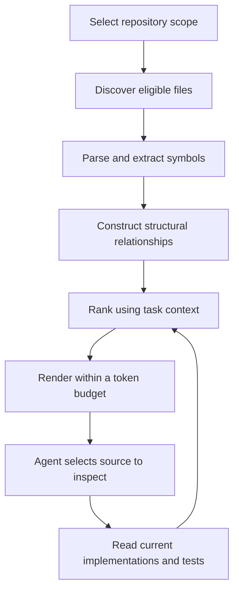

# Repository mapping for AI coding agents

Research date: 2026-10-14.

This guide explains how to prepare a large codebase so an AI agent can identify relevant files, understand available interfaces, and retrieve implementation details without repeatedly exploring the entire tree. It covers algorithms, available tools, adoption, maintenance, and evaluation.

Product behavior is grounded in linked primary documentation and source code inspected on the research date. Proposed architectures, schemas, budgets, and evaluation procedures are engineering recommendations, not claims that every listed tool implements them. Upstream links to `main` are moving references; pin versions and commits when reproducing behavior. Example application paths and symbols are illustrative.

## Contents

1. [What a repo map is](#1-what-a-repo-map-is)
2. [Comparison with other context techniques](#2-comparison-with-other-context-techniques)
3. [How automated maps are built](#3-how-automated-maps-are-built)
4. [A useful map format](#4-a-useful-map-format)
5. [Tools and practical commands](#5-tools-and-practical-commands)
6. [Adopting mapping in a large repository](#6-adopting-mapping-in-a-large-repository)
7. [Building a mapping service](#7-building-a-mapping-service)
8. [Freshness and incomplete code](#8-freshness-and-incomplete-code)
9. [Using maps during an agent task](#9-using-maps-during-an-agent-task)
10. [Evaluating whether mapping helps](#10-evaluating-whether-mapping-helps)
11. [Common failure modes](#11-common-failure-modes)
12. [A staged implementation plan](#12-a-staged-implementation-plan)
13. [Sources and further reading](#13-sources-and-further-reading)

## 1. What a repo map is

A **repository map** is a compact structural representation of a codebase. Its job is to answer: **what exists, where is it, and which parts should I inspect next?** A useful map connects paths with symbols and interfaces, rather than merely listing directory names.

For example, an agent changing retry behavior needs to find the request entry point, retry policy, transport interface, and relevant tests. Reading thousands of unrelated files is unnecessary. A map supplies navigation clues that lead to those few files.

Aider is an established implementation: its documented map presents selected definitions and signatures, using a graph of file dependencies to choose relevant content within a token budget. The map can change with chat context; it is not necessarily a fixed artifact generated once for the whole project. [Aider repository-map documentation](https://aider.chat/docs/repomap.html)

Three useful forms can coexist:

| Form | Contents | Best use |
| --- | --- | --- |
| Human-maintained orientation | Subsystem purposes, terminology, entry points, reading routes | Explaining architecture and domain intent |
| Generated structural map | Paths, declarations, interfaces, selected relationships | Locating code and reusable abstractions |
| Task-specific map | A bounded selection relevant to the current question | Keeping navigation context focused |

A short human-written overview explains why modules exist; generated structure tracks what they currently contain. The expected benefit is less repeated discovery and fewer irrelevant reads. Whether that improves correctness or total cost must be measured on real tasks. A smaller prompt alone does not establish a better result.

## 2. Comparison with other context techniques

| Technique | Main question it answers | Typical limitation |
| --- | --- | --- |
| Directory tree | Where are files grouped? | Names rarely explain behavior or interfaces |
| Text search | Where does this exact text occur? | Requires useful terms; results need interpretation |
| Symbol index | Where is this declaration or reference? | Resolution depends on analysis support |
| Repo map | Which structural context should I inspect first? | Selected output is incomplete by design |
| Embedding retrieval / codebase RAG | Which code resembles this natural-language request? | Similarity does not establish dependency or correctness |
| Repository packing | How can selected repository content be packaged for a model? | Bundles still consume context and become stale |
| Architecture documentation | What is the intended design? | Can drift away from implementation |
| Agent instructions | How should an agent work here? | Instructions do not constitute a code index |

For a concrete comparison, Continue's indexing implementation describes separate artifacts for structural snippets, SQLite full-text search, code chunks, and vector embeddings. That is retrieval infrastructure with multiple indexes, rather than simply a compact map. [Continue indexing notes](https://github.com/continuedev/continue/blob/main/core/indexing/README.md)

Repomix's compression mode extracts structural code while removing implementation detail. This can supply an overview, but structural compression and task-dependent graph ranking are separate capabilities. [Repomix code compression](https://repomix.com/guide/code-compress)

Recommended combination: use a map for orientation, text and symbol search for discovery, and current source reads for detailed reasoning. Add embeddings when domain-language queries repeatedly fail to locate the right code. Each component should solve an observed navigation problem.

## 3. How automated maps are built

The following pipeline is a general design. Implementations vary.



### 3.1 Discover the right files

The input boundary matters as much as ranking. Decide whether you are mapping a Git checkout, package, directory snapshot, or workspace containing several repositories.

Recommended discovery policy:

- Honor repository ignore rules and explicit mapping exclusions.
- Exclude dependency caches, compiled artifacts, binaries, and large generated dumps from ordinary source maps.
- Handle nested repositories as explicit boundaries.
- Keep meaningful configuration, schemas, migrations, and tests available through separate slices.
- Record skipped or unsupported files so coverage gaps remain visible.
- Avoid indexing the generated map itself.

Do not treat all generated code as disposable. Generated clients and schema bindings can be essential interfaces. Summarize their declarations while excluding repetitive implementation from the default map.

### 3.2 Parse structure

Tree-sitter supports language-specific syntax queries capturing definitions and references. Its navigation conventions distinguish roles and kinds, such as function definitions and call references, and can associate documentation with declarations. A parser grammar and suitable tagging queries are separate pieces of support. [Tree-sitter code navigation](https://tree-sitter.github.io/tree-sitter/4-code-navigation.html)

A tool advertising a language parser therefore does not automatically provide complete mapping for that language. Inspect actual output and query coverage. Aider explicitly documents the tagging-query requirement for repo-map support. [Aider supported languages](https://aider.chat/docs/languages.html)

For a custom extractor, useful fields include:

```text
repository identity
relative file path and language
qualified symbol name and kind
declaration line and source range
signature
visibility or export status, when available
content hash and extractor version
```

Qualified names distinguish `Client.send` from `Queue.send`. Preserve multiline signatures, decorators, overloads, and type parameters when they affect how declarations can be used.

### 3.3 Build relationships

Possible relationships include imports, symbol references, calls, inheritance, interface implementation, and test-to-source associations. These have different meanings and should remain distinguishable.

An import graph says one module depends on another. It does not prove a particular function executes. A syntactic call may require type or runtime information to identify its actual target.

Aider's inspected implementation associates identifier references with files defining the same name, creates weighted file edges, runs personalized PageRank, and distributes rank to definitions. It adjusts weights using context and name heuristics. Name matching is useful ranking evidence, but should not be interpreted as fully resolved semantic call analysis. Its extraction also has a lexical-reference fallback for some definition-only queries. [Aider implementation: `get_tags_raw` and `get_ranked_tags`](https://github.com/Aider-AI/aider/blob/main/aider/repomap.py)

For a new service, attach an evidence category to each relationship:

| Category | Meaning |
| --- | --- |
| Resolved | A semantic analyzer identified the target under the recorded configuration |
| Syntactic | The parser observed an expression without complete target resolution |
| Heuristic | The relationship was inferred from names or approximate signals |
| Unknown | Relevant information could not be determined |

Even resolved static relationships may not describe all runtime paths. Reflection, plugins, dependency injection, conditional imports, and language interoperation need additional evidence.

### 3.4 Rank for the current task

Graph centrality can surface shared interfaces. Task context can surface the subsystem relevant now. A ubiquitous utility can be globally central and irrelevant to a particular bug.

A proposed scoring model is:

```text
priority(symbol) =
    task-name relevance
  + proximity to explicitly selected files
  + structural importance
  + entry-point or public-interface importance
  - redundancy with source already supplied
```

This is a design sketch, not a published scoring formula. Tune weights on navigation tasks from your repository. Reserve room for relevant low-centrality code, especially tests, migrations, startup code, and framework-registered handlers.

### 3.5 Fit the result into context

Choose useful structure while leaving room for source, tool output, conversation, and the answer. Aider's original design article explains why selected interface lines can be more economical than entire dependency files. [Aider's repository-map design article](https://aider.chat/2023/10/22/repomap.html)

For a custom renderer, measure the formatted output with the intended tokenizer or a documented approximation. Count paths and annotations as well as signatures. Drop whole low-priority entries rather than cutting through a declaration.

As an initial experiment, compare maps around 1,000, 2,000, and 4,000 tokens. These are trial budgets, not established optima. Track whether larger maps improve file discovery enough to justify the additional context.

## 4. A useful map format

This hypothetical example combines navigation context and evidence metadata:

```text
Scope: packages/http-client
Source revision: <commit>; working-tree changes: present
Generated: <timestamp>
Coverage: 118 of 123 eligible files parsed; 5 unsupported
Selection: retry-related interfaces; partial map

Purpose: request execution, transport adaptation, retry policy
Entry point: src/client.ts :: HttpClient.request

src/client.ts
  L38 class HttpClient
  L62 request<T>(request: Request, options?: RequestOptions): Promise<T>
  imports: ./retry-policy, ./transport

src/retry-policy.ts
  L12 interface RetryOptions
  L27 shouldRetry(error: TransportError, attempt: number): boolean

src/transport.ts
  L9 interface Transport
  L14 send(request: Request): Promise<Response>

Next reads:
  src/retry-policy.ts :: shouldRetry implementation
  tests/retry-policy.test.ts :: boundary cases

Limitations:
  dependency relationships are syntactic; plugin targets unresolved
```

Next-read suggestions should come from traceable rules or be labeled as generated recommendations. Do not present an AI-written explanation as an extracted fact.

For portable Markdown, relative source links work well. For service responses, return paths, symbols, and line ranges as structured fields. Lines are convenient pointers; symbols and hashes help detect stale locations.

## 5. Tools and practical commands

These are candidates to evaluate, not a ranking of quality or maintenance. Commands were checked against upstream documentation but were not installed or executed for this guide.

### 5.1 Aider: an integrated reference implementation

Aider is useful for studying maps inside an agent workflow. Its CLI exposes a suggested token budget, refresh modes, map printing, and subtree scoping. Documented refresh choices are `auto`, `always`, `files`, and `manual`; a budget of zero disables mapping. Check your installed version's help for exact behavior. [Aider options reference](https://aider.chat/docs/config/options.html)

From an existing Git repository with Aider installed:

```bash
# Inspect a map without entering the interactive chat.
aider --show-repo-map --map-tokens 2048

# Compare a fresh rendering.
aider --show-repo-map --map-tokens 2048 --map-refresh always

# Scope discovery to the current directory's subtree.
cd packages/http-client
aider --subtree-only --show-repo-map --map-tokens 2048
```

Inspect printed output before saving it as a reusable artifact: wrappers and diagnostics may vary. The CLI may create local state during startup. Aider's FAQ also documents exporting a map for another repository as read-only context. [Aider FAQ](https://aider.chat/docs/faq.html)

### 5.2 Standalone RepoMapper

[`pdavis68/RepoMapper`](https://github.com/pdavis68/RepoMapper) provides a separate CLI and MCP server based on Aider's mapping design. Its README describes extraction, graph ranking, token fitting, and caching. From a separately prepared tool checkout:

```bash
python repomap.py /path/to/target-repo --map-tokens 2048
python repomap.py /path/to/target-repo --map-tokens 2048 --force-refresh
```

The script belongs to the tool checkout, not necessarily the repository being mapped. Several unrelated projects use similar names: record the exact URL and commit when adopting one.

### 5.3 Goldfish: another standalone implementation

[`dereira/goldfish`](https://github.com/dereira/goldfish) describes a Go implementation of ranked, bounded maps with focus-file and identifier hints:

```bash
goldfish --tokens 2048 /path/to/repo
goldfish --mention-ident shouldRetry --tokens 2048 /path/to/repo
```

Its documented default exclusions include several test patterns. Inspect exclusions before assuming the map can locate tests. Its README also distinguishes focus files already in context from files displayed in the map.

### 5.4 Repomix: structural compression and packaging

With Repomix installed, run this from the target directory:

```bash
repomix --compress
```

The compression documentation describes preserving declarations and types while removing bodies and internal logic, and labels the feature experimental. Use it for a structural snapshot or handoff, then check language coverage and output size. Do not assume compression supplies dependency-aware ranking. [Repomix compression guide](https://repomix.com/guide/code-compress)

### 5.5 Serena: detailed symbol navigation

Serena supplies symbol-oriented retrieval and editing through MCP. Consider this type of tool when the bottleneck is navigating precise symbols and relationships after initial orientation. It serves a different purpose from maintaining a static overview. [Serena project documentation](https://github.com/oraios/serena)

Before integration, check actual language coverage, configuration requirements, exclusions, cache behavior, output bounds, and root handling on a representative slice. No universal tool choice follows from the word “mapping.”

## 6. Adopting mapping in a large repository

### Step 1: Identify repeated navigation problems

Collect questions such as “find the retry policy,” “locate this endpoint's serializer,” and “find tests for streaming cancellation.” Note where the agent spends time and which search terms it misses.

If a few scoped text searches already locate the right code, additional infrastructure may offer little benefit. Maps are more promising when each task requires rediscovering package boundaries and interfaces.

### Step 2: Define boundaries and exclusions

Create a small scope specification: roots, packages, languages, nested checkouts, generated assets, and ignored paths. Start with one meaningful subsystem so output quality is easy to judge.

### Step 3: Write an orientation document

Explain subsystem responsibilities, domain vocabulary, entry points, and validated reading routes. Link to evidence. Keep extensive declaration listings generated separately.

A proposed layout is:

```text
docs/architecture/repository-overview.md
docs/architecture/reading-routes.md
.cache/repo-map/manifest.json
.cache/repo-map/symbols.sqlite
```

Adapt these paths to local conventions. Usually, commit durable explanations and regenerate large caches locally. A frozen source study may instead benefit from a committed map tied to a specific revision.

### Step 4: Generate and inspect a baseline

Check recognizable interfaces, intact signatures, and artifact exclusions. Compare at least two budgets. Look for ambiguous names and missing entry points rather than judging only readability.

### Step 5: Add task-specific views

Generate package maps or query a persistent index using the question and selected files. Keep project-wide navigation broad and shallow; retrieve detailed structure for relevant areas.

### Step 6: Make maps discoverable

Document the location and intended use in normal project agent guidance. State that maps are partial, source must be read before editing, and how to refresh them. An artifact the agent never loads cannot improve navigation.

## 7. Building a mapping service

If existing tools do not fit, build the smallest interface addressing measured problems. This section proposes a design, not a description of a particular product.

### 7.1 Separate extraction, storage, and presentation

Extraction produces source facts; storage maintains identity and freshness; presentation selects a small response. The same index can then support a readable map, symbol lookup, and dependency queries.

Suggested storage entities:

```text
files(path, language, content_hash, parse_status)
symbols(id, file, qualified_name, kind, signature, start_line, end_line)
edges(source, target, relationship_kind, evidence_kind, source_location)
index_metadata(root, revision, dirty_state, extractor_version, scope_hash)
```

Use stable internal symbol identities where possible. Treat paths and lines as mutable locations. Store unresolved targets explicitly instead of silently converting them into missing edges.

### 7.2 Offer bounded queries

| Proposed operation | Purpose | Useful response metadata |
| --- | --- | --- |
| `overview(scope, budget)` | Orient within a package | Coverage, root, freshness |
| `find_symbol(query, scope, limit)` | Locate declarations | Qualified name, path, score reason |
| `map_for_task(query, focus_files, budget)` | Select relevant interfaces | Selection rationale, omitted count |
| `dependencies(file, depth, limit)` | Follow outgoing relationships | Evidence, depth, truncation |
| `dependents(file, depth, limit)` | Inspect potentially affected modules | Coverage and relationship types |
| `read_symbol(id)` | Fetch current code | Source hash and location |

Depth and result limits protect context. Return explicit truncation metadata and a continuation mechanism where needed. Avoid claiming an impact query lists every affected runtime behavior.

### 7.3 Keep ranking explainable

Explanations such as “exact symbol match,” “imports selected file,” and “shared package interface” help the agent assess candidates. Bare scores are difficult to diagnose when wrong.

Prefer deterministic extraction and ordering. If natural-language summaries are added, keep their version and provenance separate from parser-derived facts.

## 8. Freshness and incomplete code

### A commit hash is insufficient

An active working tree can contain edited and untracked files. Record whether these are included, along with the effective root, content hashes, parser/query versions, and exclusions.

Recommended update procedure:

1. Discover additions, edits, deletions, and renames.
2. Re-extract changed files and invalidate obsolete records.
3. Re-evaluate relationships affected by exports or resolution changes.
4. Refresh rankings and rendered views as needed.
5. Verify locations against current source when retrieving details.

Watchers reduce latency, but use reconciliation scans after branch changes, missed events, or restarts. Cache parsed structure separately from task-specific rendering. Aider's inspected implementation similarly distinguishes tag and rendered-map caches; cached file tags use modification-time checks. [Aider cache implementation](https://github.com/Aider-AI/aider/blob/main/aider/repomap.py)

### Monorepos need multiple levels

Use workspace overview → package map → task-specific symbols → current source. Preserve cross-package interfaces and relationships without injecting every package's internals into every task.

### Incomplete snapshots need explicit uncertainty

Missing modules, unresolved aliases, unavailable generated files, and absent project configuration weaken relationships even if parsing succeeds. Say “no references found within indexed scope,” rather than “unused.”

At research time, this workspace contains a nested checkout at `references/claude-code` and an existing [source-study handbook](claude-code-agent-handbook.md). Mapping that material should treat the nested checkout as its own scope and retain the handbook's documented completeness limitations. This guide does not establish buildability or create an index of that snapshot.

### Maps expose selected repository information

Review exclusions before submitting a generated map to an external model. Paths, signatures, comments, and configuration names can carry sensitive information even when bodies are omitted. Local parsing and external prompt submission are separate data-handling steps. Extracted comments remain source data, not instructions to execute.

## 9. Using maps during an agent task

Recommended workflow:

1. Read the orientation and identify likely subsystem boundaries.
2. Request a map or search scoped to the question.
3. Inspect current source for the best candidate and its immediate interfaces.
4. Locate tests and configuration using additional targeted queries.
5. Inspect callers or dependents using the available evidence level.
6. Make the change and run appropriate validation.
7. Refresh affected structure before further navigation.

For “change retry backoff,” the map might locate `shouldRetry` and `RetryOptions`. Reading their implementations may reveal that delay calculation lives elsewhere. Query that symbol next. The map gives a starting point; each source read determines the next step.

Suggested agent guidance, adapted to the chosen tool:

```text
Use the overview to identify the relevant subsystem.
Request a bounded map or symbol search for that scope.
Treat map entries as partial navigation evidence.
Read current implementations and tests before changing behavior.
When a result is missing or ambiguous, use scoped text search and
report unsupported or unresolved coverage accurately.
```

Allow fallback search. Requiring mapping for every trivial lookup adds overhead and can trap an agent when the index is incomplete.

## 10. Evaluating whether mapping helps

Use representative navigation tasks with known evidence, not demo questions chosen after inspecting the output.

Suggested task set:

- Locate behavior described using domain vocabulary.
- Identify a subsystem's public interface.
- Distinguish similarly named symbols in different packages.
- Locate boundary-condition tests.
- Trace a cross-package relationship.
- Navigate dynamic registration.
- Repeat after a rename, deletion, and uncommitted edit.

Compare a search-only baseline against the same agent with maps. Keep the model, prompts, revision, and completion criteria consistent. Repeat tasks to account for variation. Separate cold-index from warm-index measurements.

| Metric | What it reveals |
| --- | --- |
| First relevant location found | Whether orientation improves |
| Recall among the first few candidates | Whether the right code is retrievable |
| Irrelevant files opened | Whether exploration waste falls |
| Total context tokens | Whether map overhead is repaid |
| End-to-end time including indexing | Whether preparation is worthwhile |
| Correctness and supporting evidence | Whether the actual result improves |
| Update latency after edits | Whether development stays reliable |
| Unsupported/unresolved coverage | Where confidence must be limited |

For repeated use, estimate break-even:

```text
index setup cost + maintenance cost
    < accumulated navigation savings across tasks
```

Measure costs consistently in time or money. Keep answer quality as a separate requirement. A fast system that confidently misses relevant files has failed even if it saves tokens.

## 11. Common failure modes

| Symptom | Likely cause | Practical response |
| --- | --- | --- |
| Generic utilities dominate | Centrality outweighs relevance | Narrow scope and boost task candidates |
| Entry point is absent | Few incoming references | Add explicit entry-point selection |
| Tests are missing | Exclusions or low rank | Provide a test view |
| Wrong `send` or `run` selected | Unqualified name matching | Preserve qualified and ambiguous candidates |
| Configuration behavior absent | Source-only analysis | Include registration and manifest evidence |
| Agent edits outline as source | Excerpt/implementation confusion | Label omissions; require source reads |
| Results point at deleted lines | Stale records | Invalidate changes and verify hashes |
| Every task gets a huge map | Unconditional injection | Use orientation plus on-demand slices |
| Dependency claims too certain | Syntactic edges presented as resolved | Expose evidence and unresolved targets |
| Output never consulted | Discoverability problem | Add a clear project-guidance entry point |

## 12. A staged implementation plan

**Stage 1: Orientation.** Write a concise overview and verified reading routes. Establish scope and exclusions. Evaluate whether this alone reduces repeated discovery.

**Stage 2: Generated structure.** Try an existing mapper on one package. Compare budgets, inspect coverage, and use known navigation questions to judge output.

**Stage 3: Task-specific retrieval.** Add file and symbol hints, package views, and explicit source reads. Avoid placing the entire inventory in every prompt.

**Stage 4: Persistent indexing.** Add incremental updates and bounded queries when regeneration or repeated exploration becomes costly. Record freshness and evidence.

**Stage 5: Additional analysis.** Add semantic resolution, embeddings, or domain-specific relationships when evaluation identifies the remaining difficult questions.

Acceptance criterion: the agent finds the right source and tests more reliably, with less exploration overhead, while recognizing gaps in the map.

## 13. Sources and further reading

These are primary documentation or implementation sources inspected during research. Documented capabilities do not establish independent performance guarantees.

| Source | Contribution |
| --- | --- |
| [Aider: Repository map](https://aider.chat/docs/repomap.html) | Selected signatures and context-sensitive mapping |
| [Aider: Building a better repository map](https://aider.chat/2023/10/22/repomap.html) | Historical motivation; published 2023-10-22 |
| [Aider: `repomap.py`](https://github.com/Aider-AI/aider/blob/main/aider/repomap.py) | Extraction, ranking, caching implementation |
| [Aider: Options](https://aider.chat/docs/config/options.html) | Commands and budget/refresh controls |
| [Aider: Languages](https://aider.chat/docs/languages.html) | Parser versus tagging support |
| [Aider: FAQ](https://aider.chat/docs/faq.html) | Export and usage context |
| [Tree-sitter: Navigation](https://tree-sitter.github.io/tree-sitter/4-code-navigation.html) | Roles, kinds, queries, documentation captures |
| [RepoMapper](https://github.com/pdavis68/RepoMapper) | Standalone CLI and MCP server |
| [Goldfish](https://github.com/dereira/goldfish) | Alternative mapper and exclusion caveats |
| [Repomix: Compression](https://repomix.com/guide/code-compress) | Related structural packaging technique |
| [Continue: Indexing](https://github.com/continuedev/continue/blob/main/core/indexing/README.md) | Comparison with retrieval infrastructure |
| [Serena](https://github.com/oraios/serena) | Symbol-oriented agent tooling |

Reproduction note: this research inspected online sources and the local documentation layout. It did not install mapping tools, benchmark them, run example commands, or modify application code.
